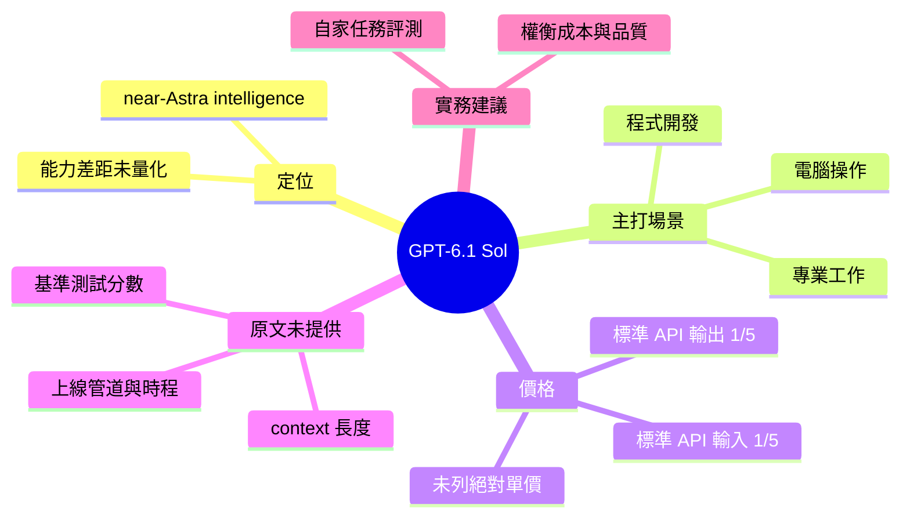

## Introducing GPT-6.1 Sol

OpenAI 推出 GPT-6.1 Sol，定位為「接近 Astra 的智慧」，主打程式開發、電腦操作（computer use）與專業工作場景。關鍵數字是其標準 API 輸入與輸出 token 價格皆為 GPT-6 Astra 的五分之一。輸入內容未提供基準測試分數、context 長度或上線方式等細節，因此「接近」的程度無法量化。對 API 使用者而言，這是以約 1/5 成本取得接近旗艦能力的選項，適合大量呼叫的程式碼與 agent 工作流，實際取捨需自行用自家任務評測。

### 重點
- GPT-6.1 Sol 定位為接近 GPT-6 Astra 的智慧，聚焦程式開發、computer use 與專業工作
- 標準 API 輸入與輸出 token 價格皆為 Astra 的五分之一
- 原文摘要未提供基準測試數據，差距需自行評測

**原文：** [openai-blog](https://openai.com/index/introducing-gpt-6-1-sol)

---

<!-- deep-analysis:begin -->
## 📌 摘要 (TL;DR)

- OpenAI 發布 **GPT-6.1 Sol**，官方定位為「接近 Astra 的智慧」（near-Astra intelligence）。
- 官方列出的主打場景有三個：程式開發（coding）、電腦操作（computer use）、專業工作（professional work）。
- 原文唯一的量化資訊是價格：標準 API 的**輸入與輸出 token 價格皆為 Astra 的五分之一**。
- 原文只有一句公告，沒有提供基準測試分數、context 長度、上線時程或可用管道，因此無法量化「接近」的程度。
- 對大量呼叫 API 的開發者來說，這是一個以約 1/5 token 成本換取接近旗艦能力的選項。實際的取捨需要用自家任務評測才能確認。

## 🎯 核心概念

- **接近 Astra 的智慧** (near-Astra intelligence)：OpenAI 對 Sol 能力的定性描述，意指接近 Astra 但未達同等。原文沒有給出具體差距。
- **電腦操作** (computer use)：模型操作電腦介面以完成任務的能力，是原文點名的三大場景之一。
- **標準 API token 價格** (standard API input and output token prices)：按輸入與輸出 token 計費的 API 定價。Sol 在這兩項上都是 Astra 的 1/5。

## 📖 整理分析

### 1. 原文實際說了什麼
原文只有標題加一句說明：GPT-6.1 Sol 以接近 Astra 的智慧，服務程式開發、電腦操作與專業工作，價格是 Astra 標準 API 輸入與輸出 token 價格的五分之一。除此之外沒有其他技術或商業細節。以下分析都以這句話為依據。

### 2. 定位：降價版的近旗艦模型
從「near-Astra」與「1/5 價格」兩個描述來看，Sol 的定位是能力略低於 Astra、但成本大幅降低的選項。這是根據措辭做的推論。原文沒有說明 Sol 與 Astra 在架構、模型大小或訓練上的關係，也沒有說明它是否取代任何既有模型。

### 3. 價格比較的範圍
原文明確寫的是「standard API」的 input 與 output token 價格，兩者都是 1/5。原文沒有提到快取、批次（batch）或其他計費方案是否適用相同比例，也沒有列出實際的美元單價。因此目前只能確定相對比例，算不出絕對成本。

### 4. 缺少的資訊
原文沒有提供以下資訊：
- 基準測試分數（例如程式或電腦操作相關評測）
- context window 長度
- 速度或延遲
- 上線日期，以及是否在 ChatGPT 或其他產品中提供
- 安全評估

在這些資訊出現之前，「接近 Astra」只能視為官方的定性宣稱。

### 5. 對讀者的實務意義
如果你的工作流以大量 API 呼叫為主，例如程式碼生成或 agent 迴圈，1/5 的 token 價格可能直接影響成本結構。這是推論。建議用自家的代表性任務並行比較 Sol 與 Astra，同時衡量品質差距與成本差距，再決定是否切換或分流使用。

## 🧠 Mindmap

<!-- deep-analysis:end -->
### 📄 原文內容

點此展開 / 收合

Meet GPT-6.1 Sol: near-Astra intelligence for coding, computer use, and professional work at one-fifth of Astra’s standard API input and output token prices.

