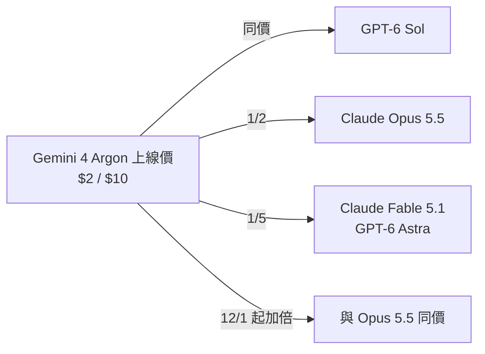
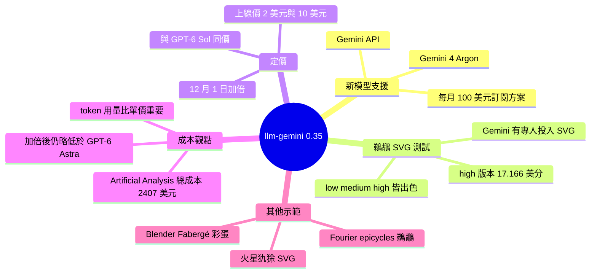

## llm-gemini 0.35

Simon Willison 發布 llm-gemini 0.35，新增對 Gemini 4 Argon 模型的支援，該模型當日透過 Gemini API 以及每月 100 美元訂閱方案的客戶提供。他以 low、medium、high 三種設定生成騎腳踏車的鵜鶘 SVG，品質都很好，其中 high 一張花費 17.166 美分；他認為 Gemini 是他所知唯一有員工專門投入 SVG 的實驗室。Argon 上線定價為輸入 $2/百萬 token、輸出 $10/百萬 token，與 GPT-6 Sol 相同，是 Claude Opus 5.5 的一半，也是 Claude Fable 5.1 與 GPT-6 Astra 的 1/5。但 12 月 1 日起價格將加倍，與 Opus 5.5 相同。Simon 指出，單價已不太可比，真正重要的是 agentic harness 中完成目標所需的 token 數；Artificial Analysis 公布的跑完其 benchmark 總成本中，Argon 為 $2,407，接近 GLM-5.3，並明顯低於 OpenAI、Anthropic 與 Meta 的最新模型，價格加倍後仍會略低於 GPT-6 Astra。

### 重點
- Gemini 4 Argon 上線價 $2/$10 每百萬 token（輸入/輸出），12 月 1 日起加倍至與 Opus 5.5 同價
- Artificial Analysis 跑完 benchmark 總成本 $2,407，接近 GLM-5.3、明顯低於 OpenAI/Anthropic/Meta 最新模型；價格加倍後仍略低於 GPT-6 Astra
- 比較模型成本應看完成任務所需的總 token 數（agentic harness 下），而非單純每百萬 token 單價

**原文：** [simon-willison](https://simonwillison.net/2026/Oct/13/llm-gemini/)

---

<!-- deep-analysis:begin -->
## 📌 摘要 (TL;DR)

- Simon Willison 發布 **llm-gemini 0.35**，新增對 Google **Gemini 4 Argon** 的支援。該模型於發文當天透過 Gemini API 及每月 100 美元的訂閱方案開放。
- 他用 low、medium、high 三種設定生成「騎腳踏車的鵜鶘」SVG，品質都很好。其中 high 版本花費 **17.166 美分**。
- 上線定價為輸入 **$2/百萬 token**、輸出 **$10/百萬 token**，與 GPT-6 Sol 相同，是 Claude Opus 5.5 的一半，也是 Claude Fable 5.1 與 GPT-6 Astra 的 1/5。**12 月 1 日起價格將加倍**，與 Opus 5.5 同價。
- Simon 認為單價已不太能直接比較，關鍵是模型在代理框架（agentic harness）中完成目標要用多少 token。
- 根據 Artificial Analysis 的數據，Argon 跑完整套 benchmark 的總成本為 **$2,407**，接近 GLM-5.3，並明顯低於 OpenAI、Anthropic、Meta 的最新模型。價格加倍後，它仍略低於 GPT-6 Astra。

## 🎯 核心概念

- **llm-gemini**：Simon Willison 開發的 `llm` 命令列工具外掛，用來呼叫 Google Gemini 系列模型。
- **鵜鶘騎腳踏車測試** (pelican-riding-a-bicycle)：Simon 的長期非正式評測，請模型生成「鵜鶘騎腳踏車」的 SVG，觀察其圖像與程式生成能力。
- **代理框架** (agentic harness)：讓模型反覆呼叫工具、多步完成任務的執行環境。在這種環境裡，總 token 用量比單價更能反映真實成本。
- **Artificial Analysis**：第三方模型評測機構，會公布用各模型跑完其 benchmark 的總成本。

## 📖 整理分析

### 1. 外掛更新與模型上線
llm-gemini 0.35 的主要變更是加入 Gemini 4 Argon。根據原文，Argon 在當天同時開放給兩類使用者：Gemini API 開發者，以及每月 100 美元訂閱方案的客戶。

### 2. 鵜鶘 SVG 測試結果
Simon 分別用 low、medium、high 三種設定生成鵜鶘，結果都很出色，和他的預期一致。他指出 Gemini 一向擅長產生 SVG。據他所知，Gemini 也是唯一有員工專門投入 SVG 能力、並曾公開炫耀過鵜鶘成果的實驗室。high 版本單張成本為 17.166 美分。

### 3. 定價比較與即將漲價
以上線價 $2 / $10（每百萬 token 的輸入 / 輸出）比較：
- 與 GPT-6 Sol 同價
- 是 Claude Opus 5.5 的 1/2
- 是 Claude Fable 5.1 與 GPT-6 Astra 的 1/5

12 月 1 日起價格加倍，屆時與 Opus 5.5 相同。依這些倍數推算（這是推論，原文未直接列出）：Opus 5.5 約為 $4 / $20，Fable 5.1 與 GPT-6 Astra 約為 $10 / $50，Argon 漲價後為 $4 / $20。

### 4. 單價不如「完成任務的總成本」
Simon 強調，單價已經不是有效的比較基準。真正重要的是模型在 agentic harness 中達成目標要消耗多少 token。Artificial Analysis 公布的 benchmark 總成本可作為參考：Argon 為 $2,407，接近 GLM-5.3，明顯低於 OpenAI、Anthropic、Meta 的最新模型。即使價格加倍，它仍會略低於 GPT-6 Astra。Simon 也說明，文中的比較圖是他用 ChatGPT 編輯的，目的是讓 Argon 的資訊框不與其他數字重疊。他表示數據都已親自核對。

### 5. 其他示範
- Simon 用 Argon 生成「穿網襪的犰狳在火星上闖馬路」的 SVG。
- Argon 用 Blender 製作了一顆 Fabergé 彩蛋。
- DeepMind 員工 @fofrAI 分享了一段影片：用傅立葉週轉圓（Fourier epicycles）畫出騎腳踏車的鵜鶘。Simon 稱之為有趣的新玩法。

## 🧭 流程圖 / 架構圖（可選）

## 🧠 Mindmap

<!-- deep-analysis:end -->
### 📄 原文內容

點此展開 / 收合

Release: llm-gemini 0.35 
 I added support to llm-gemini for the new Gemini 4 Argon model, made available today via the Gemini API and for customers of their $100/month subscription plan. 
 Here are the low, medium and high pelicans . As expected, they are all excellent: Gemini has a track record of producing great SVGs, and are the only lab where I know their staff have invested in SVG specifically (and who have boasted about their pelicans before.) 
 Here's the "high" illustration, which cost me 17.166 cents: 
 
 The pricing is interesting. At launch, Argon is $2/million input and $10/million output - the same price as GPT-6 Sol, half the price of Claude Opus 5.5 and 1/5th the price of Claude Fable 5.1 and GPT-6 Astra. 
 But on December 1st Argon is set to double in price - so it will be the same price as Opus 5.5. 
 Prices like this aren't really comparable these days since what really matters is how many tokens a model takes to achieve a goal within an agentic harness. 
 One useful clue for that comes from Artificial Analysis, who publish the total cost to run their benchmark using each model. Argon is looking very good there - costing $2,407 to run the benchmark, putting it close to GLM-5.3 and significantly cheaper than OpenAI, Anthropic, and Meta's latest models. 
 When the price doubles it will still be a little cheaper than GPT-6 Astra. 
 
 (I used ChatGPT to edit that chart ! The data is all correct, I checked - I needed to get that Gemini 4 Argon info box to display without overlapping the other numbers.) 
 Some bonus examples using Gemini 4 Argon: here's Generate an SVG of an armadillo in fishnet tights jaywalking on Mars , here's a Fabergé egg it created for me using Blender, and DeepMind staffer @fofrAI shared a video of a pelican riding a bike, using fourier epicycles . That's a fun new twist! 
 
 
 Tags: google , ai , generative-ai , llms , llm , gemini , llm-pricing , pelican-riding-a-bicycle , llm-release

