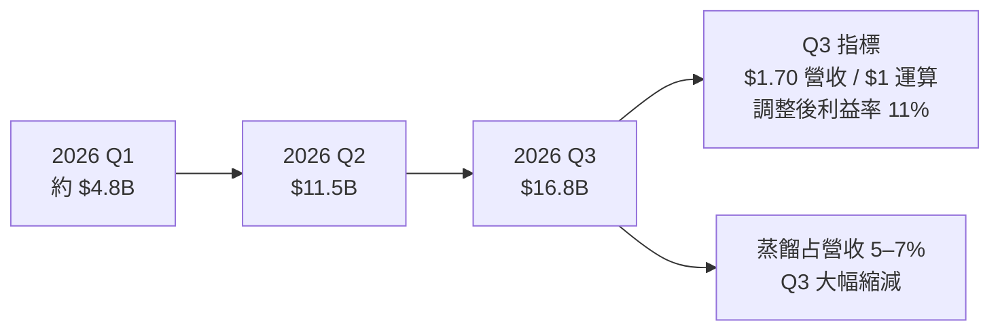
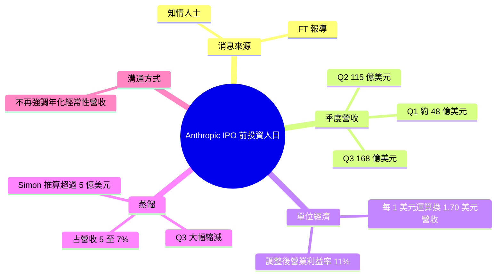

## Anthropic tells investors quarterly revenue up nearly 50% to $16.8bn ahead of IPO

Simon Willison 引述 FT 報導，Anthropic 週三在 IPO 前向投資人說明財務狀況，消息來自「知情人士」。依文中數字，2026 年 Q1 營收約 48 億美元，Q2 為 115 億美元，Q3 為 168 億美元，標題稱季增近 50%。Q3 每投入 1 美元「運算力」可產生 1.70 美元營收，排除股票薪酬後的調整後營業利益率為 11%。報導另指，Anthropic 告知投資人，「蒸餾」（distillation，競爭實驗室用較強模型的輸出訓練自家模型）占營收 5% 至 7%，並已在第三季「大幅」縮減。Simon 的粗估是：若 Q2 蒸餾占 5%，其他實驗室當季花在蒸餾 Anthropic 模型上的金額就超過 5 億美元（這是他的推算，非原文數字）。他也留意到 Anthropic 在這些投資人溝通中似乎不再主打「年化經常性營收（annualized run-rate）」。這些數字讓外界能一窺前沿模型公司的單位經濟與毛利結構，也顯示 API 被拿去蒸餾已是可觀的營收來源與競爭風險。

### 重點
- 季營收：Q1 約 $4.8bn、Q2 $11.5bn、Q3 $16.8bn；Q3 每 $1 運算成本對應 $1.70 營收，調整後營業利益率 11%（排除股票薪酬）
- 蒸餾占營收 5%–7%，Anthropic 在 Q3 已「materially」削減；Simon 推算若 Q2 為 5%，則其他實驗室當季花超過 $500M
- Anthropic 對投資人的溝通似乎不再使用 annualized run-rate revenue

**原文：** [simon-willison](https://simonwillison.net/2026/Oct/15/anthropic-tells-investors/)

---

<!-- deep-analysis:begin -->
## 📌 摘要 (TL;DR)

- Simon Willison 引述《金融時報》（FT）報導：Anthropic 在 IPO 前於週三舉辦投資人日。報導細節來自「知情人士」，文中「told investors」一詞出現四次。
- 2026 年各季營收：Q1 約 48 億美元，Q2 為 115 億美元，Q3 為 168 億美元。標題稱 Q3 季增「近 50%」。依原文數字推算，增幅約 46%。
- Q3 每花 1 美元在「運算力」（computing power）上，可帶來 1.70 美元營收。排除股票薪酬（stock-based compensation）後，調整後營業利益率為 11%。
- Anthropic 告訴投資人，「蒸餾」（distillation）占營收 5% 至 7%，並已在第三季「大幅」（materially）縮減。此說法來自四位直接知情人士。
- Simon 的粗估：若 Q2 蒸餾占營收 5%，其他實驗室當季花在蒸餾 Anthropic 模型上的金額就超過 5 億美元。
- Simon 也注意到，Anthropic 在這次投資人溝通中似乎不再強調「年化經常性營收」（annualized run-rate revenue）。

## 🎯 核心概念

- **蒸餾** (distillation)：競爭對手用較先進模型的輸出來訓練自家模型。這種做法有爭議，而且會產生大量 API 用量與支出。
- **年化經常性營收** (annualized run-rate revenue)：把短期營收外推成一整年的指標。Anthropic 過去曾用這個指標對外溝通。
- **調整後營業利益率** (adjusted operating margin)：本文指排除股票薪酬後的營業利益率。

## 📖 整理分析

### 1. 三季營收軌跡
原文列出 2026 年前三季營收：Q1（1–3 月）約 48 億美元，Q2（4–6 月）115 億美元，Q3（7–9 月）168 億美元。標題的「近 50%」指 Q3 相對 Q2 的成長。以下是依原文數字推算，原文沒有直接寫出：Q2 相對 Q1 約成長 1.4 倍，Q3 相對 Q2 約成長 46%。這代表成長仍快，但增速已經放緩。

### 2. 單位經濟與利潤
報導提到兩個獲利面數字。第一，Q3 每 1 美元運算支出對應 1.70 美元營收。第二，排除股票薪酬後的調整後營業利益率為 11%。以下是推算：若 1.70 這個比例套用到全部 Q3 營收，當季運算支出約為 99 億美元。不過原文沒有說明「運算力」的口徑，這個數字只能當作量級參考。

### 3. 蒸餾：營收來源也是風險
Simon 特別完整引用 FT 這一段。競爭實驗室蒸餾 Anthropic 模型時，會大量使用並付費。Anthropic 告訴投資人，這部分占營收 5%–7%，第三季已大幅壓低。原文沒有說明 5%–7% 指的是哪個期間。Simon 的推算是假設 Q2 蒸餾占 5%，得出其他實驗室當季支出超過 5 億美元（115 億美元的 5% 約為 5.75 億美元）。報導沒有點名是哪些實驗室。

### 4. 溝通指標的轉變
Simon 觀察到，Anthropic 這次對投資人改用實際季度營收，似乎不再依賴先前常用的年化經常性營收。原文只描述了這個現象，沒有說明原因。

## 🧭 流程圖 / 架構圖（可選）

## 🧠 Mindmap

<!-- deep-analysis:end -->
### 📄 原文內容

點此展開 / 收合

Anthropic tells investors quarterly revenue up nearly 50% to $16.8bn ahead of IPO 
The phrase "told investors" appears four times in this FT article, which reports on Anthropic's day of hosting investors on Wednesday. Lots of details in here from " people with knowledge of the matter ". 
 Key things I learned from the article: 
 
 Q1 revenue (Jan/Feb/Mar) was "about $4.8bn" 
 Q2 (Apr/May/Jun) was $11.5bn 
 Q3 (Jul/Aug/Sep) was $16.8bn 
 In Q3: $1.70 in revenue for every $1 spent on "computing power" 
 Adjusted operating margins (excluding stock-based compensation) were 11% 
 
 This point about distillation is worth quoting in full (highlight mine): 
 
 The start-up has also clamped down on “distillation” — a controversial practice whereby rival AI labs train their models on the outputs of more advanced ones. 
 When rival companies “distil” their models from Anthropic’s models, that involves heavy usage and spending. 
 Anthropic told investors on Wednesday distillation accounted for 5 per cent to 7 per cent of revenue and that they had cut it back “materially” in the third quarter of the year, said four people with direct knowledge of the matter. 
 
 Napkin maths says that if distillation was 5% of their Q2 revenue (before they cut it back in Q3) then unnamed "other labs" spent over half a billion dollars distilling Anthropic's models in that quarter! 
 Also notable: Anthropic appear to no longer be leaning on "annualized run-rate revenue" ( previously ) in these communications to their investors.

 Tags: ai , generative-ai , llms , anthropic

