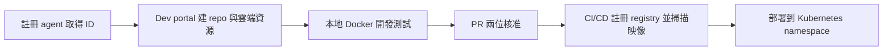

## Paving the Road to Production: Governed Enterprise AI Agents — Harish Gaggar, Credit Karma

Intuit Credit Karma 資深 staff 工程師 Harish Gaggar 分享如何把 AI agent 從實驗推進到受治理的企業生產環境。他指出 agent 常在生產失敗，是因為缺少基礎控制：沒有先做驗證的 gateway、MCP server 缺少合適工具、沒有 tracking/eval、沒有長期記憶管理，也沒有 PII/secret 防護與省 token 機制。解法不是打造神奇 agent，而是一組框架：以 LangGraph 做 agent 框架，建立 MCP gateway 讓 agent 或 service account 先通過驗證再導向正確的 MCP server，自建 MCP server 搭配對應工具，並對操作做 audit。另有 PII/secret 阻擋、tracking/eval 上雲、memory（thread 與 checkpoint）以及 context optimizer。流程上，開發者先登記 agent 取得 ID，再到內部 dev portal 填入用途、框架（LangGraph/LangChain）、語言（Python/TypeScript）與 skills/prompts，portal 會自動建立含上述所有框架的 repo，以確保公司內一致且集中可視化。本地以 Docker 開發並可用 SQLite 或 BigQuery 存 trace 與 eval；PR 需兩位核准，CI/CD 會把 agent 註冊到中央 registry、掃描映像漏洞，通過後由部署平台送進 Kubernetes 指定 namespace。portal 同時建立 workload identity、memory DB、tracking/eval 資料表與 secret 管理，使 agent 部署時身分綁定已就緒（內容在此處截斷）。

### 重點
- Dev portal 一次建立 repo（含 LangGraph agent、memory、tracking/eval、context optimizer、PII 阻擋框架）與 workload identity、memory DB、eval 資料表、secret 管理，讓全公司 agent 基礎控制一致
- Agent 呼叫須先經 MCP gateway 驗證（auth provider）再導向自建 MCP server，並對操作做 audit
- CI/CD 流程：兩位 PR 核准 → 註冊中央 agent registry → 映像漏洞掃描 → 部署至 Kubernetes 指定 namespace

**原文：** [youtube-ai-engineer](https://www.youtube.com/watch?v=tZycGA_Fbfo)

---

### 📄 原文內容

點此展開 / 收合

# Paving the Road to Production: Governed Enterprise AI Agents — Harish Gaggar, Credit Karma

Hello everyone. Um, I would like to walk you through that how we can transition in AI agents from an experiments to the real enterprise environment. So, before I begin, a quick introduction about me. My name is Sharish Gokar. I'm a senior staff software engineer at Intuit Credit Karma where I built and own the AI analytics infrastructure and services. Um, and beside that, um, I'm advisor, uh, author, researchers, um, and also a program committee members for various organizations where I mentor the young researchers as well. All right. So, let's, uh, walk through the, um, agenda here. So, first we would like to talk about what are the challenges we have when we build an AI agents and deploy into the production systems and how we, uh, can build a different framework to address that, uh, different challenges here. Um, then how the architecture looks like for it. Um, then, um, how you can build your own MCP servers, um, and MCP gateway. And then some monitoring on top of that gateway as well. Um, then further we're going to talk about what are the different type of agent framework you can have, um, and then, um, some additional framework around managing the memories, tracking and eval, um, how you can block the PII data, uh, going before the LLMs, and then context optimizer to save your token, right? So, without delay, let's, um, let me walk you through the challenge. Um, of course, like there are many agents, uh, uh, generally get failed in productions because their foundation controls are missing. Um, and the key reason behind is that, um, you know, like, oh, most of the people are missing the gateway to make sure that agent can, you know, communicate to the gateway to get authenticated first with the right auth providers so that they can redirect to the right MCP servers, right? Second, that, um, MCP servers are missing the right tool to execute your query. Third, do we have like enough tracking and evaluation system to make sure that every query when you are sending to the agents, whether they've been tracked or not, and are you evaluating the quality response or not, right? Do we have any in memory management system or not in terms of let's say you are doing the interaction with agent for long or for many days, is it able to recall that what you have been asked in the past, right? And then there are other framework, of course, like do you have a context of the measures to save the token, or do you have inner production in place to make sure that your any secrets should not go into LLM or tracking or tracing or any memory DB or so, right? So, a lot of lot of open questions. So, in order to resolve this, we are not going to, you know, like build a magical agent here in this demo. We're going to talk about like different framework that you can build to address this. So, first is the agent framework. This is where like we use the like we choose to use the LangGraph framework, which is provided by LangChain community. This is help us in building the task-specific node based on your questions, and which is easy to plug in any like marketplace plugins or skills and prompts to make sure that agents respond efficiently based on your query. Further, the second part is we are also building the MCP gateway to make sure that whenever agent make the call or any service account from that agent make the call, make sure that they are securely get authenticated to that MCP gateway, and then get redirected to the right MCP servers. Third is the customized MCP, which means that you are building your own MCP servers with the right tool in place to execute your query. And then finally some audit on top of what actually operation you're performing, right? And then we talk about some additional framework around you know like how you can block the PII secrets, how you going to store the tracking eval into the cloud, and how you going to process the memories, especially any threads and checkpoints on every context, and then also how you can optimize overall your context to make sure that you don't don't burn too many tokens when you run your query. All right? So, we talk about now the agent infrastructure. So, the Firstly, we'll go through the local development. The way the approach should be is that you know like whenever you build an agent, right? First you have to register your agent into some system. You usually tell that hey look, this is my the use case and these are the use case going to use for this particular vertical or system, and you feed all those information and generate a ID for your agent, right? Once you have that, then you can have a dev portal, internal portal where you can ingest all the details saying that hey look, this is my agent use case, this is my agent ID, this is the framework I'm going to use either LangGraph, LangChain or so. These are my language I'm going to use either Python or TypeScript, and then you can choose you know like your skills or prompts, and then you submit your information, right? To this. Once you submit this, the dev portal is going to create a repository, which is going to contains not just the agent framework like your LangGraph agent framework, but is also going to contains your memory framework, your tracking eval framework, right? and then your context optimizer framework, and your PII blocking framework as well. So, the reason for that is because not necessarily all your developers are taking care of all this framework, right? They just sometimes you know create the framework what generally like AI assistant tools are generally the right? Or they stick to one or two framework, right? So, we just want to make sure that when you roll out such framework, make sure they are consistent across the company um and they can take care of uh and they can be centralized in one place so you can visualize their results as well, right? So, once you have that repository, so developers basically, you know, clone that repository, they can build their agent as a Docker image and containers and test their agent input and output through the query. And they can also traces on their local memory, maybe cloud span evaluator here. And you can also store this tracking and eval in some of your DB, maybe SQLite or maybe BigQuery um to see to make sure that agents are fully working on your local, right? So, once your agents are running in local, um then you're ready to go ahead and generate a PR and then you can once you get your two PR approval, then it's go to the CICD pipeline, right? So, the PR is basically going to firstly is going to uh register your agent into some centralized agent registry system, which provide a length with URL to it to make sure that you see all the traces. And then the CICD pipeline is basically, you know, whatever the local Docker container you built here is going to build that container into production system. Uh it will scan that image, make sure that there's no vulnerability. Um if everything looks great, security approved, you can move that image back into the registry, right? Further, you have your own deployment platform or orchestrator platform which going to deploy that agent into the Kubernetes cluster in a given namespace, right? So, the good part here is that this dev portal is not just creating the repository, um right? It also do create um bunch of other production resources, for example, the workload identity, um right? And then memory DB or tracking and eval tables and then agent secret management, right? Um so, it based on whatever the name you provide, it not just again it like not just repository, it all these different resources as well. So, what happened is when this internal orchestrator when it deploy the agents, the agent already know that hey, what workload identity I supposed to work with, right? That binding should already happen. So, once this K to GSA binding happens, the agent will start communicating to all these resources. Once everything in place, um agent is further going to communicate to the rest of your endpoint services like for example, AI gateway or MCP servers or length fuse for tracing or some other API endpoints. Right? So, now firstly, we talk about the MCP server as well. So, we talk about architecture. Now, we're going to the different component. So, MCP server is something that you can definitely use something which is outside available, but if you're working on air gap environment, it's highly recommended that you build your own MCP servers. So, um yeah, uh and you can use the uh I will not go with the definition. Everyone knows about it. So, the way the framework has been built here is that uh you you can leverage the fast MCP server package um or wrapper to um you know, build that MCP servers and you can create a different set of tools inside that a fast MCP wrapper to construct your um you know, the overall servers. And then you make sure that, you know, like every tool when you define in MCP server, they had to be fully reviewed by your own internal security team to make sure that only authorized tool can be go in production. And that's how you can you know, enforce some filters, limits, and block the fields which is really not required to go to LLM and get you the information which is you're not supposed to get, right? Um and third part is like a of course, you need to make sure that you build your MCP server in a way that whenever the traffic is coming from your MCP client to MCP gateway to MCP servers, either it's coming from user service account, they has to be authenticated to the MCP gateway first and so that they can be access your MCP tool to get the right information. All right. Now, the gateway part. So, the how the gateway works. So, this is again, you can build it your own internal MCP gateway if you are again working on your air gap environment. So, the way it work is you are working on cloud assist like local, you know, code assistance tool or maybe your agent, right? So, the moment you submit your first query to your agent, it will send that one-time authentication request to the MCP gateway, right? MCP gateway recognized and take your request. First, it will save your session state into the Redis, right? And then it will, you know, return back the JWT access token back to the your client, right? Once client will receive that JWT token, it will know that what MCP server needs to call, right? So, it will submit that tool {slash} call request on a given name space {slash} MCP, meaning let's say Artifactory or GitHub {slash} MCP with the auth bearer JWT token into that. So, once MCP gateway receive that, it will understand that what name space, meaning MCP server needs to look up for, and then it will unwrap that JWT token, and then it will attach that user token in that request and send it to the respective MCP servers. Now, once MCP server receive it, it will make that respective API calls to that endpoint of that, you know, to the service and then it will exchange that ID token and return the response based on whatever scope that user is authorized to see, right? So, once the user receive the token, you know, MCP server basically, you know, unwrap that all the data, make the payload which is compatible for MCP gateway to receive, and then finally the final payload will send back to the client to see the data points. So, what it shows is that, you know, like we build this MCP gateway to make sure that we have a centralized authentication and routing hub that securely connect any coding assistant tool or agents to the endpoint via this MCP gateway and MCP server. This There should not be direct access provided um on any endpoints. They has to go through the MCP gateway through proper authentications uh before they're reaching to the MCP server and the endpoints. All right? So, now the part is the gateway monitoring, right? We talk about again, we talk about architecture, we talk abou

[... truncated for safety ...]

