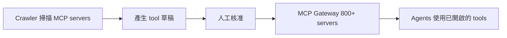

## 🚪 Uber Put 5,000 Tools in Front of Its Agents. Every One Ships Switched Off.

Byte-Sized Design 報導 Uber 把 5,000 個 tool 放到其 agent 面前，且每個 tool 預設都是關閉狀態。原文摘要指出，800 多個 MCP server 集中在單一 gateway 之後，由 crawler 產出草稿，再由人工核准。這代表工具的上架流程是自動探索加人工把關，而不是讓 agent 自行取用全部工具。實務意義是，企業在大規模暴露 MCP 工具時，可採用「預設關閉、經核准才開啟」的治理方式。更細的 gateway 架構與核准流程，提供的內容沒有說明。

### 重點
- Uber 的單一 gateway 後方有 800 多個 MCP server、共 5,000 個 tool
- 每個 tool 預設為關閉，由 crawler 產出草稿、人工核准後才開啟

**原文：** [substack-byte-sized-design](https://read.bytesizeddesign.com/p/uber-mcp-gateway-5000-tools-switched-off)

---

### 📄 原文內容

點此展開 / 收合

800+ MCP servers behind one gateway, drafted by a crawler and approved by humans

