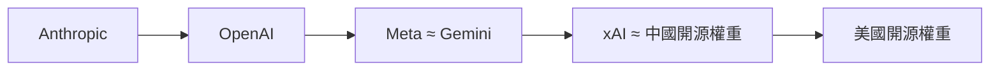
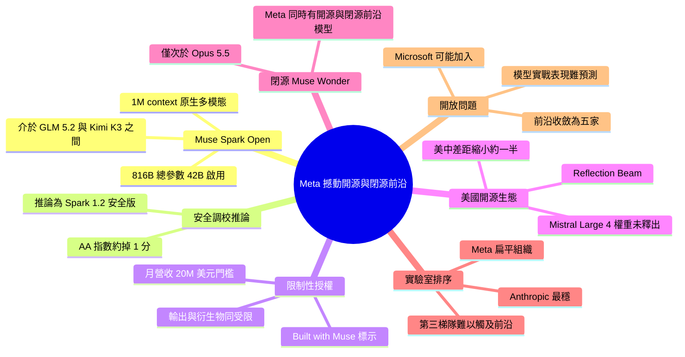

## Meta shakes up the frontiers, open and closed

Meta 釋出美國最強的開源權重模型，讓美國與中國開源模型的差距縮小約一半，但附帶一份限制很多的授權。 **Why** 在此之前，最好的美國開源模型對需要前沿效能的使用者而言幾乎無關緊要；作者認為西方開源模型在相同效能與體積下，採用量遠高於中國模型。 **How** 作者推測這是 Muse Spark 1.2 經額外安全後訓練的版本，在 Artificial Analysis 上只掉約 1 分。授權條款要求標示「Built with Muse」、月營收超過 $20M 的公司需另訂授權、必須同意使用政策，且規則同樣適用於輸出與衍生物。 **What** Muse Spark Open 為 816B 總參數、42B 啟用參數，1M context，原生多模態，主打程式與 agent 任務，效能高於 GLM 5.2、接近 DeepSeek V4.1 Flash，落後 GLM 5.3 與 Kimi K3。Reflection 的 Beam 也同期發布；Mistral Large 4 指數分數 38，但權重尚未釋出。作者另指 Meta 數日前發表閉源的 Muse Wonder 與 Muse Wonder Full，僅次於 Opus 5.5，並把各家排序為 Anthropic > OpenAI > Meta ~ Gemini > xAI ~ 中國開源 > 美國開源。

### 重點
- Muse Spark Open：816B 總參數／42B 啟用、1M context、原生多模態；效能高於 GLM 5.2、近 DeepSeek V4.1 Flash、低於 GLM 5.3 與 Kimi K3
- 授權限制：須標示「Built with Muse」、月營收超過 $20M 需另簽授權、須遵守使用政策，且涵蓋輸出與衍生物，合成資料用途有法律模糊地帶
- 作者判斷：Alex Wang 有 200+ 直屬下屬的扁平組織與高擁有權、高算力文化是 Meta 回到前沿的原因；美國前沿實驗室收斂為 Anthropic、OpenAI、Meta、Gemini、xAI 五家

**原文：** [interconnects](https://www.interconnects.ai/p/meta-shakes-up-the-frontiers-open)

---

<!-- deep-analysis:begin -->
## 📌 摘要 (TL;DR)

- Meta 釋出 **Muse Spark Open**（816B 總參數 / 42B 啟用參數、1M context、原生多模態），作者認為它是目前明顯領先的最強美國開源權重模型；加上 Reflection 首個模型 **Beam**，美中開源模型差距約縮小一半。
- 效能定位：高於 GLM 5.2、接近 DeepSeek V4.1 Flash、落後 GLM 5.3 與 Kimi K3。作者推論它是 **Muse Spark 1.2** 加上額外安全後訓練的版本，在 Artificial Analysis 上只掉約 1 分，而不是安全訓練把模型「弄壞」。
- 最大隱憂是**自訂授權**。授權要求標示「Built with Muse」，全業務月營收超過 $20M 需另簽授權，並須同意使用政策。這些規則也延伸到輸出與衍生物，因此用於合成資料有法律模糊地帶。
- 數日前 Meta 也發表閉源的 **Muse Wonder / Muse Wonder Full**。在傳統 benchmark 上兩者僅次於 Anthropic Opus 5.5，與 GPT-6-Astra、Gemini-4-Argon 相近。
- 作者排序：Anthropic > OpenAI > Meta ≈ Gemini > xAI ≈ 中國開源 > 美國開源。他也指出美國前沿實驗室正收斂為 5 家。

## 🎯 核心概念

- **開源權重模型** (open-weight model)：公開模型權重供下載部署，但授權未必符合傳統開源軟體定義。
- **安全後訓練** (safety post-training)：釋出前額外做的安全調校，目的是讓模型在沒有系統防護時也能抵抗濫用。
- **營收門檻授權** (revenue-gating)：超過一定營收的企業須另與原廠簽約，常用來建立推論轉售的分潤機制。
- **可接受使用政策** (acceptable use policy)：限制使用用途的條款，作者認為這使模型「非常不開源」。
- **RSI** (recursive self-improvement)：文中用來討論「單一贏家」情境，作者認為各家模型差距太近，離這種局面還很遠。

## 📖 整理分析

### 1. 美國開源模型重回前沿
作者指出，若沒有 Muse Spark Open 與 Beam，會有 20 個以上的中國開源模型勝過最好的西方模型。Mistral 也宣布了 Mistral Large 4，指數分數 38，但撰文時權重尚未釋出。美國開源模型因此從「對需要頂尖效能的用戶無關緊要」變成「落後但有用」。這些模型對標的是數月前的中國模型：GLM-5.3 於 8/18 發布，Kimi K3 於 7/16 發布。作者提問這兩家之後去哪了，但表示另文再談。

### 2. 為何 Muse Spark Open 可能起飛
Interconnects 的開源模型分析一再觀察到同一件事：在相同效能與體積下，西方開源模型的採用量遠高於中國模型，即使中國模型通常較早推出。作者認為開放式 LLM agent 在 GLM 5.2 等級的能力下「終於成真」。推論供應商正在快速擴張，開源後訓練經濟逐漸成形，企業也想自己掌握模型能力。Muse Spark Open 的效能應該「夠好」，能直接切入這個市場。

### 3. 安全調校與版本推論
模型卡說明，這個開源版本做了額外安全後訓練，並建議搭配其他防護機制部署。由於它在 Muse Spark 1.3 之後才推出，外界擔心安全訓練讓模型退化。作者推論它其實是 Muse Spark 1.2 的安全調校版。他的依據是：Meta 發布 30B agentic 模型 Muse Glimmer 時，Alex Wang 曾說正準備以開源權重釋出 Muse Spark 1.2。

### 4. 授權是最大策略風險
「Built with Muse」標示要求延續 Llama 的做法，Kimi 也試過，但作者說幾乎沒人遵守。這份授權複雜，也沒有經過法院檢驗。作者預期很多人會透過推論供應商直接使用，Meta 大概只會追究嚴重違規。授權目前還不是 AI 採用的決定因素，但未來可能改變。因此作者認為，想爭回採用率的實驗室使用非標準授權，是不必要的策略風險。授權仍允許內部研究與內部應用。

### 5. Meta 是第一梯隊還是第二梯隊
Meta 是唯一同時擁有前沿開源與閉源模型的美國公司；Alibaba Qwen 策略類似，但更偏向開放。作者肯定 Zuckerberg 與 Alexandr Wang 在 The Cheeky Pint 節目中描述的組織願景：高自主、每位研究員分配高算力。Alex Wang 有 200 多位直屬部屬，組織非常扁平。作者對其他實驗室的看法如下：
- **Gemini**：管理層級容易妨礙做出好模型。
- **Llama 時期的 Meta**：失敗被描述為模型決策出於政治而非效能。
- **xAI**：可能人才流動太大或組織不足。
- **OpenAI 與 Anthropic**：勝在能持續維持前沿地位。

### 6. 產業的開放問題
作者認為，美國有能力競爭前沿的實驗室已收斂為 Anthropic、OpenAI、Meta、Gemini、xAI 五家。Microsoft 已發表強勁的 scaling 研究結果，又能取用 OpenAI 的智慧財產，若開始釋出模型就可能加入。Mistral、Nemotron、Reflection、Arcee 等「第三梯隊」越來越難影響前沿，因為每個大模型的成本已以數十億美元計。作者也指出，業界仍難預測模型在真實使用中的成敗，例如 Anthropic 從 Claude Fable 5 的成功，到 Claude Opus 5 失利，再到 Opus 5.5 回勇。在財務面，作者指出 Meta 市值不到 $2T，與即將 IPO 的 Anthropic 估值相近，而 Meta 擁有極賺錢的本業。（原文在此處被截斷，後續內容無法確認。）

## 🧭 流程圖 / 架構圖（可選）

作者的前沿實驗室排序（依原文）：

## 🧠 Mindmap

<!-- deep-analysis:end -->
### 📄 原文內容

點此展開 / 收合

This has been a week where the balance of American open-weight models took a step change back toward the frontier. Meta took the lead of this charge with Muse Spark Open , which is now the strongest American-made open model by quite some margin, but the addition of Reflection&#8217;s first model Beam is also relevant. Without these two models, there would be 20+ open-weight models built and released by Chinese companies better than the best Western models. At the time of writing this, Mistral has also announced a strong model, Mistral Large 4 , with an index score of 38 (see below), but its weights are not yet released. There are rumors of a few more strong American open-weight models coming from other organizations too! In many ways, the gap between the best American and Chinese models has been reduced roughly by half. We&#8217;ve gone from the best American open models being largely irrelevant to consumers who require the cutting edge of performance, to them being behind but relevant. This paints the picture of the cut-throat, competitive nature of the frontier model business. Reflection and Mistral announced their model scores and Meta dropped the weights of a smarter model before these other two labs could get their own weights out. All of these models are competing with Chinese models released months ago, where the industry is collectively asking &#8212; where have Kimi and Zhipu AI been since the releases of GLM-5.3 and Kimi K3 on Aug. 18th and Jul. 16th, respectively? That is a very nuanced question, which I&#8217;ll dig into another time. Today&#8217;s piece is focused on Meta&#8217;s turnaround, what Muse Spark Open means for the ecosystem, and the balance of power across Western frontier labs. Share Why Muse Spark Open should take off &#8212; and why it may not One thing we see again and again at Interconnects through our open model analysis is that Western open-weight models get astonishingly more adoption than Chinese models with the same performance-to-size footprint (even though the Chinese models usually come out first)! Muse Spark Open is landing into this environment, at the same time as when open-ended LLM agents are finally real (~ GLM 5.2 capabilities and on ). Riding off a rapid increase in performance of Chinese models, the open ecosystem has been living through an acceleration in demand. The inference providers are rapidly scaling, the open post-training economy is forming, and countless enterprises are looking to own their intelligence. Muse Spark Open&#8217;s performance falls somewhere above GLM 5.2, near DeepSeek V4.1 Flash, and behind GLM 5.3 or Kimi K3. It should be squarely &#8220;good enough&#8221; to slot right into this. For some background, from the Muse Spark Open model card on Hugging Face: Muse Spark Open is an 816B total/42B active parameter open weights model with a context window of 1M tokens. Built for coding and agentic work, Muse Spark Open is natively multimodal. This open weights version has additional safety post-training to make it more robust against misuse as a standalone model without system guardrails. We recommend deploying Muse Spark Open as part of a broader AI system, with additional guardrails suited to the specific use case. Here&#8217;s the distribution of the various Muse models on the Artificial Analysis Intelligence Index. This is included to loop back to the original model card snippet. It was shared that this open-weight model underwent additional safety training to prepare for this open release. Many observers saw this release as potentially a model that was &#8220;broken&#8221; during the safety training, as it came out after Muse Spark 1.3. In reality, this was much more likely a safety tune of Muse Spark 1.2, which would only be a 1 point drop on Artificial Analysis to shore up safety behaviors. When Meta released Muse Glimmer , the 30B agentic model, Alex Wang said that they were preparing to release the Muse Spark 1.2 model as open weights, which fits with the above. If anything will hold Muse Spark Open back, it&#8217;ll be the specific license they designed for it. In summary, this custom license has pretty much all of the restrictive license behaviors we&#8217;ve seen (and criticized here) in the last few years of building with open models. They are as follows: Users of the models in products must display &#8220;Built with Muse&#8221; on their products. Meta did this with Llama, and Kimi has tried it, but almost no one complies. There is a revenue-gating factor, where companies that make more than $20M per month across their entire business deploying the model need a separate license with Meta. Other prominent open model providers are doing this too, in order to set up revenue share agreements for re-selling inference. Muse Spark Open makes you agree to an acceptable use policy, which in the true &#8220;open source software&#8221; corner of the world makes this model extremely not open-source. All of the above applies to outputs from the model as well, and derivatives, so there is legal ambiguity if you can safely use the model for synthetic data. The license does permit using Muse Spark Open for internal research and applications. We&#8217;re at a weird equilibrium where this license is complex and unproven in court, but many players will likely ignore it. Many, many people will build on this model from various inference providers, and Meta will only likely go after egregious violations. For now, licenses haven&#8217;t been the determining factor of AI adoption, but this could change in the future. This is why we think it&#8217;s an unnecessary strategic risk for labs trying to compete and regain adoption to have complex, non-standard open licenses for their models. Interconnects AI is a reader-supported publication. Consider becoming a subscriber. Is Meta a tier 1 (OpenAI/Anthropic) or tier 2 (Gemini/xAI) frontier lab? Just a few days before Muse Spark Open, Meta unveiled their closed frontier models, Muse Wonder and Muse Wonder Full . 1 On traditional benchmarks, these are very strong models only behind Anthropic&#8217;s Opus 5.5 and similar to OpenAI&#8217;s GPT-6-Astra or Google&#8217;s Gemini-4-Argon. These major releases are coming just over a year out from Meta&#8217;s massive AI redirection, characterized by CEO Mark Zuckerberg&#8217;s Personal Superintelligence post, which got a lot of criticism at the time. Meta is the only American company with frontier open and closed models. Alibaba&#8217;s Qwen has followed a similar strategy, but with a far more open-leaning approach. The vibe checks across all of these models have been solid, but the expectations were for them to not immediately challenge the level of refinement of the most recent Anthropic and OpenAI models in real-world usage. I&#8217;m excited to try them more &#8212; time to sign up for another AI subscription. I like this recent run of form from Meta, driving their own products and directions in the popular Muse agent, taking wins like the leading US open-weight crown when useful. Whether or not it&#8217;s financially successful, it&#8217;s a unique perspective that fits their history as a business. It often feels like there&#8217;s a revolving door of which lab is nipping at the heels of the Anthropic-OpenAI leading duo. It&#8217;s not clear that in the long run Gemini and xAI are out of it, but those two are much more muddled in their offerings than Meta today. If you listen to Zuck and Alexandr Wang on The Cheeky Pint , they clearly had a very specific vision of a high-ownership, high-compute per researcher lab that I would expect to pay off. Many labs die due to layers of bureaucracy and misaligned incentives. Meanwhile Alex Wang has over 200 direct reports &#8212; i.e. it&#8217;s a very flat org with minimal management &#8212; and they&#8217;re releasing very consistent model and product improvements. Leave a comment Much of my worldview of building models is that you need the resources, the compute, the data, and the talent (all downstream of large sums of money), but organizing them is very hard. Gemini is sometimes described as a place where it&#8217;s impossible to get any work done or grow &#8212; which is embellishing the issue, as many people love it there, but there are kernels of truth to it. Layers of management easily get in the way of making a great model. While I&#8217;m praising Meta today, the Llama failure has often been described as that sort of management going too far, with model decisions being made out of politics rather than performance. xAI is in its own lane, where it may be closer to having too much talent turnover or not enough organization to sustain great models for a long period of time. When we look back at the last few years, all of Meta, Gemini, and xAI have produced models pretty much at the frontier of performance, but what has distinguished OpenAI and Anthropic is their consistency in maintaining frontier status. Anthropic seems the most poised and organized, with a plan and vision for how these organizations should work, and they&#8217;ve gained a lead from it. OpenAI has been more hot and cold, but manages to keep up at the frontier of deployed models while being the leader in public scientific breakthroughs (from Navier-Stokes to o1&#8217;s inference time scaling). Here&#8217;s the state of play among the companies that this post focused on, plus Xiaomi V2.6 Pro representing the leading open-weight model overall. The ranking would be Anthropic &gt; OpenAI &gt; Meta ~ Gemini &gt; xAI ~ Chinese Open Weights &gt; U.S. Open Weights. Share Open questions for the AI industry After a long time of predicting the frontier model game getting too expensive for many to keep up, we may be seeing this play out among Western models. We seem very far from &#8220;one person wins&#8221; with RSI given how close all the models are to each other, but we&#8217;re narrowing down the number of labs who can compete in the US from a much wider net with surprises, to the 5 of Anthropic, OpenAI, Meta, Gemini, and xAI. If Microsoft starts releasing models, as they&#8217;re posting strong scaling science results , they could join this list &#8212; given their financial backing with a hyper-scale business and direct access to OpenAI&#8217;s intellectual property for training models. The best models we&#8217;ve seen from the &#8220;tier 3&#8221; players like Mistral, Nemotron, Reflection, Arcee, etc. have had an increasingly hard time impacting either the open or closed frontiers. These models still can get substantial adoption, enough to start growing a business, but the costs of building true frontier models are now measured in billions per major model and only huge companies can sustain that. Despite this massive scaling in resources, the technical core of the industry still doesn&#8217;t have a high hit rate on predicting how successful a model will be in real-world usage. Yes, evaluations are a good proxy, but why do the leading labs like Anthropic go from hit models like Claude Fable 5 to total duds in Claude Opus 5 and then back to hits with Opus 5.5? There are billions of dollars to be made in predicting this accurately, and the labs are surely trying, but the models fundamentally still are largely unknowable in the long-tail. Of all of the players left in the race, betting on Meta, Gemini, and Microsoft financially seems much easier from a long-term perspective due to their rich balance sheets. This is the &#8220;AI will take a while and OpenAI/Anthropic do not have secret sauce&#8221; perspective. After all, it&#8217;s the fastest revenue growth industry ever &#8212; competition will naturally be immense. Currently, Meta is valued under $2T and Anthropic is approaching their barnstorming IPO at the same price. Meta seems half a step behind on the same technology, but in the long-term view these seem to be starting from almost the same point and Meta has an extremely profitable core business. One of the two

[... truncated for safety ...]

