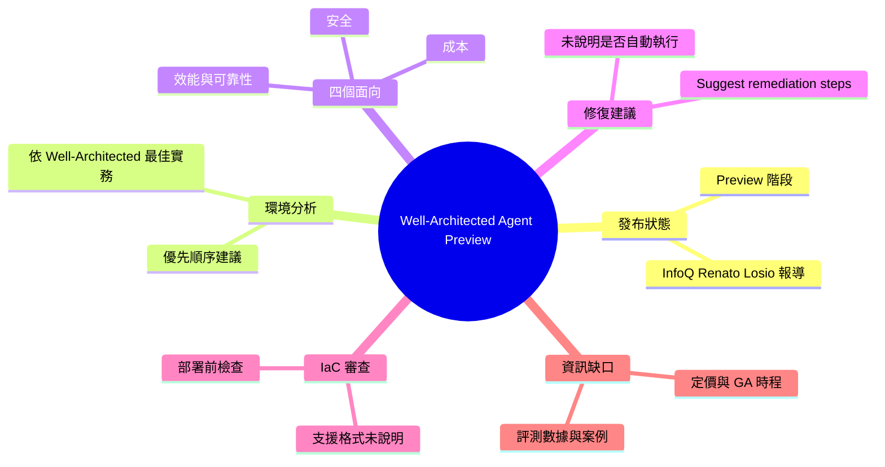

## AWS Introduces Preview of Well-Architected Agent

AWS 近期宣布 Well-Architected Agent 進入 preview。依據原文，這項服務會依據 Well-Architected 最佳實務分析使用者的環境，並在成本、安全、效能與可靠性等面向提供有優先順序的建議。此 AI agent 也能建議修復步驟，並可在部署前審查 infrastructure-as-code。對使用 AWS 的架構師與 DevOps 團隊，這代表 Well-Architected 審查可能從人工流程轉向自動化，並前移到部署前階段。目前仍為 preview，原文摘要未提供定價或正式上市時程。

### 重點
- AWS Well-Architected Agent 進入 preview
- 依 Well-Architected 最佳實務評估環境，涵蓋成本、安全、效能、可靠性並排序建議
- 可建議修復步驟，並於部署前審查 infrastructure-as-code

**原文：** [infoq-main](https://www.infoq.com/news/2026/10/aws-well-architected-agent/?utm_campaign=infoq_content&utm_source=infoq&utm_medium=feed&utm_term=global)

---

<!-- deep-analysis:begin -->
## 📌 摘要 (TL;DR)

- AWS 宣布 **Well-Architected Agent** 進入預覽（preview）階段，這是一個 AI agent 服務。InfoQ 由 Renato Losio 撰文報導。
- 這個 agent 會依照 Well-Architected 最佳實務（best practices）分析使用者的 AWS 環境，並在**成本、安全、效能、可靠性**四個面向提出**依優先順序排列**的建議。
- 除了指出問題，agent 還能**建議修復步驟**（remediation steps）。
- 它也能在**部署前審查基礎設施即程式碼**（infrastructure-as-code，簡稱 IaC），讓架構檢查可以提早到部署前完成。
- 原文是一段短篇新聞摘要，**沒有**提供定價、支援區域、支援的 IaC 工具、正式上市（GA）時程或實際操作範例。

## 🎯 核心概念

- **Well-Architected 最佳實務** (Well-Architected best practices)：AWS 用來評估雲端架構品質的一套準則。這個 agent 以它作為分析基準。
- **AI 代理** (AI agent)：原文對這項服務的定位。它不只產出報告，也會給出可執行的修復建議。
- **優先順序建議** (prioritized recommendations)：建議會依重要程度排序，而不是平鋪列出所有發現。
- **修復步驟** (remediation steps)：針對發現的問題，agent 提出的具體改善做法。
- **基礎設施即程式碼** (infrastructure-as-code)：用程式碼定義雲端資源的做法。agent 可以在部署前審查這類程式碼。

## 📖 整理分析

### 1. 發布內容：預覽階段的 AI agent
依據原文，AWS 這次發布的是 Well-Architected Agent 的 **preview** 版本，不是正式版。原文將它描述為「一個服務」以及「AI agent」。原文沒有說明開放方式（例如是否需要申請），也沒有說明可用區域。

### 2. 分析範圍：四個面向
原文列出 agent 會在 **cost、security、performance、reliability** 四個面向提出建議，並且依優先順序排列。原文只列出這四項，沒有提到 Well-Architected 架構中的其他支柱是否也在分析範圍內，因此本文無法確定實際涵蓋範圍是否更廣。

### 3. 從「指出問題」到「建議修復」
原文提到 agent「can also suggest remediation steps」。也就是說，它除了評估之外，還會提供改善方向。原文用的是 **suggest（建議）**，並沒有說它會自動執行修改。修復步驟是否能一鍵套用、是否需要人工核准，原文都沒有說明。

### 4. 部署前的 IaC 審查
第二項能力是在**部署前**審查 IaC。依照原文的描述，架構審查可以在程式碼階段就進行，不必等資源部署上線後才檢查。不過原文沒有說明支援哪些 IaC 格式（例如 CloudFormation、CDK、Terraform），也沒有說明它如何整合進 CI/CD 流程。

### 5. 對讀者的意義與資訊缺口
**以下為推論**：對已經在做 Well-Architected 審查的架構師與 DevOps 團隊來說，這項服務代表審查可能從定期的人工盤點，轉向由 agent 持續產出建議，並且提早到部署前。**原文未提供的資訊**包括：定價、GA 時程、建議的準確度或評測數據、與既有 AWS 工具的關係，以及實際案例。在評估是否導入前，建議查閱 AWS 官方公告與文件。

## 🧠 Mindmap

<!-- deep-analysis:end -->
### 📄 原文內容

點此展開 / 收合

AWS recently announced the preview of the Well-Architected Agent, a service that analyzes environments against Well-Architected best practices and provides prioritized recommendations across cost, security, performance, and reliability. The AI agent can also suggest remediation steps and review infrastructure-as-code before deployment. By Renato Losio

