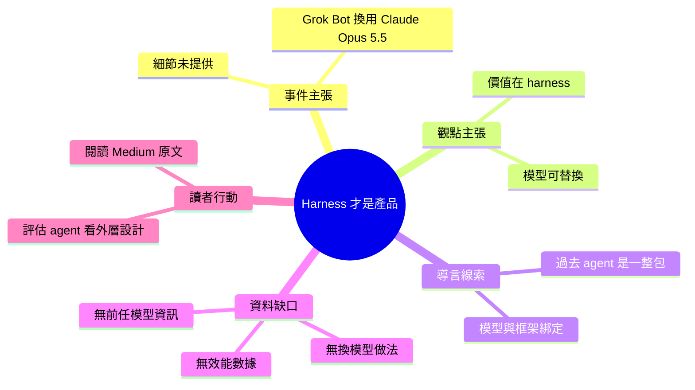

## The Harness Is the Product: Why Grok Bot Swapped Its Brain for Claude Opus 5.5

這是一篇 Medium 文章，標題為「The Harness Is the Product: Why Grok Bot Swapped Its Brain for Claude Opus 5.5」，標題指出 Grok Bot 將其底層模型更換為 Claude Opus 5.5。文章的論點是 agent 的價值在於 harness（包裝執行的框架與流程），而非單一模型本身。導言節錄指出，過去使用過的 agent 多半以一整包形式提供，暗示模型與 harness 常被綁在一起。提供的內容未包含換模型的具體做法、效能數據或前後對比，因此無法驗證標題中的細節。若作者論點成立，實務上的意義是：換模型時，harness 的設計可能比模型本身更決定產品表現。

### 重點
- 論點：agent 的產品價值在於 harness，而非底層模型
- 事件（依標題）：Grok Bot 將底層模型換成 Claude Opus 5.5；具體數據未在節錄中提供

**原文：** [medium-tag-claude](https://devenkoai.medium.com/the-harness-is-the-product-why-grok-bot-swapped-its-brain-for-claude-opus-5-5-75f69de922f1?source=rss------claude-5)

---

<!-- deep-analysis:begin -->
## 📌 摘要 (TL;DR)

- **原文內容不完整**：收到的 body_md 只有標題與一句導言「Every agent you have used so far came as one package.」，接著是「Continue reading on Medium »」。正文在 Medium 上，未被抓取。
- **標題的主張**：Grok Bot 把底層模型換成 Claude Opus 5.5。提供的資料中**沒有**任何內容能驗證這件事，例如時間、換模型的原因、做法或效能數據。
- **標題的論點**：「The Harness Is the Product」，意思是 agent 產品的核心價值在 harness，不在模型本身。
- **導言的意涵**：「至今用過的 agent 都是一整包」，暗示過去模型與 harness 常被綁在一起賣。這是依導言字面所做的推論。
- **閱讀建議**：本篇整理只能呈現標題與導言的論點框架。想了解具體案例與數據，需閱讀 Medium 原文。

## 🎯 核心概念

- **執行框架** (harness)：包在模型外層的執行系統。依一般業界用法（非出自本文），通常涵蓋提示與上下文管理、工具呼叫、流程控制等。原文對 harness 的具體定義**無法確定**，因為正文未提供。
- **代理** (agent)：能自主呼叫工具、執行多步任務的 AI 系統。導言以「one package」描述過去 agent 的交付形態。

## 📖 整理分析

### 1. 可取得的原文資訊
資料只有三項：標題、一句導言、一個「繼續閱讀」連結。來源是 Medium 的 claude 標籤 RSS（source_name：medium-tag-claude），作者帳號為 devenkoai（取自 URL）。以下分析都只建立在這三項資訊上。

### 2. 標題拆解：兩個主張
標題包含兩個層次。第一個是事件主張：Grok Bot 換用 Claude Opus 5.5 當「大腦」。第二個是觀點主張：harness 才是產品。原文用前者當案例來支撐後者。至於 Grok Bot 是什麼產品、由誰營運、何時換模型，提供的內容都**沒有足夠資料**。

### 3. 導言隱含的對比
「Every agent you have used so far came as one package」把過去 agent 描述為模型與外層系統綁在一起的單一套件。這是推論：作者接下來很可能主張，模型與 harness 應該拆開看待，而且模型可以替換。這段推論只依據導言字面與標題，原文是否這樣展開**無法確定**。

### 4. 缺漏的關鍵資訊
以下內容在提供資料中都不存在：
- 換模型前用的是哪個模型
- 換模型的動機
- harness 的具體組成
- 前後效能對比或任何 benchmark 數字
- 是否有官方來源佐證

因此本整理**不提供**任何數字或技術細節，避免捏造。

### 5. 對讀者的參考價值
若作者論點成立，實務上的啟示是：評估 agent 產品時，除了比較底層模型，也該檢視外層的工具整合、上下文管理與流程設計。這是依標題論點延伸的推論，不是原文已證實的結論。

## 🧠 Mindmap

<!-- deep-analysis:end -->
### 📄 原文內容

點此展開 / 收合

Every agent you have used so far came as one package. Continue reading on Medium »

