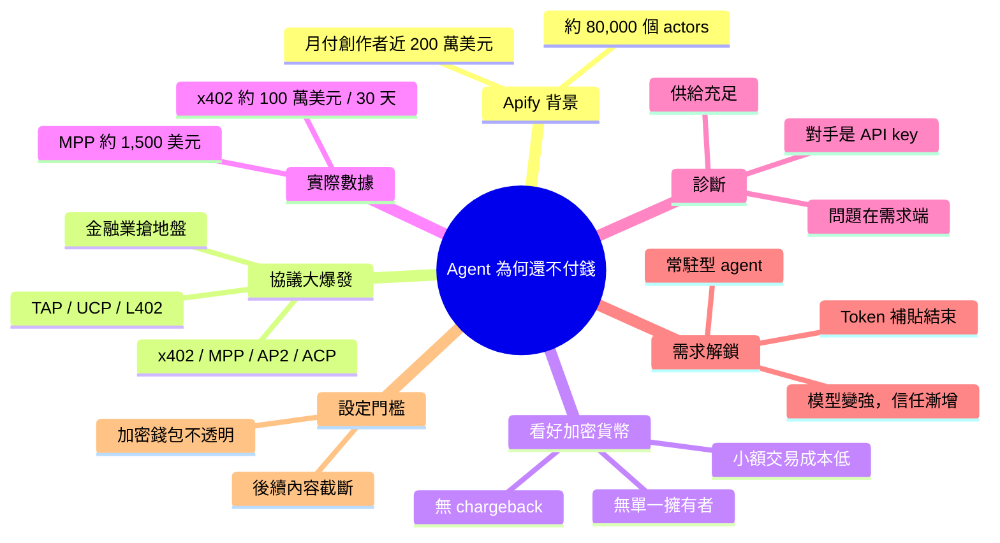

## Why AI Agents Still Won't Pay for Anything — Jan Curn, Apify

Apify（經營約 80,000 個「actors」工具的 AI 工具市集，上月付給創作者近 200 萬美元）的 Jan Curn 在 AI Engineer 演講中探討：agentic payment 協議已經一大堆，為何幾乎沒人用。他列出過去約一年半出現的標準，包括 Lightning Labs 的 L402、Mastercard Agent Pay、Coinbase x402、Skyfire KYA Pay、Google AP2、OpenAI 與 Stripe 的 ACP、Visa TAP、Google 與 Shopify 的 UCP、Stripe 與 Tempo 的 MPP、Alipay 的 ACTP 等，並提到 Gartner 預測 2028 年將成為 15 兆美元經濟、80% 的 B2B 活動由 agent 自主完成（講者自己也說「可能有點誇張」）。他認為加密貨幣最適合 agent 支付：沒有單一擁有者、小額交易成本遠低於信用卡/PayPal/銀行扣款、且沒有 chargeback 風險。但實際數據慘淡：近 30 天 x402 支付量僅約 100 萬美元，MPP 僅約 1,500 美元。他排除「供給不足」的假說——Apify、Exa、Perplexity 等都已上架，且合計每月來自 agent 的收入遠超百萬美元，但都是透過 API key 而非自主發現與付款。因此問題在需求端，他打算用「需求→…」的漏斗框架拆解原因（內容在此處截斷，結論未提供）。對做 agent 工具或 API 的業者而言，這顯示目前 agent 付費仍走傳統 API key 流程，新協議尚未成為實際營收來源。

### 重點
- 近 30 天鏈上數據：x402 支付量約 $100 萬、MPP 僅約 $1,500，採用度幾乎不存在
- 供給端不是問題：Apify、Exa、Perplexity 等每月來自 agent 的收入遠超百萬美元，但全走 API key 而非自主發現與付款
- 講者主張加密貨幣適合 agent 支付（小額成本低、無 chargeback），並以「需求→…」漏斗框架分析為何 agent 不付費（原文截斷，後續漏斗階段未提供）

**原文：** [youtube-ai-engineer](https://www.youtube.com/watch?v=-AOxpwVeIWw)

---

<!-- deep-analysis:begin -->
## 📌 摘要 (TL;DR)

- Apify 的 Jan Curn 在 AI Engineer 演講中提出問題：過去約一年半冒出十多個代理式支付（agentic payments）協議，為何幾乎沒有 agent 真正用它們付錢？
- 協議清單包括 Lightning Labs 的 L402、Coinbase x402、Google AP2、OpenAI 與 Stripe 的 ACP、Visa TAP、Google 與 Shopify 的 UCP、Stripe 與 Tempo 的 MPP，以及 Mastercard、Alipay、UnionPay、OKX 等各自的方案。
- 鏈上數據顯示，近 30 天 x402 支付量僅約 100 萬美元，MPP 約 1,500 美元（字幕寫法為「$1.5,000」，數字依上下文判讀），講者形容「基本上不存在」。
- 他排除「供給不足」：Apify、Exa、Perplexity 等服務都已上架，且每月從 agent 拿到的收入合計遠超百萬美元，只是走 API key，不走自主發現與付款。
- 核心觀點：代理式支付的對手不是 Visa，而是 API key，因為 API key 目前更方便。
- 講者用「需求 → 設定 → 發現 → 購買」漏斗拆解阻力；字幕在「設定」階段被截斷，後半段結論無資料。

## 🎯 核心概念

- **Actors**：Apify 對其市集上 AI 工具的稱呼，約 80,000 個，涵蓋社群、電商、旅遊、搜尋引擎資料擷取與網頁自動化。
- **代理式支付** (Agentic Payments)：讓 AI agent 自主發現服務並付款，不必由人事先申請帳號、綁卡。
- **退款爭議** (Chargeback)：傳統支付中買方可要求撤銷交易；講者認為在 agent 數量無限的情境下，這會讓商家被大量濫用。
- **Token 補貼** (Token Subsidies)：訂閱方案提供的用量遠高於售價，降低 agent 購買外部服務的誘因。

## 📖 整理分析

### 1. Apify 為何關心這題
Apify 經營雙邊市集，由全球創作者發布 actors，上個月付給創作者近 200 萬美元。任何新的 agent 付款管道，對 Apify 來說都是賣工具的新通路，所以每出現一個新標準，他們都很快整合。講者表示，去年在 AI Engineer World's Fair 上他是唯一談這題的人，今年大會已為代理式支付設立專屬議程。

### 2. 協議大爆發，金融業搶地盤
字幕中的「guard」依上下文應為 Gartner。講者引用其預測：2028 年 agent 經濟規模達 15 兆美元，80% 的 B2B 活動由 agent 自主完成，他自己也說「可能有點誇張」。金融科技業者紛紛推出標準，希望未來的 agent 交易跑在自家網路與基礎設施上。講者稱 x402 是目前最受歡迎的標準，並坦言新標準多到很難追蹤。

### 3. 為什麼看好加密貨幣
講者強調自己不持有任何加密貨幣，但他認為加密貨幣最適合 agent 支付，理由有三：沒有單一公司控制生態系；小額交易成本遠低於信用卡、PayPal 或銀行扣款；沒有 chargeback，只有商家自願提供的退款。目前最熱門的兩個標準 Coinbase x402 和 Stripe MPP 都建立在穩定幣上。

### 4. 數據慘淡：問題出在需求端
講者引用 x402 scan 與 MPP scan 的鏈上監測數據，兩者 30 天交易量都極低。從 agent 支付目錄來看，可買的服務很多，而且這些服務確實在賺 agent 的錢，只是付款方式是人先註冊帳號、把 API key 放進 Claude 或透過 MCP 連線，再用信用卡付費。因此癥結在需求端。

### 5. 漏斗第一關：需求的解鎖條件
講者列出三個推動因素：
- **模型變強**：信任可以逐步加碼，例如每個任務先給 5 美元，再給 50、500 美元。他認為給 agent 錢比給系統寫入權限安全，損失 50 美元遠不如資料外洩嚴重。
- **常駐型個人 agent**：要讓它們真正做事，終究得給預算。字幕中提到的產品名稱辨識不清，此處不列出。
- **Token 補貼結束**：每月 100 美元的 Claude 方案用滿可換到約 14,000 美元的 token，agent 因此傾向什麼都自己從頭做。講者推測補貼可能在 OpenAI 或 Anthropic 上市後結束，屆時 agent 會覺得買現成服務比較划算。

### 6. 漏斗第二關：設定門檻（字幕截斷）
講者指出，加密貨幣對多數人仍不透明，術語繁多，大部分人沒有自己設定過錢包。字幕在此截斷，後續的發現、購買階段分析與最終結論無法確定。

## 🧭 流程圖 / 架構圖

講者的代理式支付漏斗（後兩階段內容因字幕截斷而缺漏）：

## 🧠 Mindmap

<!-- deep-analysis:end -->
### 📄 原文內容

點此展開 / 收合

[music] Hello everyone. Uh welcome to my s session and uh today I'm going to talk about agentic payments and uh in particular the pressing question now that we have all the patent payment protocols. So the big question is like why is uh nobody is using them? Uh why don't why don't uh the agents pay and before I start uh just a quick introduction uh at API we're running a marketplace of uh tools for AI uh we call these tools actors we have about 80,000 of them and they cover use cases like extraction of data from social media sites, e-commerce, hospitality, travel, search engines and general like automation. Basically they help you automate uh your uh work on the web and these actors are created by a global community of creators and uh so they they they build them publish them on our store and we sell them to the users to the customers and uh just last month we paid almost $2 million to the creators uh for their actors right so it's like a driving two-sided marketplace so obviously I think by now you can understand why we take great interest in agic payments because for us it's just another way how we can sell our actors, our tools and our creators to uh to uh more people and agents, right? And uh so obviously uh whenever there was a new new uh uh way how we can integrate our system, our platform, our marketplace uh to let agents agents buy those tools uh we we went fast and added those things. So uh actually uh last year uh at AI engineer world fair in San Francisco I was the only one who was talking about this topic about the topic of Asian payments and uh agent economy in more broadly because back then it wasn't really like you know well known uh not many people talked about it and I think like over the last year and a half uh there's been a great progress right so uh this year uh on AI engineer worlds fair in San Francisco there was a dedicated uh track uh for agentic payments And now you know over the past year think like uh really everyone understands that uh Asians in order to complete ever longer tasks they will actually need uh budget uh because you know at some point uh they will ask you to to approve something and so on and if you want them to to be autonomous and really complete bigger task you might need need to give them money and u there's been a huge progress over the past year and a half uh in this domain so u I think like guard predicts uh that by 2028 uh this will be like a $15 trillion economy and that 80% of B2B activity between uh between uh companies will be done autonomously through agents. I mean that might be a little too much but we'll see. But anyway, a lot a lot of players in the finance uh and finance uh in fintech uh jumped on this band bedwagon because they understood they understand the size of this opportunity. So we saw a lot of different uh tools and payment standards uh appear over the past you know year and a half. So it started with L42 by Lightning Labs. Uh it was mid 2020 were super early and last year in April Mastercard agent pay uh then May 2025 X42 by Coinbase. It's probably the most popular agent payment standard currently. Uh in June last year uh KYA pay uh by Skyfire by Visa. uh we have uh Asian payments protocol AP2 by Google then agent e-commerce protocol ACP by openai and stripe in September last year uh in October trusted agents protocol tap by visa uh in January universal commerce universal commerce protocol UCP by Google and Shopify there's more agent commerce agent e-commerce trust protocol ACTP by Alipe uh machine payments protocol MPPP by Stripe and Temple. Uh that's from uh early this year. And uh from April, Asian mobile protocol, MMP, AM by Alipe. And uh last but not least, Asentic Payment Open Protocol, APOP by Union Pay. Oh, there's more. Uh OKX, agent payment protocol by OKX. So you can see this became a heated battleground uh for the future of agent e-commerce because all these like players understand okay agents are going to pay at some point and uh these companies actually want to uh you know have part of the of the of this new future and uh preferably to use their networks and existing infrastructure to do that. Oh one more agent pay for machines by Mastercard. So there's players a lot of these and it's really hard to keep track uh of all the new standards happening right now. Uh and I think like u this whole agent commerce became like a huge uh uh huge uh well big news for for uh crypto people because finally uh there seems to be like a real use case they waiting for for a long time you know for crypto except for uh like buying illegal substances and hiding money away from your spouse and I actually believe that like I'm not like a crypto person myself I'm not hodling anything I don't have any crypto but um I I think like crypto is actually very very well positioned uh to win in this like agentic payments wars because uh crypto like uh if done well is uh it doesn't have like single owner there's like no single company controlling the the ecosystem right and u and uh it has like properties that make it very useful for agentic payments. So if you for example compare uh crypto with like credit cards, PayPal or PayPal microp payments or you know bank debit um it's much cheaper like you just can't like use uh use these traditional payment methods for small agent transaction. It just doesn't make economical sense. And also uh uh the traditional payment methods uh they also have chargebacks. Like everybody who's selling online understands that uh you have to count that like some people will just abuse your service and then ask for money back and it's just like you know sort of uh way of life for for for online businesses. But you can't do that in the in the agentic uh world because there's like infinite number of agents and uh they would just like you know steal all your money effectively or you know take your service for free. So uh on crypto uh there is no chargebacks uh only like refunds if but these are optional by by the merchants. So I think really like crypto is well suited for agent payments and uh it is like bright future u for that and actually two oh sorry two biggest players uh uh or two most popular agentic payment standards currently exploring coinbase and stripe uh mpp uh on uh stable coin pass are actually like using crypto right and uh it's not surprising so let's have a look at the adoption of uh these two systems in real world. This is from the X42 scan and MPPP scan websites u which basically monitors uh the transactions on blockchain. And you can see in the last 30 days uh in the last 30 days uh on X42 there was just only like $1 million payment volume and on MPP only like $1.5,000. I mean that's basically nothing. It's uh it's like non-existent. So the question is like where is everyone? Why is nobody using it? Like uh it's been more than uh like year and a half now uh when agent payments become a thing but like agents are still not using it. So let's try to u find answer to that question. So first maybe there's a low supply of services. Maybe there's just not not too many things to buy on you know for agents autonomously. Well, I don't think that's the case because if you look u at these like agentic payment directories like there's like plenty of services, you know, and I would say just like our company and Exa and Perplexity and Farcru are all there and u I would say we together make far more you know uh than million dollars per month uh from agent agents using our services right so clearly agents are using these tools pay much more for that uh but uh through API keys not uh through autonomous discovery and payment so it must be the demand right like uh so clearly the agents just are not interested they are not buying the services so let's try to understand why okay and u I think the best way to do that is to look at the ag payments as a funnel so it starts with like need so first you as a outer of the system or creator of the agent need to have the need like okay uh because otherwise like you wouldn't allow it or you wouldn't set it up and then you need to like somehow set it up and once it's uh once it's done the agents need some way to discover the services and eventually buy them, right? And I would say at every step of this funnel, we have some friction points that ultimately like uh lead to the fact that like agents are not buying um at the end of the funnel. So let's try to look at it more in more detail. So first the need well most people are building agentic systems now uh and they give them access to services but they they they they do it through fixed uh accounts or like you know accounts with sign up uh they sign up before and through API keys right so you just like I don't know like you have an agent and if you need to give it access to web data uh you just uh create an account on aify and uh and then like put the API key into your cloud or you know through use use uh MCP to connect uh to the services and then so and then you pay uh for for the use of the services uh through your credit card, right? It's it's pretty straightforward. Everybody can do that, right? So it's it's really not like that like agentic payments are are competing with with Visa. It's uh they are competing with with API keys because it's just the more convenient way. So what needs to happen for for agents or people to really uh decide okay I want my agent not to use only fix set of services that I you know gave it before but uh uh I want my agent to also discover new services as as it goes uh and buy those on its own right so I think there's uh few prerequisites to that first is better models uh I mean as the models are getting better the agents can complete every longer task autonomously you you trust them more and so on. So this is sort of a natural progression of things and I think over time uh the models like if if if they don't have it already will will deserve a trust also with money and I think like you can start like giving them I don't know $5 for job and then 50 and if you know it works like you can do 500 and I would say people already trust agents with uh access to their systems uh even right access quite often and sometimes uh it leads to disasters or you know leakage of data think with money it's it's safer I mean like if you lose $50 it's it's sad but it's not a disaster like you Unless well somebody leaks your email that's much worse. So I this is already progressing like models are getting better and they will have more trust uh from people to to to do that uh to uh purchase services. But I think big unlocker will come with always on agents now we saw with like uh metamuse you know open eye dot and so on. I think the the personal always on agents are becoming a real thing and uh if you want those agents to actually do something like you will give them budget eventually. So I think we're we're getting to this uh stage as well. And I think what will also help a lot is uh end of the era of token sub subsidies. Now on $100 per month on claude you can buy I don't know like $14,000 worth of tokens if you max it out. Uh this is crazy because then the agents have no incentives whatsoever uh to you know to look for existing services because they can build anything from from scratch because it costs nothing. But I think at some point this will end maybe with open AAI and not entropics IPO and suddenly the agents will be okay maybe it's more economical for me to buy a service rather than build it from scratch or figure out way to to get it done. So I think this is like uh the unlock is already happening and then second u step in a in a in a in a funnel is setup. Okay, I want to use it now. How how do I do it? I think for a lot of people like crypto is still fairly opaque. you know there's like a lot of different like lingo there's like different words and you know uh terms and like I would say like most people uh really haven't tried to set up crypto wallet themselves uh maybe they use like Coinba

[... truncated for safety ...]

