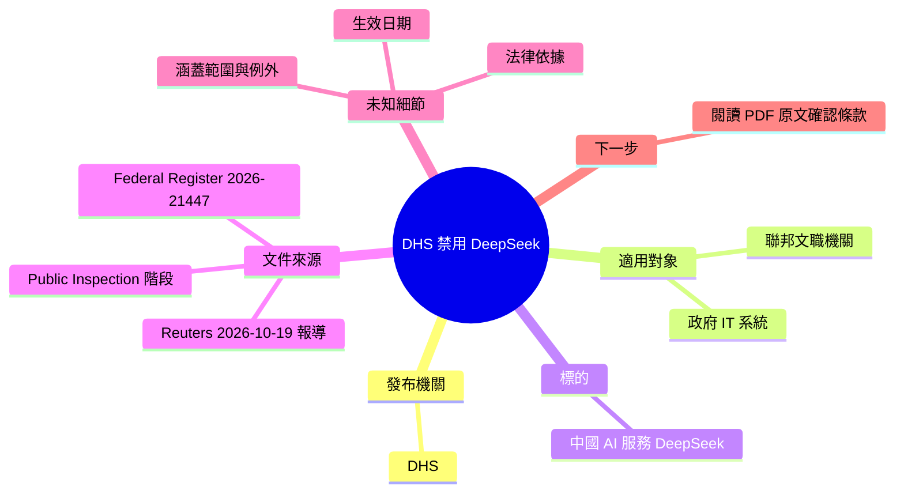

## DeepSeek banned from U.S. federal civilian agencies under new DHS order

美國國土安全部（DHS）發布命令，禁止聯邦文職機關使用 DeepSeek。 **What** 依標題與連結（Reuters 報導、Federal Register 文件編號 2026-21447），DHS 新命令將中國 AI 服務 DeepSeek 排除在美國聯邦文職機關的 IT 系統之外。原文 body 僅有 Federal Register PDF 連結，未提供適用範圍、生效日期或例外條款等細節。

### 重點
- DHS 新命令禁止 DeepSeek 用於美國聯邦文職機關
- 依據文件為 Federal Register 2026-21447（public-inspection 版本）
- body 僅有連結，禁令細節（範圍、生效日、例外）無法由所給內容確認

**原文：** [hackernews](https://www.reuters.com/technology/us-banning-chinese-ai-deepseek-government-agency-it-systems-2026-10-19/)

---

<!-- deep-analysis:begin -->
## 📌 摘要 (TL;DR)

- 依標題，美國國土安全部（Department of Homeland Security，簡稱 DHS）發布新命令，禁止**聯邦文職機關**（federal civilian agencies）使用中國 AI 服務 DeepSeek。
- 報導來源為 Reuters。URL 路徑為 `us-banning-chinese-ai-deepseek-government-agency-it-systems-2026-10-19`，顯示禁令針對的是**政府機關 IT 系統**，報導日期標記為 2026-10-19。
- 原文 body 只有一個 Federal Register 公開檢閱文件連結（文件編號 **2026-21447**），沒有附上命令全文或任何條文摘錄。
- **沒有足夠資料**判斷禁令的適用範圍、生效日期、執行方式或例外條款，這些需直接閱讀 Federal Register PDF 才能確認。

## 🎯 核心概念

- **國土安全部** (Department of Homeland Security, DHS)：美國聯邦行政部門，本則新聞中發布禁令命令的機關。
- **聯邦文職機關** (federal civilian agencies)：標題所指的適用對象。字面上與國防 / 軍事單位相對，但本文未列出涵蓋哪些機關。
- **聯邦公報** (Federal Register)：美國聯邦政府刊登法規、命令與機關公告的官方出版品。
- **公開檢閱** (public inspection)：文件在 Federal Register 正式刊登前先開放公眾查閱的階段。連結網域 `public-inspection.federalregister.gov` 顯示該文件處於此階段。

## 📖 整理分析

### 1. 原文提供的資訊
這則 Hacker News 項目只有標題與一個 PDF 連結 `https://public-inspection.federalregister.gov/2026-21447.pdf`。能從標題與連結確認的只有四點：發布機關是 DHS，對象是 DeepSeek，範圍是聯邦文職機關，文件編號是 2026-21447。

### 2. 從連結結構可確認的事項
Reuters 網址 slug 包含 `government-agency-it-systems`，對應標題的「禁止於政府機關 IT 系統使用」。Federal Register 連結位於 public-inspection 子網域，代表文件已公開供檢閱。至於文件是否已正式刊登，現有資料**無法確定**。

### 3. 原文未涵蓋的關鍵細節
讀者最可能關心的問題，原文都沒有回答：
- 禁令涵蓋 DeepSeek 的 App、網頁服務、API，還是也包含開放權重模型的本地部署
- 生效日期與機關的落實期限
- 是否有研究或資安測試用途的例外
- 承包商或受聯邦資助單位是否受約束
- DHS 依據的法律授權

以上都**沒有足夠資料**，本整理不做推測。

### 4. 為什麼值得關注
這是推論：若命令經 Federal Register 正式刊登，代表限制從個別機關的內部政策，提升為具正式公告形式的聯邦層級文件。對在政府相關專案中評估或使用 DeepSeek 的團隊，應直接閱讀文件 2026-21447 原文，確認自身是否在適用範圍內。

## 🧠 Mindmap

<!-- deep-analysis:end -->
### 📄 原文內容

點此展開 / 收合

https:&#x2F;&#x2F;public-inspection.federalregister.gov&#x2F;2026-21447.pdf

