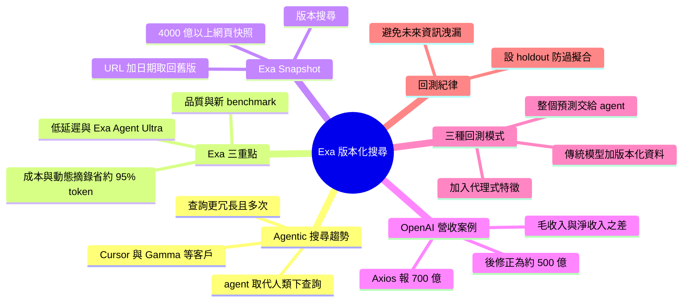

## Version-Controlled Search: The Web as It Was — Ryan Ahern, Exa

替網頁搜尋加上「時光機」，讓你用過去某個日期當時看得到的網頁來測試模型或 agent，避免未來資訊洩漏。 **Why** 即時搜尋永遠回傳最新資訊，用它回測預測系統會把事後才知道的結果洩漏進評估，無法證明搜尋特徵真的有預測力。 **How** Exa 爬取網頁時會檢查新鮮度，因此能保留各 URL 在不同時間點的版本；提供兩種用法：給 URL 加日期取回該日期（或之前最近）的內容，以及 version search，以過去時間點的狀態執行搜尋。 **What** Exa Snapshot 宣稱有 4,000 億以上網頁快照，可按日期搜尋，面向金融客戶。講者 Ryan Ahern 以 OpenAI 年化營收 700 億 vs 500 億（毛收入 vs 淨收入）的報導差異為例，說明可回測「市場尚未發現前能否找到線索」。三種回測模式：以版本化網頁萃取結構化特徵餵傳統模型、為傳統模型加入 agentic 特徵、整個預測由 agent 負責。他也提到動態 highlights 可比全頁文字少約 95% token，並提醒回測要設 holdout，否則會過擬合（工作坊中有人用「公司名稱是 Dominion」這類特徵拿高分）。

### 重點
- Snapshot 提供兩種存取：指定 URL 加日期取回當時內容；version search 以過去時間點執行搜尋，只回傳當時已有的結果
- 三種回測模式：版本化網頁→結構化特徵給傳統模型；為既有模型加 agentic 特徵（如 adverse media scan）；整個預測由 agent 負責並限制其只能看到當時網頁
- 工作坊以「預測公司是否被收購」為例（收購前 1/7/30 天），高分特徵出現過擬合（如指定公司名稱），說明回測必須保留 holdout set；動態 highlights 宣稱可比全頁文字少約 95% token

**原文：** [youtube-ai-engineer](https://www.youtube.com/watch?v=vS2IA9pq0Q4)

---

<!-- deep-analysis:begin -->
## 📌 摘要 (TL;DR)

- Exa 的前線部署工程師（forward deployed engineer）Ryan Ahern 介紹新功能 **Exa Snapshot**：收錄 4,000 億以上網頁快照，可依日期搜尋，主打「讓搜尋回到某個過去時間點」。
- 起源是 Exa 爬取網頁時會做新鮮度檢查。每次檢查都留下該 URL 在那個時間點的版本，累積起來就成了版本歷史。
- 提供兩種用法：一是指定 URL 加日期，取回該日期或之前最近的內容；二是版本搜尋（version search），以過去時間點的索引狀態執行整個搜尋。
- 核心用途是金融回測。即時搜尋會把事後才知道的資訊洩漏進評估；版本化搜尋能檢驗 agent 在「市場還沒發現前」能否找到線索。講者以 OpenAI 年化營收 700 億 vs 500 億美元的報導落差為例。
- 講者也提到 Exa 的動態摘錄（dynamic highlights），宣稱比回傳全頁文字少約 95% token，且結果品質更高。

## 🎯 核心概念

- **代理式網頁搜尋** (agentic web search)：由 agent 代替人類下搜尋。agent 的查詢更冗長，也會在單一任務中執行多次搜尋。
- **版本化搜尋** (version-controlled search / version search)：只回傳在指定日期當時或之前就存在的結果，模擬「當時搜尋會看到什麼」。
- **回測** (backtest)：用歷史時點的資料檢驗模型或 agent 的預測能力，前提是不能混入未來資訊。
- **動態摘錄** (dynamic highlights)：從所有搜尋結果中挑出完成任務所需的片段送回 context window，而不是回傳整頁內容。
- **保留集** (holdout)：不參與調整的驗證樣本，用來確認找到的特徵可以推廣，不是過擬合（overfitting）。

## 📖 整理分析

### 1. 為什麼搜尋主體變成 agent
講者先在現場調查：多數人已改用 ChatGPT、Claude 等工具做搜尋，而不是 Google。他指出 agent 和人類的搜尋方式不同。人類輸入幾個關鍵字、看前幾筆就放棄；agent 會詳細描述需求、反覆嘗試，所以每個任務的搜尋次數多很多。Exa 就是接在這類系統後面，例如 Cursor 查最新文件、Gamma 找 Apple 2018 年的 SEC 資料。Exa 擁有自己的爬蟲、資料庫、嵌入模型（embedding model）與檢索架構。

### 2. Exa 的三個重點：品質、成本、延遲
- **品質**：agent 越少次工具呼叫就拿到所需資訊，推論成本越低，任務也越容易成功。Exa 最近發布了新 benchmark，想把「搜尋工具」與「呼叫它的模型」的表現分開評估。
- **成本**：講者認為該看的是 agent 完成整個任務的總成本，而不是單次搜尋價格。動態摘錄就是為此設計，宣稱比全頁文字少約 95% token。
- **延遲**：因為擁有自有基礎設施，Exa 能做低延遲搜尋。另一端則有幾週前推出的 Exa Agent Ultra，講者稱它在多項長時間深度研究 benchmark 上達到 state-of-the-art。

客戶面，講者主要服務避險基金、資產管理公司、主權基金與 VC。保險業者需要評估交易對手風險，VC 則想在新創爆紅前找到它們。

### 3. Snapshot 的運作與兩種存取方式
Exa 持續爬網並檢查新鮮度，順帶保存每次檢查時的 URL 版本。第一種用法是「已知 URL」：給定日期，回傳當時或之前的版本，就像那天去請求一樣。第二種是講者認為更有意思的版本搜尋：模擬在過去某時點執行搜尋，只回傳當時已存在的結果。

### 4. 案例：OpenAI 營收 700 億 vs 500 億
講者並列兩次搜尋：左邊是 10 月 1 日的 snapshot 搜尋，右邊是做投影片前幾天的即時搜尋。10 月初，Axios 報導 OpenAI 年化營收約 700 億美元，市場據此推估估值。後來有報導指出應約為 500 億，原因是先前計入毛收入，但部分收入來自雲端供應商，應視為供應商轉手（vendor pass-through），以淨收入計才對。講者的重點是：可以回到市場發現之前，檢查網路上是否已有線索，例如 SEC 文件的會計註腳，或較不知名來源的報導。接著再測試 agent 能否穩定找到這類落差。他建議準備約 50 組樣本，並用 holdout 驗證能否推廣。

### 5. 三種回測模式
講者以「預測公司是否被收購」為例。即時搜尋一定會找到併購宣布，因此要改在宣布前 1 天、7 天、1 個月的時點做預測。他把目前的回測方式分成三類：
- **傳統模型＋版本化資料**：把版本化網頁的非結構化內容轉成結構化特徵，例如軟體價格、情緒分析、服務條款，再餵給 ML 或決策樹。很多網站不會保存歷史頁面，Snapshot 補上了這塊。
- **傳統模型＋代理式特徵**：在既有模型上加入一兩個由 agent 產生的特徵，例如負面新聞掃描（adverse media scan）或股票研究。做法是多次搜尋、探索多條路徑，再濃縮成結構化結果。
- **整個預測交給 agent**：逐字稿在此中斷，此模式僅見於先前的摘要。摘要也提到講者警告：回測若不設 holdout 會過擬合，工作坊中曾有人用「公司名稱是 Dominion」這類特徵拿到高分。

## 🧭 流程圖 / 架構圖

## 🧠 Mindmap

<!-- deep-analysis:end -->
### 📄 原文內容

點此展開 / 收合

[music] >> Welcome everyone. Looking forward to giving you all a introduction into one of our newest features in Exa, which is version controlled search. So I'm Ryan, I'm a forward deployed engineer here at Exa. And today I'm going to give you an overview of two things. We only have a very short amount of time. So the first one, I just want to motivate what is Exa, what is agentic web search? Just because you kind of need to believe in the dream of that to understand why you'd want to use it to do the second thing I'm going to talk about, which is how to backtest financial models using that. So first, just to understand where I'm at in the room, who here has heard of Exa before or used it? Okay, I've got a good show of hands. Who here has ever used like Google back in the day to like do some sort of work or personal use, just like typed into Google to do some sort of search? Hopefully like everyone in the room, most people had pretty good market share, you might have heard of it. Last one would be, how many of you now no longer really use Google? You use ChatGPT or Claude or maybe even Instinct or Muse if you're like at the cutting edge to actually do your searches. Yeah, most people, right? So we're going to connect all of these things together. This last point where a lot of people now are like, "Hey, I don't even really use desktop search anymore. I kind of ask an agent to do this." is something that we see more broadly in the market, right? And the idea is that like agents tend to do a pretty good job at understanding how to search because they're allowed to try multiple, multiple times. They kind of don't get tired. They tend to be quite agreeable and work very, very hard. So when you say like this is the thing that I want, it's going to go out and it's going to do many, many different searches in order to satisfy like your objective. And the other thing here is that like they tend to search different to humans. So as a human, you might put in like a few keywords for the thing and then hope that you get the best results like in the first couple, and otherwise like maybe you try like a different query and then you'll kind of give up. Whereas agents will be very verbose. Um they they tend to describe what they want to search in great detail and will execute many searches in order to understand the space more fully before they respond. Um and that means that they do way more searches um on on a per task basis. So, generally the idea is that like, "Hey, nowadays most humans, you're going to be using agents to kind of broker your search tasks." Um and that's where Exa kind of plugs in. So, uh when you're working with um like many many agentic systems. So, whenever Cursor wants to go and search latest documentation to help its coding agent complete its trajectory, whenever you're like talking to Gamma and you're like, "Hey, it'd be great if I had just this like SEC data from like Apple in like 2018 to complete my slide, like that would make it brilliant." It's going to use Exa to go out, search the full web, so we have our own crawling infrastructure, our own database, our own embedding model, our own retrieval architecture to get exactly what it needs to answer its query. Um this is like a couple of the logos of like the bigger companies, but because this is AI engineer, like here are a few like kind of archetypes that we work across the financial space. I work with a lot of hedge funds, asset managers, sovereign wealth funds, VCs across like a bunch of different tasks because they also need like the latest information. So, if you're a hedge funder, you're going to be trading on information. You're looking in the market for alpha, right? And for information that allows you to understand how you could position your your organization better. If you're a um uh an insurer, you're probably understanding like what counterparties you're working with or who you're insuring to make sure that ultimately you're making the determination. So, you want to make sure you're making it on the best information and that your risk models are the most accurate. Or even if you're in VC, you're like, "I need the hottest startup. I need to know the in next instant before they blow up." And they're not necessarily going to be in like some structured data set. Like I need to go and find them wherever they exist in the web. Um that's what they come to Exa to kind of support them for. Um and then the the kind of to wrap up the last part on like why Exa and the reason why I think now you'd be like, "Okay, I'm I'm building agents or I'm interested in agents and I definitely need a generative web search. Why Exa?" Um and it's because like we're a lab um in the sense that we're very very interested in the search market um and in the ways in which agents search and we're hyper focused on that problem. There's three like core tenants and then we'll talk about how that goes into versioning to segue into the next part of the talk. But first and quite obviously is like quality, right? So, you want to make sure that when the agent does that um the tool call and the retrieval, it gets what it needs cuz the fewer tool calls that it needs to make, the more cost-effective on your inference and also just like the more likely it is to succeed on its overall trajectory. You're not going to bring in something that like misaligns it. Um uh we're really really interested in the quality space. We uh recently released like a new benchmark um which we think more accurately assesses the um the the performance of like the search tools separately to the inference because these two things can be confounded, right? Like what agent or what model is calling the search and what search is connected to what model. So, that you can kind of have a look at that to see our latest thinking there. Secondly, on cost. So, it's not just the line item of the tool call, right? Like how much does one search cost because agents can broker many different searches. Um so, the idea is both like, "Hey, what's the value to this to complete your trajectory?" But also like what's the impact of this on the total cost of that agent completing its task cuz that's actually the thing that you care about, right? You're generally less opinionated about one tool call. It's like, "How much did this overall agent take?" Uh and that's why like we're we we worked on things like say dynamic highlights, which means that for every single result, we're not we're not just returning full pages. Uh we're not even just taking one page, which is our previous highlight features, and figuring out what are the exact right snippets on that page that we need to send back to the context window to complete the trajectory. We now do that across all of the search results, which means that you can actually get higher quality results at 95% fewer tokens than you would at full page text. We have a blog about this, it's very interesting, but basically it means you'll save a lot of money downstream on all of the input tokens you'll be spending on inference for the agent to complete its trajectory. Last one on latency, so because we own our own infrastructure, we can do very very low latency search. Um I'm just going to touch on the other side of the spectrum, which is like very long-running deep research. So we have ExaAgent Ultra, which we released um like not too long ago, maybe a few weeks ago, which is like state-of-the-art on um a lot of benchmarks around like very very long-running um search. And that's because we can do a lot of things under the hood. We have obviously we own the search harness, but we can also be opinionated about that how that interacts with the agent to harness do these like very very long-running research task. So highly recommend you check those things out. Um this is just a segway to be like, "Okay, Exa really cares about this space. I think that their search is going to be good." To motivate the next part, which is really interesting is the topic of this talk, which is versioning. So just recently we released ExaSnapshot. Uh it's 400 billion plus snapshots of the web, um and you can search them by date. Um and that's really really interesting in the um in the financial services industry. We'll get into that, but first I'm just going to talk a little bit about like what this basically means. So uh we're we're a search company, so we're constantly uh searching across the web for the latest information that we can add to our index. Um and every single time we do it, we check it for we're checking for freshness. Because ultimately you want to have the latest live up-to-date information at the point at which you're searching. But because we're doing all of those checks, it means that we can capture a version of those URLs at the point where we checked it and have like a version history. Um and you can access that in two ways. One is like, "I know the URL I want to find as it was at or before a given date." And so you can give us a URL and you say, "This is the date that I want it. I want it at that date or before and serve it to me as you would have if I had requested it at that point." The second one, which is even more exciting, is this concept of version search. So, where a search API, and the idea is like, "Hey, what would happen if I had executed that search but at a prior point, right?" So, I only get results that would have been served at that point or before. Um that has very like interesting implications. I'm just going to do one like very small example here. So, OpenAI recently I say as of like October 1st. So, on the left-hand side here, you'll see a snapshot search as it was in October 1st. And on the right-hand side was a live search as of like a couple of days ago when I made this slide. Um but uh at that time in early October, like there was some discussions that like OpenAI had a like annualized like run rate around like the 70 billion, right? Um and that was leading to certain ways in which the market was projecting how and where they would be valued. And then more recently, there was some and that reporting was originally by Axios. And then more recently, there were some publications that were reporting like, "Actually, it's closer to 50 billion for fun accounting reasons, right?" Like it turns out that they were counting gross revenue when actually like some of their revenue was coming from cloud providers. And technically, the way that you should account for that would be that there would be a vendor pass-through. So, net annualized revenue is better. That's how what some what some other players were reporting, etc., etc., right? But basically, it meant that the the the net annualized run rate was like kind of down forecast from 70 billion down to 50 billion, right? Now, this is just like a financial thing that some of you may or may not find interesting. But the so what for version search is like, "Let's say you're in the interest of creating a product or a solution or an agent that is made to that that will that its job is to to find these things, right?" You can now go back and be like, "Okay, before everyone figured it out, right? Before the market and before some financial analyst published the think piece that was like slamming down on this particular thing and everyone knew about it, what information existed on the internet, right? Like was there an SEC filing that would have revealed this thing in an accounting footnote? Like was there some other reporting from some other vendor that maybe is like you would consider is like less reputable, but actually was able to find that kind of thing and and maybe you should consider them differently." Um you can you can potentially like trace these things before like the rest of the market found it. But most importantly, like not only can you test out that you can backtest that, right? You could then adjust the ways in which you're setting up your model, you can adjust the ways that you're setting up your agent to be able to be like, "Could it have found this discrepancy?" Uh and more importantly, could it have found that discrepancy in a way that is generalizable, right? Let's like create a set of like like 50 sample sets, see if it can perform against that, check it against the holdout and be like, "Okay, I think that my model is now going to be pretty good at finding this kind of feature." And that's something that's kind of new in this in the in the web search space and that you can backtest that. Um this is like a like a little diagram just to kind of motivate the idea, but at any like live search that you do with like any existing search product, the idea is it's live, so it has all of the information. So, in this particular little example, um we're we're trying to predict whether company got acquired or not. Um in this case, if you do a live search, you're going to find like that the deal was announced, right? Because that happened, it got released everywhere. You could um be like, "Hey, I'm trying to train a model that's able to predict whether this company got acquired or not." So, I'm going to go like 1 day before the announcement, 7 days before the announcement, a month before the announcement and see whether I could or could not predict it, right? Uh and you can build a set of those companies um and basically train your model um or whatever system it is that it's trying to do this prediction, and see like was it able to reliably like predict this particular feature. Um So, I'm going to spend a little bit of time here just talking about how different systems are currently being back-tested with Snapshot. So, there's like three kind of archetypes here. The first one is I'm operating like a very traditional model. Maybe it's ML, maybe it's even more simple than that, like a decision tree or something. Uh and all I want to do is just gather unstructured data from the version web into some sort of structured set of information. So, it could be something like software prices, it could be some sentiment analysis, it could be like the terms and conditions of a particular site. Whatever it is that like powers your model, not all information is continually available. Like if you're trying to understand software prices, like, you know, the the page of that software price is not necessarily stored in a versioned um a way for that website in a way that you could reliably access. Or potentially like you have some like, sentiment analysis that you want to do, but like that's going to be mired in like what point was that sentiment released in time, right? And you want to be able to get like a reliable set of those signals. And then you can just transform it into some array of signals that goes into your model and you can predict it. That's like the sort of basic space. And some people are just like enriching data that they wouldn't have had access to for their existing models. So, that's just like sort of like the status quo plus one. The interesting space is in like the next two areas. So, the first one is this idea of like adding an agentic feature. And the And And here is like, okay, well, I have this existing model. It performs pretty well, but I have an idea that like if I add one or two like agentic features to this model, it would be able to perform better. So, let's say something like an adverse media scan. Necessarily like adverse media is going out into the web, searching across it for all of the information that exists, potentially doing it in an agentic way, right? Where you're doing multiple searches, you're exhausting multiple different trajectories, and then you're going to take all of that and then condense it into some sort of structure. Um Uh another example here would be to say like equity research in much the same way. Like, "Hey, I want to go out. I want to look at the full universe of companies and I want to find like potentially all of their like like estimated uh like rack revenue or head count or all of the features that matter." Um and the idea is that you'd be using something like adverse search at the point at which you're doing a prediction life to go out and gather all of that information to then send into your um traditional model. And you can now use like adverse snapshot to back test those particular features. So, you can go back and be like, "Hey, if I was to do this like adverse media scan like 1 month before." Or maybe I've already like onboarded a bunch of people into my portfolio like 4 months ago, what would I have said at the point where they were going to enter my portfolio? And would how is that tracked against today? Um and that kind of motivates like especially with a lot of financial services customers like you don't now just have to believe that like search will be better. You can actually go back and back test that against your existing processes and say, "Hey, it's better." Um so, that's like the maybe the next evolution like one step plus plus. Um on the far right-hand side here um is kind of like maybe the future. So, there's some like startups that are working in this prediction space. And the idea here is that the full sort of like simulation or prediction is being managed by an agent. So, in the middle is like an ML model that's maybe doing a prediction or some algorithm or decision tree. On the right-hand side like it is like an agent that's just going off and doing a bunch of things. It could be searching internal knowledge, it could be accessing data feeds, it could be doing whatever it is. But one of the things that it may do that that is to tool call uh and access the web. And the idea is like now you don't have to try and create some internal corpus that tries to represent what it would be like to access the full web. You can just be like, "Hey, I want to make sure that I can control that feature so I know that future information is not just going to leak directly into my model." Like I'm trying to predict company acquisitions through some very very insane like agentic process that's accessing everything. You can now be like, "All right, let's just make sure that's not just going to have one web search that finds that it was acquired, comes back and predicts it with like 100% accuracy. Um so that's kind of the the sort of right-hand side there. Um I'm just going to give like a little example of like the middle um just to round off um this this this kind of discussion. Um so uh yesterday we ran like um a kind of extended workshop on snapshot uh and we had a bunch of around about 100 people in the room that were kind of uh running through this the same example we had before about trying to predict company acquisitions. Um one thing that was kind of interesting is that um the this was like some like one of the example features from the workshop from one of the people um that uh that that got a relatively high score. But a thing that was interesting here is like um the just to just to motivate so the first one was this idea that like, "Hey, within the past year did an investor or a significant shareholder publicly call for a supported sale of the company as a whole?" And the second one, which is the interesting one, is like, "Hey, did this company's share price um was at least 60% lower than high share price during the past 5 years?" Which the idea is like it's kind of dipped down. Um the last bit that's interesting is like, "Hey, is the company named Dominion?" Now this is a little bit of overfitting for people that know like backtesting. Um like and the idea here is like this could be something that like an agent could do, right? If it's trained on like a live set, um it can potentially just overfit to the training data that you have. But the idea with snapshot is like not only can you go back and test for these things, um you can go back and like set up your your your e-vals and your identic harness in such a way that you can detect these things, but you can also try and check that it generalizes. And this is something that would be very, very hard to do if you are gated by like testing live, like in production. And you can only change the ways in which these features are described over time and check against real time, right? you might be waiting for months to try and see how and why your identic setup um, actually is predictive or is overfitting in different ways. Um, that is like you can describe these like quite complex features like um, these ones are like maybe you could imagine trying to recreate in um, uh, in like some sort of like uh, like non-semantic search, but you can go as crazy as you want within the within existing like uh, like extra semantic search world. So, you can say things like, "Hey, I want to see if there was any adverse media against like reputable VPs that are operating like um, uh, that are operating within VC funds that have like been on the AI Engineer podcast and they've said something bad about it, right? Like you can go as as hard as you want on these features that you think are going to be predictive cuz that's what core extra search allows, but then you can back test it, right? and see if it's performative or not. Um, then I'm just going to kind of like recap. So, the first thing that we talked about here is like um, using Exa because it's quality cost-effective identic web search across every latency. Um, we have lots of blogs around this, so encourage you if you've not tried Exa um, to have a go at this um, because the first thing you want to know is like, "Hey, do I actually think that this is going to add some benefit to my model?" The second thing as we talked about is like, "Hey, using Exa snapshot to be able to like back test these financial models or whichever model of risk risk model prediction model with these web search features in order to see like, hey, does adding it uh, add value to to you and your identic processes?" Thank you so much.

