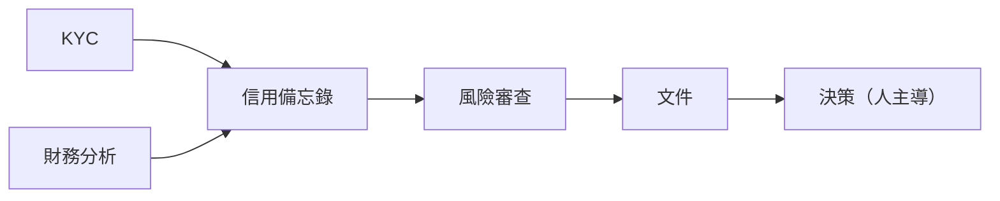
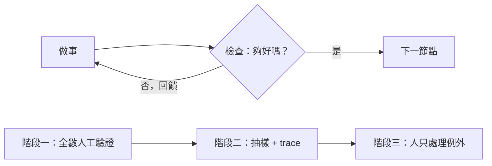
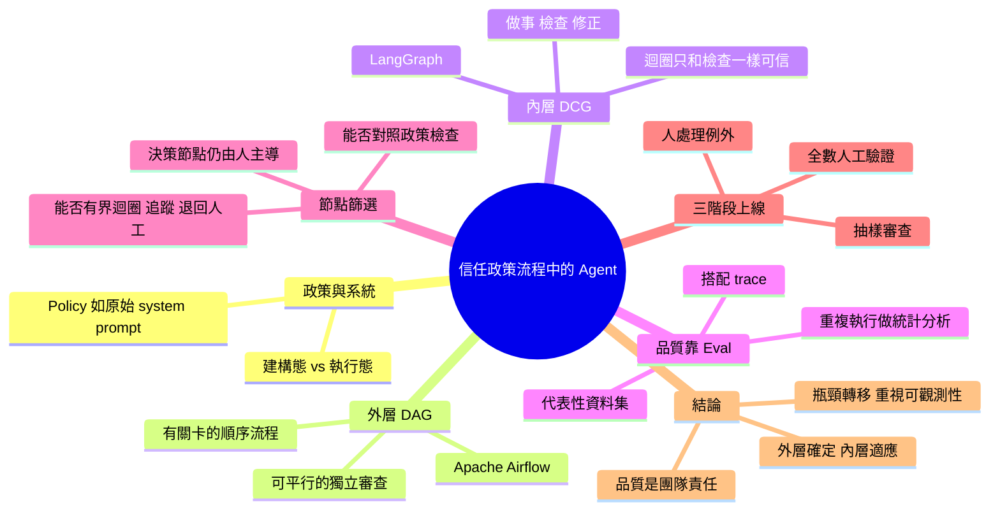

## How to Know When an AI Agent Can Work Unsupervised — Evan Kormos, Coinbase

把公司流程畫成「外層固定、內層可變」的流程圖，再依信心逐步把節點交給 AI agent 自己跑。

**Why** 受政策與合規約束的流程要引入 agent，關鍵在於如何證明它的輸出可信，而不是模型本身。

**How** 外層用 DAG 表示有順序、有關卡的政策流程，節點內用「做事→檢查→回饋修正」的迴圈（DCG，如 LangGraph）；用 eval（具代表性的資料集、重複執行的統計分析）加 trace 作為信心機制；逐節點問「能否對照政策檢查、能否在有界迴圈內執行、能否追蹤、能否退回人工」。上線分三階段：全數人工驗證→信心達政策門檻後抽樣審查→人只處理例外。

**What** Coinbase 的 Evan Kormos 在 AI Engineer 的演講，舉商業貸款、交易所上架代幣、受監管的軟體交付為例；結論是「外層確定、內層適應」、品質靠 eval、品質是團隊責任。也提醒 agent 加速某一段後瓶頸會轉移，所以流程層級的可觀測性比建構工具更重要。

### 重點
- 外層用 DAG（如 Apache Airflow）表示政策閘門流程，節點內用 DCG（如 LangGraph）做「執行→檢查→修正」迴圈；迴圈只有檢查機制可信才可信
- 判斷節點是否適合交給 agent 的四問：能否對照政策檢查、能否在有界迴圈內跑、能否 trace、能否退回人工
- 導入三階段：全量人工驗證 → 達政策信心門檻後抽樣 → 人只處理例外並持續維護資料集

**原文：** [youtube-ai-engineer](https://www.youtube.com/watch?v=_4Ph2dhmUFI)

---

<!-- deep-analysis:begin -->
## 📌 摘要 (TL;DR)

- Coinbase 的 Evan Kormos（自述有 20 年軟體交付經驗、其中 15 年在企業金融服務）在 AI Engineer 演講中，談如何在受政策（policy）約束的流程中信任 AI agent。
- 核心配方：外層用有向無環圖（Directed Acyclic Graph，簡稱 DAG）表示有順序、有關卡的政策流程；節點內部用有向循環圖（Directed Cyclic Graph，簡稱 DCG）表示「做事 → 檢查 → 回饋修正」的迴圈。口號是「外層確定、內層適應」。
- 迴圈的可信度取決於檢查（check）的品質。agent 是機率性的，不能只靠精確比對輸出，要用具代表性的資料集做 eval、重複執行做統計分析，再搭配 trace。
- 上線分三階段：全數人工驗證 → 信心達到政策門檻後改為抽樣審查 → 人主要處理例外，同時持續修訂資料集。
- agent 加速某一段流程後，瓶頸會轉移到其他段。講者認為流程層級的可觀測性，比撰寫與建構 workflow 工具重要得多。

## 🎯 核心概念

- **政策** (Policy)：組織內規定工作如何完成的規則，尤其涵蓋風險與合規，常用 must / may / should 表述。講者把它比喻為「原始的機構意圖」或「最初的 system prompt」。
- **建構態與執行態** (Build state / Run state)：政策的定義與修改是建構態；持續運行、隨產品變動快速演化的系統是執行態。兩者要分開看。
- **有向無環圖** (DAG)：只往前推進、不回頭的流程表示法。講者舉 Apache Airflow 為例，它用 Python 程式碼定義 DAG。
- **有向循環圖** (DCG)：允許迴圈的圖，用來表示節點內反覆修正的過程。講者認為 LangChain 的 LangGraph 適合管理 DCG 的狀態。
- **信心機制** (Confidence mechanism)：讓人相信輸出品質的系統性方法。傳統軟體靠單元測試，agent 則靠 eval 加 trace。
- **爬坡** (Hill climb)：逐步提升某個節點的自動化程度，直到 agent 能接手。

## 📖 整理分析

### 1. 政策與系統分離
講者先把「政策」與「實際運行的系統」切開。政策定義規則，改動頻率低；系統則持續運轉，並隨產品需求快速變化，但整體仍應大致受政策約束。在「人、流程、技術」（people, process, technology）這個企業常用模型中，他把 agent 視為橫跨三者的營運模型：agent 與人協作、自己執行部分流程、本身也由技術構成。這場演講聚焦在 agent 與「流程」的交會點。

### 2. 外層 DAG：有關卡的流程
許多流程必須依特定方向、經過關卡推進。例如變更上線前要先核准，客戶開戶前要先完成驗證。講者認為 agent 讓我們值得重新檢視哪些步驟能平行：過去因成本或協調太複雜而做不到的獨立審查，現在可以同時跑，再彙整結果，同時保留必要檢查。他舉了三個可用 DAG 表示的例子：商業貸款、在特定地區的交易所上架代幣、受監管的軟體交付。他指出 agent 在軟體交付已有大量採用，目標是把同樣的效率帶到公司其他領域，縮小採用落差。

### 3. 內層 DCG：迴圈只和檢查一樣可信
以 code review 節點為例，工作完成後會被檢查，夠好就放行，不夠好就依回饋迭代。講者強調品質好的輸入能用較低算力換到較好的輸出，並提到可以把 DAG 狀態注入 agent，讓它知道自己在大流程中的位置。真正的難點在於定義「好」長什麼樣，並找到可靠的評估方式。否則多跑幾輪不一定會更好，所以「迴圈只和檢查一樣可信」。他也提醒要設計例外流程，例如程式碼被取消或沒達到安全標準，讓工作不會卡住，但也不必為每個邊界情況都設計。

### 4. 用 eval 補足傳統測試
傳統軟體的信心機制是單元測試，並嵌在交付流程中。agent 是機率性的，同一請求可能得到不同答案，而且可能不只一個答案可接受，所以精確比對不夠用。做法是建立具代表性的資料集、和領域專家一起定義「好」的標準、重複執行 eval 做統計分析，再搭配 trace（執行期紀錄）。講者的說法是，這讓品質變成可提出研究與統計證據的東西，而不是「對模型的感覺」。

### 5. 節點篩選與三階段上線
以貸款流程為例，KYC 與財務分析可以平行進行，信用備忘錄、風險審查、文件、決策則依序進行。評估每個節點是否適合交給 agent，可以問四個問題：能否容易對照政策檢查？能否在有界迴圈內執行？能否追蹤？能否退回人工？答案若多為「是」，該節點就較適合自動化。講者認為整條 DAG 都應導入 agent 輔助，重點在於 AI 是否預期接手，而不只是 AI 有沒有參與。他也認為最後的「決策」節點本質上是對照政策的檢查，大概仍需由人主導，較難爬坡。上線三階段為：(1) 監督期，人工驗證全部輸出並修訂資料集；(2) 信心達政策門檻後改為抽樣，用 trace 系統化評估人沒看到的部分；(3) 越過門檻後，人主要處理例外，但仍參與資料集修訂。

## 🧭 流程圖 / 架構圖（可選）

講者以貸款 DAG 為例（下圖依講稿整理；講稿只說平行與依序，未逐一說明各步驟之間的依賴關係）：

節點內迴圈與三階段上線：

## 🧠 Mindmap

<!-- deep-analysis:end -->
### 📄 原文內容

點此展開 / 收合

Hi everyone. My name is Evan Cormos. I've been delivering, designing, building software for 20 years. The last 15 in enterprise financial services. I am a player coach at Coinbase. And we're here today to talk about trusting agents in policy-driven workflows. So, let's start with the policy and it's pretty boring. Um, I'm going to go over here for my notes. So, our starting point center centers around the policy and this sets the rules for how work gets done within the organization and including especially risk and compliance. Think of policy as the original institutional intent or the original system prompt. So, ideally we have this written down. Um, it's a little bit boring, so stick with me. Um, using language like must, may, and should. And the again, these help define the rules and decisions about how the system operates in the organization. Separate from policy, we have the actual running system. So, the first thing we're going to do is separate these two uh these two both the build state and the run state in two different moments in time. So, typically we're either defining or chaining changing our policy but this the system is constantly running and it's constantly moving and changing. So, we could then sort of imagine a compilation event that Oops, sorry. I'm skipping ahead there. It's constantly changing. So, it's evolving quickly with these product-driven changes. So, everything is expected to still be roughly bound by the policy, but ultimately um we separate this from the run state and the build state. So, inside the system, what does it look like? We have a familiar model if we have any enterprise uh folks in the in the room here. Um people, process, and technology. But, where really do agents fit into this model? Um so, I see them as an operational model cutting across all three. They work with people, execute parts of the process themselves, and they use and are made up of technology. So, for our talk today, we're going to be focusing here where agents meet process. What work we give them, what boundaries we set, and how we build trust in their outputs. So, let's dive into your workflow. And it's high-level and seems basic, but if you haven't, there are good reasons to map this out. So, maybe a change has to be approved before it goes live, or a customer goes through has to go through verification before their account is opened. We expect work to flow in a specific and gated direction. So, I believe it makes it agents make it worth revisiting what we can do in parallel. So, previously some work used to cost too much or be too complex to coordinate in this way. But now we can run independent reviews alongside each other, bring the results together, but keep the required checks in place. So this is a directed acyclic graph or a DAG. It is a way to represent this workflow or process, the steps, the dependencies for a flow that moves forward without looping back on itself. Apache Airflow, if you're familiar, is an example of open source software that represents workflows, their dependencies as DAGs in Python code. So this Python code, this these DAGs can be used to define and manage a number of policy driven processes like, for example, commercial lending. We could also use a DAG to represent the workflow to list a token on the exchange in a specific region, if you're into that. Or we could use a DAG to represent a regulated flow of delivering software, which is a hot topic. And one we'll spend a little bit of time on, I think that we've seen a lot of adoption within agents, within software delivery, and ultimately we're looking to leverage that same efficiency and scale in other areas of the business and close that the the adoption gap. So let's stick with the software delivery example for a little bit. What happens inside one of these nodes of the process? And I'll give you a hint, it's a loop. >> I'm oversimplified, but we have a basic version of what's happening within the Let's Let's say this is a code review process, right? So, we're going to essentially do a number of steps and essentially once we realize the work we recognize that the work is good enough, we're going to allow it to pass on to the next step. And that's essentially the function of the code review node. The work doesn't always uh end up okay. So, sometimes we have to take the feedback from the code review and iterate on it um until the work is a good enough to pass. So, this is a representation of a directed cyclic graph or DCG. So, as far as open source software, uh something like LangChain LangGraph would be what I would um say is helpful to manage the state of DCGs. Um and this is an oversimpli- an oversimplification. These graphs can be very complex. So, zooming back out, the inner flow um of the node, we have people and agents working together. On the outer flow, we have a policy boundary. But not everything goes to plan. Um so, we have to handle exception flows. We don't want the work to get stuff stuck, and we don't want to design for every edge case, either. Um the exception flows will monitor and see kind of what happens if you're shipping code that gets canceled or doesn't meet security standards, that's something you would should want to know about. Volume shifts across the flow once we start to add agents into the mix and we've seen this with software delivery and we'll see it in other processes as we bring agents into those processes as well where now all of a sudden if you're reviewing code faster you need to design it quicker or you need to do the security scan that's faster. So we see the volume shift across the flow. And this is where it's really important that we have visibility into the process overall from a a metric standpoint because as we start to supercharge and and parallelize and add more efficiency to the process we start to develop more and more bottlenecks and so the operational visibility of the process is extremely important much more important than the authoring and the building of your workflow tool. Um so we want to visualize the process. So we want to add parallel capacity by still keeping the controls and so this is where we'll add more additional capacity. Okay. So we're doing some work we're checking it we're using the feedback again to refine it until the work is good enough to move on. But why is that hard? Oh it seems like a pretty easy thing to do. But as I mentioned before these graphs get actually pretty complex and we'll dive a little bit more into why this is difficult. And if you're familiar one challenge with AI engineering is the variability of inputs and outputs and I believe that higher quality inputs will result in better outputs at a lower compute cost. But what are quality inputs? >> So, we would generally speak to it as context model maybe. We can nitpick that, but this isn't our area of focus today. We're going to focus more on outputs. But, we can't really talk about quality of outputs without the quality of without talking about the quality of inputs. So, ideally we've established a trusted context for our agent. Um and there's some references on that, but one thing we can do in this model is inject the DAG state into our agent and let it know kind of where it fits into the bigger picture. Okay, so now we've added even long time horizon goals and that's emphasizes the need to optimize the cost and efficiency of this loop. So, the check is where we decide whether the work is good enough to move forward. We need to define what good looks like. That's the hard part. And we need to have a reliable way to evaluate it. Otherwise, more passes don't necessarily uh mean better results. The loop is really only as trustworthy as the check. So, if we want to talk about quality, let's talk about the check and let's talk about quality. Okay, um I think building with AI is an opportunity to improve product quality overall. I like some of the conversation about durable software. Um So, I'm a believer in quality and in traditional software um we we built confidence mechanisms in place uh to give us confidence that the software is of high quality. And that's done with a variety of uh mechanisms, but primarily systematically with test cases, unit tests, um checking these as a part of our delivery flow to ensure that when we make code changes, mistakes aren't made that break other things, right? So, this is a confidence mechanism that we've put in place with traditional software. The agents are probabilistic, and so the same request can produce different answers. More than one answer may be acceptable. And we still need evidence, but exact output uh comparisons alone really aren't good enough. Uh we need to build a representative data sets and evaluate them um and define what good looks like. We need to run uh ev- these evaluations in repeated uh series, and this is a statistical analysis, right? Um where we actually look at the outputs uh and in volume and not just as a direct comparison. So, in combining with evals is sort of your run time logs of what happened, or sorry, traces, uh wh- which are sort of your run time logs of what happens. Um we've built this confidence mechanism to complement um traditional software. And ultimately, this is what we're going to be talking about a little bit more in in terms of driving confidence in the output, not only putting this mechanism in place, but how do we begin to turn it on? So, where does the agent belong? Um back to the lending example, like we can do KYC, financials in parallel and sequence like credit memo, risk review, documentation, decision, all these things in our our DAG. Um looking at each node, we want to ask some certain questions like how valuable would it be to have an agent drive this node versus a human drive this node? Um and we can sort of look at some of these basic questions like can we check it against the policy easily? Can it run in a bounded loop? Can we trace it? Can we fall back to a human? Um if we can answer yes to these type of questions, and we we can kind of have a good idea going in that this particular node may be better suited for automation. Um but throughout the DAG, we should look to drive agent assistance. So, what we're really talking about is not whether or not AI is involved, but whether or not AI we expect to take over at some point. On the decision, you would probably agree that we probably need that to be human-driven. This is essentially the check against the policy. Um so, this is going to be a little bit more difficult, I think, to hill climb. But what do we mean by hill climb? All right, how do we turn this on? So, day one, um we start supervised and as we have agents and humans working together as a part of the process, we can um manually um verify the output to ensure that it is high high quality. Um this is where we refine our data sets and ensure that we have the right confidence mechanisms in place. We've defined what good looks like with the domain subject matter experts and that they're beginning to verify it. When measured confidence reaches a policy threshold, we can move towards sampling. And what that means is humans are looking at a slice of the output and not necessarily all of it. Um we begin systematic more systematic evaluation through traces Um in order to ensure that what we're what the humans aren't seeing is still meeting the quality bar. And then finally, once we clear the confidence threshold, humans handle more of the exceptions of the process, but still acting as participants in refining the data sets and ensuring the quality outputs. Okay, so a few takeaways from this. Um DAG and DCG, basic graph theory, but ultimately, how do we build these processes that exist today and where people are working them and bring agents into the mix. And the recipe really is to keep it deterministic on the outside and make it adaptive on the inside. The next is quality through evaluation. And this is really establishing a complementary confidence mechanism. So, it's not a feeling about a model. We can actually provide research and statistics about the quality of our agents. So, this builds confidence and inherently trusts output. Quality is a team sport. AI engineers own the pipeline to taking product signals from all directions and deliver applications that are well built and utilize ML operations behind the scenes. Finally, agents accelerate across the operating model. I've included some references on the final slide of things that I've spoken about today. This concludes my presentation. Thank you very much. >> [applause]

