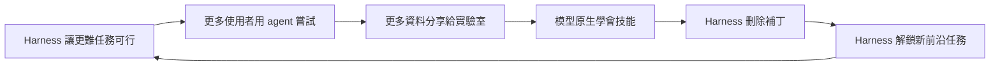
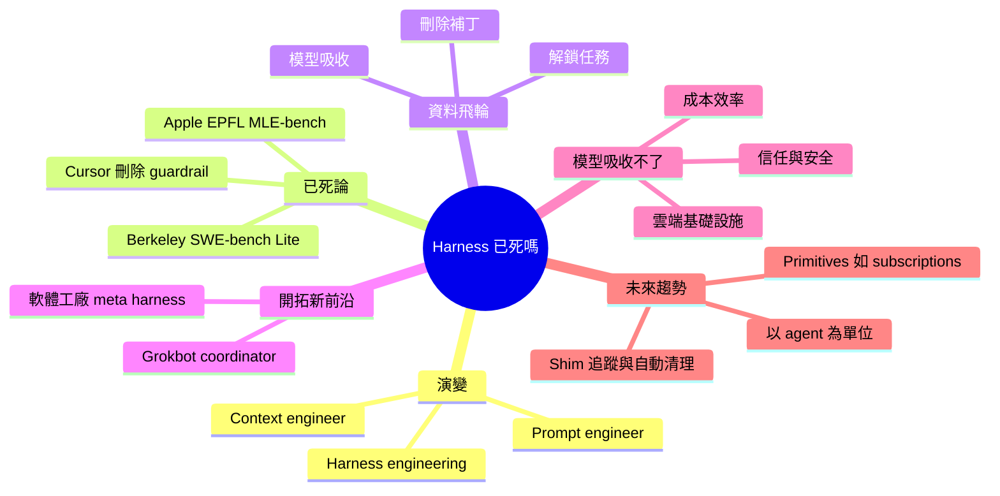

## Smarter Models Killed the Harness. Here's What's Left — Jediah Katz, SpaceXAI

模型變聰明後，harness 裡幫模型補腦的部分確實被吃掉了，但 harness 仍決定 agent 能做什麼新事、跑得安不安全、貴不貴。

**Why** 網路上流行「harness 已死」的說法，需要釐清哪些部分真的過時、哪些不會。

**How** 作者提出資料飛輪：harness 讓更難的任務可行→更多使用者嘗試→更多資料給實驗室→模型原生學會→harness 可刪掉補丁→再去解鎖新任務。模型吸收不了的部分是雲端執行環境、信任與安全、效率（cache hit rate、token 效率、model mix）。

**What** SpaceXAI（Cursor 被 SpaceX 收購後）Jediah Katz 引用 UC Berkeley 研究（7 個前沿模型、含 Pi、Codex、Claude Code 等 harness，在 SWE-bench lite 上 harness 差異不顯著）與 Apple/EPFL 的 MLE 研究（MLE-bench 同樣差異不大，但兩者每任務成本差異明顯）。以 Grokbot（長壽 coordinator 搭配 worker agents）為例，新領域反而要把 prompt 與 guardrail 加回去。預測：primitives 設計（如 subscriptions）、用儀表板追蹤 shim 並讓 bot 在 shim 不再觸發時提 PR 清理、harness 以 agent 為基本單位，並預期 6 個月內 90% 的 agent 工作將脫離筆電執行（這是講者的預測）。

### 重點
- 資料飛輪：harness 解鎖難任務→資料回流→模型原生吸收→harness 刪補丁→解鎖下一個前沿；寫程式能力被商品化，新領域（Grokbot）反而要加回 prompt 與 guardrail
- 兩項研究顯示 harness 選擇對 coding 分數影響小，但每任務成本差異顯著，優化 cache hit rate、token 效率、model mix 可在不降品質下降成本與延遲
- 工程實踐：設計 primitives（如 subscriptions 事件喚醒）、集中追蹤並記錄每個 shim，shim 不再觸發就由 bot 提 PR 清除

**原文：** [youtube-ai-engineer](https://www.youtube.com/watch?v=7Y4sbZgBdnc)

---

<!-- deep-analysis:begin -->
## 📌 摘要 (TL;DR)

- Jediah Katz 是 Cursor 在 agent harness 上年資最久的工程師，隨 Cursor 被收購而加入 SpaceXAI。他在這場演講要回答一個問題：「agent harness 已經死了嗎？」他的答案是沒有。
- UC Berkeley 的研究測了 7 個前沿模型，搭配 Pi、Codex、Claude Code 等 harness，結果在 SWE-bench Lite 上 harness 選擇對分數影響不顯著。Apple 與 EPFL 在 MLE-bench 上也得到類似結論。不過兩份研究都發現，不同 harness 的「每任務成本」差異明顯。
- 講者承認，花俏的 harness 已不再增加程式碼智能。探索 codebase、長時間持續工作、跑測試驗證等技能，模型都已原生吸收。
- 他提出資料飛輪（data flywheel）來解釋這個現象：harness 讓更難的任務變得可行，接著更多使用者嘗試，實驗室取得更多資料，模型原生學會這些技能，harness 就能刪掉原本的補丁，再去解鎖下一個前沿。
- 模型吸收不了的部分有三塊：雲端執行環境、信任與安全、效率（cache hit rate、token 效率、model mix）。
- 對做 agent 產品的人來說，harness 的價值已經從「幫模型補腦」轉向「開拓新任務領域、提升可靠性、安全與成本效率」。

## 🎯 核心概念

- **代理框架** (Agent Harness)：包在模型外層、引導模型並把它連到外部世界的系統，像是模型的「眼睛與手」。
- **執行期層** (Runtime)：harness 的地基，決定 agent loop 在哪裡跑、狀態如何儲存以便續跑，性質接近傳統軟體工程。
- **情境與編排層** (Context and Orchestration Layers)：決定何時呼叫哪個模型、模型看到什麼情境，包含 prompt、工具、記憶壓縮（memory compaction）等。
- **資料飛輪** (Data Flywheel)：harness 解鎖任務、模型學會任務、harness 刪除補丁，如此循環。
- **基本元件** (Primitives)：可組合、可擴充的積木式介面，讓功能增減不必大改程式碼。
- **墊片** (Shims)：為修補模型壞行為而加的確定性 guardrail，屬於暫時性的 hack。

## 📖 整理分析

### 1. 從 prompt 到 harness 的演變
講者整理了職稱的演變。2023 年初最熱門的是 prompt engineer。到 2025 年中，變成程式化組裝最佳情境的 context engineer。今年初，業界才定名為 harness engineering。年初 Cursor 用名為 Grind Swarm 的長時間運行 harness，從零打造了一個瀏覽器，講者稱這是「peak harness」。這套系統編排大量 agent 與機器，成本極高，據講者說還曾讓 Cursor 掛掉一兩次。

### 2. 為何有人說 harness 已死
講者列出幾個例子。Anthropic 的 Tariq（字幕拼法）提到 Claude Code 的 system prompt 被大量刪除。YC 的 Garry Tan 認為 harness 會淡出，最後只剩 skills 重要。講者本人與同事 Stefan 也寫過文章，說明 Cursor 移除了許多 guardrail。被移除的東西包括：一個專門把程式碼編輯套用到檔案的小模型（因為當時前沿模型不擅長這件事），以及「如何探索 codebase、如何檢查成果」等寫程式專用指令。前述兩份研究也支持「harness 不再增加寫程式能力」這個觀點。

### 3. Grokbot：新領域要把補丁加回去
Grokbot 定位為「自主同事」，處理的不只是寫程式，也包括各類知識工作。它的架構是長壽的 coordinator bot 去編排一群 worker agents，講者比喻成大律師帶一群助理律師。跟 Cursor 的方向相反，Grokbot 反而需要把 prompt 與 guardrail 加回去，因為模型還沒掌握這些新任務：
- 關鍵網站流程，例如做簡報、訂旅行
- 溝通：讓使用者掌握進度，但不能訊息轟炸
- 判斷該「自己做」還是「先問」，例如寄信給同事
- 透過記憶學習使用者的工作方式

另一個例子是內部的「軟體工廠」（software factory）流程：bug 回報後自動分類，再啟動雲端 agent 修復並附上前後對比影片。修復合併後，rollouts 產品會再啟動一個 agent 監看線上狀況。講者把這種編排多個 agent 的系統稱為「meta harness」。

### 4. 模型吸收不了的三件事
- **基礎設施**：agent 的任務時長已從分鐘擴展到小時、天甚至更久，筆電會休眠，所以必須在雲端跑。
- **信任與安全**：權限要限縮到特定 agent 與特定人員，避免災難性操作，或一早醒來看到一萬美元的 API 帳單。
- **效率**：講者過去一個月專注優化 Grokbot。他調整 cache hit rate、token 效率與 model mix，在品質不降的前提下明顯降低了成本並提升速度。

### 5. 接下來的趨勢
- **產品再次跑得比模型快**：harness 會先變得更凌亂才會整理乾淨，因此要設計成容易上線、也容易下架功能。
- **少暴露內部運作**：講者援引 Hyrum's Law（暴露給使用者的東西，使用者終究會依賴），認為隱藏內部細節可減少變更管理負擔，迭代更快。
- **設計 primitives**：例如 subscriptions，用單一框架與單一工具，讓 agent 訂閱 Slack 訊息、PR 的 CI 轉紅、特定時間等事件。
- **追蹤 shims**：例如 Grokbot 回覆太慢時，系統會提醒它「使用者在等你」。所有 shim 集中記錄，每次觸發都留 log。有一個 bot 監看儀表板，發現某個 shim 不再觸發時，就自動發 PR 提議刪除。
- **抽象層級上移**：上一代 harness 由多次 LLM 呼叫組成，新一代（Grokbot、軟體工廠）以 agent 為基本單位。

註：先前的 brief 摘要還提到「6 個月內 90% 的 agent 工作將脫離筆電」這項預測，但提供的字幕在此處截斷，無法核對原話。

## 🧭 流程圖 / 架構圖

講者的資料飛輪：

## 🧠 Mindmap

<!-- deep-analysis:end -->
### 📄 原文內容

點此展開 / 收合

[music] >> My name is Jedidiah and I joined Cursor early in 2025 as the longest tenured engineer working on our agent harness and recently I came along to SpaceX as part of the acquisition of Cursor. So, today I want to talk to you all about how the agent harness has evolved to where we are today and where I think things are going. And there's a motivating question that I have for us to answer today, which is is the agent harness dead? So, let's get started. >> [clears throat] >> Here's a more natural and flowing version of that script which reads like a cohesive conference talk rather than a series of short points. Oops. Just making sure everyone's still got their soft detectors on before lunch. Um no, for real. So, the story starts in early 2023 when prompt engineer was the hottest title out there. By mid-2025, that had evolved to context engineer, someone who programmatically puts the best context for the model together on the fly. And then only at the beginning of this year did the industry land on the term agent harness and harness engineering to describe work that my team and I have been doing for a while. So, what's in an agent harness? The harness is like the eyes and the hands for the model. It wraps around the model, steers it, and connects it to the world. Users connect to our harness through apps and then the harness connects the model to computers and also to third-party services like MCPs. I like to divide the harness into two layers, the runtime and the context and orchestration layers. The runtime is kind of like the foundation of the harness. It controls where the core agent loop runs and how state is stored so that work can resume. Building this foundation is a lot like traditional software engineering. And then, the context and orchestration layers are kind of like the wild west. This is what a lot of people refer to when they talk about the harness. These parts of the harness control which models are called when and what context they see. That includes things like prompts and tools, of course, but also memory compaction and a bunch of tricks you might not know that we do to make the agent behave in the way that we want. So, this is the area that I primarily work in. In the new year, we kind of hit peak harness. Cursor announced that we had created a browser entirely from scratch uh using a new long-running harness called Grind Swarm. This was a multimodal harness that orchestrated a lot of a lot of agents and a lot of machines and it was very expensive to run. Uh it actually took down Cursor maybe once or twice to to get this demo. Um now, like anything in the world of agents, it only took a few months of peak harness for people online to start saying that the harness was dead. Tariq from Anthropic talked about how they had killed much of the system prompt from Claude Code. Garry Tan from YC thought that the harness would fade away and only skills would matter. Even myself and my colleague Stefan, we wrote about how we had removed all these guardrails that we had in cursor to patch over gaps in the model's intelligence. We used to have things like a small model just to apply code edits to a file because the frontier models weren't good at this. We also had all sorts of coding specific instructions like how to explore the codebase and how to check your work. So, if all these people are saying the harness is dead, they were saying that smarter models are what killed it. And there's a lot of evidence for that. I want you all to think about a very simple harness where the model only has access to the shell and to all of my secrets. Please don't screenshot this slide by the way. This one's off limits. So, who here thinks that this really simple harness would do just as well on coding evals as a more sophisticated one? Maybe some hands who thinks it would? Who thinks so Who thinks it would if you Raise your hand if you think it would. A few hands, but most of you know. So, a few recent studies tried to investigate exactly that question. The first one out of UC Berkeley tried seven different frontier models on a series of harnesses including Pi, Codex, and Cloud Code. And what they found, particularly on the newer smarter models, is that the choice of harness did not actually make a difference significantly in the score on SweetBench light. And then another another study from from Apple and EPFL found similarly that a dedicated MLE harness did not make a big difference on MLEBench. So, what is going on here? Is it Is it actually true that the harness is dead? Are they right? Here's what I think that the evidence shows. A fancy harness in this day and age, no longer adds coding intelligence. I think that is true. I know that's surprising. But, these things that we used to do in the harness to patch over gaps in the raw coding muscle memory of the model, like teaching it how to explore the code base, uh how to work persistently for very long time with things like slash goal, uh how to run tests to check your work. The model has natively absorbed these skills. So, why is this happening? It turns out the harness is actually making itself obsolete through what I call the data flywheel. So, in this process, the harness brings harder and harder coding tasks within reach. At that point, more users can productively attempt those tasks with agents. That means more coding data is shared with the labs. And eventually the models learn natively how to do these skills as well. Eventually, the models get so good that the harness can actually delete the things it needed to do to make those tasks work in the first place. It's a very interesting process. So, that's how you get people saying that the harness is dead. And if the models are good enough to code well in any harness, then why should you care? Does it really matter which harness you use? Is the harness really dead? I say no, and there's two reasons why. First of all, and I'm going to go into both these points, the harness actually opens the new frontier of tasks for the model to solve. And then, second, there are some tasks or some parts of the harness, especially outside the context layer, which the model cannot absorb. So, to first talk about how the harness unlocks the next frontier, I want to talk about Grokbot. Who here has tried Grockbot? Can I see some hands? Awesome. Let's go. That's great. Um so, for those of you who haven't, Grockbot is our autonomous colleague who gets work done for you. Not just coding, but all kinds of knowledge work. And I really recommend you try it. I'm not going to sell too much, but it's a groundbreaking new product. It's already created a new category. Let's just talk about the harness, though. So, Grockbot has a new kind of harness that operates not based off of one-off chats, but long-lived coordinator bots that orchestrate a fleet of worker agents. You can kind of think of it like hiring a high-powered lawyer who deals with you, you know, directly and owns strategy, but they farm out their tasks to a team of paralegals. It's like that. Now, something interesting about the Grockbot harness is I mentioned how in Cursor we found ourselves removing things from the harness, removing prompting, removing guardrails as the models got smarter. But, curiously in Grockbot, we've actually found ourselves putting back a lot of these things, adding new prompting, adding new guardrails. And that's because there's a lot of new tasks in this new way of working, in the new domains that Grockbot is meant to solve, that the models have not nailed yet. To give a few examples of those kind of things, just a few things that we're focused on right now when it comes to Grockbot, there's key website flows like making slide decks and booking travel, communication. An autonomous colleague needs to keep you up to date on what it's been doing without overwhelming you. Acting versus asking is another big one. Grockbot can do a lot of things which are kind of risky in some sense, like emailing your colleagues. You want us to be able to do that, but you only want us to do it in the way that you intended. And then, of course, learning over time the way that you work through memories is another big focus. So, those of you who might have pushed the boundaries with coding agents might have noticed that none of these tasks are new. But, for GrokBot, they're much more important because everybody is needing them in some way. And right now in GrokBot, it is the harness that is making these tasks feasible. Of course, the model is a big part of that, but the harness is helping bring them into its own reach. So, going back to our data flywheel, GrokBot, that example, lets us fill in the last the last arrow in our cycle, which is when a capability like coding gets commoditized by the model, it's actually the harness which unlocks a new frontier for the model to then solve and kicks off that flywheel again. So, that might look like, you know, taking on new tasks outside of the coding domain, um as we just saw with GrokBot, or it could just mean taking on tasks in the software engineering job beyond pure coding. I'm sure some of you here are, you know, pretty senior in your software careers, and you might know the more senior you get, the less coding you're actually doing. So, there's a lot of other things in the job that matter. Um this is the core idea that I would like you to understand, this flywheel and how the model and the harness together drive it. One more example of how the harness can unlock new frontiers is some of you may have heard of this idea of the software factory, where you have multiple agents coordinating together to solve the full software development life cycle. Now, this is far from a solved vision, but there's a lot of industry or there's a lot of innovation happening across the industry at the harness. To give an example of how this might manifest, you know, internally, we have a lot of channels where someone might report a bug to that channel, and then an automation immediately auto triages that bug. Then it might kick off a cloud agent to try to fix the bug, and that agent will use our tooling to show before and after videos to prove that it's fixed. And then, once that fix is deployed and or is merged in and starts deploying, we have our rollouts product, which kicks off another agent to watch in production for any issues. So, you can think of all this as almost like a meta harness, which is orchestrating many agents together. That's how I'd like you to think about this. So, that's the first reason you should care about the harness because a frontier harness is needed to be at the frontier of agentic tasks. And then the next reason is there are some parts of the harness that the model can't absorb. So, let's talk about those. First of all, there is the infrastructure and runtime needed to make an autonomous colleague reliable. Over the past year plus, we've gone from agents that work on a typical task for minutes to hours to days and even longer. And there's just no way that this can work on one person's laptop, which might go to sleep. It has to be running in the cloud if you really want an autonomous colleague. And then next, we have trust and security. Yes, like we saw before, uh a simple harness with just bash and all your, you know, all your API keys in a file can solve coding tasks, but you probably don't want to give all your API keys in a file to the model. Um or if you're okay with that, I'm sure that your head of security would have something to say. Um so, this is obviously really important companies where we want to have permissions that are scoped down to specific agents and specific people, but it's also important to have guardrails for anyone who doesn't want to wake up one morning to a really catastrophic action or to a $10,000 API fee, right? And then finally, there's efficiency. If you think back to to two studies I showed, where the choice of harness did not make a significant difference in eval scores, both of those studies actually found that there was a significant difference in cost per task. I have personally been focused over the past month on optimizing the efficiency of the Grok Bot harness. Now, through tweaking variables like uh cache hit rate, improving that, token efficiency, um model mix, we were able to bring down the costs and the speed of Grok Bots significantly for users without any hit to quality. Users have really, really been appreciating this. It's been awesome to see. Um now, it could be an entire different talk about how we did this, but the key takeaway here is that the more and more that you use agents to do your work, the more it matters, the more valuable it will be for you to have the most efficient harness. So, by now you might be convinced that the harness still matters. Then you might be asking, "What's next?" Here's a few trends that I'm anticipating. First of all, that flywheel is speeding up, and right now we've entered a new age where the product is once again moving faster than the model. That means that the harness is going to get more messy before it gets cleaned up. There's going to be more things shipped. So, because of this, we're expecting people to um build their harnesses, design them so it's easier to ship and unship new features. One way we're already seeing that manifest is with both Grok Bot and other similar products, less and less of the harness inner workings are being exposed to the user. Some of you may have heard of Hyrum's Law, which says that anything that you expose to users, they will come to depend on. Now, obviously there are tradeoffs to giving users less, you know, less visibility into what's happening, but one advantage is that there's less change management to deal with, and you can iterate much faster. Now, another way that we've been seeing um this trend manifest is a bigger focus on designing primitives for agents. Primitives are like building block interfaces that can be composed and extended into powerful features. When you have primitives, you can add new features without making things more complicated for the agent, and you can remove features without having to do a complicated refactor in your code base. It's just good engineering. One example across our agent harnesses of a primitive we've added is called subscriptions. Agents need a way to wake up in response to events. Those might be someone posting in Slack, CI going red on a PR that the agent cares about, or just a certain time of day. Now, rather than having one separate integration, you know, having separate integrations for each of these things, we have one framework and one tool that the model can use or the agent can use to subscribe to an event. And then another cool thing that we do, I mentioned earlier that we have these deterministic guardrails to patch over bad behaviors in the model. That might be, for example, if GrokBot doesn't respond to the user fast enough, and we might give it give it a little nudge and say, "Hey, user's waiting on you." Now, we'd rather not do these things. They're kind of like hacks, but we would rather fix them now than, you know, wait for the next model checkpoint to to get released. So, in order to make our code base, you know, be less messy and and have less of a worse time iterating the future, we track all these things, which we call shims centrally, and every time the model uses one, it gets logged. So, now we have a bot who watches this dashboard, and whenever a shim stops firing, that model or that agent will put up a PR and say this shim can be cleaned up. Another thing that I think is next for the harness is it is moving up to a higher level of abstraction. Yesterday's generation of harnesses were built from composing a bunch of LLM calls. Now, the new harnesses we're seeing, like GrokBot and the software factory, are using agents as the core building block. And then finally, I predict that within 6 months, 90% of agent work is going to run off the laptop. This is already where things are going, and I think there's just no way that, you know, this is this is not necessary in order to have truly autonomous agents who can, you know, really work with us in in the way that we want. So, is the harness dead? The parts that made it smarter at coding, yes, that is the flywheel at work. That is the flywheel at work. But, the harness, as we saw, is how the agents can unlock the next frontier of work. And then also the trust, the efficiency, the infrastructure that the harness brings, those things are not going anywhere. So, yesterday's harness may be dead, but long live the agent harness of tomorrow. Thank you. >> [applause]

