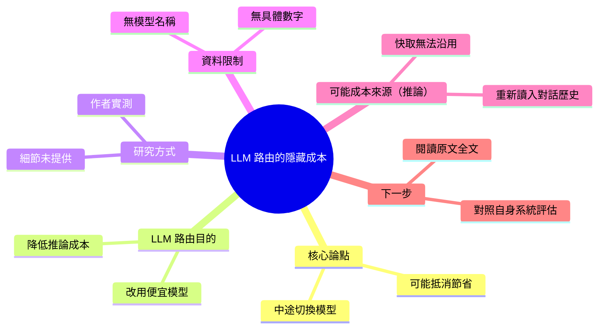

## The Hidden Cost of LLM Routing: Why Switching Models Costs More

在對話中途切換模型，可能抵消較便宜推論所省下的成本。

**Why** LLM routing 的目的通常是省錢，作者實測後想了解為何中途切換模型會讓節省消失。

**How** 作者以實測方式測試 LLM routing。

**What** 節錄未提供具體數字；核心論點是中途切換模型可能抵消 cheaper inference 承諾的節省。

### 重點
- 作者實測 LLM routing，探討為何 session 中途切換模型會抵消節省
- 問題情境：在同一段 session 中換模型，而非單次請求選模型
- 核心論點：切換成本可能超過較便宜推論的省下金額；節錄未提供具體金額

**原文：** [medium-towards-data-science](https://towardsdatascience.com/the-hidden-cost-of-llm-routing-why-switching-models-costs-more/)

---

<!-- deep-analysis:begin -->
## 📌 摘要 (TL;DR)

- 作者實際測試 LLM 路由（LLM routing），探討**在單一對話（session）中途切換模型**，為什麼可能抵消改用較便宜模型推論（inference）帶來的成本節省。
- 核心論點：路由看起來能省錢，但「中途切換模型」本身有隱藏成本，最終可能讓節省消失。
- ⚠️ 目前取得的原文只有一句導言，**沒有提供實驗設定、測試模型、數據或結論細節**，因此本整理無法列出具體數字。
- 值得關注的原因：若你的系統用路由在多輪對話中動態切換模型來降低成本，這篇文章質疑了「換便宜模型就一定比較省」這個前提。

## 🎯 核心概念

- **LLM 路由** (LLM Routing)：依請求內容或條件，把任務分派給不同模型（例如簡單任務給便宜模型）的做法，通常目的是降低成本。
- **中途切換模型** (Switching Models Mid-session)：在同一段多輪對話進行中，把後續回合交給另一個模型處理。
- **推論成本** (Inference Cost)：每次呼叫模型產生回應所需支付的費用。

## 📖 整理分析

### 1. 問題設定
原文導言指出，作者想了解「為什麼在 session 中途切換模型，會抹去較便宜推論所承諾的節省」。也就是說，作者的出發點不是質疑路由本身，而是質疑「多輪對話中切換模型」這種特定用法的成本效益。

### 2. 研究方式
原文僅說明作者是「實際測試（I tested）」LLM 路由。使用了哪些模型、哪個供應商、多少回合、如何計算成本，**取得的內容中沒有提供，無法確定**。

### 3. 結論與數據
標題的結論是「切換模型花費更多（Switching Models Costs More）」。但成本差距多大、在什麼條件下才會發生、是否有反例，**原文節錄都沒有說明**，本整理不補充任何數字。

### 4. 可能的成本來源（推論，非原文內容）
以下是**推論**，原文節錄並未提及：多輪對話切換模型時，新模型通常需要重新讀入完整對話歷史；如果原本的模型有提示快取（prompt caching），切換後快取無法沿用，輸入 token 可能要用全價重新計費。這可能是「隱藏成本」的來源之一，但是否就是作者的論點，需閱讀原文全文確認。

### 5. 讀者行動建議
若你正在設計路由策略，建議閱讀原文全文，取得作者的實驗數據，再對照自己系統的對話長度、切換頻率與計費方式評估。本整理僅能提供問題框架，無法替代原文的實測結果。

## 🧠 Mindmap

<!-- deep-analysis:end -->
### 📄 原文內容

點此展開 / 收合

I tested LLM routing to understand why switching models mid-session can erase the savings promised by cheaper inference 
 The post The Hidden Cost of LLM Routing: Why Switching Models Costs More appeared first on Towards Data Science .

