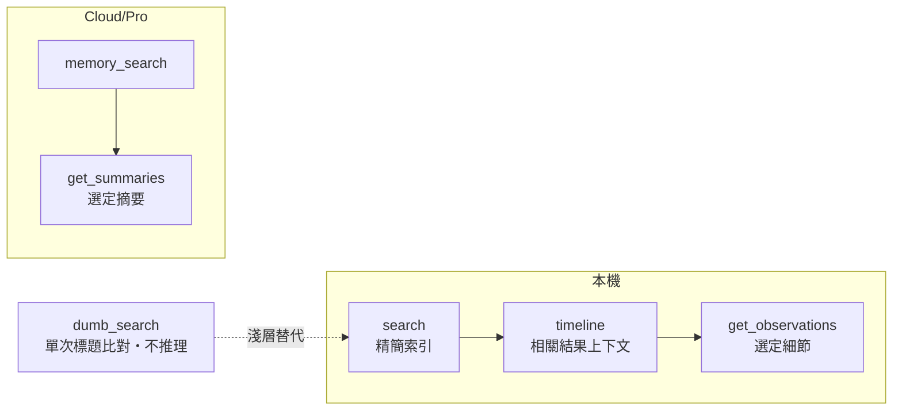
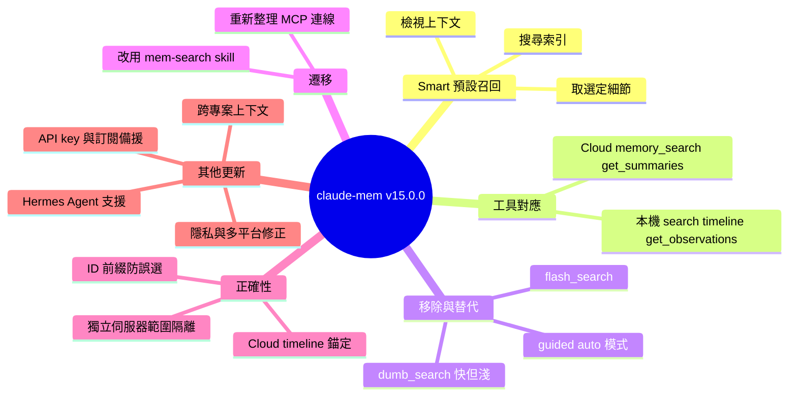

## v15.0.0 — Smart memory search by default

讓 AI 分三步逐層找記憶，每步判斷相關性，不一次全撈。 **How** 先搜尋精簡索引，再檢視相關結果的上下文，最後只抓選定的細節；agent 在每一步之間推理相關性。本機版工具依序為 search → timeline → get_observations，Cloud/Pro 則從 memory_search 開始，並可用 get_summaries 取摘要。 **What** claude-mem v15.0.0 將預設記憶召回改為 Smart 模式，移除 mem_search 的 guided/auto 模式與 flash_search，並保留一次呼叫的 dumb_search（確定性標題比對、不推理相關性，官方稱「快但淺」）。升級後需重新整理 MCP 連線以載入新工具清單。

### 重點
- 預設改為 Smart 三步驟召回：本機為 search → timeline → get_observations，Cloud/Pro 為 memory_search + get_summaries
- dumb_search 為確定性標題比對、不推理相關性，官方建議可靠召回改用 Smart
- 移除 mem_search 的 guided/auto 模式、flash_search 與 continuation cursor，升級後需重新整理 MCP 連線

**原文：** [claude-mem-releases](https://github.com/thedotmack/claude-mem/releases/tag/v15.0.0)

---

<!-- deep-analysis:begin -->
## 📌 摘要 (TL;DR)

- claude-mem v15.0.0 把預設記憶召回（memory recall）改為 **Smart 模式**，流程分三步：先搜尋精簡索引，再檢視相關結果周圍的上下文，最後只抓取選定的細節。agent 會在每一步之間判斷相關性。
- 本機版工具依序為 `search` → `timeline` → `get_observations`。Cloud/Pro 版從 `memory_search` 開始，可再用 `get_summaries` 取得選定的摘要。
- 舊的 `mem_search` guided/auto API、`flash_search` 與延續游標（continuation cursors）全部移除。唯一保留的單次呼叫查詢改名為 `dumb_search`，官方描述是「快，但淺」（Fast, but shallow）。
- 升級後必須重新整理既有的 MCP 連線，客戶端才會載入新的工具清單與描述。
- 自 v14.0.1 以來還有其他更新：新增 Hermes Agent 支援、Anthropic API key 與 Claude 訂閱之間的自動切換，以及跨 Windows、macOS、Codex 等環境的安裝修正。

## 🎯 核心概念

- **Smart 召回** (Smart recall)：分成「搜尋 → 看上下文 → 取細節」三步，每步之間由 agent 推理相關性，而不是一次把所有內容撈回來。
- **dumb_search**：一次呼叫完成的查詢，只做確定性的標題比對（deterministic title matching），不推理相關性。官方建議需要可靠召回時改用 Smart。
- **觀察紀錄** (observation)：claude-mem 中記憶的一種紀錄類型。`get_observations` 用它取回細節，原生記憶查詢也只使用 observation 的索引。
- **mem-search skill**：官方指定用來執行預設 Smart 召回的 skill。

## 📖 整理分析

### 1. 預設改為三步式 Smart 召回
這次的核心變更是記憶召回的預設行為。agent 先搜尋精簡索引，接著檢視相關結果周圍的上下文，最後只抓取選定的細節，並在三步之間判斷相關性。發行說明也提到，本機、Cloud/Pro 與獨立伺服器（standalone server）三種執行環境，各自的說明文字都只描述該環境可用的工具。

### 2. 遷移：舊 API 移除，dumb_search 成為淺層選項
原本 `mem_search` 的 guided/auto 模式、`flash_search` 與延續游標都已移除。開發者有兩種選擇：改走 Smart 流程，或明確選用 `dumb_search` 做淺層查詢。`dumb_search` 的工具描述直接寫著「Doesn't reason about the results. Fast, but shallow. Use Smart for reliable recall.」。另外，既有的 MCP 連線需要重新整理，才能載入新的工具清單。

### 3. 正確性修正
- Cloud 版 timeline 支援以選定的搜尋結果為錨點來取上下文。
- 獨立伺服器的召回範圍限定在它設定的伺服器專案內，不會讀到本機 worker 的記憶。
- 取回選定細節時，若內容過長需要截短，會如實回報截斷範圍，並保留選定紀錄的識別資訊。
- 混合型本機索引會保留 session/prompt 的 ID 前綴，避免後續讀取時誤選到編號相同但類型不同的紀錄。
- 安裝提示、公開文件、整合說明與自動產生的記憶指引，全部統一採用 Smart 優先的政策。

### 4. 自 v14.0.1 以來的其他變更
- **新整合**：新增 Hermes Agent 的記憶支援與安裝流程，並能安全處理既有的 YAML 設定。
- **供應商切換**：Anthropic API key 與 Claude 訂閱之間可以互相備援，會分類配額狀態，並在訊息邊界時切回主要供應商。
- **效能**：本機讀取上下文時，worker 的 HTTP 請求仍保持回應；大範圍全文備援搜尋設有上限；移除了二次方複雜度的標籤剝除卡頓。
- **記憶正確性**：`type="all"` 會搜尋所有類別；刪除 observation 時會一併移除對應的 Chroma 文件；Chroma 意外結束時會拒絕待處理的請求；Windows 上 checkpoint 改名失敗時會保留前一份 checkpoint。

### 5. 隱私與相容性強化
- **隱私**：完全私密的 prompt 不再被存成使用者請求；金鑰遮蔽可處理結尾的破折號；內部的 Grok 研究摘要不會被當成使用者的工作；能辨識多語言的工作請求；OpenRouter 的欄位精簡會避免不必要的推理。
- **安裝與執行**：改善了 Windows、macOS、Conda、Qoder、Goose、OpenCode、Antigravity、Codex、TeamBrain 等環境的可靠性。修正項目包括啟動器自我遞迴、工作目錄處理、過期暫存目錄清理、驗證與缺少執行環境時的錯誤訊息，以及 host hook 註冊。
- **跨專案上下文**：新增選用設定 `CLAUDE_MEM_CONTEXT_PROJECTS=all`。

## 🧭 流程圖 / 架構圖

## 🧠 Mindmap

<!-- deep-analysis:end -->
### 📄 原文內容

點此展開 / 收合

Smart memory search by default 
 Memory recall now defaults to Smart: search the compact index, inspect context around relevant results, then fetch only the selected details. The agent reasons about relevance between these three steps. Local, cloud/Pro, and standalone-server instructions describe the tools available in that runtime. 
 The optional one-call lookup is now dumb_search . Its description is explicit: “Doesn’t reason about the results. Fast, but shallow. Use Smart for reliable recall.” It performs deterministic title matching and does not reason about relevance. 
 Migration 
 
 Use the mem-search skill for default Smart recall. Local tools are search → timeline → get_observations ; Cloud/Pro starts with memory_search and can fetch selected summaries with get_summaries . 
 Replace calls to the old mem_search guided/auto API and flash_search with the Smart workflow, or explicitly choose dumb_search for a shallow lookup. Auto/guided modes and continuation cursors are removed. 
 Refresh existing MCP connections so clients load the new tool catalog and descriptions. 
 
 Correctness 
 
 Cloud timeline supports context anchored to a selected search result. 
 Standalone-server recall stays scoped to its configured server project rather than reading a local worker's memory. 
 Selected-detail output reports its bounds honestly and preserves selected record identities when long content must be shortened. 
 Native memory lookup uses observation-only indexes, and mixed local indexes retain session/prompt ID prefixes so follow-up reads cannot select a different record kind with the same number. 
 Installer prompts, public documentation, integration instructions, and generated memory guidance use the same Smart-first policy. 
 
 Other changes since v14.0.1 
 
 Added Hermes Agent memory support and installation, including safe handling of existing YAML configuration. 
 Added fallback between an Anthropic API key and the Claude subscription, with quota classification and recovery back to the primary provider at a message boundary. 
 Kept worker HTTP requests responsive during local context reads, bounded broad full-text fallback searches, and removed quadratic tag-stripping stalls. 
 Improved memory correctness: type="all" searches every category, deleted observations remove their Chroma documents, unexpected Chroma exits reject pending requests, and failed Windows checkpoint renames preserve the previous checkpoint. 
 Tightened privacy and request handling: fully private prompts no longer become stored user requests; key redaction handles trailing dashes; internal Grok research briefs do not become user work; multilingual work requests are recognized; and OpenRouter field condensation avoids unnecessary reasoning. 
 Improved installation and runtime reliability across Windows, macOS, Conda, Qoder, Goose, OpenCode, Antigravity, Codex, and TeamBrain. Fixes include launcher self-recursion and working-directory handling, stale temporary-directory cleanup, actionable authentication and missing-runtime errors, and correct host hook registration. 
 Added optional cross-project context with CLAUDE_MEM_CONTEXT_PROJECTS=all , corrected folder context ordering and glob matching, expired orphaned summary spool entries, and improved effective-data-directory log lookup and cloud authentication telemetry. 
 
 Validation and delivery identities are recorded separately in the release receipt after the final builds, deployment, and package checks complete.

