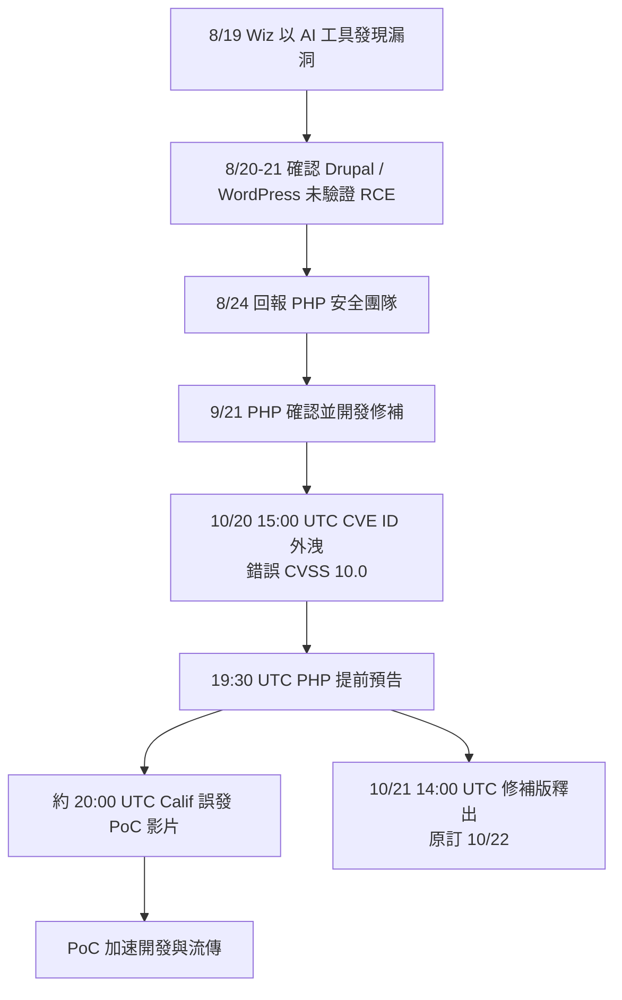
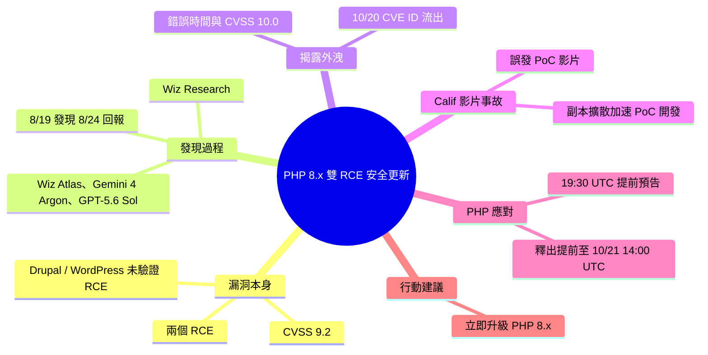

## Today's PHP Security Release, and How We're Strengthening PHP Security

PHP 發布修補兩個遠端程式碼執行漏洞的安全更新，但協調揭露流程外洩，漏洞利用程式已在流傳。

**Why** CVE 編號於 10 月 20 日約 15:00 UTC 在論壇與社群流出，附帶錯誤的發布時間與 CVSS 10.0（實際為 9.2）；之後 Calif 誤發布的 PoC 影片更加速了各種 PoC 的開發。

**How** PHP 專案將預告提前到 19:30 UTC，並把釋出時間從 10 月 22 日提前至 10 月 21 日 14:00 UTC。

**What** 更新涵蓋整個 PHP 8.x，修補兩個 RCE，使用 PHP 的人需立即升級。發現者 Wiz Research 於 8 月 19 日以 Wiz Atlas、Gemini 4 Argon 與 GPT-5.6 Sol 發現第一個漏洞，並確認可對 Drupal 與 WordPress 進行未經驗證的 RCE。

### 重點
- PHP 8.x 全系列更新修補兩個 RCE，CVSS 實際為 9.2（外流資訊誤傳 10.0）
- 協調揭露外洩：10 月 20 日約 15:00 UTC CVE 編號流出，釋出日由 10 月 22 日提前到 21 日 14:00 UTC
- Wiz Research 8/19 以 Wiz Atlas、Gemini 4 Argon、GPT-5.6 Sol 發現漏洞，8/24 通報 PHP，9/21 PHP 確認並著手修補

**原文：** [simon-willison](https://simonwillison.net/2026/Oct/21/php-security-release/)

---

<!-- deep-analysis:begin -->
## 📌 摘要 (TL;DR)

- PHP 發布涵蓋整個 PHP 8.x 系列的安全更新，修補兩個遠端程式碼執行（remote code execution，簡稱 RCE）漏洞。Simon Willison 呼籲所有跑 PHP 的人立即升級。
- 協調揭露（coordinated disclosure）流程外洩：10 月 20 日約 15:00 UTC，兩個 CVE 編號在論壇與社群流出，並附帶錯誤的發布時間與錯誤的 CVSS 分數 10.0（實際為 9.2）。外洩內容不含技術細節。
- PHP 專案於 19:30 UTC 提前發出預告，並把正式釋出從 10 月 22 日 14:00 UTC 提前到 10 月 21 日 14:00 UTC。
- 回報漏洞的資安公司之一 Calif 誤發一支 PoC 影片，片中透露了少量額外細節。影片刪除後副本仍在社群流傳，加速了各方 PoC 的開發；原文指出，從前一晚起已有漏洞利用程式在流傳。
- 第一個漏洞由 Wiz Research 於 8 月 19 日發現，使用的工具是 Wiz Atlas、Gemini 4 Argon 與 GPT-5.6 Sol。隔兩天內即確認可對 Drupal 與 WordPress 發動未經驗證的 RCE。

## 🎯 核心概念

- **協調揭露** (Coordinated Disclosure)：研究者先私下通報維護方，等修補版本就緒後才公開，目的是讓使用者在漏洞細節曝光前完成升級。
- **CVE**：公開漏洞的統一編號。本次外洩的正是兩個 CVE ID。
- **CVSS**：漏洞嚴重度評分。外洩訊息誤稱 10.0，官方實際評分為 9.2。
- **概念驗證** (Proof of Concept，簡稱 PoC)：證明漏洞可被利用的示範程式或展示。
- **未經驗證的遠端程式碼執行** (Unauthenticated RCE)：攻擊者不需登入，就能在目標伺服器上執行任意程式碼。

## 📖 整理分析

### 1. 漏洞嚴重度與影響範圍
本次更新涵蓋整個 PHP 8.x 系列，修補兩個 RCE。Wiz Research 在發現漏洞後的兩天內，就分別確認了對 Drupal（8 月 20 日）與 WordPress（8 月 21 日）的未經驗證 RCE。這代表兩大主流 PHP CMS 都在攻擊面內。官方 CVSS 為 9.2。原文未列出具體受影響的版本號與 CVE 編號。

### 2. 原本規劃的揭露時程
根據 Wiz 的時間線：8 月 19 日發現首個漏洞，8 月 24 日回報 PHP 安全團隊，9 月 21 日 PHP 確認並開始開發修補，原定修補版與公開揭露同步進行。PHP Foundation 的說明顯示，原訂的正式釋出時間是 10 月 22 日 14:00 UTC。

### 3. 外洩如何打亂流程
10 月 20 日約 15:00 UTC，CVE ID 先在網路流出，附帶的發布時間與 CVSS 都是錯的，但沒有技術細節。PHP 因此在 19:30 UTC 提前預告，並把釋出提前一天。約 20:00 UTC，Calif 誤發 PoC 影片，片中展示 PoC 攻擊多個目標，也透露了少量漏洞細節。影片雖已刪除，副本仍持續擴散，導致 10 月 21 日各種 PoC 加速出現並廣泛流傳。

### 4. AI 在漏洞研究中的角色
Wiz 明確列出，首個漏洞是靠 Wiz Atlas、Gemini 4 Argon 與 GPT-5.6 Sol 發現的。Simon Willison 也替這篇加上 ai-security-research 標籤。原文沒有說明這些工具各自負責哪一部分，也沒有交代第二個漏洞是由誰、用什麼方法發現。

### 5. 給讀者的行動建議
原文的結論很直接：只要有任何服務跑在 PHP 上，就必須立刻升級。理由是 PoC 已經公開流傳，原本預留給使用者的修補窗口已被外洩壓縮。PHP Foundation 的文章標題提到「如何強化 PHP 安全」，但 Simon 的摘錄沒有包含具體的改進措施，本文無法確定其內容。

## 🧭 流程圖 / 架構圖

## 🧠 Mindmap

<!-- deep-analysis:end -->
### 📄 原文內容

點此展開 / 收合

Today&#x27;s PHP Security Release, and How We&#x27;re Strengthening PHP Security 
If you're running anything on PHP it's vital you upgrade - today's updates (across the entire PHP 8.x line) address two remote code execution holes, and there have been exploits circulating since last night, thanks to a leak in the coordinated disclosure process. 
 This post from the PHP Foundation explain what went so wrong: 
 
 On Tuesday, October 20th, at around 15:00 UTC, the two CVE IDs began circulating on online forums and social media. They came with a wrong release time and a wrong CVSS score of 10.0 (the actual score is 9.2). No technical details leaked. In response, the PHP project brought its pre-announcement forward and published it at 19:30 UTC . It also moved the release from October 22nd, 14:00 UTC, to October 21st, 14:00 UTC [...] 
 As a result of the leak and pre-announcement around 20:00 UTC, Calif, one of the security firms that had reported the issues mistakenly published a video. It showed their proof of concept working against a number of targets and revealed a few additional, though limited, details about the vulnerabilities. Copies of the deleted video started circulating on social media soon after. The video contributed to accelerated development of various PoCs (exploitation proof of concepts), which then increased circulation on October 21st. 
 
 This article from the team that discovered the original vulnerability includes a more detailed timeline of the original intended responsible disclosure: 
 
 
 August 19, 2026: Wiz Research discovers the first PHP vulnerability using Wiz Atlas, Gemini 4 Argon, and GPT-5.6 Sol. 
 August 20, 2026: Unauthenticated RCE is confirmed against Drupal. 
 August 21, 2026: Unauthenticated RCE is confirmed against WordPress. 
 August 24, 2026: Wiz Research reports the vulnerabilities to the PHP security team. 
 September 21, 2026: PHP acknowledges the reports and begins developing a coordinated fix. 
 October 21, 2026: Patched PHP releases become available. 
 October 21, 2026: Public disclosure. 
 
 

 Via Hacker News 

 Tags: open-source , php , security , ai , ai-security-research

