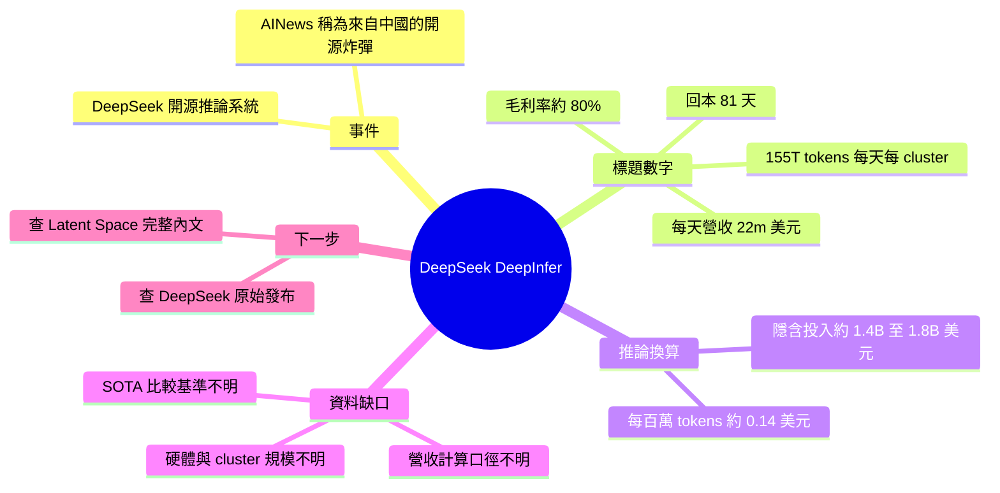

## [AINews] DeepSeek DeepInfer: Open Source SOTA Inference running 155T toks/day/cluster making $22m/day at ~80% margin for a 81 day payback

據標題，DeepSeek 開源了一套推論系統 DeepInfer，並公布驚人的吞吐量與利潤數字。 **What** Latent Space AINews 將其形容為來自中國的開源「炸彈」。標題給出的數字：單一 cluster 每天處理 155T tokens、每天營收 $22m、毛利率約 80%、回本期 81 天。內文僅有一句摘要，這些數字皆來自標題，原文未提供其他細節。

### 重點
- DeepSeek DeepInfer 為開源推論系統，標題宣稱達 SOTA
- 標題數字：每個 cluster 每天 155T tokens、每天 $22m、約 80% 毛利
- 標題宣稱回本期為 81 天

**原文：** [latent-space](https://www.latent.space/p/ainews-deepseek-deepinfer-open-source)

---

<!-- deep-analysis:begin -->
## 📌 摘要 (TL;DR)

- **資料限制**：原文 body 只有標題和一句副標「An open source "bomb" drops from China」，沒有技術細節、架構說明或數據來源。以下內容只依據這兩行文字。
- **核心事件**：根據標題，DeepSeek 開源了一套推論（inference）系統，名為 **DeepInfer**，Latent Space AINews 稱它為 SOTA 等級的開源推論方案。
- **標題數字**：單一 cluster 每天處理 **155T tokens**，每天營收 **$22m**，毛利率約 **80%**，回本期（payback）**81 天**。
- **原文沒交代的事**：這些數字是 DeepSeek 自己公布的還是 Latent Space 估算的、硬體配置、cluster 規模、定價假設，原文都沒有說明，無法確定。
- **值得關注的原因**：如果數字屬實，代表開源推論堆疊的經濟效益可以達到很高的毛利水準。不過要判斷可信度，需要回頭查 DeepSeek 的原始發布。

## 🎯 核心概念

- **DeepInfer**：根據標題，是 DeepSeek 推出的開源推論系統名稱。原文沒有描述它的內部設計。
- **回本期** (Payback Period)：投入成本靠營運利潤收回所需的天數。標題給的是 81 天。
- **毛利率** (Margin)：營收扣除直接成本後的比例。標題給的是約 80%。

## 📖 整理分析

### 1. 原文實際提供的內容
這則 AINews 的 body 只有標題和一行副標，把這件事形容為來自中國的開源「炸彈」。正文沒有展開，所以 DeepInfer 的技術做法、支援的模型、部署方式，都**沒有足夠資料**可以整理。

### 2. 標題數字的拆解（推論）
以下是**依標題數字自行換算的推論**，原文沒有給出：
- 每天營收 $22m ÷ 155T tokens，約等於每百萬 tokens **$0.14** 的平均營收。
- 毛利率 80% 代表每日直接成本約 **$4.4m**，每日毛利約 **$17.6m**。
- 若回本期 81 天是用每日毛利計算，隱含的初始投入約 **$1.4B**。若是用每日營收計算，則約 **$1.8B**。原文沒有說明計算口徑，所以這個數字無法確定。

### 3. 尚待查證的問題
- 「155T toks/day/cluster」的 cluster 指多少張加速卡、哪一種硬體，原文未說明。
- $22m/day 是實際營收，還是用 API 牌價推算的理論值，原文未說明。
- 「SOTA」比較的對象和基準，原文未說明。

要確認以上幾點，建議查閱 DeepSeek 官方的 GitHub 或技術報告，以及 Latent Space 完整電子報。

## 🧠 Mindmap

<!-- deep-analysis:end -->
### 📄 原文內容

點此展開 / 收合

An open source &#8220;bomb&#8221; drops from China

