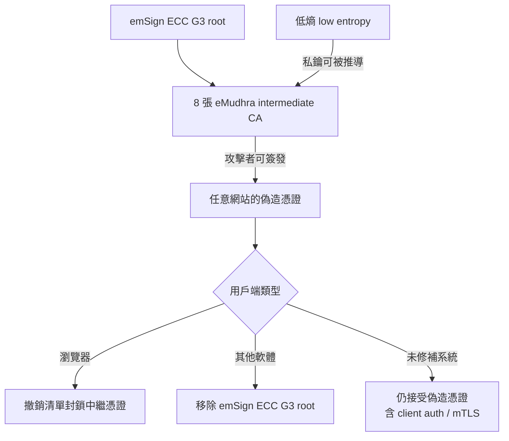
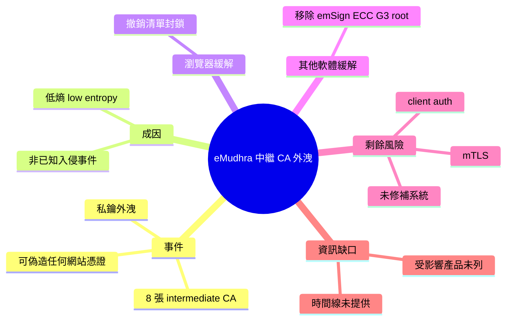

## eMudhra Intermediate CA Compromise

一家憑證機構的 8 把中繼 CA 私鑰因亂數不夠隨機而外洩，攻擊者可偽造任何網站憑證。 **Why** 憑證機構是網路信任的根基，私鑰外洩代表可冒充任何網站。 **How** 金鑰是因低 entropy 被推導出來，而非經由已知的入侵事件。 **What** eMudhra 的 8 張 intermediate CA 憑證私鑰遭洩；瀏覽器以 revocation list 封鎖，其他軟體則需移除 emSign ECC G3 root。未修補的系統仍暴露於偽造憑證風險，包括 client auth 與 mTLS。

### 重點
- 8 張 eMudhra intermediate CA 憑證私鑰因低 entropy 洩漏
- 瀏覽器用 revocation list 封鎖；其他軟體須移除 emSign ECC G3 root
- 未修補系統仍受偽造憑證影響，含 client auth 與 mTLS

**原文：** [infoq-main](https://www.infoq.com/news/2026/10/emudhra-ca-compromise/?utm_campaign=infoq_content&utm_source=infoq&utm_medium=feed&utm_term=global)

---

<!-- deep-analysis:begin -->
## 📌 摘要 (TL;DR)

- eMudhra 旗下 **8 張中繼憑證機構（intermediate CA）憑證**的私鑰已遭外洩，持有者可替**任何網站**簽發偽造憑證。
- 私鑰外洩的原因是**低熵（low entropy）**，也就是產生金鑰時的隨機性不足，使私鑰可被推導出來；原文指出這**並非源自已知的入侵事件（breach）**。
- 瀏覽器透過**撤銷清單（revocation lists）**封鎖這些中繼憑證；其他軟體則必須直接移除上層根憑證 **emSign ECC G3 root**。
- **尚未修補的系統**仍可能接受偽造憑證，影響範圍不只網站 TLS，也包含**用戶端驗證（client auth）**與 **mTLS**。
- 原文作者為 Chris Swan（InfoQ）。⚠️ 取得的原文內容只有摘要段落，沒有提供受影響產品清單、時間線、發現者或 eMudhra 的回應。本整理不補寫這些細節。

## 🎯 核心概念

- **中繼憑證機構** (Intermediate CA)：由根憑證簽發、實際替終端網站簽發憑證的 CA。只要它的私鑰外洩，攻擊者就能簽出被信任鏈接受的憑證。（此為 PKI 一般背景說明）
- **熵** (Entropy)：產生金鑰時隨機性的來源。熵不足會讓金鑰變得可預測或可推導。本事件中私鑰就是因此外洩。
- **根憑證** (Root Certificate)：信任鏈的最上層。本事件涉及的根憑證是 emSign ECC G3。
- **撤銷清單** (Revocation List)：列出不再受信任的憑證。原文指出瀏覽器是用這個機制封鎖受影響的中繼憑證。
- **雙向 TLS** (mutual TLS，簡稱 mTLS)：伺服器與用戶端雙方都要出示憑證來驗證身分。原文特別點名這類情境同樣暴露在風險中。

## 📖 整理分析

### 1. 事件本身：8 把中繼私鑰外洩
受影響的是 eMudhra 的 8 張 intermediate CA 憑證。依原文說法，攻擊者拿到這些私鑰後可以「為任何網站偽造憑證」。換句話說，風險不限於 eMudhra 自己的客戶，而是任何信任這條憑證鏈的系統都可能被冒充。

### 2. 成因：低熵，而非入侵
原文強調，私鑰是因為 low entropy 而被揭露，並不是透過已知的入侵事件。這代表問題出在金鑰產生環節的隨機性品質，而不是有人闖進系統偷走金鑰。原文沒有說明是哪個元件或流程造成熵不足，也沒有說明是誰、在何時發現的。

### 3. 緩解方式分兩條路
瀏覽器的處理方式是用撤銷清單封鎖這 8 張中繼憑證。至於其他軟體，原文的描述是「必須移除 emSign ECC G3 root」。也就是說，不使用瀏覽器撤銷機制的軟體，只能拔掉整個根憑證，影響範圍比只撤銷中繼憑證更大。原文沒有列出具體是哪些軟體或作業系統。

### 4. 剩餘風險：未修補系統與 mTLS
沒有更新撤銷資料、也沒有移除該根憑證的系統，仍然可能接受偽造憑證。原文特別提到 client auth 與 mTLS。推論：這類情境常見於服務之間的內部通訊或 API 驗證，通常不走瀏覽器的撤銷機制，因此更可能被忽略。這一點是依原文點名的情境所做的推論，原文並未展開說明。

## 🧭 流程圖 / 架構圖（可選）

下圖依原文資訊整理信任鏈與兩種緩解路徑（受影響產品細節原文未提供）：

## 🧠 Mindmap

<!-- deep-analysis:end -->
### 📄 原文內容

點此展開 / 收合

Private keys for eight eMudhra intermediate CA certificates have been compromised, allowing attackers to forge certificates for any site. The keys were revealed due to low entropy, not through a known breach. Browsers blocked them using revocation lists, but other software had to remove the emSign ECC G3 root. Unpatched systems remain exposed to forged certificates, including client auth and mTLS. By Chris Swan

