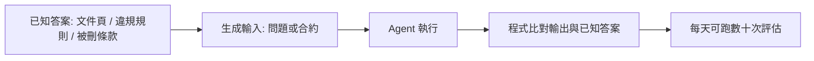
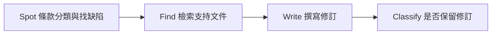
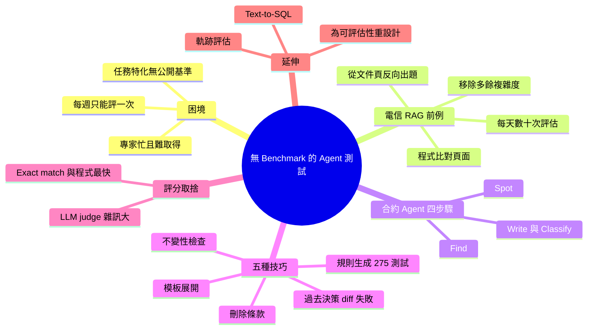

## How to Test AI Agents When No Benchmark Exists — Nathanael Weill, Air Canada

沒有 benchmark 時，先埋好已知答案，再看 agent 能不能找回來。

**Why** 領域專家很忙，每週只能評一次，沒有公開 benchmark 可用，agent 改了也不知道有沒有變好。

**How** 反轉問題：先從一頁文件讓 LLM 出題，再用程式比對 agent 找到的是不是原頁，不需要意見也不需要 LLM judge。Air Canada 合約分析把這個概念延伸成五種技巧：比對過去決策、依規則生成合約、拿簽好的合約刪掉條款、不變性檢查、用模板產生大量案例。

**What** 在電信 RAG 專案，評估從每週一次變成每天數十次，也因此能拿掉不必要的複雜度。在 Air Canada 供應商合約專案，產生了 275 個規則測試；刪除條款法被認為最有威力，結果顯示 agent 漏掉多數被刪的條款。作者提醒 LLM judge 的雜訊幾乎和待測 agent 一樣難處理，專家回饋應拿來改進測試，而不是直接改 agent。

### 重點
- 答案優先（answer-first）：先植入已知答案/缺陷，再讓 agent 找回來，可用程式（exact match）評分而非 LLM judge
- 五種技巧：past decisions diff、依規則生成、刪除條款、不變性（改供應商名稱/順序不應影響結果）、模板填空組合；模板法回饋週期約 4 週，評估腳本約 5 分鐘
- 評估頻率從每週一次升到每天數十次；測試集用來指引開發，不等於上線與否的 go/no-go 判斷

**原文：** [youtube-ai-engineer](https://www.youtube.com/watch?v=c_SPW__jF9w)

---

<!-- deep-analysis:begin -->
## 📌 摘要 (TL;DR)

- Air Canada 的 Nathanael Weill 分享：當 agent 任務高度特化、**沒有公開 benchmark**、領域專家又難以取得時，如何建立可自動化的評估。
- 核心手法是**反轉問題**：先埋好已知答案，再看 agent 能否找回來，盡量用程式比對評分，而不是靠專家意見或 LLM judge。
- 2024 年在電信 RAG 專案（約 10,000 份文件）中，評估頻率從**每週 1 次**提升到**每天數十次**。團隊也因此拿掉不必要的複雜度，準確率逐週上升。
- 2026 年 Air Canada 供應商合約分析專案延伸出五種技巧，其中依規則生成合約共產生 **275 個測試**。專家回饋週期原本約 **4 週**，改用腳本後約 **5 分鐘**就能跑完評估。
- 刪除條款測試顯示，agent **漏掉了多數被刪除的條款**。講者也強調 LLM-as-a-judge 的雜訊幾乎和待測 agent 一樣難處理。

## 🎯 核心概念

- **反轉評估** (Inverting the problem)：先有答案（例如某一頁文件、某條違規條款），再生成輸入讓 agent 去找，答案已知就能用程式評分。
- **埋入問題** (Planting the problem)：在合約中刻意製造違規或缺漏，檢查 agent 是否標記出來。
- **不變性檢查** (Invariance check)：改動不應影響結果的部分（供應商名稱、地址、條款順序），或重跑同一份合約，確認輸出一致。
- **LLM 評審** (LLM-as-a-judge)：用 LLM 評分 agent 輸出。講者認為它雜訊太大，盡量避免使用。
- **軌跡評估** (Trajectory evaluation)：檢查 agent 呼叫 endpoint 的順序是否符合預期。

## 📖 整理分析

### 1. 問題：沒 benchmark 也沒專家
Air Canada 的 AI 團隊服務營運、企業、商務、會員忠誠計畫等部門，任務特化到找不到公開 benchmark 可用。資料科學家會建 agent，但不是領域專家，而專家分散在各事業單位、本身就很忙。結果是 agent 改一版只要幾分鐘，評估卻要等很久。

### 2. 前例：電信 RAG 的反轉評估
講者在前一家公司幫電信工程師做 Q&A 助理，文件約 10,000 份，還有大量供應商文件。當時共有 2 個外部團隊和 1 個內部團隊分段競爭。原本每週開一次會，把 5 個 chatbot 投在大螢幕上讓專家比較，但專家意見常常不一致，每週也只能試一個方案。

講者觀察到，只要找對頁面，約 90% 的情況答案就會正確。所以團隊改成：從一頁文件請 LLM 出題，再讓 agent 去檢索，最後用程式比對找到的是不是原頁。講者強調這不是他發明的方法。改用之後評估變成每天數十次，也發現論文裡的許多複雜技巧並沒有幫助，有時還會弄壞原本正常的功能。真正有效的是選對 embedding model、chunking 方式和 BM25 的 alpha。講者的結論是：**不能評分的 agent，就無法改進**。

### 3. Air Canada 合約 agent 的四步驟
2026 年的專案是分析供應商合約。漏看條款會讓公司承擔風險，審查太慢又會拖延供應鏈，加上律師時薪高，人工審查成本很大。agent 分成四步：找出條款並分類到各領域、檢查缺陷，接著找支持修訂的文件、撰寫修訂，最後分類是否保留這項修訂。其中檢索文件那一步已經可以沿用 RAG 的評估法，其餘步驟需要新的方法。

### 4. 五種埋答案技巧
1. **比對過去決策**：拿原始合約與簽約版本做 diff，agent 應標出相同的修改。但團隊沒有保存各版本合約，這個方法**行不通**。
2. **依規則生成合約**：例如「上限超過 100 萬美元」這類規則，生成刻意違反規則的條款和合約，看 agent 是否標記。規則來自專家和內部文件，團隊也自行補充，但無法保證涵蓋所有情況。最後產生了 275 個答案已知的測試。
3. **刪除條款**：從已簽約的合約中刪掉一條條款，並混入不應被標記的正常合約。這個任務很難，因為不同供應商的模板不同。講者稱它是目前最有威力的方法，結果發現 agent 漏掉了多數被刪除的條款。
4. **不變性檢查**：更換名稱或地址、打亂條款順序、重複執行同一份合約，結果都應該一致，而且全部可以用程式檢查。
5. **模板展開**：專家本來就在用含空白欄位的模板。團隊為每個空白準備一組候選值，組合出大量合約，每一組是否違規事先就知道。講者在開場時稱這個方法最有威力但也最難。

### 5. 評分方式的取捨與延伸
評分方式從快到慢依序是：exact match、程式檢查、LLM-as-a-judge。講者表示 LLM judge 的雜訊和待測 agent 一樣多，要找到合適的 prompt 和 harness 幾乎跟解決原問題一樣難。他們試過事實查核等方法，但在這個專案中沒有找到可行的設定。

其他延伸做法包括：軌跡評估（依 endpoint 呼叫順序生成情境，再檢查 trace）和 text-to-SQL。講者也提到，有時他們會**為了能被評估而重新設計 agent**，即使偏離原本的架構也值得。（註：字幕在結尾處中斷，後續內容無法確認。）

## 🧭 流程圖 / 架構圖

## 🧠 Mindmap

<!-- deep-analysis:end -->
### 📄 原文內容

點此展開 / 收合

[music] >> Thank you for joining this station. It's a bit of an emotional one. My name is Nathaniel. And I'm a non-evaluator. It's been a lot of time since the last agent I've been shipping without any evaluation. And today I want to tell you the story how I quit this addiction of shipping an agent without any evaluation. So, I'm working at Air Canada. So, compared to the previous talk, it's more like focus on specific business. I joined Air Canada in June of this year. And Air Canada is a huge company. We work in operation, corporate, commercial, and loyalty. Each of those segments have their own challenges. So, my team is in charge of delivering AI solution for all of those. And the problem when we tackle task we create an agent for a task that is so specific, we don't have any public benchmark we can rely on. And that's the main main problem we I'm trying to address in this presentation. More importantly, it's not that we don't have a benchmark, is we are data scientists that can build agents or AI engineers that can build agents, but we are not domain experts. And those domain experts sit in different business units. And they are very busy in their own task. And we have a limited access to that. So, both of those things went together in a situation where it's very hard for us to build any evaluation or any any benchmark for our task. So, before going to Air Canada, I was working for a different company. It was a company that and the task was to build a a Q&A assistant for telecommunication engineer. So, I don't know if you're familiar with the domain. The telecommunication is a huge domain. There is about 10,000 documents. A lot of vendor documents on top of that. There's a logic to know which document you should you should find in order to answer the question. So, it's it's a bit of a complex task. And then 2024, everybody wanted to build RAGs. So, we started to do that. Yeah, on LinkedIn it's super easy. It's not. So, um The thing is when we tackle this project, the same problem as at Air Canada, we don't have access to expert. We have the limited access to experts. And we we could not actually grade the answer ourselves. So, that's the the problem I I want to talk today. Funny enough, uh we were in competition with other teams. Um, two external, one internal. It's not like in parallel, but in segments. And our solution actually worked. What mean worked is actually delivering the value. The people liked the solution, actually used it. Uh, but to be honest, I don't know why we actually made it work compared to the other the other team. So, today I'm just going to show what I actually did or my team actually did to make it work. Um, so the the all have the same document, same task, everything is the same, but our solution somehow worked. So, for those that are familiar with RAGs, um the principle is very is is to ask a question to the system, the system found the the relevant documents, based on this relevant document, formulate an answer. It's something that exists for a long time now. And for those that actually tried it, if you found the right page or the right documents, 19 90% of the time you have actually the right answer. So, the challenge to find the right documents, at least in this task. So, we created a very complex pipeline that get complexified over time if you publication if you found publication back in the time this everybody has an amazing technique to improve the the solution. We try them. It's actually didn't improve the solution. So, on paper it worked for them for the publication but for us it didn't really help. And more importantly when we add complexity, we found that like we break something else. So, something that used to work now is not working anymore. And that's actually the the real problem. So, we can add and more we can get more ideas on into solving the different problems but we we keep continue we keep breaking things over and over. So, complexity doesn't always help. And the other problem is this one. Uh we can change an agent in few minutes, add a certain layer of query writing or whatever reasoning step. But to grade that, we had those crazy meeting once a week with experts. We put a giant giant screen with five different chatbot, ask the same question to all of them and ask the the expert to grade them. I prefer this one, I prefer this one. And funny enough they're not always agreeing. It's very hard when you when you put expert to explain the room you get three opinions. So, that's the the the problem we were facing. And so, our budget was we can try one solution a week and this was not enough to go fast. So, the before uh going further so, the the the the process was the following. We ask we ask a question the agent answer. We ask the expert to read. Sometimes they don't know the answer. They have to look up. It takes a lot of time. And we had the budget of one trial a week. Um, so there is nothing new here. This abiding that is well known is we reverse the problem. So we start with a page. We ask an LLM to write a question about this page, which is uh an easy task. We ask the agent to search for this answer and compare to what the agent found, compared to the to the page that has been used for to generate the question. We can actually use code to grade that. And no longer opinions, no longer anything. We can automate this task. And that allow us to go much much faster. So for those that work in rags, there is plenty of implementation of this thing. I didn't invented it. I just found it very very uh very smart. And it stick to me. Like why this principle cannot be applied to other task? So the impact of that is we went from one evaluation a week to dozens a day. And we start to see the the accuracy of the the the grading from the expert going up and up. And actually removing a lot of complexity help. Like we didn't need a lot of those. And focusing on the right uh embedding model, the right chunking, the right alpha in the BM25 uh is the right thing to do. And we we saw the we saw the the accuracy increasing over over weeks. >> [snorts] >> So I don't know why we succeeded, but I'm pretty sure the other team didn't had any test set. So they were using this kind of long loop with expert maybe a much more expert than we had access to. But we had it uh we had this test set. And my learning from this uh back in 2024 is if you cannot grade the agent, uh you can't make it better. So that stick to me until this day has been 2 years now. And I want to go back to Air Canada now. Where we have a different project. So in 2026 the project is about analyzing supplier contract. So you can imagine Air Canada has a lot of suppliers. We get a lot of those contract. There's expert looking at them one by one. Checking each of those clauses. And they have to analyze it and provide a feedback. Like this clause is not compliant. This clause needs to be rewritten. Like there's a lot of work to do that. It's a very long task and very costly because if we need the if we need some supplier to deliver right now and we don't, then it cause a lot of delay in the in the chain. And if we miss a clause, it's also very costly because at at the end of the day it can backfire to us. So it's a tricky problem. Um and they came to me I mean to the to the data science team to build an agent that can actually do that for them. So can we automatize this task? And obviously there's a lot of documents, a lot of rules, a lot of things to consider when you do that. Uh expert are super busy. You can imagine the price of of a lawyer by hour. And there's no benchmark for that. We cannot go on the web and found documents I found an existing benchmark we can apply. So go back to the same problem as I was in 2024. Uh cycle were super slow and we knew that we want to be there in a in a in in a in a in a shape where we can go fast and try and try and try. Um and I knew that if we if we learn to this situation, we can have a better trajectory in term of accuracy. And that What the challenge for this uh for this project? So, the the problem is creating the answer from documents is a well-known and defined thing in the rags, but for this specific project, there's no guy in the world that say, "Hey, you should use this technique. You should use this technique." So, we try to think how we can reapply the same mechanism from what I learned on rag to this specific project. And we have plenty of project at Air Canada. So, we're using the same concept of getting the answer first and then try the agent to find it back. So, going into the details, uh it's a bit simplified, but actually the um the agent has four steps. Uh we need to spot the clause in the contract. We need to find the relevant documents to support an amendment. Uh we need to write the the amendment. And then at the end, there's a classification system that tells you should we keep it or not uh this amendment. So, the first step, for example, spot is classifying all the section of the contract into specific domain domains. And then found if there's a defect or there's a change to be to be done in this section. So, we did have this trick from the rag. So, we know how to find the documents. So, this is covered. Uh but for the other other section of the um of the agent, we didn't have anything. So, I going to present five different techniques that we use in this project or we try to use in this project. That is trying to address this specific problem. My goal is not to show off. My goal is to get you inspired in how to reapply those techniques in your own uh challenges. So, the first one is to use past decision and answer. So, we we you can retrieve past contract, compare with the one that has been changed. The second one is to choose something you're looking for, write the contract around or generate the contract. The third one is uh take a good contract that has been signed and break it. Um the fourth one is about things that should not change no matter what you do, you should not get more flags. And the fifth one is actually the most powerful. It's very hard. It's to turn an example into many using the concept of templates. So, immediately we jump into this approach. Uh we ask the expert to provide us the original contract, the one that has been signed. We're going to take that, do a diff like you do in the code, compare what has been changed, and the agent should should provide the same exact flags. That would be perfect. However, for many reason, our our team do not keep all the contract. Um they don't keep the original one, they just keep the last one, they don't have all the version of the contracts. It sometimes goes into negotiation, there is a lot of things. So, we could not have any of those pairs of contracts, so this thing doesn't work. Okay, second one. We took a rule. And so, that's changing a bit the topic. Um instead of creating um flags or creating an agent that can provide flags, we start from rules. And the rule is, for example, we have the the cap above $1 million. So, that's every contract that Arcada should follow this rule or many of those in specific domains. So, you know the rule, you create uh a clause without breaking this rule and generate the contract around, and you should found um the rule back the the flag, which is breaking the rule. So, that's simple. It doesn't require a lot of uh of work. A a of things can be generated. The problem is you need to know the rules. So, luckily enough, we could actually get some of those from either the expert or the documentation they had, uh but cannot guarantee the coverage of everything. So, we came up we also with our own rules, etc. So, we generate at the end uh 275 tests that we know can run and we know the answer. So, similar to the rug, we inverse it we inverted the problem, we planted the problem, and we try to find it back. Another one which is a very hard, actually, uh we took an example of a contract that has been signed, we remove a clause, and the agent is supposed to say, "Hey, there's something missing here." Um it's a very hard task because some supplier has different templates, have different kind of content. Knowing what should be in what contract require a bit of thinking. Uh and we mix those with existing contract that should not show any flag. So, that's the most powerful approach what that we had today. Um using this approach, we can generate a lot of contract, and at the end of the day, we found that our agents are missing uh most of the clause that has been removed. So, that's a very very strong benchmark. Okay. Uh fourth technique, um you don't change you change something that should not affect the agent or should should not change anything in the result. For example, the name of the supplier, the address of the supplier, something that should not have any impact on the number of flags. Um you can reorder the clause, so some randomness should also lead to the same results. Uh and you can run the same uh contract again and again. All of those are things that we check to make sure that the the output is consistent over all of those. In this example two, everything can be checked using code. You don't need to do any LLM as a judge. The previous uh speaker showed like it's very hard task. So, we stay away from uh LLM as a judge as much as possible. The fifth one, um it's the concept of template. Our expert have different kind of templates with blank. So, I don't know if you ever write a contract. Those blanks should be filled by the expert. And instead of trying to fill them, we generate um an array for each of those blanks to be filled with. So, that's allow us to generate plenty of contracts. Some tuples break some rules, some tuples doesn't. We know that. And so, we know what actually should be flagged as a as a as a breach or not. Again, this is a code check. We don't need to have any LLM involved. Um What What The good thing is with this one is our expert already use templates, so we can reuse them to generate some contracts. So, the cycle was a bit slower in this case, so 4 weeks to get a a feedback, and we can get a script to run and get the the evaluation back in 5 minutes. So, I just want to highlight one point, and we went through all of those um kind of categories of grading at the at the bottom. Exact match or code that are very fast. As soon as we step into LLM as a judge, uh it's can be very fancy, it can be very useful. It's so hard. Like, we got so much noise from the LLM as a judge compared to the noise with the with the agent that we building. Solving this problem is actually almost as hard as solving the the the right problem. So, finding the right prompt of the right harness for the LLM as a judge is a very hard task. There's some padding you can do. task. You can do fact checking. You can do a bunch of stuff, but actually it require so much work and we could not found the right one for this project. There's plenty of other techniques. I won't go over all of them. For example, trajectory. We have another project that require the agent to eat some hand points. So, trajectory you can you you know what the end point should be in some order. You generate a story about it. You ask the LM to fill to use the agent and look at the trace to to see if the the trajectory is correct. Test to SQL, you might already know it. Doesn't matter what your agent is. If you know how to pick the answer, if you know what you're looking for, and I showed a couple of examples. Generate the input and then try try to find it. Doesn't apply to everything. And sometime we had to re-engineer our solution to fit this paradigm, even if we move away slightly from the original design of the solution. We could with the original design we could not evaluate it. We switched to something that we can actually evaluate because of that. Um one thing to highlight is not the end of the day. You generate the test. You get a better agent. You get some real feedback. So, expert can provide some feedback and we don't use this feedback to fix the agent. We use this feedback to generate better test. Better prompt. Better ideas how to remove clauses, etc. etc. And one loop at a time. Uh that can be done by Rise. There's a lot of tools there. Thanks for the invitation. >> [snorts] >> Um and that's my conclusion slide. Why the answer first? Um I think I I explained that. Um When you generate those tests, it's not enough to know if you can ship the product. Just a starting point. It's a tool to help anticipate the developer. It's not the go no go for the for the solution. So I hope you like this this presentation. I know that the 24 hour chip is the hardest one. If you want to quit releasing agent without evaluation and I would be happy to support you and have your own feedback. Thank you very much.

