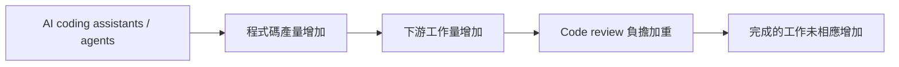
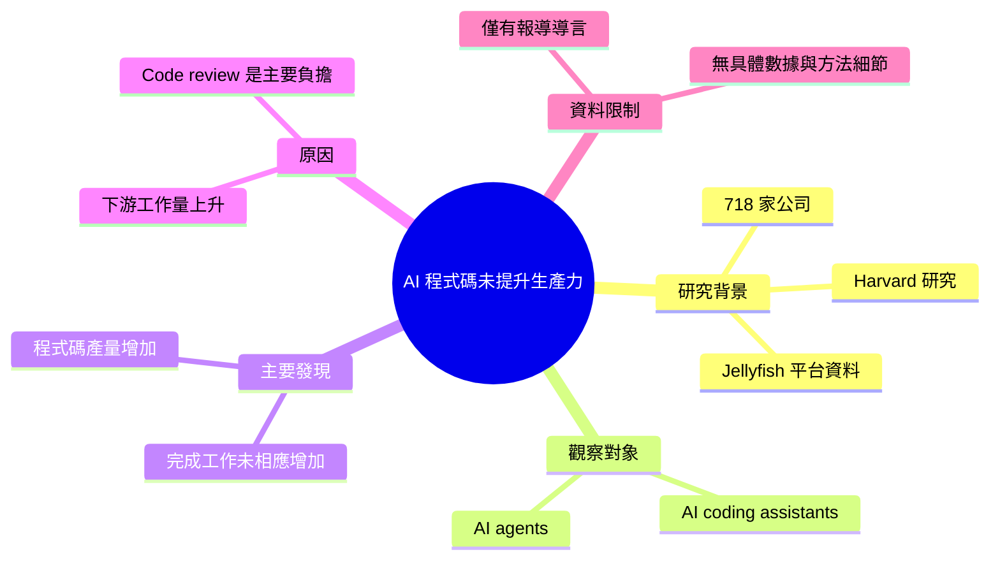

## Study Finds AI-generated Code Fails to Boost Productivity Due to Downstream Bottlenecks

AI 讓程式碼寫得更多，但做完的工作沒有跟著變多，因為瓶頸移到了後面的審查等環節。 **Why** AI 產生的程式碼量增加，下游階段（尤其是 code review）的工作量也跟著增加。 **How** 研究使用 Jellyfish 分析平台的資料，比較 AI 程式助手/agent 帶來的程式碼量與實際完成的工作量。 **What** 一項涵蓋 718 家公司的 Harvard 研究發現，AI coding assistants 與 agents 提高程式碼產量，但並未對應提高完成的工作量，code review 是主要的下游負擔。

### 重點
- 樣本：718 家公司，資料來自 Jellyfish 分析平台（Harvard 研究）
- 結果：程式碼量上升，但完成的工作量沒有相應增加
- 原因：AI 產生的程式碼加重後段開發流程，尤其是 code review

**原文：** [infoq-main](https://www.infoq.com/news/2026/10/jellyfish-ai-productivity/?utm_campaign=infoq_content&utm_source=infoq&utm_medium=feed&utm_term=global)

---

<!-- deep-analysis:begin -->
## 📌 摘要 (TL;DR)

- 一項涵蓋 **718 家公司**的 Harvard 研究，使用 **Jellyfish** 工程分析平台的資料，檢視 AI 程式助手（AI coding assistants）與 agents 對開發生產力的影響。
- 研究發現：AI 工具確實**提高了程式碼產量**（code volume），但**完成的工作量**（completed work）沒有相應增加。
- 原文指出，落差的「部分原因」是 AI 產生的程式碼增加了開發流程後段的工作量，其中又以**程式碼審查**（code review）最明顯。
- 對工程團隊的意義：只看程式碼行數或產出量，無法衡量 AI 導入後的實際交付成效，瓶頸會往下游移動。
- ⚠️ 資料限制：本次取得的原文僅有 InfoQ 報導的導言段落（作者 Sergio De Simone），未包含研究的具體數據、方法細節或作者建議，以下整理只依據這段內容，不補充原文未提及的資訊。

## 🎯 核心概念

- **程式碼產量** (Code Volume)：開發者產出的程式碼數量，AI 工具能明顯拉高這項指標。
- **完成的工作** (Completed Work)：實際走完流程、交付出去的工作項目，是研究用來對照程式碼產量的另一項指標。
- **下游瓶頸** (Downstream Bottlenecks)：寫程式之後的階段（如 code review）因輸入量增加而成為新的限速點。
- **Jellyfish**：工程管理分析平台，本研究的資料來源。

## 📖 整理分析

### 1. 研究規模與資料來源
這是一項 Harvard 的研究，樣本涵蓋 718 家公司，資料取自 Jellyfish 分析平台。研究對象同時包含 AI coding assistants 與 AI agents，而非單一工具。原文導言未說明研究期間、具體的衡量指標定義或統計方法，因此無法進一步評估其研究設計。

### 2. 核心發現：寫得多 ≠ 做得多
研究的主要結論是，AI 工具帶來的程式碼量增加，並沒有轉化為等比例的完成工作量提升。原文導言沒有提供兩者的具體增幅數字，所以無法判斷落差有多大。

### 3. 瓶頸轉移到 code review
原文將落差「部分」歸因於 AI 產生的程式碼加重了開發後段的負擔，並特別點名 code review。可理解為：上游產出越多，需要審查的變更也越多，審查能力若沒有同步擴充，整體交付速度就被卡住。原文用的是 "partly"，代表 code review 不是唯一原因，但導言未列出其他因素。

### 4. 對團隊實務的啟示（推論）
以下為根據原文結論的推論，非原文內容：若團隊以程式碼產量作為導入 AI 的成效指標，可能會高估實際效益；評估時需要同時觀察 review、整合等下游環節的負載與吞吐量。

## 🧭 流程圖 / 架構圖

依原文描述的因果關係整理：

## 🧠 Mindmap

<!-- deep-analysis:end -->
### 📄 原文內容

點此展開 / 收合

A recent Harvard study of 718 firms, using the Jellyfish analytics platform, finds that although AI coding assistants and agents increase code volume, this does not translate into a corresponding increase in completed work, partly because AI-generated code increases the workload in later stages of development, particularly code review. By Sergio De Simone

