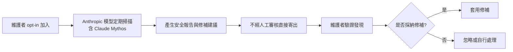
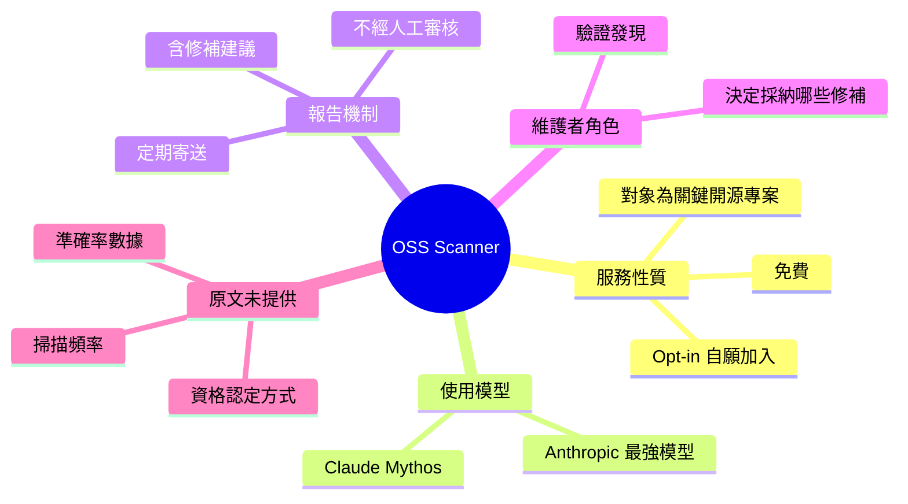

## Anthropic Adds Opt-In Security Scanning for Critical Open-Source Projects

Anthropic 讓開源專案自願加入，由 AI 定期掃描並回報安全漏洞。

**Why** 開源專案維護者資源有限，漏洞難以持續被發現。

**How** 維護者 opt-in 後會定期收到由 Anthropic 最強模型（含 Claude Mythos）產生的安全報告；報告未經人工審核即寄出，維護者可自行驗證發現並決定採納哪些修補建議。

**What** Anthropic 推出免費的 OSS Scanner 服務，對象為關鍵開源專案。

### 重點
- OSS Scanner 為免費、opt-in 服務，針對開源專案找漏洞
- 報告由包含 Claude Mythos 的最強模型產生，且寄出前無人工審核
- 維護者自行驗證發現並決定接受哪些修補建議

**原文：** [infoq-main](https://www.infoq.com/news/2026/10/anthropic-oss-security-scanner/?utm_campaign=infoq_content&utm_source=infoq&utm_medium=feed&utm_term=global)

---

<!-- deep-analysis:begin -->
## 📌 摘要 (TL;DR)

- Anthropic 推出 **OSS Scanner**，這是一項**免費**、**自願加入（opt-in）**的服務，用來找出開源專案中的安全漏洞。
- 加入的維護者會**定期**收到安全報告，報告由 Anthropic 最強的模型產生，其中包括 **Claude Mythos**。
- 報告**未經人工審核**就直接寄給維護者，由維護者自行驗證發現，並決定要採納哪些修補建議。
- 本文是 InfoQ 的簡短新聞，作者為 Matt Saunders。原文只提供服務概要，沒有涵蓋效能數據、涵蓋語言、申請資格細節或已發現漏洞的案例。

## 🎯 核心概念

- **自願加入** (Opt-in)：專案不會被預設掃描，要由維護者主動報名才會收到報告。
- **安全掃描** (Security Scanning)：自動檢查程式碼並找出潛在漏洞，這裡由 AI 模型執行。
- **Claude Mythos**：原文列為產生報告的模型之一，並稱其屬於 Anthropic「最強的模型」。
- **無人工審核** (Without Human Review)：報告送出前沒有 Anthropic 人員把關，因此驗證責任落在維護者身上。

## 📖 整理分析

### 1. 服務定位：免費且自願加入
原文把 OSS Scanner 描述為 free、opt-in 的服務，對象是關鍵開源專案（標題寫的是 Critical Open-Source Projects）。原文沒有說明「關鍵」怎麼認定，也沒有提到申請流程，所以本文無法確定哪些專案符合資格。

### 2. 報告來源：Anthropic 最強模型
報告由 Anthropic「strongest models」產生，原文點名 Claude Mythos。原文沒有列出其他模型，也沒有提供偵測準確率、誤報率或 benchmark 數據。

### 3. 報告流程：定期寄送、不經人工審核
維護者會收到 periodic 安全報告，但原文沒有寫明頻率。報告在寄出前不經人工審核，等於把 AI 產出直接交給維護者。

### 4. 維護者保有最終決定權
維護者可以自行驗證報告中的發現，再決定是否接受模型提出的修補建議（proposed fixes）。從這點可以看出，報告除了指出漏洞，也附帶修補方案。

### 5. 值得注意的取捨（推論）
以下為推論，原文沒有直接說明。不經人工審核可以降低營運成本，也讓服務能擴大規模；代價是誤報的過濾工作會轉到維護者身上。對本來就資源有限的開源維護者來說，報告品質會直接影響這項服務的實際價值。

## 🧭 流程圖 / 架構圖

以下根據原文描述的步驟整理，原文本身沒有附圖：

## 🧠 Mindmap

<!-- deep-analysis:end -->
### 📄 原文內容

點此展開 / 收合

AI company Anthropic has launched OSS Scanner, a free, opt-in service to find vulnerabilities in open-source projects. Enrolled maintainers receive periodic security reports generated by the company's strongest models, including Claude Mythos. The reports are sent without human review, and project maintainers can choose to validate their findings and decide which proposed fixes to accept. By Matt Saunders

