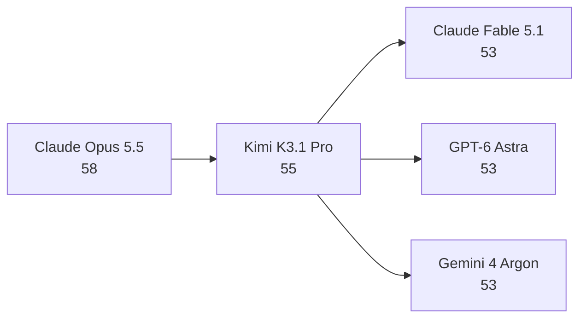
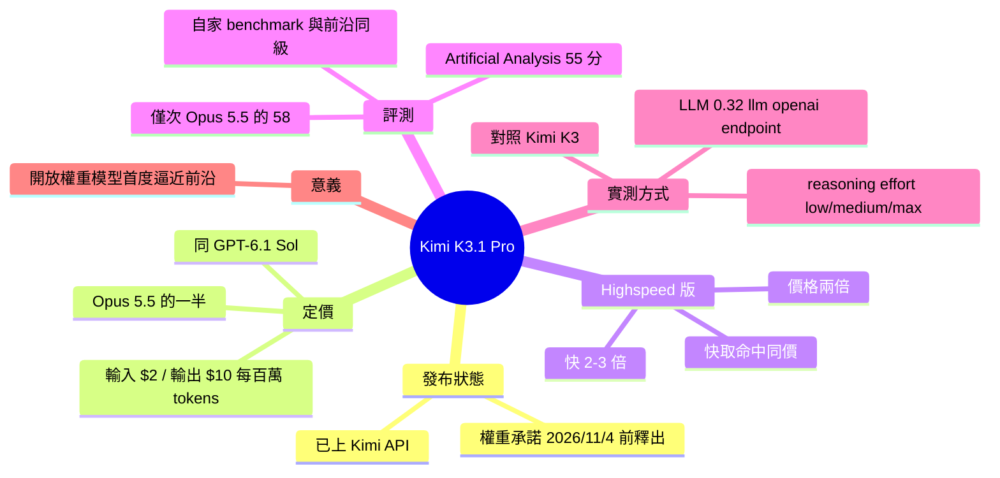

## Introducing Kimi K3.1 Pro

Moonshot 推出 Kimi K3.1 Pro，開放權重承諾下的模型首度在第三方評分上逼近頂尖閉源模型，價格只有一半。 **Why** 開放權重模型長期落後閉源前沿模型，這次差距明顯縮小，讓成本敏感的團隊多了一個選項。 **How** 原文僅提到 Moonshot 同時提供 2-3 倍速、價格兩倍的 Highspeed 版本（input cache hit 價格相同）；作者用 LLM 0.32 的 `llm openai endpoint` 指令，經 OpenAI 相容端點呼叫並測試 low／medium／max 三種 reasoning 等級。 **What** Kimi K3.1 Pro 已上 Kimi API，定價 input $2.00／output $10 每百萬 tokens，與 GPT-6.1 Sol 相同、為 Claude Opus 5.5 的一半。Artificial Analysis 評分 55，高於 Claude Fable 5.1、GPT-6 Astra、Gemini 4 Argon（皆 53），僅次於 Claude Opus 5.5（58）。Moonshot 承諾完整權重於 2026/11/4 前釋出，目前尚未開放。

### 重點
- Artificial Analysis 評分 55：高於 Claude Fable 5.1／GPT-6 Astra／Gemini 4 Argon（53），僅次於 Claude Opus 5.5（58）
- 定價 $2/M input、$10/M output，與 GPT-6.1 Sol 相同、Claude Opus 5.5 的一半；Highspeed 版快 2-3 倍、價格兩倍（cache hit input 同價）
- 權重承諾於 2026/11/4 前釋出；可用 `llm openai endpoint` 搭配 `--responses -o reasoning_effort` 測任何 OpenAI 相容端點，但需自行 redirect stdout/stderr 存檔

**原文：** [simon-willison](https://simonwillison.net/2026/Oct/23/kimi-k31-pro/)

---

<!-- deep-analysis:begin -->
## 📌 摘要 (TL;DR)

- Moonshot 今天在 Kimi API 上推出 **Kimi K3.1 Pro**。目前還不是開放權重，但官方承諾「完整模型權重將於 2026 年 11 月 4 日前釋出」。
- 定價為輸入 **$2.00／百萬 tokens**、輸出 **$10／百萬 tokens**，與 GPT-6.1 Sol 相同，是 Claude Opus 5.5 的一半。
- Artificial Analysis 給 Kimi K3.1 Pro 打了 **55 分**，高於 Claude Fable 5.1、GPT-6 Astra、Gemini 4 Argon（皆為 53），只落後 Claude Opus 5.5（58）。
- Simon Willison 指出，這是第一次有（即將）開放權重的模型，在與前沿模型的比較中拿到這麼高的分數。
- 另有 **Highspeed** 版本，速度快 2-3 倍，價格是兩倍；輸入 token 的快取命中（cache hit）價格則不變。

## 🎯 核心概念

- **開放權重** (open weights)：公開模型權重，讓外部可以自行下載與部署。Kimi K3.1 Pro 目前尚未開放，屬於「承諾釋出」的狀態。
- **快取命中** (cache hit)：輸入內容命中快取時的計價方式。Highspeed 版在這一項不加價。
- **推理強度** (reasoning effort)：控制模型推理投入程度的參數。Kimi K3.1 Pro 支援 low、medium、max 三個等級。
- **OpenAI 相容端點** (OpenAI-compatible endpoint)：沿用 OpenAI API 格式的服務端點，可以用同一套工具呼叫不同廠商的模型。

## 📖 整理分析

### 1. 發布狀態：先上 API，權重後放
Kimi K3.1 Pro 先在 Kimi API 上線，目前還沒有開放權重。Moonshot 承諾在 2026/11/4 前釋出完整權重。所以文中的稱呼是「即將成為」開放權重的模型，而不是已經開放。

### 2. 定價：對標 GPT-6.1 Sol，是 Opus 5.5 的一半
標準版價格為輸入 $2.00、輸出 $10（每百萬 tokens），與 GPT-6.1 Sol 一樣，是 Claude Opus 5.5 的一半。Highspeed 版速度快 2-3 倍，價格是兩倍，但輸入 token 的快取命中價格與標準版相同。

### 3. 評測：第三方分數僅次於 Opus 5.5
Moonshot 自家的 benchmark 顯示，Kimi 與 Opus 5.5、GPT-6 Astra 大致同級，部分項目勝出、其他項目接近。原文沒有列出各項 benchmark 的具體數字。第三方的 Artificial Analysis 給出 55 分，排在 Claude Opus 5.5（58）之後，領先 Claude Fable 5.1、GPT-6 Astra、Gemini 4 Argon（皆為 53）。作者認為，這是（即將）開放權重模型第一次在前沿比較中拿到這麼高的分數。

### 4. 實測：用 LLM 0.32 跑 pelican 測試
作者使用他在 8 月加入 LLM 0.32 的 `llm openai endpoint` 指令，指向 `https://api.moonshot.ai/v1`，模型為 `kimi-k3.1-pro`，加上 `--responses` 與 `-o reasoning_effort low` 參數，讓模型生成「騎腳踏車的鵜鶘」SVG。這個指令可以對任何 OpenAI 相容端點下 prompt，但不會記錄結果。因此作者另外把 stdout（輸出）和 stderr（推理軌跡，reasoning trace）各自導出成檔案。

### 5. 對照組：K3 同樣跑三個推理等級
作者用 low、medium、max 三個推理等級各跑了一次 pelican，原文展示的是 max 版本的成果。為了對照，他也重新用前代 Kimi K3 跑了同樣三個等級。不過提供的內容沒有包含圖片連結，也沒有描述圖像品質，因此無法判斷兩代的差異。

## 🧭 流程圖 / 架構圖（可選）

Artificial Analysis 評分對比（依原文數據）：

## 🧠 Mindmap

<!-- deep-analysis:end -->
### 📄 原文內容

點此展開 / 收合

Introducing Kimi K3.1 Pro 
Kimi K3.1 Pro landed on the Kimi API today - it's not yet open weights, but Moonshot promise "Full model weights will be released by Nov 4, 2026". 
 They're also offering a "Highspeed" version that's 2-3x faster, at twice the price (except for input token cache hits, which are priced the same). 
 The US dollar pricing is $2.00/million tokens for input and $10/million for output - the same as GPT-6.1 Sol and half the price of Claude Opus 5.5. 
 Moonshot's own benchmarks show Kimi as approximately level with Opus 5.5 and GPT-6 Astra - beating them on a few benchmarks, coming close on others. 
 Artificial Analysis scored Kimi at 55 - ahead of Claude Fable 5.1, GPT-6 Astra, and Gemini 4 Argon (all at 53) and behind only Claude Opus 5.5 (58). 
 This is the first time a (soon-to-be) open weight model has scored this highly against the frontier. 
 I tried it out via the Moonshot API using the llm openai endpoint command I added to LLM 0.32 back in August: 
 llm openai endpoint \
 https://api.moonshot.ai/v1 \
 --key kimi \
 -m kimi-k3.1-pro \
 "Generate an SVG of a pelican riding a bicycle" \
 --responses \
 -o reasoning_effort low \
 &gt; kimi-k3.1-pro-pelican-low.stdout.txt \
 2&gt; kimi-k3.1-pro-pelican-low.stderr.txt
 
 llm openai endpoint can run prompts against any OpenAI-compatible endpoint but doesn't log the results, hence the extra options to save stdout and stderr (the reasoning trace). 
 Here are the pelicans I got for Kimi K3.1 Pro on the three reasoning levels it supports - low, medium, and max. This is max: 
 
 For comparison, I ran fresh pelicans against Kimi K3 on those three reasoning levels.

 Via Hacker News 

 Tags: ai , generative-ai , llms , llm , llm-pricing , pelican-riding-a-bicycle , llm-release , ai-in-china , moonshot , kimi

