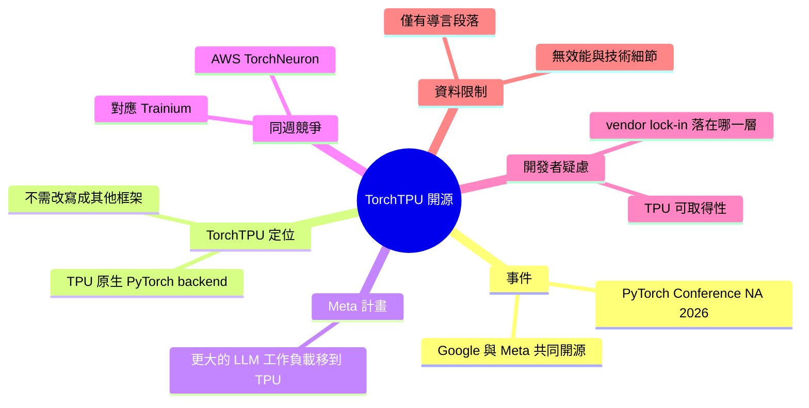

## PyTorch Conference 2026: Google and Meta Open-Source TorchTPU for Native PyTorch on TPUs

讓原生 PyTorch 程式直接跑在 Google TPU 上，不必再改寫成別的框架。

**Why** 開發者長期受限於硬體與框架綁定，報導指出大家也在質疑 TPU 的可取得性，以及 vendor lock-in 如今落在哪一層。

**What** Google 與 Meta 在 PyTorch Conference North America 2026 開源 TorchTPU，為 TPU 提供原生 PyTorch backend，Meta 表示計畫用它把更大的 LLM 工作負載移到 TPU；同週 AWS 也釋出針對 Trainium 的 TorchNeuron。

### 重點
- TorchTPU：Google 與 Meta 開源的 TPU 原生 PyTorch backend
- Meta 計畫以 TorchTPU 將更大型 LLM 工作負載遷到 TPU
- AWS 同週釋出 TorchNeuron（Trainium）；開發者關心 TPU 供應與 lock-in 位置

**原文：** [infoq-main](https://www.infoq.com/news/2026/10/google-meta-torchtpu/?utm_campaign=infoq_content&utm_source=infoq&utm_medium=feed&utm_term=global)

---

<!-- deep-analysis:begin -->
## 📌 摘要 (TL;DR)

- Google 與 Meta 在 **PyTorch Conference North America 2026** 共同開源 **TorchTPU**，這是 Google TPU 的原生 PyTorch 後端（native PyTorch backend）。
- **Meta** 表示計畫用 TorchTPU 把**更大的 LLM 工作負載**移到 TPU 上。
- 同一週，**AWS** 也發布了針對自家 Trainium 晶片的 **TorchNeuron**。
- 開發者社群提出兩個疑問：**TPU 實際能不能取得**，以及**廠商鎖定（vendor lock-in）現在落在哪一層**。
- 注意：本次輸入的原文只有 InfoQ 報導的導言段落（作者 Andrew Hoblitzell）。技術細節、效能數據與 API 設計都不在輸入範圍內，以下整理只依據這段內容。

## 🎯 核心概念

- **TorchTPU**：Google 與 Meta 開源的 PyTorch 後端，讓原生 PyTorch 程式直接在 Google TPU 上執行。
- **TorchNeuron**：AWS 在同週發布的 PyTorch 後端，對應 AWS 的 Trainium 晶片。
- **原生後端** (native backend)：PyTorch 直接把運算交給特定硬體執行。開發者不需要先把程式改寫成其他框架。
- **廠商鎖定** (vendor lock-in)：使用者被綁在單一供應商的軟硬體上，轉換成本很高。

## 📖 整理分析

### 1. 事件：TorchTPU 開源

Google 與 Meta 在 PyTorch Conference North America 2026 開源 TorchTPU，定位是 TPU 的原生 PyTorch 後端。根據先前的摘要，重點在於 PyTorch 程式可以直接跑在 TPU 上，不必改寫成別的框架。原文導言沒有提供版本號、支援的 TPU 世代或效能數據。

### 2. Meta 的角色：把大型 LLM 搬上 TPU

Meta 是 PyTorch 的主要維護方。這次它不只參與開源，還明確表示計畫用 TorchTPU 把更大的 LLM 工作負載移到 TPU。原文沒有說明具體是哪些模型、移轉規模或時程。

### 3. 同週競爭：AWS TorchNeuron

AWS 在同一週發布 TorchNeuron，對象是 Trainium。兩家雲端業者都在做同一件事：讓自家 AI 加速器（AI accelerator）能原生支援 PyTorch。原文導言沒有比較兩者的功能或成熟度。

### 4. 開發者的疑慮：可取得性與鎖定

報導提到開發者質疑兩件事。第一是 TPU 的可取得性，也就是有軟體支援不代表拿得到硬體。第二是 vendor lock-in 現在落在哪一層。

以下是推論，原文未展開：當 PyTorch 能跨 TPU 和 Trainium 執行，框架層的綁定會變弱，但對雲端平台與硬體供應的依賴仍然存在。

### 5. 資料限制

輸入內容只有一段導言，以下問題無法從來源確認：

- TorchTPU 與既有 TPU 執行方案的差異
- 授權方式
- benchmark 數據
- 社群實際討論的細節

如需這些資訊，要閱讀 InfoQ 全文。

## 🧠 Mindmap

<!-- deep-analysis:end -->
### 📄 原文內容

點此展開 / 收合

Google and Meta open-sourced TorchTPU, a native PyTorch backend for Google's TPUs, at PyTorch Conference North America 2026, and Meta said it plans to move larger LLM workloads onto TPUs with it. AWS released TorchNeuron for Trainium the same week, while developers questioned TPU availability and where vendor lock-in now sits. By Andrew Hoblitzell

