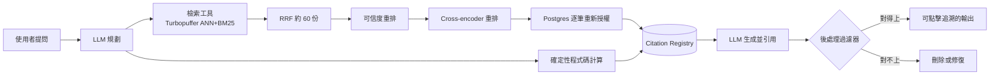
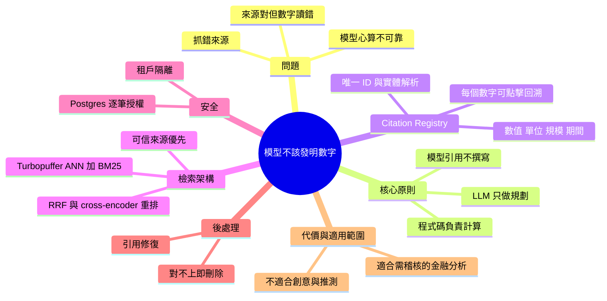

## Do Not Let Models Invent Numbers - Vinoo Ganesh, Kepler

讓模型只能「引用」數字而不能「自己寫」數字，凡是無法追溯到來源的數字一律刪除。

**Why** 在金融分析中數字必須可驗證；LLM 是機率機器，可能找錯來源、對的來源卻讀錯數字（單位、期間、頁碼），而且心算並不可靠。

**How** 模型只負責規劃；檢索由確定性工具完成，計算交給程式碼，並將每個事實登記為帶有數值、單位、期間等中繼資料的 citation；後處理過濾器會移除無法對應 registry 的數字。搜尋端以 Turbopuffer 結合向量 ANN 與 BM25、做 reciprocal rank fusion 與 cross-encoder 重排，並以租戶隔離與逐筆重新授權防止資料外洩。

**What** Kepler 處理約 3,000 萬份 SEC 文件，每個數字皆可點擊追溯至原文與計算過程。其評測中，過濾器拒絕了 10,981 筆引用，其中 3,810 筆為純粹錯誤數字，作者據此主張原生 RAG 不足以應付需要數字準確性與可稽核性的場景；約三分之一的 citation 屬於模型沒做的數學。

### 重點
- 架構原則：模型負責規劃、確定性程式碼負責檢索與計算、後處理過濾器負責刪除未登記的數字；每個事實有 value/unit/scale/period 等中繼資料
- 搜尋管線：Turbopuffer namespace 內結合 ANN 與 BM25，經 reciprocal rank fusion 與 cross-encoder 重排，並依來源可信度再排序；每筆命中在 Postgres 重新授權
- 數據：過濾器在其評測中拒絕 10,981 筆引用，其中 3,810 筆為純錯誤數字；約 1/3 citation 是模型沒做的運算。代價是工具不適合需要創意或推測的任務

**原文：** [youtube-ai-engineer](https://www.youtube.com/watch?v=dZgA6btnb_s)

---

<!-- deep-analysis:begin -->
## 📌 摘要 (TL;DR)

- Kepler 執行長 Vinoo Ganesh（曾任 Palantir 運算層負責人、Citadel 商業工程主管）分享核心原則：**模型只能引用數字，不能自己寫數字**。無法追溯到可信來源的數字，一律由後處理過濾器刪除。
- 他把 LLM 在數字上的失誤分成三類：抓錯來源（例如 Seeking Alpha 或隨便一篇部落格）、來源對但讀錯數字（單位、幣別、年度，甚至把頁碼當成數值），以及模型自己心算成長率、利潤率、倍數。
- 架構分工：LLM 只負責規劃（planning）。檢索交給確定性工具，計算交給人類預先寫好的程式碼，每個事實都登記進引用註冊表（citation registry）。
- Kepler 預處理了 3,000 萬份以上的 SEC 文件。講者指出，所有引用中約三分之一是「模型沒有做的數學」，也就是由程式碼算出、而不是模型生成的數字。
- 搜尋端使用 Turbopuffer，以 ANN 向量搜尋加 BM25 混合檢索，再經 reciprocal rank fusion、可信度重排與 cross-encoder 重排。每筆命中都會在 Postgres 重新授權，做到租戶隔離（tenant isolation）。
- 講者坦承這樣的代價：Kepler 不適合需要模型發揮創意或推測的情境，例如行銷文案，或以銷售為主的投行業務。

## 🎯 核心概念

- **引用而非撰寫** (cite, never write)：模型輸出中的數字必須指向註冊表中的事實，不得自行生成。
- **引用註冊表** (citation registry)：儲存每個事實的數值、單位、規模、期間與來源的確定性資料庫，每個事實都有唯一 ID。
- **可引用錨點** (citable anchors)：從申報文件中抽出、可點擊回溯原文的財務事實。
- **後處理過濾器** (post-processing filter)：模型生成後比對註冊表，對不上的數字就刪除或嘗試修復。
- **冪等性** (idempotency)：同一查詢不論在哪裡重跑，都會得到相同結果。
- **實體識別與實體解析** (entity recognition / entity resolution)：為每個事實指派可辨識、可對應的唯一識別碼。

## 📖 整理分析

### 1. 為什麼事後附來源不夠
在金融業，分析師絕不會給客戶或 PM 看一個無法驗證的數字，例如「營收成長 12.4% 至 4,182 億」。常見做法是生成完答案再附上來源，但這有一個根本問題：LLM 不會真的「讀」文件。它只是把切塊（chunk）做語意搜尋，抓回可能相關的片段。以 10-K 中的「17」為例，它可能代表 1,700 萬或 170 億、日圓或美元、2023 年或 2025 年的數字，也可能只是頁碼。

### 2. 規劃與事實處理分離
使用者提問後，LLM 會在了解所有工具的前提下產出計畫。以「Google 的 adjusted EBITDA」為例，回答需要跨多年 10-K 檢索、比對投資人簡報與法說會的新揭露，還要處理財報重編（restatement）。實際的檢索、計算、建表都由工具完成，結果寫入 citation registry。事實必須帶上脈絡：Palantir 2025 年 10-K 裡提到的 2023 年營收，要標註為 2023 年的數據點；表格中的單位（例如以十億計）也要和數值綁在一起。

### 3. 結構化與混合搜尋並用
講者認為 XBRL 不能解決所有問題，因為它約有 10% 的錯誤率。而且投資人大量依賴內部資料，例如 OneDrive、Bipsync、SharePoint、Box、Outlook 和投資備忘錄。因此 Kepler 的做法是：資料有結構就結構化，沒有結構就用搜尋。檢索流程如下：
- 使用 ZeroEntropy 的 1280 維 embedding 做 ANN，搭配 BM25。
- 以 reciprocal rank fusion 取回約 60 份文件。
- 依來源可信度重排。例如法說會逐字稿與 10-K 數字不一致時，講者視之為需要調和的特性，而不是 bug。
- 最後用 cross-encoder 重排，再交給模型。

這套流程的前提是新資料進來時能便宜地重算 embedding，策略是「先廣搜，再重排」。

### 4. 文件層級的安全隔離
講者舉例：Citadel 的 Desk 1 絕不能看到 Desk 2 的研究。因此每筆命中都要在 Postgres 重新授權，逐一檢查引用、數值與文件。每個 builder 會疊加新的過濾條件，只有授權服務能簽發限定範圍的 token，使用者身分也來自簽章裝置。目的是確保客戶的 alpha 不外洩。

### 5. 即時過濾與代價
推論過程中，LLM 要「解參照指標」（dereference the pointer），也就是把引用解析到註冊表中的來源；對不上的數字直接刪除。即使是 2005 年營收這類可能存在於訓練資料中的數字，也因為無法保證年度與範圍正確、無法追溯，而不被採用。講者承認這讓平台「沒有大家期待的那麼神奇」，因此另外設計了引用修復（citation repair）步驟，判斷該刪除還是修復。本次字幕節錄在這一段中斷，修復機制的細節沒有完整收錄。

## 🧭 流程圖 / 架構圖

以下依講者描述整理，非原投影片：

## 🧠 Mindmap

<!-- deep-analysis:end -->
### 📄 原文內容

點此展開 / 收合

[music] >> Hey, thanks for coming. My name is Vinod Ganesh. I'm the CEO of Kepler. We have a few of my teammates here as well. I'm excited to be here to chat with you. So, the initial inception of this session comes from the World's Fair for AIE. Where we discussed at a high level Kepler as a whole and how we do what we do. Um and our big claim to fame right now and there's a new bunch of other stuff is Anthropic did a full deep dive into our architecture, our technology, and the biggest question that I got after the World's Fair presentation was well, how do you actually do this? Um so, our partners and friends at Turbo puffer have given me this session to talk about how we use Turbo puffer as a component of this overarching ecosystem. Um also shameless plug, Jack and I are doing a talk on the main stage in about 25 minutes. So, we're going to power through this and if you want to hear about fundamental investing in the age of AI, uh feel free to come to that 25 minutes from now. Um so, to talk a little bit about uh so, quick background of myself. Um again, I'm Vinod. I'm the CEO of Kepler. Uh began my career at Palantir. I led the compute layer there. Um then built my own data as a service company and then was head of business engineering at Citadel. Um so, a lot of what we learned here in building uh Kepler comes directly from the experiences of understanding how to build and harness or a substrate or whatever the cool new word is in pretty aggressive environments where accuracy and fidelity matter pretty aggressively. So, let's talk a little bit about what Kepler does. Um I know we're um we've been in a lot of places. We're excited to be part of Gemini Force um blog post today as well. Uh they've a new model out. Um so, the core tenant is um, an analyst, if you're actually working in finance, you never show a client or your PM a number that they can't explicitly validate or trace. So, when you see something like revenue grew 12.4% to 418.2 billion, these are actual numbers that need to be correct. The challenge is we're all operating off of probability machines. LLMs are at their core probability machines. The same thing that makes them so creative and cool is the same thing that makes them very difficult to use in mission-critical situations. So, a natural thing you see is people that attach sources after the fact. Now, this is cool, but here's the problem that happens when you just attach a source after the fact. First, LLMs don't actually read your documents, despite what many people think. What they do is they chunk a bunch of things together, they do a semantic search, and they retrieve information that may be semi-relevant, if you're lucky. So, the first big challenge a lot of people have is we have the wrong source. Like, we've pulled information from Seeking Alpha or Venu's random YOLO blog that says Palantir will be worth $100,000 a share. Or, we have the right source and the wrong number. For example, when you read a 10K or a 10Q, you can imagine a world where I see the number 17. Well, what does that correspond to? Is it 17 million, 17 billion, is it 17 million yen, 17 million dollars? Is it 17 million was the revenue of this company in the year 2023 in the 10K that's in 2025? Or, is 17 the page number? Like, all of these things are considerations that occur when we're actually working on any kind of environment that requires verifiability or numerical accuracy. Finally, there's a piece of mental math. Growth rates, margins, multiples, models are not actually doing Now, in some cases, they write code that does do math, but models themselves are not actually doing math in a way that ensures fidelity and accuracy. So, what we end up having to develop is an architecture where the model sites the numbers, but never writes them. At its core and the magic that powers Kepler is retrieval finds the right source, thank you TurboPuffer, which we'll talk about. Code does the math, and code meaning the model is not writing the math, but predetermined a deterministic code that we humans have written. And we have a post-processing filter. So, let's break this down. So, what we did is we processed the entire corpus of SEC data. Now, that's 30 plus million documents. Um our friends at TurboPuffer will be hopefully working with us fairly soon on how we actually surface this to all of you. Um but we ran a pre-processing step, and we registered what we're calling citations. And so, citations are effectively the deterministic numerical numbers that we have pulled out of filings. Things like revenue numbers, things like an income statement, a balance sheet, things like MD&A that actually says, "Hey, my revenue grew 37% in human-written text." There's about 20,000 of those. There's three individual filing facts that we've revealed as citable anchors, which effectively means our ability to tell you where a number came from comes down to the ability to be able to click on a number and actually reference back a core document where that came from. When we're running in production, we actually refuse citations that we can't verify. Meaning, if I have a number that's not cited, the model is structurally incapable of producing this output. Finally, uh the number of citations that the filter has correctly extracted, we got about 21,000. I'll I'll through this in a little bit more detail. How Kepler works and the piece and anthropic, if you want more information Google Kepler anthropic, you can read about is the language models themselves are planning. Deterministic software handles every number or even more generally every single fact. So, let's break this down. A user asks the question. The LLM then creates a plan with full knowledge of tooling, deterministic retrieval steps, uh citation filter, bounding boxes, and this whole thing. Now, let's actually make this specific. Let's say I'm saying, "What is the adjusted EBITDA of, you know, Google?" Think about what's involved in getting answering that question. I have to first retrieve a bunch of facts across 10-Ks, arguably over potentially different years. I have to figure out, uh you know, in an investor presentation and an earnings call, what new information was disclosed or if a restatement came out and now I have to actually update a number. All of that is what the model thinks through. From there, we have tools that actually retrieve, compute, build tables, and register this entire infrastructure into a citation registry. That citation registry is what allows us to not only give magnitude or metadata associated with numbers or facts, but type those facts. So, a simple example here. Let's say I do look at Palantir's 2025 10-K. In there, it says Palantir's 2023 revenue was, you know, let's say a billion dollars. All of those numbers that I just said need to be contextualized. That billion dollars, even though it appears in the 10-K from 2025, has to be annotated and treated as 2023's data point. I said billion. Well, if you looked at a 10-K or a 10-Q, it usually says one. The billions is up in the table somewhere far away floating around. So, we have to somehow take these complex objects and actually give them the annotations to be able to pursue meaningful and traceable output that's actually correct. Now, after the fact, models like saying stuff. That is what they do. So, what happens when a model actually invents a number that we cannot deterministically prove came from a trusted source? We have to have a post process a post processing step to actually strip this information out. And so, we do this and we give you the full traceability in the most I'm going to claim this and I think it's true in the most granular form of any tool on the market. Which means you can click on everything in the Kepler platform and I'll show you screenshots that actually allow us to prove this architecture works globally. So, um let's talk a little bit about how this works in the realm of Turbo Buffer who's uh been nice enough to give us a stage to have this conversation. First and foremost, let's look at a 10K. Let's say we see total net sales. That fact that $416,000 $416,000 It's a good point, right? We don't know what that means. That $416,000 number um needs to have facts associated with it. Things like a value, a unit, a scale, a period. Now, here's the problem. For those of you who work in this space, everyone can say XBRL solves all this issue. We don't need to worry about pulling information out of documents. That's true if XBRL weren't incorrect like some 10% of the time. But even more so, how many people are just looking at public information when they're making investment decisions? Fairly few. They have their own One Drive, their own BIP sync, their own various investment memos that they've put together and a slew of internal information. So, for our architecture to work, we have to work not just across 10Ks and 10Qs, but also on top of your internal data, your SharePoint, your Box, your Ignite, your One Drive, your Outlook. >> [snorts] >> So, we structure the data where the data structured and then we implement search where it isn't. And what that allows us to do is create a namespace in Turbopuffer that actually combines both the BM25 and hybrid search with the full guarantees of the Kepler platform. Here's how we do it. And this is probably the slide I know people are taking photos. This is the magical slide. I'm not worried about revealing this because this is a very hard problem and it moves quickly. So we use zero entropy so zero embeddings we use 1280 dimensions here. ANN is approximate nearest neighbors plus BM25 is how we actually grab information across I look at everyone's taking photos. This is amazing. >> [laughter] >> This is how we actually grab this information across our namespace. We do do reciprocal re-rankings to actually make sure that we pull the right usually 60K or 60 documents back and then we do another form of re-ranking. And this is a trusted form of re-ranking where we pull back the sources that we actually trust more than others. For example, different sources will have different pieces of information that claim to be the same thing. An earnings transcript an earnings call transcript where a presenter says my revenue was this that disagrees with exists in the 10K is actually a it's not a bug it's a feature. There's two different pieces of information I have to actually deconflict across these. So you need to be aware of that as well. We use a cross encoder to actually do the re-ranking and then we return that result to the model. This step in this process is predicated on two things. It's predicated on one our ability to rerun embeddings as new information comes in incredibly cheaply. So generating embeddings is not a cheap process. If you can do it and you can do it efficiently great but if you're hosting your own embeddings model it becomes unless you're hosting your own embeddings model it becomes really expensive and very difficult. So strategy here is we search wide then we re-rank. Now there's tenant isolation that also becomes really important. Now, when we actually hit any kind of a document, we have a bunch of different pieces that are important. For example, it would be very unfortunate if Citadel Desk 1 saw Citadel Desk 2's research, right? So, we have to have security built into the document level as well. So, re- The first thing we do is if you start at that middle query that goes to the document, um every hit is reauthorized in Postgres, meaning we check the citation, the value, the document across every one of these computations. Every builder adds a new filter. So, we're building up these complex filters over time that actually allow us to make sure that as we're querying information and querying data, we're not leaking data inadvertently across a bunch of different sources. Only Auth itself can create a scoped token to actually create this information. And of course, the user and aura come from a signed device. So, this is the way that we ensure security, and this is the way that we ensure your alpha stays within your firm's ecosystem. Alpha's an interesting question which we can talk about in a world where everyone has access to LLMs as well. Cool. Now, how do we make sure a number can appear in the Kepler platform? First and foremost, we assign unique identifiers to each fact in our platform. Meaning, we need to have identifiers that both can do entity recognition and entity resolution. Each one of these source IDs corresponds to a bunch of metadata in a fact stored in a in a deterministic engine. In order for us to show you the output in a way that's customizable, we need to have a display value. So, if you want your whole Kepler platform in thousands of dollars or in yen or in any of these, we need to be able to post process and show you the actual output. And we have to show you how we got it and where we got it from. So, the invariant in Kepler, you can click on every number, every fact in the platform and see the actual source that we got it from. And that's how we actually give you numbers that are truly citable, deterministic, and reproducible. This is also the item potent guarantee that we're able to give to people. By having this guarantee, we can run the same query over and over again wherever and get the same results. So, here is what we uh have to deal with. When we ran this whole corpus of data, um a third of all of our citations are the math that the model didn't do. What that means is pulling every one of these citations out, whether it's web results, spreadsheets, whether it's coming from a filing exhibit, the model itself can make up a bunch of things from its own corpus or its own um training set that are really, really difficult to work around, especially when you go to historical data. For example, looking up a revenue number from 2005 likely lives within the model's training corpus. But it if we retrieve it from that corpus, we can't guarantee that it was pulled correctly from the right year and right scope, and that we can actually trace it back. So, just off of a whole, a third of this are math that the model that a third of all citations are the math the models did not do. Now, how do we actually do this live? As tokens move forward as we're flowing kind of like we're doing inference, um we give these filters and these references to an LLM that has to actually resolve these. Think of this as the LLM dereferences the pointer. We then have a registry where the sources themselves are looked up, and we pull information out of that registry to give you the traceability. Now, the really powerful thing here is when we don't have a match, we strip that number. That's a very aggressive thing to do. It means your LLM will not be that wonderful thought partner that you thought it would be, where it would make up, speculate, and project. This means at this moment, and I'll say this, Kepler's not a super useful tool if you rely on model hallucinations. Meaning if you're trying to be creative or you're trying to I don't know, write marketing content, Kepler's not the right product to use. That means there are certain industries in finance where opportunistically selling, like banking, probably don't rely on numerical accuracy because your job is to sell an offering. It's not to create a DCF that's backed by accurate traceable information. So, by checking against our sources, we've effectively created a ground truth retrieval engine across any corpus of data, including public equities as well as your own internal data. Now, this is annoying. This means the platform cannot be as magically powerful as many people want it to be. So, how do we actually ensure whether we should strip a citation or whether we should try to repair it? And so, the core insight here is we have a post-processing step that actually tries to do a citation repair. Which effectively means if we find information that we can't reliably trace, should we try to repair that and do an on-the-fly agentic determination that says this information came from this source? The answer is in certain spaces we actually do do that. And that's probably the second piece of this presentation that we can keep a little bit, um, kind of like wishy-washy, which is how Kepler maintains its IP. Cool. Um, now, when we actually run these queries, there are some numbers that I think are worthwhile to share. Because most people in this industry right now are wrapping a lot of financial research with an LLM and they're saying, "Great, everything is right as long as things are, you know, ragged properly, I should be good to go." So, our filter across native, just like running it on Claude or ChatGPT, um, refused 10,981 citations from our evals. Meaning 10,000 about, I guess, 3,810 of these were just straight-up wrong numbers. This is the scariest thing ever if you live in financial analytics. This means hooking up Claude to uh, uh or open AI or any of these models to just a native rag tool or a vector database actually isn't enough. Now, there's really cool things that you can do if you're looking at just semantic search and that's it. But if you're looking at anything that requires numerical accuracy and auditability, you actually can't trust regular rag platforms. This is a scary thing for a lot of startups that are effectively chat GPT wrappers. I'm not saying that in a negative way. It's the reality of where we are right now. So, a new kind of architecture has to emerge and that architecture has to combine both the auditability and traceability with the deterministic elements of of course like numerical accuracy. Um models don't do math. This is pretty simple and I think it's actually pretty critical um insight here. Uh anytime that we see some kind of situation where the model is uh forced to do math or if it can't reason through something, we effectively make that impossible. By having that post post processing step, the model can't actually write something it can't cite. Meaning the model is structurally incapable and I'll be careful. The platform is structurally incapable of producing hallucinated numbers. The model can still hallucinate and it definitively does. Cool. Let's talk a little bit about what Kepler looks like and this is a tiny sliver of what our platform does when we show the deterministic traceability and all that. Um happy to chat through uh this as if it's if it's useful. But a simple question like Apple's 2025 revenue and how fast it grew, every number being clickable means by clicking on these, you see not only the 10-K or the 10-Q or the 8-K or the investor presentation that it came from, but you see the actual calculations that are done behind the scenes. Things like I did these two numbers and I have a 6.4% um increase all becomes present and traceable on the platform. So, this architecture I think will become the standard. Um, the opportunity in front of people that are building financial research tools or operating in the realm of AI is right now limited by the lack of architecture that actually supports the workflows you want to do. You can set up fully managed agents right now that try to ask for ideas based on, you know, generated information, but you still can't produce a DCF, which is why we still have analysts down the street from here or working right now on stripping information out of S-1s and taking information from a PDF and putting it into Excel. Our goal is to end that. And so, um, I do want to end on a kind of one very important thing, which is our guarantees do end somewhere. We make models site numbers, not write them. We verify every citation. Uh, we push arithmetic to the compute layer, not to the model layer. We isolate tenants and we measure recall. This means we can actually guarantee that the ground truth research that you do in your platform is unique and powerful. It does not mean that we can create a full-scale hedge fund that's replacing everyone, at least right now. And so, I see the move, and we'll talk about this in, I guess, 30 seconds as we go, uh, to the next place, but, um, the move that I'm seeing is folks will be more quantamental. This is the future. This is the opportunity. The more that we can use unique retrieval mechanisms in conjunction with, of course, deterministic retrieval, um, we'll end up in a really powerful place where AI can finally do the stuff that we don't want to do instead of sitting there and doing the ideating that we do want to do. With that, um, there's an appendix here, but thank you so much. Uh, I appreciate the time. >> [applause]

