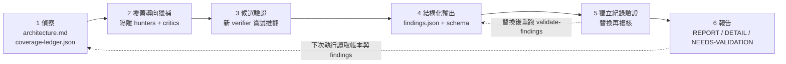
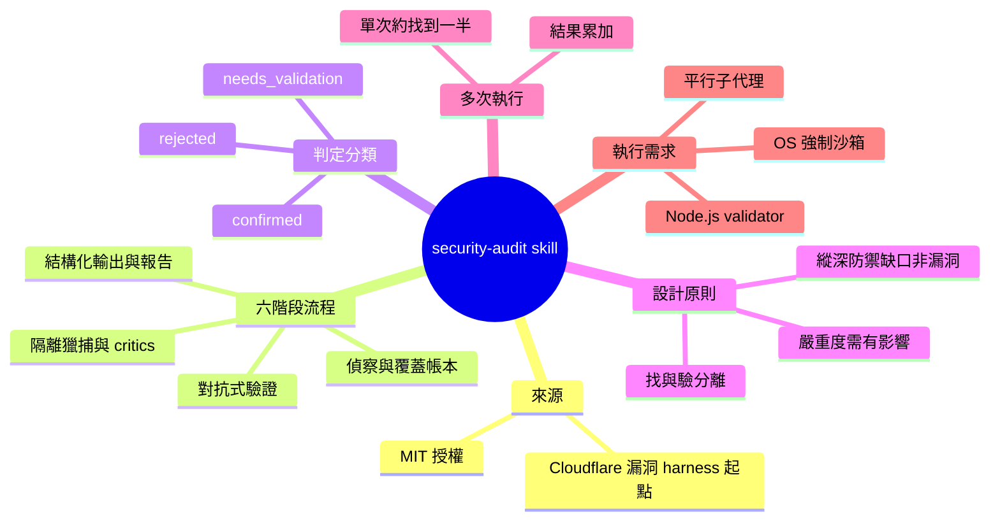

## cloudflare/security-audit-skill ⭐ 47,082(今日 +2,878)

讓 agent 做安全稽核時，找漏洞的 agent 與驗證漏洞的 agent 必須分開。 **How** 流程分六階段：偵察、依覆蓋帳本分派獵捕、候選驗證、結構化輸出、獨立紀錄驗證、與目標無關的報告；負責驗證的 agent 的任務是試圖推翻候選。 **What** 這是 Cloudflare 漏洞發現 harness 的起源 skill，GitHub 星數 47,082（今日 +2,878）；結果分為 confirmed、needs_validation、rejected 三類。原文表示在其測試中，單次執行約找到重複執行總數一半的漏洞。

### 重點
- 對抗式驗證：檢查發現的 agent 永遠不是找到問題的那個 agent，候選交給新 agent 嘗試推翻
- 嚴重性需以影響為依據（可能性 × 影響），防禦縱深缺口若上層已擋住攻擊，只算加固建議而非漏洞
- confirmed 需有完整來源追溯與有界的觀察結果；needs_validation 需寫明未解事實且不給嚴重性；rejected 為已被推翻的候選

**原文：** [github-trending-agent-tools](https://github.com/cloudflare/security-audit-skill)

---

<!-- deep-analysis:begin -->
## 📌 摘要 (TL;DR)

- Cloudflare 開源 `security-audit`，這是一個給 coding agent 用的技能（skill），讓 agent 執行多階段安全稽核。產出的漏洞紀錄經過獨立驗證，而且是機器可讀的格式。GitHub 星數 47,082（今日 +2,878），授權為 MIT。
- 這個 skill 是 Cloudflare 漏洞發現 harness 的起點，原文說明見〈Build your own vulnerability harness〉。harness 後來擴展成多階段、跨整個 fleet 的系統，這個 repo 則是它的單一 repo 版本。
- 流程分六階段：偵察、覆蓋導向獵捕、候選驗證、結構化輸出、獨立紀錄驗證、與目標無關的報告。核心原則是「檢查漏洞的 agent 永遠不是發現它的 agent」。
- 每筆結果分成三類：confirmed、needs_validation、rejected。安全條件不足時，skill 不執行目標程式碼，該線索保留為 needs_validation。
- 原文表示，在他們的測試中，單次執行約找到多次重複執行總數的一半漏洞。多次執行的結果會累加。

## 🎯 核心概念

- **覆蓋帳本** (coverage ledger)：`coverage-ledger.json`，記錄稽核範圍內各單元是否已檢查，用來分派獵捕者並找出遺漏。
- **對抗式驗證** (adversarial validation)：每個候選漏洞交給一個全新的驗證 agent，由它嘗試推翻這個候選。
- **覆蓋評論者** (coverage critics)：專門檢視覆蓋帳本、找出尚未檢查區塊的 agent。
- **縱深防禦缺口** (defense-in-depth gaps)：如果 A 層已能擋下攻擊，缺少 B 層只算強化建議（hardening note），不算漏洞。
- **與目標無關的報告** (target-neutral reporting)：報告只從已驗證的紀錄和覆蓋帳本推導，不另外加入未驗證的內容。

## 📖 整理分析

### 1. 六階段稽核流程

1. **偵察（reconnaissance）**：描繪架構、信任邊界、輸入面、既有證據與確定性覆蓋，寫入 `architecture.md` 和 `coverage-ledger.json`。
2. **覆蓋導向獵捕**：依帳本單元分派彼此隔離的 hunter，並記錄它們做過的檢查。
3. **候選驗證**：去重後的每個候選，都交給新的 verifier 嘗試推翻。
4. **結構化輸出**：結果寫入 `findings.json`，並以 `report-schema.json` 驗證格式。
5. **獨立紀錄驗證**：由新的 agent 複核最終的原始碼主張。有實質替換的紀錄，會再交給另一個獨立 verifier。
6. **報告**：產出 `REPORT.md`、`FINDINGS-DETAIL.md`、`NEEDS-VALIDATION.md`。

每次更新帳本後，母流程（parent）都會執行 `validate-coverage-ledger.cjs`。Phase 4 和 Phase 5 每次替換紀錄後，都會執行 `validate-findings.cjs`。

### 2. 三種判定的嚴格定義

- **confirmed**：必須有完整的原始碼追蹤，以及有界的實際觀察結果。
- **needs_validation**：必須寫明確切的未解事實，而且不標嚴重度。
- **rejected**：記錄已被推翻的候選。

設計原則要求「只確認已成立的邊界失效」。受阻但有原始碼依據的線索，一律保留為 needs_validation。

### 3. 嚴重度與縱深防禦的判準

嚴重度採用「可能性 × 影響」計算，不看是否偏離檢查清單。沒有實際影響，就不給嚴重度。如果某層防禦已能阻止攻擊，缺少另一層防禦只歸類為強化建議。這兩條規則用來減少稽核報告中常見的誤報與膨脹。

### 4. 多次執行與累加覆蓋

對同一個 repo 重複執行時，skill 會讀取先前的帳本和 findings，有三個作用：

- 鎖定先前沒涵蓋的缺口。
- 對已變更的原始碼重新驗證。
- 沿用仍對應現行原始碼的證據。

過時或未解決的項目不會被當成已覆蓋。原文的實測數據（單次約找到總數一半）是這個設計的依據。

### 5. 安裝、使用與執行需求

安裝指令為 `npx skills add https://github.com/cloudflare/security-audit-skill --skill security-audit`，加上 `--global` 則為使用者層級安裝。使用者說出「security audit this codebase」「find security vulnerabilities in ./src」這類請求時，skill 會自動觸發。

觸發後有兩種模式：

- **完整稽核模式**：直接要求稽核或 pen-test 時啟用。未指定輸出目錄時，預設寫到 `~/security-audit-skill/` 底下的 run 目錄。只有在使用者明確選擇一個被版本控制忽略的目錄時，才會寫進目標 repo。
- **指引模式（guidance mode）**：一般安全問題或針對單一漏洞的工作，預設使用這個模式，除非使用者要求報告檔。

執行需求有三項：

- 支援工具使用（tool use）與平行子代理（parallel sub-agents）的模型。
- Node.js，用來執行零依賴的 validator。
- 由作業系統強制執行的沙箱。沙箱必須斷開外部網路、使用淨化過的 allowlist 環境、限制資源，並且只允許寫入指定的暫存路徑。

## 🧭 流程圖 / 架構圖（可選）

## 🧠 Mindmap

<!-- deep-analysis:end -->
### 📄 原文內容

點此展開 / 收合

A coding-agent skill for multi-phase security audits with independently verified, machine-readable findings

security-audit

What it does

Files

Installation

Usage

Requirements

Design principles

Contact

License

A coding-agent skill that turns your agent into a security auditor. It orchestrates isolated agents through reconnaissance, coverage-led hunting, candidate validation, structured output, independent record verification, and target-neutral reporting.

This is the skill that seeded Cloudflare's vulnerability discovery harness, described in Build your own vulnerability harness . The harness grew into a multi-stage, fleet-wide system; this skill is the single-repo starting point it evolved from.

The skill runs a structured audit in six phases:

The parent runs validate-coverage-ledger.cjs after creating the ledger and after each later ledger update. It runs validate-findings.cjs in Phase 4 and again after every Phase 5 replacement.

The verdicts are distinct: confirmed has a complete source trace and bounded observed result, needs_validation has an exact unresolved fact and no severity, and rejected records a disproved candidate.

Multiple runs against the same repo are additive. The skill uses prior ledgers and findings to target gaps, revalidate changed source, and carry forward current-source evidence without treating stale or unresolved work as covered.

Install the skill with the Skills CLI :

Use --global for a user-level installation:

Run npx skills --help for agent-selection and non-interactive options.

Start your coding agent in (or pointed at) the codebase you want to audit, then ask it to do a security audit:

The skill activates automatically when the request matches its trigger (security audit, find vulnerabilities, pen-test the code, etc.). A direct codebase audit or pen-test request uses full audit mode. Security questions and focused vulnerability work use guidance mode unless you request report artifacts. In full audit mode, an unspecified output directory defaults to ~/security-audit-skill/ /run- . The workflow writes inside the target repository only when you explicitly select a directory that version control ignores.

Questions, feedback, or comparing notes on AI-driven security tooling: security-ai-research@cloudflare.com

MIT -- see LICENSE .

Reconnaissance -- map architecture, trust boundaries, input surfaces, prior evidence, and deterministic coverage in architecture.md and coverage-ledger.json .

Coverage-led hunting -- assign isolated hunters from ledger units, record their checks, and use coverage critics to find gaps.

Candidate validation -- give every unique candidate to a fresh verifier that tries to disprove it.

Structured output -- write confirmed , needs_validation , and rejected records to findings.json and validate them against report-schema.json .

Independent record verification -- fresh agents verify final source claims. Material replacements receive another independent verifier.

Target-neutral reporting -- derive REPORT.md , FINDINGS-DETAIL.md , and NEEDS-VALIDATION.md from the verified records and coverage ledger.

A coding agent with a model that supports tool use and parallel sub-agents

Node.js for the zero-dependency findings and coverage-ledger validators

An OS-enforced sandbox for target-controlled builds, tests, processes, browsers, emulators, fuzzers, and fixtures. It must disable external networking, use a sanitized allowlisted environment, enforce resource limits, and allow writes only to assigned scratch paths. Without these controls, the workflow keeps the lead as needs_validation instead of executing target code.

Only confirm established boundary failures. Keep a source-grounded blocked lead as needs_validation with its exact unresolved fact.

Adversarial validation. The agent that checks a finding is never the agent that found it.

Severity requires impact. Likelihood x impact, not deviation from a checklist.

Defense-in-depth gaps are not vulnerabilities. If Layer A prevents the attack, the absence of Layer B is a hardening note.

Multiple runs improve coverage. In our test runs, a single run found roughly half of the vulnerabilities that repeated runs found in total.

npx skills add https://github.com/cloudflare/security-audit-skill \
 --skill security-audit

npx skills add https://github.com/cloudflare/security-audit-skill \
 --skill security-audit \
 --global

security audit this codebase

find security vulnerabilities in ./src

do a security review, output to ~/audits/my-project

