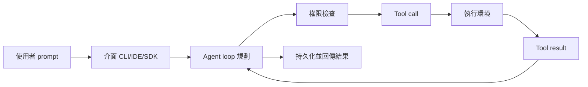

## EP232: 6 Frequently Used Orchestration Frameworks in an AI system

整理 AI 系統常見的 6 種 agent 編排框架、6 種降成本手法，以及 Claude Code 如何處理一次請求。

**Why** AI 系統需要管理多 agent 的任務分派、失敗處理與共享記憶，且 AI 帳單成長很快，需要有系統地降低成本。

**How** 編排框架依控制方式區分：LangGraph 用圖、CrewAI 用角色、OpenAI Agents SDK 由 LLM 決定是否交棒、Google ADK 為混合式、Claude Agent SDK 則把編排放在 agent 內部。降成本則靠快取、路由、批次、縮減 context 與縮小模型。

**What** ByteByteGo EP232，列出 6 個框架（LangGraph、CrewAI、Microsoft Agent Framework、OpenAI Agents SDK、Google ADK、Claude Agent SDK）與 6 種成本策略（prompt caching、model routing、Batch API、semantic cache、trim context、smaller model）。另有 SQL 執行流程，以及依 Claude Code 原始碼畫出的 8 步請求流程：整個系統就是迴圈重複，直到模型不再要求工具。

### 重點
- 6 種編排框架的控制方式：LangGraph 圖狀態轉移、CrewAI 角色、MS Agent Framework 圖加檢查點與人工暫停、OpenAI Agents SDK 由 LLM 決定交棒、Google ADK 混合、Claude Agent SDK 編排內建於 agent
- 6 種成本策略：prompt caching、model routing、Batch API、semantic cache、trim context、smaller model（蒸餾/量化）
- Claude Code 請求流程為 8 步迴圈：介面→agent loop→權限檢查→tool call→執行→結果→持久化，重複到模型不再呼叫工具

**原文：** [substack-bytebytego](https://blog.bytebytego.com/p/ep232-6-frequently-used-orchestration)

---

### 📄 原文內容

點此展開 / 收合

A state-of-the-art, fully assembled agent harness (Sponsored) Match or beat harnesses on accuracy with 28% fewer tokens. Strands harness is open source and ships with benchmarked defaults for the system prompt, tools, memory, sessions, and context management, so you can skip wiring up a harness piece by piece. Spin it up from the CLI or in a few lines of Python or TypeScript. Nothing is a black box: swap model providers, override any default, or drop down to the SDK primitives with no rewrite. Then validate before you ship with 25+ built-in evaluators. From idea to production with fewer tokens wasted. Get started This week’s system design refresher: 6 frequently used orchestration frameworks in an AI system Top 6 Cost Optimization Strategies in AI Systems How a SQL Query Executes Inside a Database How does a request actually travel through Claude Code? 6 frequently used orchestration frameworks in an AI system Orchestration in an AI system manages tasks across agents, handles failures, shared memory and context. LangGraph: This uses a graph-based technique where workflows are represented as nodes and edges determine the state transitions. CrewAI: A role-based abstraction technique is used here. Agents are assigned a defined role and goal that enables them to work on the tasks sequentially or via a manager agent . Microsoft Agent Framework: This framework is designed to handle organizational workflows. It also uses graphs with built-in branching, checkpoints, and human intervention pauses. OpenAI Agents SDK: An LLM driven runtime approach is used, where an agent decides whether it should delegate control to other agent or retain execution to complete the task itself. Google ADK: Hybrid control approach is used where a developer defines a strategy to run tasks and a root agent splits and distributes tasks to sub-agents. Claude Agent SDK: No separate layer for orchestration exists. It lives inside an agent which gathers context, works with tools, evaluates and keeps going until no calls left. Top 6 Cost Optimization Strategies in AI Systems Your AI bills can grow quickly. The diagram below shows the top 6 techniques to make your AI system less expensive. Prompt caching: This technique caches stable prefixes like system prompts and tool schemas. This means the model can skip redundant computation on requests with a shared prefix. Model routing: A router sends simple queries to a small model and hard requests to a frontier model. Since a lot of queries are simple in practice, this can save a lot of money. Batch API: This technique processes large jobs asynchronously by batching the requests first and then sending them. Providers often offer discounts on batch requests. Semantic cache: We use an embedding model to cache queries. When there is a hit, the stored answer will be reused instead of calling the model again. Trim the context: This technique trims the conversation history. This prevents sending the whole conversation every time, which can be costly. Smaller model: We can also use techniques like distillation or quantization to convert a large model into a smaller model. Over to you: Which of these techniques are most useful in production? INFER/CON: Meet the People Building the AI Stack (Sponsored) Join AI engineers, researchers, founders, and technical leaders at INFER/CON on November 16 in San Francisco. Convened by Datadog, this one-day conference brings together speakers from Anthropic, Together AI, Inferact, Fireworks AI, and more. Explore inference performance, production reliability, evaluation, and the economics of AI alongside the people building and operating these systems. Expect technical conversations, practical perspectives, and opportunities to connect with peers tackling similar challenges. Attendance is free and by application only; all applications are subject to approval. Use exclusive code to apply: Byte/VIP Apply to attend How a SQL Query Executes Inside a Database Parse and validate: The database parses the SQL to check it is syntactically correct and the referenced objects, columns, and data types are valid. It converts the SQL into a logical query tree. Rewrite and Transform: The database simplifies and restructures the query tree so it can be executed efficiently. Optimize and choose a plan: The database evaluates the most efficient way to run the query. It compares different execution plans and selects the best plan that is supposed to use the least time and resources. Execute the plan tree: The database runs the selected plan operations, like filtering, joining, and sorting, typically from the bottom of the parse tree to the top to produce the results. Access cache and storage: The database retrieves the required data during execution from the cache when it is available or reads from the storage when it is not. Return rows: The final result is formatted and sent back to the client. How does a request actually travel through Claude Code? Most of us type a prompt and watch the magic happen. The diagram below shows what's really going on behind the curtain, based on the Claude Code source code. Let's trace one real request: "Fix the failing test in auth.test.ts." Step 1: The user sends a prompt to Claude Code through their interface. Step 2: The interface (CLI, IDE, or SDK) wraps the prompt with repo and file context and hands it to the agent loop as a request. Step 3: The agent loop plans the next move and proposes an action: Edit(auth.ts, lines 42–58). Step 4: The permission system checks the proposed action against the rules. Step 5: The approved action becomes a tool call: Edit(auth.ts, patch), dispatched to the matching tool. Step 6: The tool runs in the execution environment (shell, cloud, or sandbox) as a real syscall. Step 7: The execution returns a tool result back to the agent loop. Step 8: The agent persists the turn to state and streams the final message to the user. The whole system is just this loop, repeated until the model stops asking for tools. Over to you: which step in this loop do you think is the hardest one to get right when building your own coding agent?

