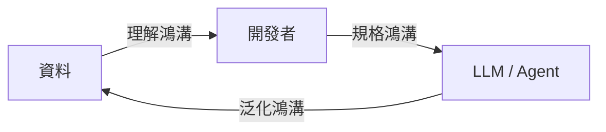

## Evals for AI Engineers

把 LLM 應用失敗拆成「看不懂資料、說不清需求、模型做不穩」三道鴻溝，各用不同方法解。

**Why** 評估 AI 產品是最難也最重要的環節，建議眾多互相矛盾，團隊常只能籠統說「模型不好用」。

**How** 用 Three Gulfs 框架診斷：理解鴻溝（開發者與資料）需大規模檢視輸入與輸出；規格鴻溝（開發者與模型）需把 prompt 的隱含選擇寫明；泛化鴻溝（資料與模型）即使前兩者都做好仍會偶發出錯，需靠自動化評估量測失敗頻率。

**What** 節錄自 Hamel Husain 與 Shreya Shankar 的書《Evals for AI Engineers》（O'Reilly），以「email 處理 agent」為例，並延伸到客服機器人與程式碼助理。框架可作團隊共通語言，區分「規格失敗」與「泛化失敗」。

### 重點
- 三道鴻溝：Comprehension（開發者↔資料）、Specification（開發者↔LLM）、Generalization（資料↔LLM）
- 診斷順序：先看輸出找錯誤；若 prompt 沒寫明就是規格問題，改指令；已寫明仍錯才是泛化問題，用自動化評估量測
- email 範例：prompt 未規定摘要格式、寄件人用顯示名稱或完整地址，會導致不同次執行格式不一

**原文：** [substack-bytebytego](https://blog.bytebytego.com/p/evals-for-ai-engineers)

---

### 📄 原文內容

點此展開 / 收合

GlobalFoundries on Taking AI Agents to Production (Sponsored) Getting AI agents into production at enterprise scale raises hard questions: what data they can reach, how fresh it needs to be, and how to keep them in bounds. At the Agentic Data Summit on December 9, Vishal Mehra, SVP & CIO at GlobalFoundries, shares how one of the world’s leading semiconductor manufacturers is putting agentic AI to work. Hear why GlobalFoundries chose Redpanda, what the team built, the results so far, and lessons for peers. Catch GlobalFoundries live at 10:00 AM PT. The summit is free and virtual and runs 8:30 AM–2:00 PM PT. Save Your Seat AI evals are one of the most important and hardest parts of building AI products. Getting started can feel like navigating a maze of conflicting advice. I reached out to Hamel Husain , an ML engineer at OpenAI with 20 years of experience, to share a practical introduction to AI evaluation. Previously at Airbnb and GitHub, Hamel has helped more than 35 companies build and evaluate real-world AI products. He coauthored Evals for AI Engineers: Systematically Measuring and Improving AI Applications with Shreya Shankar , an ML systems researcher and PhD candidate at UC Berkeley focused on LLM evaluation and data quality. Together, they’ve trained more than 4,500 engineers and product managers through their AI evals course. In today’s issue, we’re featuring an excerpt that introduces the Three Gulfs of LLM Application Development : understanding your data, making your requirements explicit, and getting the model to follow them consistently. Check out the book Excerpted from Evals for AI Engineers by Shreya Shankar and Hamel Husain. Copyright © 2027 Hamel Husain and Shreya Shankar. Published by O’Reilly Media, Inc. Used with permission. Evaluation in Applications At the application stage, the model has already been trained. The work is in building around it. You have to decide what the product should achieve, translate that goal into prompts and agent logic, and then verify that the model’s outputs are acceptable. Each of these steps introduces its own difficulties: Objectives are vague at first. A goal like “summarize emails” sounds simple, but only when you inspect outputs do the ambiguities appear: how detailed, in what format, and with what exclusions? Instructions might have gaps. Prompts and agent logic expressed in natural language rarely capture the full intent, which leads to inconsistent or incomplete behavior. Behavior changes on new data. A setup that works on a handful of test cases may fail once it encounters the variability of real inputs. In practice, these issues show up again and again when building LLM applications. To reason about these challenges more systematically, we use the Three Gulfs framework, which names three places where development tends to break down—comprehension, specification, and generalization. Each gulf highlights a different point where development typically goes wrong, and each requires a different strategy to address, a theme we will return to throughout this book. The Three Gulfs of LLM Application Development As mentioned, a useful way to understand the challenges of building with LLMs is the Three Gulfs model (Figure 1-1), adapted from Shankar et al. (2025) and inspired by Norman (1988). The model highlights three common gaps that developers face when building and evaluating applications. We call these gaps comprehension , specification , and generalization . Throughout this book, we will use this framework to diagnose why an application is failing, and select the most appropriate strategy to fix it. Consider an agent that processes incoming emails sent to an organization. The goal is to extract the sender’s name, summarize the key requests, and categorize the email. At first glance, this seems straightforward. But each stage of development exposes different challenges across the Three Gulfs. Figure 1-1. Three Gulfs model of challenges in LLM agent development, adapted from Shankar et al. (2025) The Gulf of Comprehension (Between the Developer and Data) The first gulf is between the developer and the data. To build effective prompts and agents, you need a solid grasp of what your inputs actually look like. Without that, you will design against an imagined version of the task, not the real one. Consider the email processing example. If you only look at a handful of clean, well-written emails when drafting your prompt, you might write instructions that work fine on those cases. But the production data will also include forwards, replies with long quoted threads, messages with signatures in multiple languages, and poorly formatted text copied from PDFs. A prompt that ignores these realities might lead the LLM to, for example, summarize an entire quoted thread instead of the new message, or mistake a signature block for the main request. The Gulf of Comprehension applies to outputs too, not just inputs. We also need a clear sense of how the LLM behaves on those inputs. You cannot read every output it generates, but you still need to recognize the common ways it succeeds and the common ways it fails. Otherwise, it’s easy to be misled by a few good examples and miss the patterns that only show up at scale. In the email agent, for example, the LLM might usually extract the sender and write a decent summary. But when you look closer, you may notice recurring mistakes. The LLM might pull the wrong name when several are mentioned, drop key details in longer messages, or copy boilerplate like confidentiality notices into the summary. These failures may only happen occasionally, but if they occur, the system will feel unreliable to users. Bridging the Gulf of Comprehension means developing strategies to characterize both your inputs and your outputs at scale, so you know what the data really looks like, and how the system actually behaves, without having to inspect everything by hand. The Gulf of Specification (Between the Developer and the LLM Agent) The second gulf is between what we want and what we actually tell the LLM to do. Our intent (the task we have in mind) is often only loosely captured by the prompts or agent logic we write. Natural language is imprecise, and small gaps in how we phrase things can lead to large differences in behavior. Take the instruction: Extract the sender’s name and summarize the key requests in this email. At first glance it looks specific, but important details are left unstated. Should the summary be a paragraph or a bulleted list? Should the sender be the display name, the full email address, or both? Should implicit requests be included, or only explicit ones? How concise should the summary be? The LLM cannot fill in these choices for you. If you don’t make them explicit, the system will guess, and those guesses will not always line up with what you expect. That’s why two runs of the same agent might produce outputs in different formats, with varying levels of detail, or with inconsistent handling of edge cases. The Gulf of Specification is this gap between our intent and our instructions. Closing it requires making expectations explicit and aligning them closely with the data the agent will actually see. Limit agent reach. Record everything. Terminate agent access (Sponsored) Most enterprises hesitate to connect AI agents to production infrastructure. It feels risky, so they keep agents out of production or approve every step by hand. Teleport Beams is different: Trusted runtimes for AI agents in production Agents propose execution plans for human or LLM judgement Separate runtime executes with only approved access No secrets in the agent’s environment Trace actions and LLM conversations, flag behavior that drifts from intent, and terminate agents and their connections with a kill switch. Explore Beams The Gulf of Generalization (Between the Data and the LLM Agent) The third gulf is between the data your system sees and how the LLM generalizes to it. Even if you have a solid grasp of your inputs and have written a clear, well-scoped prompt, the LLM is still prone to errors. LLMs are not perfect, and they will make mistakes. For example, imagine you’ve clearly specified that the system should extract the sender’s name from the email header. Most of the time the LLM follows this instruction. But occasionally, when the body of the email mentions another person (say, a public figure), the LLM will incorrectly return that name instead. Nothing about your understanding of the data or your prompt was wrong. The LLM simply failed to apply the instructions consistently. Maybe the LLM is too biased in favor of names it has seen in its training data. This is the Gulf of Generalization: the fact that LLMs can behave unpredictably even when comprehension and specification are handled well. These errors usually become visible only when the system is exposed to the full variety of real-world data. And they are unavoidable: no matter how advanced the models become, there will always be cases where they produce the wrong output. Applying the Three Gulfs to Other Domains The Three Gulfs apply beyond email processing. For example, in a customer support chatbot, the Gulf of Comprehension is about the full variety of customer queries, including multilingual messages, typos, and multi-part questions. The Gulf of Specification is about defining what a “good” response looks like; a bot that apologizes when it should escalate to a human is following the wrong instructions, and without explicit rules the bot will guess. The Gulf of Generalization shows up when the bot handles billing questions well but fails on product-specific questions it has seen fewer examples of. In a code generation assistant, the Gulf of Comprehension is about how developers actually describe what they want, which often includes vague requests, incomplete context, and references to undocumented internal APIs. The Gulf of Specification is about defining output format, error handling, and style conventions. The Gulf of Generalization shows up when the model produces correct Python but fails on less common languages or complex multi-file changes. The evaluation strategy for each application depends on which gulf is the primary source of failure. Why LLM Agent Evaluation Is Challenging Evaluating LLM applications is challenging because every application requires bridging all Three Gulfs (Comprehension, Specification, and Generalization) again in its own context. Evaluation is not a one-time check. It is an iterative process where requirements become clear only after you interact with real outputs. Tip: The Three Gulfs framework provides a shared vocabulary for discussing LLM application failures. When debugging with your team, you can quickly identify whether a problem is a “specification failure” (the prompt didn’t make requirements clear enough) or a “generalization failure” (the LLM isn’t applying instructions consistently). This common language helps teams diagnose issues faster and choose the right fixes, rather than debating vague notions of the model “not working.” When you start examining outputs (closing the Gulf of Comprehension), you will inevitably find mistakes. The next question is whether these mistakes are due to incomplete specification or to failures of generalization. If the prompt does not make the requirement explicit, you may fix it with better instructions or agent design. If the prompt is already well specified and the LLM still fails, then the issue lies in generalization, and automated evaluations can help measure how often that failure occurs. Applications also differ in how much they can rely on users to bridge the gulfs on their own. In a coding assistant, maybe we can assume programmers have high agency. They know how to specify requirements precisely, they can read and debug generated code (comprehension), and they can run tests that expose when the LLM has failed to generalize (e.g., generating a working React ap

[... truncated for safety ...]

