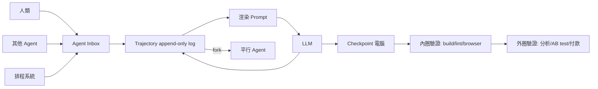

## What it takes to set intelligence free — Fabian Hedin, CTO, Lovable

Lovable 的 CTO 分享讓 AI agent 能連續跑 10 小時以上的架構：把任務紀錄、運算環境與驗證迴圈三件事拆開設計。

**Why** 2023 年他們太早打造多 agent 框架（主 agent 派生前後端 agent 互傳訊息），結果產品變差，後來退回單一 LLM 的簡單系統；如今模型夠強，agent 才真正可行，但要長時間運作就需要穩定的執行底層。

**How** (1) 每個 agent 有獨立 inbox，軌跡（trajectory）是仿 git 的 append-only log，每個事件指向 parent，可 fork 但不能 merge，prompt 從 log 另行渲染以便壓縮並適配不同模型，處理程序本身無狀態，因此每天可部署約 700 次而不打斷長任務；(2) 對整台電腦做 checkpoint（含磁碟、記憶體、執行中程序），並用 RAM copy-on-write 與串流載入記憶體加速 fork；(3) 驗證分為回合內（build、lint、type、runtime error、headless browser）與回合間（流量、A/B test、付款轉換等商業指標）兩層回饋迴圈。

**What** Lovable 平台目前每分鐘處理超過十億 token。黃金 checkpoint 複製約 230 毫秒；他們把 Vite 用 Rust 重寫，程式啟動快 2 倍、預覽從 14 秒降到 3 秒、記憶體用量少 6.5 倍。agent 以前被限制最多跑 30 分鐘，現已不設上限。

### 重點
- Trajectory 仿 git：append-only log、事件指向 parent、可 fork 不可 merge；prompt 與任務歷史分離，處理程序無狀態，因此每天約 700 次部署不中斷 10 小時以上的 agent
- 電腦 checkpoint 含磁碟、記憶體與執行中程序；黃金 checkpoint 複製約 230ms，搭配 RAM copy-on-write 與串流載入記憶體加速 fork
- 以 Rust 重寫 Vite：啟動快 2 倍、預覽 14 秒降到 3 秒、記憶體少 6.5 倍；整體系統每分鐘處理超過十億 token

**原文：** [youtube-ai-engineer](https://www.youtube.com/watch?v=pZWPq_ZAmM4)

---

### 📄 原文內容

點此展開 / 收合

[music] Welcome everyone. Glad to be here. I'm Fabian, co-founder and CTO of uh of Lovable. And um we spent the last three years or so building a platform to let anyone create software and then operate that and deploy that software. Um and um the the topic of today is what it takes to set intelligence free. Um really um for us this takes us back to when we when we started three years ago and um I have to say I have a bit of a complicated relationship with with agents. Um and I I'll tell you why. um we almost uh failed as a company because we thought um back in 2023 that hey we these agents are the future so let's build for them now um I think they we kind of turned out to be true that they were the future but we were definitely wrong on the the now piece in in 23 so this was back in kind of GPT4 days um and um at the at that time the intelligence was simply not there to have more of these kind of complex agentic systems Um but now it is right now uh now the intelligence is actually at a place where where you can really build out more complicated systems around them. Um and so I I'll give you kind of a quick um background story here of uh of our journey um in in working with intelligence or or these LMS. And so um back in 2023 we built the first version of our product. We called it GPT Engineer back then. Um, and uh, really the UI was very similar to what it is today where you kind of have a chat and and this preview. Um, but uh, the AI at that point was uh, quite simple. We just had a prompt and a response, one LM call per user message. Uh, very simple. It it worked fine. Um, but you could kind of build one page apps and and simpler applications with this. Um and then um we thought okay this intelligence is going to keep on evolving so we have to be ready for uh for it as it evolves and so we thought let's go out and build this agentic framework and so we we went and we built this very sophisticated there I say beautiful framework for for agents to work and um we had kind of this one main agent that would talk to the user and that agent would spawn other agents like an implementation agent here in the example And each agent could have a specialtity. This agent would kind of specialize in the first generation of an app. And then you would have like a front end agent and a backend agent. And they would all talk to each other, send messages back and forth. And we thought, "Oh, this is beautiful." And there was papers around this and how well this could work. And uh in the end, it didn't work at all. We just made the product worse. Um we um we definitely [clears throat] failed [laughter] on this one. Um but uh luckily before we ran out of money we figured out like hey let's go back to a simpler system again. So uh in late 24 we went back to a much simpler um system where it was a bit of a shame where we had like some some smaller LMS doing some knowledge retrieval and then really just one main LM kind of writing to the user and and writing the code in the same message. And this worked great. it was very responsive for for users in the UI and and it was reliable and users were kind of in it and and iterating with uh with the model. Um and so um let's close that down. Um but now it's time again. We're back. We're so back. Agents this time uh they work um and uh we're running them in production over a billion tokens per minute on on on these systems that I'm going to talk about. Um but um first just looking at okay what is actually lovable. So uh if you simplify the UI and this was same back in 2023 as it is today. Uh to the left we have a chat where humans come in and they kind of describe their their intent to to build or whatever they want to do. And to the right you have a preview uh which is the output or or the outcomes of uh of what you're building. Um and this back in 23 you could do simpler things with right but now we've really seen working at this layer of abstraction you're able to build very complex things right and I think we've even seen uh a lot of tooling meant for for developers for example moving to this type of interface where you're not really looking at the code every day and so on and you're getting kind of abstracted and working on on be architecture uh or looking at some kind of output of of what you're And um this is something that we've always believed in and it's been kind of a core thesis behind lovable that you won't have to care about the code in in the same way that you had had to do before. And I think today we're kind of in this almost a bit in between I think in the industry where you know some people might say oh you don't have to care about code at all and some people might have different opinions. Um um I of course like growing up coding and these things you get a bit attached. Uh but in the end what matters is is actually not the code. Um sorry if we remove that last part but uh what what matters is uh is the outcomes right? Um and so um the outcomes what is that? Well, for for our users, the outcomes is um uh creating a business and monetizing and creating value for for others in in in some type of way. And uh I'll kind of quickly go over um what we build as a platform to to enable this before I go in kind of on the uh on the technical side of this talk. So if you if you look at lovable the first thing that that you can say about the platform is that we have this agent and like any other agent it can do quite arbitrary things and it's quite specialized at at building software uh and it has access to a browser so it can verify what it's building and um it connects to to GitHub and you know it writes code that and you can do whatever you want with that code so on. So that's um kind of your basic uh coding coding agent. Um and the other pieces of the platform is this kind of cloud and and business piece of the platform. And so um the cloud part of the platform is is about just giving kind of these u hosting primitives just seamlessly to to this agent. And so we we built out databases, authentication, storage, uh all type of backend compute and security scanners and like backups and logs for all of these things. And all of it can be introspected by by the agent. Um, and this just makes it seamless to to build things. You don't have to kind of go to different services to set this together. We just kind of provide you uh these primitives. Um, so that's still around building software and hosting this, right? Um, but then the last piece is around um these business capabilities where uh again the output of what our users are doing on lovable, we don't see that output as code. the output is is a product or or a business. Um, and if you want to succeed as a business, you need to do more things than just write code, right? And so we we we help our users with uh receiving payments, sending emails, optimizing SEO, um, doing ads on on Google and meta um, and kind of analyzing what is happening with the product through uh, through analytics and you can look at kind of conversions and and optimize these sort of things. and the agent is in the loop in all of this. Right? So that's kind of our uh capability offering you could say. Um and again the core part of this is an agent that all of these capabilities are built for. Um and at some point in level history we used to limit our agents to work for only 30 minutes because we thought they weren't reliable to to work for a longer amount of time. Um but uh now we've changed this to really be uh without any any sort of bound in terms of the length an agent can work. And so you can imagine agents working for for 10 hours plus. Um and so I'll I'll go into some of the things that we've done um in our architecture to to enable this. And so the first piece is really around the agent runtime itself and how how we enable that to to run for a longer amount of time. And the second piece is the computer where each of these agents are actually doing their work running a dev server um and um actually verifying what it's doing. And so so the last piece then is the verification itself where if you want an agent to to work for a long amount of time, you need to make sure that you have these feedback loops in place so that it's not kind of going off uh in in in the wrong direction. Um and so if we start by looking at the agent runtime itself um you can imagine that um um you have um really three different sources that can um interact with an agent. So it can be yourself kind of prompting this or a human. It could be other agents and it could also be just a system on on a schedule waking up. And the way we chose to architect this is that for for each agent we have a separate inbox uh where any of these sources would kind of send in messages. And so you might have a message here like what's the status? Um and you can imagine you have this agent and this agent is kind of an always on agent that that might be working right. And so um you can imagine it has done like three actions here a request a tool call and it got some some result. And then at this point the agent is ready to actually receive uh messages. So um since anyone can drop a message into this inbox, the agent then can copy that itself into its own uh what we call a trajectory basically it's a task history. Um and this is the type of interaction that I think you're familiar with if if you're using agents overall. Um so that's kind of the the first design principle uh behind this agent runtime. I'll go through a few more here. And so um the the trajectory in which the the agent is working in which is kind of the history of what has happened so far um and really the basis for any sort of of memory for for for the agent right um and we designed this trajectory with uh really git as inspiration and so the trajectory what is it it's an append only log where each event uh points towards a parent the previous event Um and because of this you get um a nice um capability just like in git where you can fork things right. So you can have two events pointing to the same parent which essentially creates a fork. Um and because of that you can kind of spin up parallel agents at um um at any point of time in the history without having to duplicate all of the kind of the shared history. Um and um semantically it's a bit unclear what would happen if you merge this. So unlike it we cannot merge agent trajectories but we can kind of um spawn them out right and these agents can can talk to each other. Um the other thing that uh we made sure to design for is that this uh agent trajectory it includes kind of the full history and everything that happens uh with the agent. So every tool call um a bunch of other things happening on the platform if a tool call like failed or succeeded and a bunch of things that might not be fully relevant for a prompt. But um then what we've done is to make sure that we have this appendon log and and from that we can actually build a prompt that we would feed into into the actual LM. And um you might ask why why why would you want to do this? Well, um, one one reason is that, um, when you build a prompt, you if you have a long history, you probably want to do some sort of compaction. You want to summarize part of that history, um, in in the earlier steps, for example. Um, but this summarization would differ um, for example, if you use different models with different context lens, you would probably think differently about when you should summarize and not. And so by separating the the prompt from the actual task history, we're able to render prompts for for any type of model or or any type of task um that um that we can kind of find the best and optimal prompt for. Um so to show this event history in in progress, we have this debug tool here. So here it's just recording of me dragging this uh slider in our UI. And you can see on the right that uh um the UI is kind of updating as I'm as I'm dragging this along. And you have 156 events here and one each of those is an event in this event history. Uh and you can see how how the UI can render kind of any point in history. And this is just showcasing that at any point in time we have full control of um of say the UI or or anything else happening on the this platform thanks to um this history kind of detailing everything that has happened. Um the the last piece I'll go over here on the on the runtime itself is that um the process that is running these agents, they're separate from from the actual task history. And so the process is uh almost entirely stateless in that uh between each each call each call each turn um it will actually just persist into the task history. And so you can have a process come and go. Um and and then the question is why why do we care about this? Um well at lovable this system um we deploy to it um 700 times per day. So that's about once every two minutes. And you can imagine if you have um a agent working for for 10 hours um you want to not disrupt that agent when it's working, right? This this agent is doing something for for a customer. Um but at the same time we want to make sure that this agent is running on the latest deploy. and it might be a new feature or something like that, but it might also be like a security vulnerability in in the Linux kernel and it's like, okay, we need to update this ASAP. Um, and and so to do that, thanks to this separation between the actual history and and the processes, we can actually make sure that we have one one agent that is working on one task, but we can have different processes taking up and actually doing the compute behind that work. Um so so this task can keep on working while we have um different deploys um working on it be it for 10 hours or or even longer right um so that's the agent runtime the second piece of um of this platform right is the is the computer so this is where the work is actually happening um and we've been through a lot of iterations and a lot of vendors kind of working with um um providing these sandboxes for for the computer for for agent to work in and we've landed in in this system that we've worked really hard now to develop which is um um checkpointing um a computer and so you can imagine you come to level you start a new project uh we have this common what we call a golden checkpoint which contains the OS and the system services it has common tools installed and a dev server that is ready to start and this checkpoint it it includes everything on disk uh memory and also running processes And and so when you start a new project, you get all of that for free. And uh all of that is copied over in about 230 millonds. Um and so once you start a project, you you might have some specific code and and some dependencies within that project. Um and um that is also checkpointed as you go. And and so each time the the agent is running and it finishes a turn, we will actually save a checkpoint of of that computer. And and from that we're able to again like very quickly sub-second uh uh spin that computer up whenever you need it. That means we can save on on resources by kind of spinning this down. If you leave for say 10 minutes or or so and come back, we can just spin it up extremely quickly. So you don't even notice this. And even uh kind of requests um in transit will will not even be dropped in in this setup. Um the other thing we can do thanks to uh this checkpointing is that just like the trajectory itself uh in the agent runtime we can also fork um the computer and uh when we do this um we have for example we have um a feature in in level that is called drafts where you kind of work in different environments of what you're doing and and to support that we need to fork the computer that you're working in. Um and um here we have um um kind of the example of doing two at the same time. And um you can imagine doing hundreds of these, right? Um and so um we've we've had to do uh some optimizations to make this feasible to to actually run. So one of these optimizations is copy and write on the RAM itself. And so creating one of these forks of a computer is uh is basically free in terms of of the RAM that it's using. But um as soon as you start writing um um in in a process to to RAM, we will kind of copy that page over and only then will you start having to allocate new memory. Um and and there's another optimization here also which is that um each of these sandboxes require a few hundreds of megabytes of memory. Um but and that would take a few seconds to stream in if you have it in like cold object storage and then it has to go to disk and then then into memory of this uh um this VM. But um thanks to uh um being able to stream the memory, we can actually boot up the uh the machine before all of the memory is is actually um ready on it. So the the memory the OS uses comes first and then like some processes and so on will will start to work as soon as the memory gets there. And this also shaves off uh some some extra startup time. Um and then we started asking ourselves how can we make this even more efficient and even more faster for our users. And so you might be familiar with V. It's this great dev server that most of the meta frameworks out there in the JavaScript ecosystem is using. Uh and so we we took that and we forked it and we rewrote it in in Rust. And uh that made our code starts two times faster and we went from getting this preview from 14 seconds to to 3 seconds. And the main um kind of thing that we made faster here is that vit uses nojs and we're able to like drop that dependency off vit itself and just have this rust binary. So um that made the memory footprint be 6.5 times less uh in these machines. Um and by taking control of the applications that we're running in these computers, we're also able to control kind of how we write to memory. And so when we control how we write to memory, we're even more optimizing. If you remember back to the kind of the copy on write solution when we're drafting different um um different computers and so we're able to uh run this extremely efficiently so that we can run um lots and lots of agents in in parallel and kind of have agents explore different solutions to solving a bug or improving the performance of of your applications and and so on. Um and so this has been fun. Um [laughter] uh but the last piece now is is about verification. And of course this kind of computer and this dev service is a big piece of being able to verify what an agent is doing. Um and if you look at verification, you can think of these feedback loops, right? That the agent needs to get information. It took an action. Was this a good action or was it a bad action? And um you can think of it as this inner loop and this outer loop. So this inner loop is um during the turn of the agent. Then you have kind of obvious things such as like the um is the build working? Do we have lint errors or type errors in the code that we're running? And then you can check for runtime errors in in the preview that you're running. You can also have within this computer a headless browser where the agent can go in and kind of explore um the the web app it's it's building or whatever it's building, right? Um and and a bunch of other things that we're using to help verify within the turn of an agent. But then you also have this outer loop which is kind of between each turn and the turn you can think of like when the agent is yielding to you as a user. Um and um between each turn you might get some info on on the product itself uh from from production from your users right and so you can look at how your visitors are behavior are behaving um what users are are telling you online uh you can do automatic AB tests and actually see change some copy and see is this improving conversion and so on and then you can also take these business metrics and and remember this goes back to kind of the capabilities I showed you by having control over these things we can make sure that we can optimize how the agent is is getting this outer feedback loop. So, we can make sure that if you're running payments, we can actually uh track those transactions and conversions and make sure that um the agent can actually help you optimize uh not only the the code, right, but the the business strategy um around around your product. Um and so those are really the the three things that uh that we've been working for and we'll continue to kind of build out um these uh these capabilities and this architecture around really orchestrating these LMS into into agents. And so um this aentic system that we're building is running billions of tokens per minute. um and um um these computers, right? We can spawn up with each agent and we can have multiple agents use one computer. And now we're kind of back to this uh uh quite beautiful setup where you have agents talking to agents and they're orchestrating and and this time it's it's actually working and it's working at scale thanks to some of these optimizations. Um and so if you're curious to try this out, you can head to level.dev and you'll you'll see our our previews spinning up and and so on, but you'll get a very simple and um a nice interface and you won't have to care about all of this stuff. Uh thank you so much. It's been pleasure. Um and uh yeah, hope you hope you learned something. Thanks so much.

