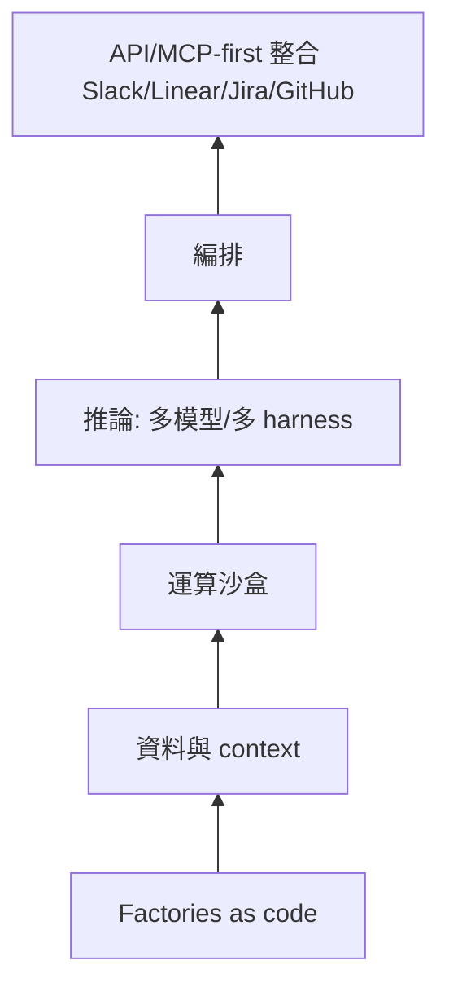

## Engineer Your Coding Agents Like Any Other System — Zach Lloyd, Warp

把 coding agent 當成一套要工程化的系統來管理，用程式碼定義、持續量測、閉環改進，而不是靠感覺各自使用。

**Why** 本地互動式 prompt 受限於人的產能、無法自動化；每人各自選模型與技能，難以管控成本與生產力，也帶來安全與治理問題。

**How** 以類似 Terraform 的宣告式程式碼定義整座「軟體工廠」（agent、觸發、工作流、MCP、執行環境），集中記錄所有 agent 對話與產出，跑線上 eval 評分，再讓 agent 針對失敗模式對工廠定義提 PR 自我改進，並用自己真實任務建立 benchmark 重播比較不同模型、harness 與技能。

**What** Warp 創辦人 Zach Lloyd 將軟體工廠定義為「以程式碼定義、持續量測並改進雲端 coding agent 的閉環系統」，並提出由下而上的堆疊：factories as code、資料與 context、運算沙盒、推論（多模型、多 harness）、編排、API/MCP-first 整合。例子是用「redundant tests」eval 抓出 agent 寫多餘測試的失敗模式；Warp 稱藉此大幅提升吞吐並降低成本，但未提供具體數字。

### 重點
- 軟體工廠定義：程式碼宣告、持續閉環改進、一切可量測三要件，並非只是自動化、共用 skills/MCP 或個人 agent 群
- 自我改進流程：線上 eval 評分（如 redundant tests）→ agent 找失敗模式 → 對工廠定義提 PR
- 用自己真實資料建 benchmark 重播，比較模型、harness、移除 skills 後的成本與品質，勝過看公開排行榜

**原文：** [youtube-ai-engineer](https://www.youtube.com/watch?v=0LeT996Hz3E)

---

### 📄 原文內容

點此展開 / 收合

[music] All right. Hi everyone. Uh excited to be here and today I'm going to chat about the evolution of software factoring software engineering and how it's becoming factory engineering. So excited to do this. First a little bit about me. Uh I've been an engineer for a long time. I was a principal engineer at Google. I used to lead engineering on the Google Doc Suite. Uh helped scale that product to hundreds of millions of users. I'm currently the founder and CEO of Warp. Uh Warp builds a platform uh for companies to build their own internal software factories. I'm going to show a little bit of that today. Um Warp is also well known for our open-source Aentic terminal. Has about 65,000 GitHub stars. uh it's used by almost a million developers. Our mission has always been helping developers ship better software more quickly and it's it's it's cool to evolve what we're doing as the world changes around us. Um this is where I think we're still mostly at. Uh most developers that I talk to, most platform teams, um they they are working with individuals who are running their own coding agents locally. Maybe they're running uh multiple of them at a time. Uh could be through their terminal. It could be through an agentic development environment. Um just show of hands quickly actually how many people in here are mostly working in this fashion local multi-threading. Okay. So still still most people but actually not everyone. Um I think that this is going to change and is starting to change already. Uh the the reasons are there's a few of them. So one is like if you are doing local interactive prompting as your main way of working with coding agents um you're kind of limited by you know human throughput really like you cannot automate uh if every agent needs to be interactively prompted there's a second reason too that I hear a lot from platform teams um and from you know engineering leaders this mechanism of like everyone choosing their own local setup their own models their own skills uh it makes it very hard to actually make sure that you're using these agents efficiently uh from like a cost perspective and a productivity perspective. And then finally, there's like a you know big security problem and governance problem when everyone is setting up and running their own local agents. And so the thing that uh is coming uh I loosely call a software factory that means different things to different people. Um, I would well I'm curious for people in this room like how many folks are currently trying to build or building or using their own internal software factories? Show of hands. Okay, so I would say that's almost more than the interactive agents at this point. That's super cool. Um, so I'm going to define what I think of as a software factory, but I'll start by saying what I think a software factory is not. Um, I think it's not just a loose set of automations. Uh, I don't think of a software factory as a collection of AI teammates. Uh, I don't think it's a shared set of skills and MCPs. And I also don't think software factories are personal agent swarms. I think these are all useful primitives, but they're not the end state that we should be shooting for. And so to me, the way that I define software factory is very specific. Um, and I'll unpack this, but I define it as a code-defined closed loop system for continuously measuring and improving cloud coding agents. So that's a mouthful, but let me unpack it. So if you want to build a software factory and really scale it, I believe the first thing you need to do is fully encode it in a declarative language. So you need to say, okay, these are all of the coding agents that I want to run. These are how they're triggered when work comes into this factory. This is the workflow from issu, you know, from triage to spec, whatever your workflow is. You need to specify what MCPs are available, where your agents run really as much as you can in a Terraform style declarative uh, you know, set of code files that define your factory. I'll talk about why this matters in a bit. The second part of it is a continuous closed loop of improvement. And that closed loop can look something like this. This is the typical one. This is just really the SDLC. Uh where you have ideas that come in from people um uh they could come in from automated signals and then your agents do some amount of work um taking that issue through various stages from triage to implementation, verification, monitoring and so on. The important piece here is really this closed loop concept where the more that your agents run, the more efficient you can make this loop. And I'll talk about how you do that in a second. The third really key aspect if you're building a software factory is that everything needs to be measurable. um if if you're just going on vibes in terms of how you deploy coding agents, you can't be confident that you're actually um getting the best highest quality outputs the at the best cost. You can't be confident you're maximizing throughput. So you really need a measurement mindset and measurement capabilities. And so if there's one thing that I'm hoping people walk away from this talk with, it's the idea that the way to work with coding agents and the way to think about them is that there there's a really cool fundamental new engineering problem, which is how do you take this magic new primitive that we all have that we've gotten the last year that you have these intelligent agents and how do you engineer a system around them to use them most effectively. To me, it's not about like growing a garden or following a recipe. We're all engineers. We've spent our careers learning how to solve problems from an engineering mindset. And when you think of coding agents as a new engineering primitive, then you naturally want to you you'll naturally start to build a certain way of using them. That's the mindset. So, yeah, just to unpack that a bit. So there's continual measurement and continual learning, but there's also a new set of tools. And so when I was learning how to become a better engineer at Google, um you know, I really had to get good at using things like debuggers and profilers and Chrome dev tools. And basically there were all of these tools of the trade for building software by hand that maybe are not as important now but they really separated uh the the best engineers from the okay engineers. And in the new world of factory engineering there's a new set of tools that everyone should be trying to to master. And so those are things like eval. It's can you set up uh self-improvement loops that work? Can you write benchmarks? Can you AB test your factory? And that's a really important skill set. And that mastering that skill set is something that I I think of as like factory engineering. Now, that doesn't mean that that's the only kind of engineering you're going to be doing. You're still going to be doing product engineering. Meaning, you as an engineer should still feel responsible for, you know, does the product you ship actually solve a real user or customer problem? But the best engineers and I would say like every engineer really is going to need to learn this new tool set of how do you improve the system not just build the product. And so what does that look like? Uh if you think from first principles about how do you engineer an agentic system? I think you come up with something like this. Doesn't have to be exactly this but uh it's kind of an infrastructure stack that uh that you're going to want to use to engineer your agents. And so at the bottom of this is what I call factories as code. I talked about this earlier. It's defining all of your coding agent workflows in a in a code format. And the the value of that is that you get the ability to branch off it and test different factory configurations. you can roll back. And then crucially, it opens up the way for self-improvement, which is the ability for coding agents themselves to suggest changes to how your factory works to get that continual loop going. Above that is a layer of data and context. This is also crucial. So if you are running coding agents at scale in an organization, you you really must be recording every everything that those agents are producing. So all of their conversations, all their artifacts, the videos that they make, the screenshots. Uh and the reason for doing that is that's the raw material that you will use to improve the way your factory works over time. On top of that is a compute layer. Um so you need to have sandboxing. Uh sandboxing increases security. It makes your factory more repeatable. Your sandboxing should be probably multiplatform. On top of that is the inference layer. The way that I would think about inference and models in a factory is they are a degree of freedom to test. And so your factory, however you build it, should support multiple models. Um, it should also support multiple coding agents because you know cloud code might be better for some things. Codeex, pi, warp, these harnesses all have different properties. You might want to write your own coding agent harness that has some of your organizational context baked in. So your platform should support that. On top of that, you need an orchestration layer. So this is what actually moves work through the factory. In some ways the least interesting part, but you need that. And then finally, your factory should be all API and MCP first so that it can be used not just by uh you know people but can be used by other coding agents and it can go to where the work is being done. So your factory should integrate into things like Slack, Linear, Jira, GitHub, and so on. I'm going to give a quick demo of what some of these tools look like in the context of warp factories, but this stuff I'm going to show I think applies also if you're building your own. So let me start here. So the at the foundation I mentioned earlier is factories in code. And so I'm going to show some code. It's not going to be that interesting, but if you're familiar with something like Terraform, you will get what's going on here. You basically want a declarative way of saying this is my factory. My factory uh has certain policies. It accesses certain repos. It has certain triggers. It has a sort of blueprint that defines the workflow of work going through it. And then if you zoom out all of these other things that are part of the factory also have code definitions. The second thing moving up a layer is um the idea that uh uh sorry that everything that you do in the factory um should be tracked across your entire team. And so this think of think of what I'm showing here is this is a sort of Google Doc style live view of what every coding agent on Warps team across all of our engineers are doing at all times. And so I could click in and I could see okay I don't know what Maggie is working on but I know I could look at it. She's implementing Opus 55 on the high plan. She's doing it from Slack. It has this artifact. I could look in and see the actual conversation here. I could see what it's generated. And so I could see this in real time which is cool. But the really important thing is that you gather all this information so that it can be used for um improving the factory. And so that brings me to the third, you know, the third thing moving up the stack here is once you have all of this information that's being stored centrally, you get the ability very easily uh without doing any like install stuff on everybody's laptop, anything like that to to understand how these coding agents are working. And you can think of that in terms of like traditional output metrics like your Dora metrics like okay cycle time but you can also think of that in terms of like how automated am I like how many human interactions per PR what's your throughput you get um you should be able to see data very clearly here on like what's your cost again surfacing this if if you don't have this data you you're kind of flying uh oh uh you're kind kind of flying blind Um, so this is really important. And then there's this uh next layer of data which is also really important that I mentioned earlier which is the ability to set up online evals that run across all your coding agent sessions. And so what I mean by this, an eval is just like as these coding agent sessions are running and they're recording their output, you want uh the ability to to go back and have another agent look at them and score them on some dimension that might indicate how well they're doing. And to make that more concrete, so it's like we have an eval a score here that we use that is looking for redundant tests. This is a good example. And so one common failure mode of coding agents is that sometimes they will write tests that are unnecessary. We want to catch that and that's what this eval does. We want the ability then to see okay when it's writing too many tests why is it doing that? And is there a mechanism that we could change in the factory for improving that? And so again, just to kind of recap here, uh you want a way of recording all the runs. When these runs run, I didn't show this, but all of the runs are, you know, you want the a way of specifying um what is the sort of like actual loop that they're running through. You want to be able to see where they are in that loop. As the runs uh work, you want to be able to gather their data. Once you gather their data, you want to be able to set up these online eval. And then these online eval give you a sense of like, okay, where are their opportunities for improvement. Once you have that in place, you can do something that we call self-improvement, which is rather than having humans look at the outputs of these scores, you have agents look at the output. And so the way to think about self-improvement is like it looks at the score output. It says okay we saw some number of failed runs um let's try to look for patterns in those failures and suggest a possible solution and then the form that that solution takes is as a PR against your factory definition. And so this is like the awesome thing about having your factory defined as code and being able to use coding agents is that you can then have the coding agents diagnose problems with how they're working internally and suggest fixes to them. The final tool that I'm going to point out that I mentioned earlier is the ability to create and run benchmarks. This is also essential. So if you're following discourse online, you'll often see things like, okay, this is the best model. this is the new best skill, this is the best harness. The only way to answer those questions for real is to test on your own data. And so you should have in place some mechanism where you can basically create a benchmark set out of your real data. Um, and then uh replay those tasks. Oops, I'm on the wrong one here. and replay those tasks against different configurations to see how they would have done if you had varied some model or varied some harness or varied your factory configuration. So just to make this clear, this is something that looks like what you might get uh when a a new model drops like in SweetBench or Terminal Bench. It's showing the tradeoffs of different models here in terms of cost and quality. You want to be in this upper lefth hand quadrant, but it's on your own actual data. And you can you can test not just models, but also you want to be able to test, hey, if I got rid of these skills, does my factory perform better or worse? So, these are some of the tools. Um, and just to return to this big concept, like this has worked well for us. We have managed to use these tools to drastically improve our throughput and lower our cost. We we are just constantly doing this because this cost really matters to us where we're getting a performance baseline, we're scoring, we're benchmarking, we're testing, and we're doing factory engineering. And so that brings me back to this last point that I just want to emphasize again. Engineer your agents. It's a new engineering primitive. We're all engineers. think about how you can get the most out of them and build the system for that. I think this is very exciting. Um, I know there's a lot of like angst around what it means to be an engineer right now. I know we're not writing code, but I'm still using all the engineering skills that I spent my whole career learning. And so, to me, it's still a really exciting time. Uh, if you're interested in more factories, you can check it out here. Thank you all for coming to the talk.

