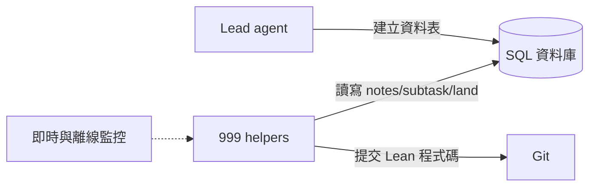

## 1,000 Claude Agents Formalized Fermat's Last Theorem — Lance Martin, Anthropic

讓一千個 Claude 代理人只靠 Git 與資料庫自行分工，完成費馬最後定理的 Lean 形式化；另展示模型越強越會用記憶，並可靠「做夢」整理記憶。

**Why** 形式化這類長時程任務原本需要領域專用 harness 與研究員協助；記憶方面則有「寫入時只看當下，卻要成為全域一致的地圖」的悖論。

**How** 多代理人實驗中，每個代理人有受限網路的沙盒，只能連 Git 與 SQL 資料庫，另有即時與每 10 分鐘的離線監控；lead 在約 5 分鐘內自行建立 announce、notes、subtask、land 等資料表來調度。記憶方面，讓 Claude 回顧並整理 transcript 與筆記（dreaming），如修正錯誤記憶、補齊 wiki 缺漏。

**What** Anthropic 的 Lance Martin 以 Fable 5.2 發布為背景分享。一個 lead 加 999 個 helper 約跑 30 小時、涵蓋證明中的 60 個陳述，且無領域專用 harness 與人工指引（9 月版只用約一打代理人並依賴 prove-to-me 平台）。記憶方面，CLB 基準中 Sonnet 4.6 幾乎無法受惠於記憶，更強的模型提升更多；Pokemon 實驗中 Sonnet 3.7 的記憶目錄雜亂、Fable 5 精簡且進度更遠，dreaming 能修復毒化記憶；Stainless 語料實驗中，原始搜尋 53%，wiki 隨 dreaming 運算量增加而變好，與搜尋合用更佳。

### 重點
- 1000 個 Fable 代理人（1 lead + 999 helper）僅用 Git 與 SQL 資料庫，約 30 小時完成費馬最後定理 Lean 形式化（60 個陳述），無領域專用 harness 與人工引導；lead 約 5 分鐘內自建 announce/notes/subtask/land 資料表
- 記憶能力隨模型變強：CLB 基準中 Sonnet 4.6 用記憶幾乎無益，更強模型更會判斷何時寫入與讀取；Pokemon 中 Fable 5 的記憶目錄比 Sonnet 3.7 精簡且進度更遠
- Dreaming 讓模型回顧 transcript 與記憶：修復毒化記憶讓 Pokemon 脫離迴圈，Stainless 語料的 wiki 品質隨 dreaming token 增加而上升，搭配搜尋高於單純搜尋（53%）

**原文：** [youtube-ai-engineer](https://www.youtube.com/watch?v=wrfbI5eyLAI)

---

### 📄 原文內容

點此展開 / 收合

Uh, I'm Lance from Anthropic. I know we've had some issues with the one of the prior keynotes, so we're set to go. I'm going to tell two stories about getting the most out of Claude and exploring Cloud's frontier capabilities. So, the first is multi-agent. This is a blog I wrote with the fable 52 launch and I want to kind of tell the story of what happened here. So for mats last theorem is one of the more kind of famous um claims in mathematics. It's stood and proven for around 350 years and it's actually a very simple statement just a to the n plus b to the n equals c to the n has no solution for any positive whole numbers greater than two. Now this deceptively simple kind of statement has proven to be quite difficult to actually prove. In the mid 90s, Sir Andrew Wilds uh did prove it. Uh he put out a proof and it took him seven years of work. It was extremely painstaking. And since that time, a major effort and interest in mathematics has been formalizing that proof or basically computationally checking every step. So proofs are kind of long chains of logic and you actually can computationally check proofs using different systems which I'll talk about for example using lean. So this is just kind of a visual kind of explaining the this is a very interesting video showing the effort that he went through was extremely painstaking process to you know establish this proof and in September we published that we used claw to formalize it. This was like kind of first very important result that we kind of shared along these lines and we used lean to do it. So lean allows you to computationally verify every step in a proof. Now doing this though is extremely painstaking. We started with a team of down a dozen agents and this is kind of just showing a schematic of that team. Very early on that team didn't work very effectively. We had to give it something called prove to me. Now this is a kind of a platform for orchestrating mathematics proofs and it helped the agents significantly manage the state of the project. Lean you can think about as a harness. So basically it provides the agents with a graph that they can query. So it it's basically lots of scaffolding around this problem statement. You can think of it as like a a very domain specific harness. Okay. Now this is all setting up what we actually did. We reported this was back in September. The formalization. Now what I wanted to do for f for 52 is show can we have a much larger team of agents. So going from around a dozen to a thousand do this formalization with no domain specific harness. without proved to me and with no human steering with respect to the solution. So the report we talked about in September had both this domain specific harness proved to me and a lot of support from a researcher. This is testing whether or not a large team of Fable 2 agents can autonomously develop this this formalization themselves. So this is just giving you a sense for the harness. It looks kind of complicated but it's actually pretty simple. Each of the thousand agents has its own sandbox with restricted network access. Most of this is directed on safety and security. So we have a thousand agents. Each have their own sandbox. They can connect to two different things. Git and a SQL database. That's it. That's the only those are the core prims that we give this team. And we have real-time monitoring looking at every tool call for things like escapes. We also have offline monitoring looking at runs of all the agents every 10 minutes. This is kind of the setup. thousand agent team very simple primitives just get and a database the prompting is pretty simple it establishes one lead agent 9999 helper agents it gives them awareness of git and the database and the problem statement that's really it we want to see if this team could then do this formalization what's interesting is this kind of the story of what the team did the lead very early on five minutes into the run basically created these database tables. So agents now are sufficiently advanced that they can actually build primitives that they need to solve hard problems. We didn't tell them to build these tables. These are the tables that the agent actually just kind of built. A table where the lead can announce things, assign roles to workers, everyone, you know, agents can post notes, a subtask table, a table that indicates whether or not things are landed. So the lead just creates these tables to orchestrate this team. And this is a visualization showing how the agents wrote to and read from these tables over the course of this run. Now red on the top is showing writes to the tables. Green is showing reads. What's really interesting is you can see occasionally the lead right into the announce table. This kind of announces major global like kind of um announcements about the problem. Um it also assigns workers these helpers different statements in this theorem as they proceed. Notes are where they communicate and share kind of progress. Land is where they kind of actually write the lean code uh as part of the proof. And so the agents all autonomously without specific prompting use the database in this way to coordinate their work on this extremely hard long horizon task. This ran for around 30 hours and for particularly challenging parts of this proof they actually developed their own abstractions. This is actually a task tree for this lran's tunnel. This is one of the harder statements in the proof and this is actually showing the different dependencies of the tasks within this tree and this is actually showing over time how you know the progress from like in progress to done in red. So the point of all this is really just to to kind of highlight agents can solve very long horizon problems without much scaffolding. This is showing kind of the overall kind of um allocation of the agents across these different tasks over the course of this run. And um this kind of shows how the lead and the agents themselves kind of reallocate themselves and kind of reassign themselves to different parts of the problem as it progresses and as these statements there's 60 statements in this proof are all solved. So the agents using simple primitives get and the database can coordinate themselves across this very hard problem to solve it progressively over time. That's really the key point and you can see time progressing here. This from whatever runs this is one of the notes that the agents left basically saying total freeze of the origin effective now magnificent work all 999 of you. Um so so basically what is really interesting about this is we were able to show this formalization which was expected to take many many years back in September. We showed initially we could do it with 12 with like a dozen agents with a lot of scaffolding. This proved to me harness and a lot of poking and and and support from a researcher. This new result is showing um we provide a lot of structure in terms of safety and monitoring but the agent team was able to accomplish this task with very simple primitives without a domain specific harness in this particular case. Um and agents are getting increasingly good at orchestrating themselves and knowing how to coordinate using these simple primitives for very challenging long horizon tasks. That's really the key kind of observation which is very interesting from this work. Now I want to shift gears and talk about memory which is uh entirely different when I talked about in terms of multi- aent but it's highlighting another area we're seeing claude gain significant capability. So previously we talked kind of about claude's ability to orchestrate large teams to solve very long horizon problems. Memory is is a different capability. It's showing that claude is increasingly capable to organize this context to help solve long horizon problems. So I published an end blog on this fairly recently and this is actually the lead line of the blog. I think this actually encapsulates the idea of the blog and like one of the central ideas around memory I think is very interesting and this is from the philosopher Kirkard. So life can only be understood backwards but it must be lived forwards. This is a fundamental paradox of agent memory because agents write to memory typically as they go about a task. They encounter something weird or interesting they write to memory. But memory needs to be a coherent map of an agent's knowledge that agents can look back on and reflect on. So when they're writing to memory, they're writing kind of myopically. They're looking greedily within a session saying, "Ah, this seems important for this task at hand." But memory needs to be something that's globally coherent and not redundant. So this is like a very tricky paradox of memory. And frankly, we as humans have the same kind of challenge. We go about our day, we write to short-term memory. It's believed that the hippocampus kind of is the place that that's orchestrated. At night, it's believed that the hippocampus replays to the neoortex is where long-term knowledge is stored. Uh so it's believed that actually this dreaming process for humans help consolidate the fragments or like the most important aspects of our daily experience into long-term knowledge. So there's this decomposition between daily memory and kind of long-term knowledge. And we found agents can benefit from the same decomposition. That's really the key point of the post. Now, here's some results kind of telling the story. So, this is actually u an open source continued learning benchmark called CLB and [clears throat] this is showing that uh different models as you go from like sonnet up to like open 55 get increasingly good at using memory. Now, this task is a very simple setup. It asks Claude to ask to solve 40 questions about a database. In between each question, it's a fresh session and Claude can write to notes like a memory directory between each session. So, it's kind like a set of sequential questions and Claude can write memories to help with future questions, right? So, what happens is the the dark bars are showing when you give Claude the memory store and then the the hash is like without memory. Okay. Now, what's interesting is with Sonnet 46, giving Sonnet memory, you can see in the dark blue has very little benefit. can't really use memory. And we looked at the results and we found sonnet doesn't um doesn't reliably know when to write to memory. It also doesn't really uh naturally read from memory. Okay. It's also worth noting that these experiments are done with no specific memory prompting. It just tells the agent the directory is available. Use memory if you want. That's really it. So sonnet 4.6 doesn't natively use memory effectively. Sonnet 5 does does indeed better. Opus and so on. And so basically the models get better and better with the same simple instruction at using memory. And really the the key idea here is that what happens is with stronger models they know intrinsically when to write to memory and they kind of know intrinsically uh when to read from memory to retrieve information. Their memories are also better. They're like they're highly verified statements or predictions about kind of the state of the database or what may happen next versus earlier models tend to write um lower quality memories. And I'll show you a very fun example of this from a different game. This is from Pokemon. So this is showing you Claude 37's memory directory from Pokemon versus Fable 5. Um here is the key point. The size of each box indicates the um the number of memory files in each of these directories. Okay. So when we have Claude Pay Pokemon, we give Claude a memory directory just like I did in that prior benchmark, right? Claude can write whatever it wants that directory while it plays the game. What's really interesting is Sonnet 37, we see it writes a huge amount to memory. And when you look at the memories, it's indiscriminate. It's basically writing down all sorts of experience. It creates this huge unwieldy just disgusting memory directory of things that are not really relevant or strategic for gameplay and it proceeds much worse in the game than Fable 5. Fable 5's memory directory is much tighter. It's really strategic insights, tactical knowledge, things you can't just get from game state very easily. So what we see is better models are much are have much better instincts for salience and like what to write to memory. And you can see this reflected in the size of the memory directories. It's much tighter. It's much more strategic and gameplay indeed with Fable 5 gets much further than Son 37. So it gives another intuition around the fact that Claude is much better at writing to memory, knowing kind of what to write in salience and what's salient and uh and also kind of using and reading from memory. So models are getting more and more um kind of effective at knowing salience, knowing what to write and also reading. Now, both of these represent what I would consider in my initial framing of like writing to memory during experience. So, basically in both of these tasks, we let Claude write to memory while it plays this game. We let Claude write to memory while it does the CLB benchmark. But, as I mentioned, there's also the dreaming side of memory. So, this is allowing Claude to reflect over memories to fix things. And I'll show some interesting examples of that. This is kind of a a framing of dreaming. And so you can think about memory in terms of um there are transcripts. Transcripts you can think about as kind of the foundation of memory. So imagine a memory system could very simply be just transcript search. Claude writer transcript as it goes about a task. Future session can read from the transcript. Of course transcripts are large. It's very unwieldy. We talk a lot about in the blog post the fact that transcripts often contain information that you know a very very small amount of information in transcripts is actually salient and matters. So we also allow claw to do things like writing memory notes also I just talked about as it goes it can write notes to memory but dreaming lets you do more. Dreaming lets you reflect over transcripts and these written notes and re re-represent them build memory representations like wikis as an example actually promote certain memories to injected context and load it preemptively into every future session. So memory is this dreaming is this mechanism where you can kind of process existing transcripts or existing memory notes and build new things from them including representations injected contexts and more. So some fun examples of this is from Pokemon gameplay dreaming is an effective way to correct mistakes in memory. So as I talked about when Claude's going about a task it can write incorrect notes to memory just it makes a mistake. this happened. This is in in this particular game. Um Claude wrote incorrectly wrote the location u of a particular landmark in the game. Now what happened is with this incorrectly written memory. Claude got trapped in a loop where basically it would misloize itself at this particular point in the game, fall down this trap door and it would basically send it back to the prior level. That's like the high level intuition. The details aren't that interesting or important. The key idea is a poison memory was injected and it's stuck there. Dreaming can rescue that. That's really the intuition on why dreaming is extremely powerful for reflecting over memories and correcting them. So this is showing some trajectories of the game where orange is memory and dreaming. Up is good. So basically up represents game progress and down represents kind of game regression. And what's interesting is raw memory um basically without dreaming we can see crashes out a incorrect memory is planted and claw continues to basically regress or fall in the game when it hits that particular point. With dreaming it rescues that mistake claw proceeds to the next level. That's really the key observation and this is a very general principle that claw can use dreaming to correct mistakes in memory that are otherwise stuck there. It's a very important way you can kind of um kind of correct from errors. Now, this is another fun example of building representations in memory. So, there's been a lot of interest in wikis as kind of general um kind of ways that cloud can organize knowledge. This is a really fun example uh from we acquired a company Stainless back in May and we had access to the the company Corpus all its documents and Slack messages and so forth and we deanmi we anonymize things and we built um kind of a a a data set from it which allowed us to test dreaming. So what we did was we created kind of an email set of 25 questions about the company that can only be answered from this corpus. We allow Claude to build a wiki from this information to help it answer questions. What you see is we compare a raw search tool that's just like some kind of semantic search over this this kind of documentation. We compare that as a baseline which does reasonably well. You can see it's like 53%. Just for search. We also test letting quad build a wiki over this knowledge. You can see as you push, you add more and more dreaming tokens, the wiki gets better and better and better, allowing Claude to answer questions. So Claude natively can kind of build up over time a representation of this of this kind of corpus of knowledge through a wiki. And as you add more dreaming compute, the wiki gets more and more useful. We think it's a really nice mental model to think about how agents can kind of build knowledge over time. they can be given access to kind of raw corpuses of text of transcripts and they can kind of build these representations that allow them to search those tong texts much more easily to answer questions and to connect their knowledge in effective ways. We also find that adding the wiki and the search tool together actually bumps further beyond just raw search. So it's kind of another intuition that basically claude can also build representations like wikis in its kind of memory um in order to help it kind of solve problems. And and a final example, this is from a different benchmark uh but um this is showing two different wiks that Claude built. So this is pri prior to dreaming and after dreaming. What we saw is when Claude was building wiks in this particular case, there were some gaps and for example this initial wiki had a bunch of placeholders for pages that didn't exist. This can happen when cla's kind of building different memory representations and without dreaming compute, there may not be opportunities to rescue or fix those errors. that we saw is when we ran dreaming. Dreaming can look over Claude's existing representation like for example a wiki and can fill in mistakes. So in this case it fills in all those missing gaps. It may creates an index and so again dreaming is a way that claude can reflect and and kind of apply compute across its memory to improve it by correcting mistakes like I talked about by filling in gaps in its knowledge like we see here uh or for example by creating new representations like wikis. Um, so with that I uh thank you all for listening and um I I'll be at the at the anthropic booth. Please uh come see me and happy to talk about any of this.

