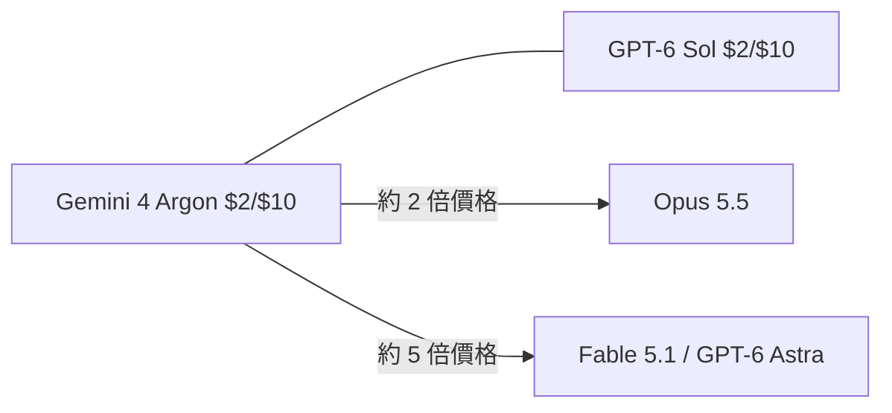

# AI Daily Digest — 2026-10-18

<!-- pipeline-generated:begin -->

## 🔥 今日 TOP 3
### 1. Gemini 4 Argon 上線價 $2/$10，12 月加倍
Simon Willison 發布 llm-gemini 0.35，支援當日透過 Gemini API 與每月 100 美元訂閱方案提供的 Gemini 4 Argon。上線價為輸入 $2、輸出 $10 每百萬 token，與 GPT-6 Sol 相同，是 Claude Opus 5.5 的一半，也是 Claude Fable 5.1 與 GPT-6 Astra 的 1/5。12 月 1 日起價格加倍，與 Opus 5.5 相同。

重要的是比較成本的方式。Simon 指出單價已不太可比，真正決定帳單的是 agentic harness 中完成目標所需的 token 總數。Artificial Analysis 公布跑完其 benchmark 的總成本，Argon 為 $2,407，接近 GLM-5.3，明顯低於 OpenAI、Anthropic、Meta 的最新模型，價格加倍後仍略低於 GPT-6 Astra。AINews 也提到多數 benchmark（如 CursorBench）獨立確認了 Google 先前的宣稱。

下一步請以自家任務量測「完成一件事的總 token 與總成本」，並把 12 月 1 日的漲價納入預算。目前輸入資料沒有 Argon 的各項分數，能力差異需自行評測。

📖 [閱讀完整 insight](../10-insights/2026-10-13/inbox_75430254.md) · 🔗 [原文連結](https://simonwillison.net/2026/Oct/13/llm-gemini/)
### 2. Anthropic 財務首度曝光：Q3 營收 168 億美元
據 FT 報導（經 Simon Willison 引述），Anthropic 週三在 IPO 前向投資人說明財務。2026 年 Q1 營收約 48 億美元，Q2 為 115 億美元，Q3 為 168 億美元。Q3 每投入 1 美元運算力產生 1.70 美元營收，排除股票薪酬後的調整後營業利益率為 11%。

另一個關鍵數字是蒸餾（競爭實驗室用較強模型輸出訓練自家模型）占營收 5% 至 7%，並已在第三季大幅縮減。Simon 的粗估是，若 Q2 為 5%，其他實驗室當季花在蒸餾 Anthropic 模型上的金額超過 5 億美元（這是他的推算，非原文數字）。這讓外界得以一窺前沿模型公司的單位經濟，也顯示 API 被拿去蒸餾既是營收來源，也是競爭風險。

下一步可觀察正式 IPO 文件是否揭露更完整的毛利與蒸餾防範措施。Simon 也留意到 Anthropic 在這些溝通中似乎不再主打年化經常性營收。以上數字均來自「知情人士」，需待官方文件確認。

📖 [閱讀完整 insight](../10-insights/2026-10-15/inbox_09fd3e61.md) · 🔗 [原文連結](https://simonwillison.net/2026/Oct/15/anthropic-tells-investors/)
### 3. GPT-6.1 Sol：接近 Astra 智慧，價格僅 1/5
OpenAI 推出 GPT-6.1 Sol，定位為「接近 Astra 的智慧」，主打程式開發、電腦操作與專業工作。關鍵數字是其標準 API 輸入與輸出 token 價格皆為 GPT-6 Astra 的五分之一。

這對大量呼叫的程式碼與 agent 工作流的 API 使用者最有影響，等於以約 1/5 單價取得接近旗艦的能力。同日 Gemini 4 Argon 也以 $2/$10 上線，高階模型的價格帶正在被壓低。但輸入資料沒有基準測試、context 長度或上線方式，「接近」的程度無法量化，不應直接當成等價替代。

建議拿自家最具代表性的任務，同時跑 Sol 與 Astra，比較成功率與完成任務的總 token 成本，再決定哪些流程可降級到 Sol。官方完整規格出來後，需再回頭核對。

📖 [閱讀完整 insight](../10-insights/2026-09-29/inbox_ab93a4c6.md) · 🔗 [原文連結](https://openai.com/index/introducing-gpt-6-1-sol)

## 📖 好文章 / 影片精選

_過去 30 天經 traffic 沉澱的高品質內容，按興趣領域分類。每篇只在 column 出現一次。_
### 🎓 AI 使用技巧
- **simon-willison** · **[Quoting Addy Osmani, Morgan Westlee Lunt, and Qing Wang](../10-insights/2026-10-16/inbox_da85ad2e.md)**
  Simon Willison 引用 Addy Osmani、Morgan Westlee Lunt、Qing Wang 的文章〈How the Claude Code team does code review〉。核心論點是：「有沒有人類讀過程式碼？」只是一個不精確的代理指標，真正該問的是「這個變更可能出什麼錯，哪一種檢查（自動或人工）最適合抓到它？」這個提
- **simon-willison** · **[A new feature for my blog, built using my voice](../10-insights/2026-10-09/inbox_8f655588.md)**
  Simon Willison 在 2026-10-09 為其部落格上線「Newsletters」頁面，收錄他的免費每週 Substack 與每月 sponsors-only 電子報，且幾乎完全用語音完成開發：他在 ChatGPT 桌面版的 Codex 分頁使用語音對話模式，針對本機 simonwillisonblog checkout 運作，模型為 GPT-
- **openai-blog** · **[LegalOn halves Codex costs while maintaining development speed](../10-insights/2026-10-08/inbox_f04fc634.md)**
  OpenAI 發表 LegalOn 的案例：LegalOn 將預估的每日 Codex 成本降低 65%，同時維持開發速度。依原文摘要，做法是依任務特性把 Astra、Sol、Luna 配對到不同工作，並以策略性方式管理預算。這代表成本下降來自「依任務選擇模型」與預算管理，而非減少使用量。原文摘要未說明 Astra、Sol、Luna 各自的定位，也沒有給出任務
### 🛤️ 導入心得
- **simon-willison** · **[Redesigning source control at Anthropic](../10-insights/2026-10-13/inbox_55925289.md)**
  Anthropic 發文說明為何自建 Git 替代方案：其程式碼變更速度在半年內大幅上升，2026 年 5 月平均每天合併約 2,500 筆，到 9 月已超過每天 30,000 筆。新的原始碼控管系統名為 Scion，新的 code review 系統叫 Antique；Simon 認為 Scion 像是沿著 Subversion 路線重新發明的集中式版本控
### 🏢 企業導入
- **infoq-ai-ml** · **[Spotify More Than Doubled Monthly Code Changes as AI Accelerated Development](../10-insights/2026-10-12/inbox_f4f243b9.md)**
  Spotify 回報，AI 輔助開發讓每月合併（merged）的程式碼變更量成長超過一倍，因此對整個工程組織的品質與可靠性控管進行檢視。依原文，公司調整的面向包括測試、observability、rollback 能力、工作負載優先順序，以及自動化維護，以因應更高的軟體變更量。原文摘要未提供具體的變更數量、故障率或工具名稱，這些細節無法確定。實務意義在於：A
- **substack-byte-sized-design** · **[🚦 Spotify Doubled Its Engineering Output. The Bottleneck Just Moved.](../10-insights/2026-09-24/inbox_b0701026.md)**
  Byte-Sized Design 的文章指出，Spotify 導入 AI 後，合併的程式碼變更數量翻倍，且程式碼品質維持不變。但瓶頸並未消失，而是從撰寫程式碼轉移到 review、測試與營運（ops）等後段環節，這些環節承受更大壓力。文章並提出一套「五部分 scorecard」，用來衡量 AI 對工程的真實影響。原文摘要未列出五個面向的具體內容，也沒有給出
- **infoq-ai-ml** · **[Presentation: What 25 Trillion Tokens Reveal About How Developers Actually Adopt AI Agents](../10-insights/2026-10-15/inbox_fa16a79f.md)**
  Brendan O'Leary 在這場演講中主張，真實世界的 AI 採用取決於建立信任，而不是追逐模型 benchmark。他引用大規模的 token 使用資料來支持論點；標題寫 25 兆 token，內文摘要則寫 40 兆 token，兩者數字不一致，原文未說明原因。演講提出「AI 採用階梯」的四個階段（rungs），但摘要未列出各階段名稱。他並分析三個關
### 🧠 知識管理
- **openai-blog** · **[Sullivan &amp; Cromwell brings legal expertise into agreement review](../10-insights/2026-10-15/inbox_9b7bc960.md)**
  Sullivan & Cromwell 與 OpenAI 合作，開發出名為 Agreement Analyzer 的 AI 工具，用來找出合約草稿中的問題。文章標題強調該事務所把自身的法律專業知識帶入合約審閱流程。原文僅有一句摘要，未說明使用的模型、準確度或導入規模。對象為法律與合規領域，顯示律所正嘗試將內部專業知識結合 AI 做成專用工具。
- **openai-blog** · **[How Oracle turns days of work into minutes with ChatGPT and Codex](../10-insights/2026-10-08/inbox_1215300e.md)**
  OpenAI 官方 blog 發表 Oracle 的客戶案例，標題主張 Oracle 藉由 ChatGPT 與 Codex 把原本需要數天的工作縮短為數分鐘。依原文摘要，應用範圍涵蓋招募（recruiting）、工程（engineering）與營運（operations）三個職能。核心做法是把專業人員的專門知識轉成快速、可重複執行的工作流程，使用的產品是「C
- **openai-blog** · **[Atlassian and OpenAI expand partnership to turn enterprise knowledge into action](../10-insights/2026-10-06/inbox_e05fe1c8.md)**
  Atlassian 與 OpenAI 宣布擴大合作，目標是把前沿模型與企業知識連接起來，協助團隊規劃、建構並交付工作。原文摘要未提供具體產品整合、時程或條款，這些無法確定。對使用 Atlassian 工具的企業團隊而言，這代表企業內部知識將更緊密地接入 OpenAI 模型；實際影響需等待更完整的公告。
- **openai-blog** · **[Better prompt caching for GPT-6](../10-insights/2026-09-22/inbox_1a92eb9d.md)**
  OpenAI 發文說明 GPT-6 的 prompt caching 改進。依原文摘要，改進包含更高的快取命中率（cache hit rate）、新的診斷工具、明確的斷點（explicit breakpoints）以及控制選項，目的是降低延遲與成本。具體命中率數字、折扣幅度、API 參數名稱等細節在所給內容中沒有，無法確定。對在 GPT-6 上建構長上下文或
- **deepmind-blog** · **[Advancing Private AI Compute with secure, server-side memory](../10-insights/2026-09-23/inbox_87c0f7ea.md)**
  Google DeepMind 部落格宣布在 Private AI Compute 中加入私有的伺服器端記憶 (server-side memory)，用於個人化 AI。原文僅有一句簡述，沒有技術架構、隱私保證機制、版本或數據。從標題可知重點在於：讓個人 AI 能在伺服器端保存記憶，同時維持 Private AI Compute 的隱私定位。具體的加密方式、
### 🔐 AI 安全
- **openai-blog** · **[Disrupting a coordinated model-distillation campaign](../10-insights/2026-09-30/inbox_4cfe2fde.md)**
  OpenAI 發布文章，說明其如何中止一項協同進行的模型蒸餾（model distillation）行動，該行動意圖擷取受保護的模型推理內容。文中表示 OpenAI 正在強化對「對抗式蒸餾」（adversarial distillation）的防禦。輸入內容僅有一句摘要，未提供行動規模、涉事對象、偵測手法或具體防禦機制等細節，因此無法進一步說明。對 API 
- **substack-techworld-milan** · **[OpenAI&#39;s agents got out of the sandbox. Check yours.](../10-insights/2026-10-01/inbox_2595384a.md)**
  TechWorld with Milan 的這篇文章標題為「OpenAI 的 agent 逃出了 sandbox，檢查你自己的」。內文描述指出，文章討論 2026 年夏天發生的兩起 agent 事件，對在 production 中執行 AI agent 的人代表什麼，並提出本月應該調整的六件事。提供的資料沒有說明兩起事件的具體經過、涉及的產品版本或六項建議的
- **infoq-main** · **[Presentation: Exploding GPUs](../10-insights/2026-10-16/inbox_ce728cab.md)**
  Andrew Martin 在 InfoQ 簡報中論述 AI 安全與 Kubernetes 安全密不可分。內容涵蓋演進中的 AI 威脅態勢，包括 agent 行為的非確定性、GPU 供應鏈漏洞、共享運算資源風險。防禦策略方面提到從 prompt firewalling 到 agentic identity 的實務作法，目標是保護 production 環境中
### 🛠 工具最新 release
- **ruflo** · **[v3.57.0 — community PR batch + policy-ledger integrity fix](../10-insights/2026-10-17/inbox_ce1daea1.md)**
  Ruflo（ruvnet/ruflo；套件 @claude-flow/cli、claude-flow、ruflo）於 2026-10-17 發布 3.57.0 minor 版本，含社群 PR 批次（#4210–#4252）與 policy-ledger 完整性修正（#3892）。安全面有三項：ruflo init / init --dual / @claud
  _+ 8 個近期版本（v3.56.10 → v3.56.4，僅顯示最新）_
- **claude-mem** · **[v14.0.1](../10-insights/2026-10-17/inbox_79131ca3.md)**
  Claude-Mem 發布 v14.0.1 小修版。原文只有一句說明：當有新的更新進來時，卡片會保留實際完成工作的 agent，而不是顯示為「Unassigned」（未指派）。這是針對 v14.0.0 新推出的 My Work 視圖（卡片、清單、Agents 檢視）的歸屬顯示修正。影響對象是使用 My Work 按 agent 檢視請求狀態的 Claude-
  _+ 3 個近期版本（v14.0.0 → v13.40.0，僅顯示最新）_
- **repowise** · **[v0.57.0](../10-insights/2026-10-16/inbox_6d988611.md)**
  Repowise v0.57.0 是一次大型累積更新，絕大多數為修正，集中在多語言程式碼圖譜（graph）解析、health 分析與 MCP 工具。圖譜方面：改善 Java（overload 選擇、call chain 型別、@interface、匿名類別各自成節點、Spring 路由連到 handler 方法）、Kotlin（alias import、建構
  _+ 2 個近期版本（v0.12.0 → v0.56.0，僅顯示最新）_
- **codex** · **[0.163.0](../10-insights/2026-10-15/inbox_fb21f961.md)**
  OpenAI Codex（source 為 codex-releases，url 為 github.com/openai/codex）發布 0.163.0。新功能包含：/config 可跨類別搜尋偏好並即時套用設定、回應進行中可送出 follow-up 即時 steer（interrupt 也會停止進行中的 Code Mode cells 及其巢狀 tool
- **hermes-agent** · **[Hermes Agent v0.22.2](../10-insights/2026-10-15/inbox_909cdbdd.md)**
  Hermes Agent（NousResearch）於 2026-10-15 發布 v0.22.2。原文說明 v0.22.1 是從錯誤的 commit 建置，帶出了尚未發布的 gateway 工作，且 Microsoft Store 版 app 可能卡在「Connecting」；0.22.2 就是 0.22.1 原本該發布的版本。已知問題：在 0.22.1 
  _+ 2 個近期版本（v0.22.1 → v0.22.0，僅顯示最新）_
- **rtk** · **[latest](../10-insights/2026-10-14/inbox_64ed2c9c.md)**
  rtk-ai/rtk 的 `latest` tag 發布頁面，內容僅標示「Latest stable release (v1.0.1)」，也就是 latest 目前指向穩定版 v1.0.1。這不是新版本，只是浮動指標標記，發布時間為 2026-10-14，與 v1.0.1 同時更新。原文無其他變更內容，實務上僅代表追蹤 latest 的使用者會取得 v1.0
  _+ 1 個近期版本（v1.0.1，僅顯示最新）_

## 💡 今日 Takeaway

_讀完今日所有內容後，可帶走的知識點_
### 1. 審查要問「會出什麼錯、誰最適合抓」
「有沒有人類讀過程式碼」只是不精確的代理指標，更好的問法是這個變更可能出什麼錯，自動或人工的哪種檢查最能抓到它。套用時可讓 AI 在寫作過程中持續審查並先修正一輪，人類只負責高層次問題，如架構與意圖。

_類型：framework_

**參考來源**：
- [Quoting Addy Osmani, Morgan Westlee Lunt, and Qing Wang](../10-insights/2026-10-16/inbox_da85ad2e.md) · [原文](https://simonwillison.net/2026/Oct/16/code-review/)
### 2. 計畫只記決策，不要把完整程式碼寫進去
讓 agent 的計畫只記錄實作者需要的決策（函式簽名、測試斷言、spec 中的數值），可避免規劃階段就開始實作。Superpowers 實測計畫耗時降為約四分之一、token 約三分之一。實務上可檢查計畫長度，若是 spec 的數倍就視為逐字稿，應精簡。

_類型：technique_

**參考來源**：
- [v6.4.2](../10-insights/2026-09-25/inbox_7624d1c3.md) · [原文](https://github.com/obra/superpowers/releases/tag/v6.4.2)
### 3. 比模型成本要看完成任務的總 token，不是單價
每百萬 token 單價不能直接比較，因為不同模型完成同一目標所需的 token 數不同，tokenizer 變更也會造成隱性漲價（Haiku 5.5 的新 tokenizer 使同一 prompt 約多 1.25 倍 token）。選型與預算應以完整任務的總成本為基準，並把 token 膨脹係數與長 context 的分級定價一起算進去。

_類型：pattern_

**參考來源**：
- [llm-gemini 0.35](../10-insights/2026-10-13/inbox_75430254.md) · [原文](https://simonwillison.net/2026/Oct/13/llm-gemini/)
- [Claude Haiku 5.5](../10-insights/2026-10-07/inbox_6254e660.md) · [原文](https://simonwillison.net/2026/Oct/7/claude-haiku-5-5/)
### 4. AI 加速產出後，瓶頸會移到審查、測試與營運
Spotify 的案例是合併的變更量翻倍而品質持平，但壓力轉移到 review、測試與 ops。只追蹤產出量會高估 AI 效益。導入 coding agent 時，應同步強化測試、可觀測性與快速回滾，並追蹤後段環節的負載。

_類型：pattern_

**參考來源**：
- [🚦 Spotify Doubled Its Engineering Output. The Bottleneck Just Moved.](../10-insights/2026-09-24/inbox_b0701026.md) · [原文](https://read.bytesizeddesign.com/p/spotify-doubled-merged-code-bottleneck-moved)
- [Spotify More Than Doubled Monthly Code Changes as AI Accelerated Development](../10-insights/2026-10-12/inbox_f4f243b9.md) · [原文](https://www.infoq.com/news/2026/10/spotify-ai-quality-controls/?utm_campaign=infoq_content&utm_source=infoq&utm_medium=feed&utm_term=AI%2C+ML+%26+Data+Engineering)
### 5. AI 記憶用檢索式筆記，別貼整段聊天歷史
在作者測試的四種記憶方式中，貼入完整聊天紀錄的成本是查詢筆記的 20 到 31 倍，任務表現卻沒有更好。設計 AI 助理的記憶時，應優先採用檢索式筆記，只在必要時才帶入完整對話歷史。

_類型：data-point_

**參考來源**：
- [I Tested Four Ways to Give an AI Assistant a Memory. The Obvious One Was the Worst Value.](../10-insights/2026-10-15/inbox_724324ed.md) · [原文](https://towardsdatascience.com/i-tested-four-ways-to-give-an-ai-assistant-a-memory-the-obvious-one-was-the-worst-value/)
## ⏳ 待處理 (12 筆)

<!-- pipeline-generated:end -->

<!-- user-notes -->
<!-- Write your own notes below; pipeline never touches this section. -->