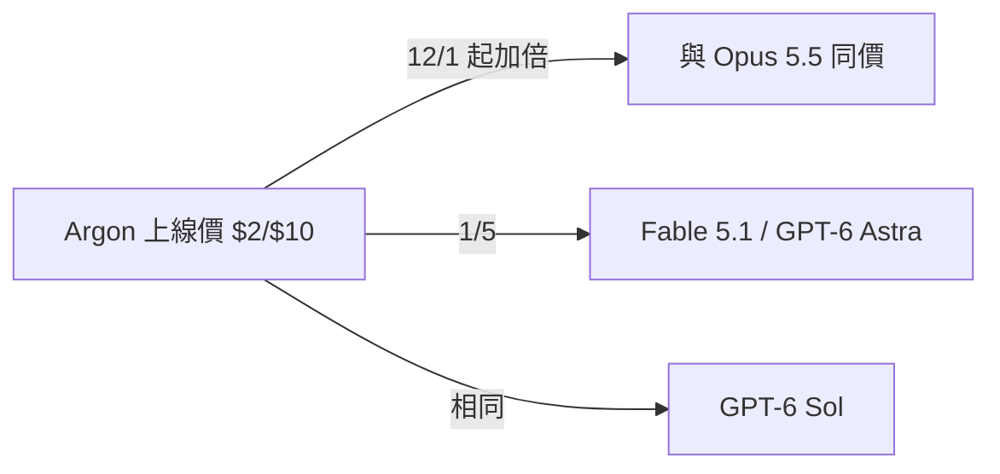

# AI Daily Digest — 2026-10-18

<!-- pipeline-generated:begin -->

## 🔥 今日 TOP 3
### 1. GPT-6.1 Sol：近旗艦智慧、五分之一價格
OpenAI 推出 GPT-6.1 Sol，定位為「接近 GPT-6 Astra 的智慧」，主打程式開發、computer use 與專業工作場景。標準 API 的輸入與輸出 token 價格皆為 GPT-6 Astra 的五分之一。

對大量呼叫 API 的團隊來說，這是用約 1/5 單價取得接近旗艦能力的選項，尤其適合程式碼與 agent 工作流。不過原文沒有提供基準測試、context 長度或上線方式，「接近」到什麼程度無法量化，不能直接假設能力差距很小。

下一步建議用自家真實任務跑 A/B 評測，比較 Sol 與 Astra 在成功率與完成任務所需 token 數上的差異，再決定哪些工作流切換到 Sol。同時留意 OpenAI 後續是否補上官方基準數據。

📖 [閱讀完整 insight](../10-insights/2026-09-29/inbox_ab93a4c6.md) · 🔗 [原文連結](https://openai.com/index/introducing-gpt-6-1-sol)
### 2. Gemini 4 Argon 上線價 $2/$10，12 月加倍
Simon Willison 發布 llm-gemini 0.35 支援 Gemini 4 Argon，該模型當日透過 Gemini API 提供。上線價為每百萬 token 輸入 $2、輸出 $10，與 GPT-6 Sol 相同，是 Claude Opus 5.5 的一半，也是 Claude Fable 5.1 與 GPT-6 Astra 的 1/5。但 12 月 1 日起價格加倍，與 Opus 5.5 相同。

重要性在於比較成本的方式：Simon 指出單價已不太可比，關鍵是 agentic harness 下完成目標所需的總 token 數。Artificial Analysis 公布跑完其 benchmark 的總成本，Argon 為 $2,407，接近 GLM-5.3，明顯低於 OpenAI、Anthropic 與 Meta 的最新模型；價格加倍後仍略低於 GPT-6 Astra。

下一步：若打算利用目前的低價，需把 12 月 1 日的漲價納入預算規劃。評估時應以自家任務的「每個完成任務總成本」比較，而非只看單價。

📖 [閱讀完整 insight](../10-insights/2026-10-13/inbox_75430254.md) · 🔗 [原文連結](https://simonwillison.net/2026/Oct/13/llm-gemini/)
### 3. Anthropic 對投資人揭露 Q1–Q3 營收與單位經濟
據 FT 報導（Simon Willison 引述），Anthropic 在 IPO 前向投資人說明財務：2026 年 Q1 營收約 48 億美元、Q2 115 億美元、Q3 168 億美元。Q3 每投入 1 美元運算力產生 1.70 美元營收，排除股票薪酬的調整後營業利益率為 11%。

這些數字讓外界難得看到前沿模型公司的單位經濟。報導另指「蒸餾」占營收 5% 至 7%，並已在第三季大幅縮減；Simon 推算若 Q2 為 5%，其他實驗室當季花在蒸餾 Anthropic 模型上就超過 5 億美元（這是他的推算，非原文數字）。這顯示 API 被拿去蒸餾既是可觀營收，也是競爭風險。

下一步：留意 Anthropic 正式的 IPO 文件是否證實這些數字，以及 Anthropic 是否持續不再主打年化經常性營收。以上為單一媒體引述知情人士，應視為未經官方確認的資訊。

📖 [閱讀完整 insight](../10-insights/2026-10-15/inbox_09fd3e61.md) · 🔗 [原文連結](https://simonwillison.net/2026/Oct/15/anthropic-tells-investors/)

## 📖 好文章 / 影片精選

_過去 30 天經 traffic 沉澱的高品質內容，按興趣領域分類。每篇只在 column 出現一次。_
### 🎓 AI 使用技巧
- **simon-willison** · **[Quoting Addy Osmani, Morgan Westlee Lunt, and Qing Wang](../10-insights/2026-10-16/inbox_da85ad2e.md)**
  Simon Willison 引用 Addy Osmani、Morgan Westlee Lunt、Qing Wang 的文章〈How the Claude Code team does code review〉。核心論點是：「有沒有人類讀過程式碼？」只是一個不精確的代理指標，真正該問的是「這個變更可能出什麼錯，哪一種檢查（自動或人工）最適合抓到它？」這個提
- **simon-willison** · **[A new feature for my blog, built using my voice](../10-insights/2026-10-09/inbox_8f655588.md)**
  Simon Willison 在 2026-10-09 為其部落格上線「Newsletters」頁面，收錄他的免費每週 Substack 與每月 sponsors-only 電子報，且幾乎完全用語音完成開發：他在 ChatGPT 桌面版的 Codex 分頁使用語音對話模式，針對本機 simonwillisonblog checkout 運作，模型為 GPT-
- **openai-blog** · **[LegalOn halves Codex costs while maintaining development speed](../10-insights/2026-10-08/inbox_f04fc634.md)**
  OpenAI 發表 LegalOn 的案例：LegalOn 將預估的每日 Codex 成本降低 65%，同時維持開發速度。依原文摘要，做法是依任務特性把 Astra、Sol、Luna 配對到不同工作，並以策略性方式管理預算。這代表成本下降來自「依任務選擇模型」與預算管理，而非減少使用量。原文摘要未說明 Astra、Sol、Luna 各自的定位，也沒有給出任務
### 🛤️ 導入心得
- **hamel-husain** · **[Claude’s new auto eval tool](../10-insights/2026-09-30/inbox_8389f3d7.md)**
  Hamel Husain 與 Isaac Flath 直播實測 Anthropic 為 Claude Code 推出的新 eval 工具：claude-api plugin 新增 build_eval 與 hill-climb 指令，協助建立 eval、檢查 grader、並針對 eval 改進應用。他們拿一個公寓租賃助理的對話 trace 來試。負面發現有
### 🏢 企業導入
- **substack-byte-sized-design** · **[🚦 Spotify Doubled Its Engineering Output. The Bottleneck Just Moved.](../10-insights/2026-09-24/inbox_b0701026.md)**
  Byte-Sized Design 的文章指出，Spotify 導入 AI 後，合併的程式碼變更數量翻倍，且程式碼品質維持不變。但瓶頸並未消失，而是從撰寫程式碼轉移到 review、測試與營運（ops）等後段環節，這些環節承受更大壓力。文章並提出一套「五部分 scorecard」，用來衡量 AI 對工程的真實影響。原文摘要未列出五個面向的具體內容，也沒有給出
- **infoq-ai-ml** · **[Spotify More Than Doubled Monthly Code Changes as AI Accelerated Development](../10-insights/2026-10-12/inbox_f4f243b9.md)**
  Spotify 回報，AI 輔助開發讓每月合併（merged）的程式碼變更量成長超過一倍，因此對整個工程組織的品質與可靠性控管進行檢視。依原文，公司調整的面向包括測試、observability、rollback 能力、工作負載優先順序，以及自動化維護，以因應更高的軟體變更量。原文摘要未提供具體的變更數量、故障率或工具名稱，這些細節無法確定。實務意義在於：A
- **substack-pragmatic-engineer** · **[Uber’s AI infra, from the inside](../10-insights/2026-10-14/inbox_11064126.md)**
  Pragmatic Engineer 的「Uber's AI infra, from the inside」由 Uber Distinguished Engineer Uday Kiran Medisetty 分享 Uber 內部的做法。內容涵蓋三個面向：Uber 如何建構內部開發者工具、如何把 AI agent 整合進工程工作流程，以及如何衡量這些工具對生
- **infoq-ai-ml** · **[Presentation: What 25 Trillion Tokens Reveal About How Developers Actually Adopt AI Agents](../10-insights/2026-10-15/inbox_fa16a79f.md)**
  Brendan O'Leary 在這場演講中主張，真實世界的 AI 採用取決於建立信任，而不是追逐模型 benchmark。他引用大規模的 token 使用資料來支持論點；標題寫 25 兆 token，內文摘要則寫 40 兆 token，兩者數字不一致，原文未說明原因。演講提出「AI 採用階梯」的四個階段（rungs），但摘要未列出各階段名稱。他並分析三個關
- **substack-byte-sized-design** · **[🚪 Uber Put 5,000 Tools in Front of Its Agents. Every One Ships Switched Off.](../10-insights/2026-10-15/inbox_e30bdd4f.md)**
  Byte-Sized Design 報導 Uber 把 5,000 個 tool 放到其 agent 面前，且每個 tool 預設都是關閉狀態。原文摘要指出，800 多個 MCP server 集中在單一 gateway 之後，由 crawler 產出草稿，再由人工核准。這代表工具的上架流程是自動探索加人工把關，而不是讓 agent 自行取用全部工具。實務意
### 🧠 知識管理
- **openai-blog** · **[Sullivan &amp; Cromwell brings legal expertise into agreement review](../10-insights/2026-10-15/inbox_9b7bc960.md)**
  Sullivan & Cromwell 與 OpenAI 合作，開發出名為 Agreement Analyzer 的 AI 工具，用來找出合約草稿中的問題。文章標題強調該事務所把自身的法律專業知識帶入合約審閱流程。原文僅有一句摘要，未說明使用的模型、準確度或導入規模。對象為法律與合規領域，顯示律所正嘗試將內部專業知識結合 AI 做成專用工具。
- **openai-blog** · **[How Oracle turns days of work into minutes with ChatGPT and Codex](../10-insights/2026-10-08/inbox_1215300e.md)**
  OpenAI 官方 blog 發表 Oracle 的客戶案例，標題主張 Oracle 藉由 ChatGPT 與 Codex 把原本需要數天的工作縮短為數分鐘。依原文摘要，應用範圍涵蓋招募（recruiting）、工程（engineering）與營運（operations）三個職能。核心做法是把專業人員的專門知識轉成快速、可重複執行的工作流程，使用的產品是「C
- **openai-blog** · **[Atlassian and OpenAI expand partnership to turn enterprise knowledge into action](../10-insights/2026-10-06/inbox_e05fe1c8.md)**
  Atlassian 與 OpenAI 宣布擴大合作，目標是把前沿模型與企業知識連接起來，協助團隊規劃、建構並交付工作。原文摘要未提供具體產品整合、時程或條款，這些無法確定。對使用 Atlassian 工具的企業團隊而言，這代表企業內部知識將更緊密地接入 OpenAI 模型；實際影響需等待更完整的公告。
- **openai-blog** · **[Better prompt caching for GPT-6](../10-insights/2026-09-22/inbox_1a92eb9d.md)**
  OpenAI 發文說明 GPT-6 的 prompt caching 改進。依原文摘要，改進包含更高的快取命中率（cache hit rate）、新的診斷工具、明確的斷點（explicit breakpoints）以及控制選項，目的是降低延遲與成本。具體命中率數字、折扣幅度、API 參數名稱等細節在所給內容中沒有，無法確定。對在 GPT-6 上建構長上下文或
- **deepmind-blog** · **[Advancing Private AI Compute with secure, server-side memory](../10-insights/2026-09-23/inbox_87c0f7ea.md)**
  Google DeepMind 部落格宣布在 Private AI Compute 中加入私有的伺服器端記憶 (server-side memory)，用於個人化 AI。原文僅有一句簡述，沒有技術架構、隱私保證機制、版本或數據。從標題可知重點在於：讓個人 AI 能在伺服器端保存記憶，同時維持 Private AI Compute 的隱私定位。具體的加密方式、
### 🔐 AI 安全
- **infoq-architecture** · **[Article: Server-Side DPoP and Token Exchange in Spring Security 7](../10-insights/2026-10-15/inbox_54b14f7e.md)**
  這篇 InfoQ 文章（作者 Dhruv Agnihotri）說明 Spring Authorization Server 現已併入 Spring Security 7，Maven coordinates 不變，因此升級僅需調整版本號。文章為伺服器端指南，涵蓋啟用 DPoP 與 RFC 8693 Token Exchange。一個重要提醒是：7.1 的應用程
### 🛠 工具最新 release
- **ruflo** · **[v3.57.0 — community PR batch + policy-ledger integrity fix](../10-insights/2026-10-17/inbox_ce1daea1.md)**
  Ruflo（ruvnet/ruflo；套件 @claude-flow/cli、claude-flow、ruflo）於 2026-10-17 發布 3.57.0 minor 版本，含社群 PR 批次（#4210–#4252）與 policy-ledger 完整性修正（#3892）。安全面有三項：ruflo init / init --dual / @claud
  _+ 8 個近期版本（v3.56.10 → v3.56.4，僅顯示最新）_
- **claude-mem** · **[v14.0.1](../10-insights/2026-10-17/inbox_79131ca3.md)**
  Claude-Mem 發布 v14.0.1 小修版。原文只有一句說明：當有新的更新進來時，卡片會保留實際完成工作的 agent，而不是顯示為「Unassigned」（未指派）。這是針對 v14.0.0 新推出的 My Work 視圖（卡片、清單、Agents 檢視）的歸屬顯示修正。影響對象是使用 My Work 按 agent 檢視請求狀態的 Claude-
  _+ 9 個近期版本（v14.0.0 → 4614，僅顯示最新）_
- **claude-code** · **[v2.1.302](../10-insights/2026-10-16/inbox_88729498.md)**
  Claude Code v2.1.302 發布，以修復為主並帶有幾項行為調整。新增 CLAUDE_CODE_AUTO_MODE_MODEL，可指定 client-side auto mode classifier 使用的模型（不影響 server-side auto mode）；/config 新增 Idle compaction 開關；/design-sy
  _+ 3 個近期版本（v2.1.301 → v2.1.299，僅顯示最新）_
- **repowise** · **[v0.57.0](../10-insights/2026-10-16/inbox_6d988611.md)**
  Repowise v0.57.0 是一次大型累積更新，絕大多數為修正，集中在多語言程式碼圖譜（graph）解析、health 分析與 MCP 工具。圖譜方面：改善 Java（overload 選擇、call chain 型別、@interface、匿名類別各自成節點、Spring 路由連到 handler 方法）、Kotlin（alias import、建構
  _+ 2 個近期版本（v0.12.0 → v0.56.0，僅顯示最新）_
- **codex** · **[0.163.0](../10-insights/2026-10-15/inbox_fb21f961.md)**
  OpenAI Codex（source 為 codex-releases，url 為 github.com/openai/codex）發布 0.163.0。新功能包含：/config 可跨類別搜尋偏好並即時套用設定、回應進行中可送出 follow-up 即時 steer（interrupt 也會停止進行中的 Code Mode cells 及其巢狀 tool
- **hermes-agent** · **[Hermes Agent v0.22.2](../10-insights/2026-10-15/inbox_909cdbdd.md)**
  Hermes Agent（NousResearch）於 2026-10-15 發布 v0.22.2。原文說明 v0.22.1 是從錯誤的 commit 建置，帶出了尚未發布的 gateway 工作，且 Microsoft Store 版 app 可能卡在「Connecting」；0.22.2 就是 0.22.1 原本該發布的版本。已知問題：在 0.22.1 
  _+ 2 個近期版本（v0.22.1 → v0.22.0，僅顯示最新）_

## 💡 今日 Takeaway

_讀完今日所有內容後，可帶走的知識點_
### 1. Review 該問「什麼會出錯、誰最適合抓」
「有沒有人類讀過程式碼」只是不精確的代理指標，更好的問題是這個變更可能出什麼錯，哪種檢查（自動或人工）最適合抓。實際套用時，讓 agent 在人工審查前先審查並修正一輪，把人類注意力留給高層次問題。

_類型：framework_

**參考來源**：
- [Quoting Addy Osmani, Morgan Westlee Lunt, and Qing Wang](../10-insights/2026-10-16/inbox_da85ad2e.md) · [原文](https://simonwillison.net/2026/Oct/16/code-review/)
### 2. 比較模型成本要看完成任務的總 token 數
單價不能代表實際花費：agentic 任務的總成本取決於完成目標所需的 token 數，tokenizer 改變也會造成隱性漲價（例如 Haiku 5.5 同一 prompt 的 token 數約為 Haiku 4.5 的 1.25 倍）。預算規劃應以自家任務的「每個完成任務總成本」為基準，並把 token inflation 與 context 分段計價納入。

_類型：pattern_

**參考來源**：
- [llm-gemini 0.35](../10-insights/2026-10-13/inbox_75430254.md) · [原文](https://simonwillison.net/2026/Oct/13/llm-gemini/)
- [Claude Haiku 5.5](../10-insights/2026-10-07/inbox_6254e660.md) · [原文](https://simonwillison.net/2026/Oct/7/claude-haiku-5-5/)
### 3. AI 加速產出後，瓶頸會移到驗證與營運端
Spotify 的案例顯示，AI 讓 merged changes 翻倍後，壓力轉移到 review、測試與 ops。導入 coding agent 時，不能只追蹤產出量，應同步強化測試、observability 與 rollback 能力，並追蹤後段環節的負載。

_類型：pattern_

**參考來源**：
- [🚦 Spotify Doubled Its Engineering Output. The Bottleneck Just Moved.](../10-insights/2026-09-24/inbox_b0701026.md) · [原文](https://read.bytesizeddesign.com/p/spotify-doubled-merged-code-bottleneck-moved)
- [Spotify More Than Doubled Monthly Code Changes as AI Accelerated Development](../10-insights/2026-10-12/inbox_f4f243b9.md) · [原文](https://www.infoq.com/news/2026/10/spotify-ai-quality-controls/?utm_campaign=infoq_content&utm_source=infoq&utm_medium=feed&utm_term=AI%2C+ML+%26+Data+Engineering)
### 4. Prompt cache 只命中位元組相同的前綴
provider 的 prompt cache 只在完全相同的前綴上命中，所以把固定指令放在最前面、變動內容放在後面，才能讓不同類型的 prompt 共享快取。claude-mem 把 init 與 continuation prompt 改為相同開頭後，共享前綴從 422 字元增至約 7.26k。設計 prompt 時應檢查固定區塊是否在前。

_類型：technique_

**參考來源**：
- [archive/core-dev: warn(session): report pending buffer counts during teardown (#4614)](../10-insights/2026-10-12/inbox_43f4e9ca.md) · [原文](https://github.com/thedotmack/claude-mem/releases/tag/archive%2Fcore-dev)
### 5. 先看 trace 找失敗模式，再建針對性 eval
有效的 eval 流程是先分析真實 trace 找出失敗模式，再把每種失敗轉成一個針對性 eval，改動後重跑驗證。反過來在看資料前就選定要測的項目，或把多種檢查綑綁在同一個 evaluator，會讓結果難以解讀與除錯。

_類型：framework_

**參考來源**：
- [AI Evals: Everything You Need to Know](../10-insights/2026-09-18/inbox_4837f622.md) · [原文](https://hamel.dev/blog/posts/evals-faq/)
- [Claude’s new auto eval tool](../10-insights/2026-09-30/inbox_8389f3d7.md) · [原文](https://hamel.dev/blog/posts/claude-auto-evals/)

<!-- pipeline-generated:end -->

<!-- user-notes -->
<!-- Write your own notes below; pipeline never touches this section. -->