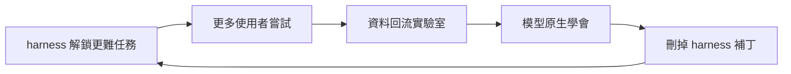

# AI Daily Digest — 2026-10-20

<!-- pipeline-generated:begin -->

## 🔥 今日 TOP 3
### 1. Harness 沒死：模型吃掉補丁，成本與安全仍靠它
**一句話：** 模型變強只會吃掉 harness 裡「幫模型補腦」的補丁，雲端執行、安全與成本效率仍要靠 harness。

**Why｜為什麼重要：** 網路上流行「harness 已死」的說法，建構 agent 的工程團隊需要分清楚哪些設計真的過時、哪些不會。

**How｜怎麼做到：** 講者提出資料飛輪：harness 讓更難的任務可行，更多使用者嘗試，資料回流實驗室，模型原生學會，harness 就能刪掉補丁，再去解鎖下一個新任務。模型吸收不了的是雲端執行環境、信任與安全、效率（cache hit rate、token 效率、model mix）。

**What｜具體內容與下一步：** SpaceXAI 的 Jediah Katz 引用 UC Berkeley 研究（7 個前沿模型，SWE-bench lite 上 harness 差異不顯著）與 Apple/EPFL 的 MLE-bench 研究（分數差異不大，但每任務成本差異明顯）。他預測 6 個月內 90% 的 agent 工作將脫離筆電執行（講者預測）。明天可做的事：集中登記每個 shim，在 shim 不再觸發時讓 bot 提 PR 清除。

📖 [閱讀完整 insight](../10-insights/2026-10-19/inbox_e2e86a4d.md) · 🔗 [原文連結](https://www.youtube.com/watch?v=7Y4sbZgBdnc)
### 2. Exa Snapshot：用過去的網路回測搜尋與 agent
**一句話：** 替網頁搜尋加上「時光機」，只讓模型看到過去某天當時存在的網頁，才能測出搜尋是否真有預測力。

**Why｜為什麼重要：** 即時搜尋永遠回傳最新資訊，用來回測預測系統會把事後才知道的結果洩漏進評估，無法證明搜尋特徵真的有用。主要面向金融客戶。

**How｜怎麼做到：** Exa 爬取網頁時會檢查新鮮度，因此保留了各 URL 在不同時間點的版本。提供兩種用法：給 URL 加日期取回當時內容，以及 version search，以過去時間點的狀態執行搜尋。

**What｜具體內容與下一步：** Exa Snapshot 宣稱有 4,000 億以上網頁快照。三種回測模式：版本化網頁萃取結構化特徵餵傳統模型、為傳統模型加入 agentic 特徵、整個預測由 agent 負責。工作坊中高分特徵出現過擬合（如指定公司名稱），因此回測務必保留 holdout set。這是企業功能，需聯繫 Exa。

📖 [閱讀完整 insight](../10-insights/2026-10-19/inbox_956997f7.md) · 🔗 [原文連結](https://www.youtube.com/watch?v=vS2IA9pq0Q4)
### 3. Coinbase：外層固定、內層可變的 agent 導入法
**一句話：** 把受規範的流程畫成固定骨架，再依「檢查得出對錯」的信心，一個節點一個節點交給 agent。

**Why｜為什麼重要：** 受政策與合規約束的流程要引入 agent，關鍵在於如何證明輸出可信，而不是模型本身。影響金融等受監管產業的團隊。

**How｜怎麼做到：** 外層用 DAG 表示有順序、有關卡的政策流程，節點內用「做事、檢查、回饋修正」的迴圈（如 LangGraph）；以 eval 加 trace 作為信心機制。逐節點問四件事：能否對照政策檢查、能否在有界迴圈內執行、能否追蹤、能否退回人工。

**What｜具體內容與下一步：** Coinbase 的 Evan Kormos 以商業貸款、交易所上架代幣、受監管軟體交付為例。上線分三階段：全數人工驗證，信心達門檻後抽樣審查，人只處理例外。agent 加速某一段後瓶頸會轉移，所以流程層級的可觀測性比建構工具更重要。

📖 [閱讀完整 insight](../10-insights/2026-10-19/inbox_b1da160e.md) · 🔗 [原文連結](https://www.youtube.com/watch?v=_4Ph2dhmUFI)

## 📖 好文章 / 影片精選

_過去 30 天經 traffic 沉澱的高品質內容，按興趣領域分類。每篇只在 column 出現一次。_
### 🎓 AI 使用技巧
- **youtube-ai-engineer** · **[Teach Your Agent to Prove It&#39;s Done — Nick Nisi &amp; Zack Proser, WorkOS](../10-insights/2026-10-18/inbox_12d993dc.md)**
  WorkOS 的 Nick Nisi 與 Zack Proser 以「Beyond Done」為題，談如何讓 agent 證明自己真的做完，而不是靠人逐行 review PR。開場引用一則 agent 在 9 秒內刪光 production 資料庫的事件，說明目標是在不必看每行程式碼的前提下，逐步建立對 agent 的信任。Agent 產出量遠超人類 rev
- **youtube-ai-engineer** · **[Stop Telling Agents How — Dan Barrett, Raymond Weitekamp &amp; Jose Montes de Oca, OpenProse](../10-insights/2026-10-18/inbox_1ad588e0.md)**
  OpenProse 創作者 Dan Barrett 與 Raymond Weitekamp、Jose Montes de Oca 在 AI Engineer 的演講，主張「別再告訴 agent 怎麼做（how），只宣告你要什麼（what）」。Dan 回顧 prompting 的演進：從 next-token 補全的 prompt 技巧，到手動填 contex
### 🛤️ 導入心得
- **youtube-ai-engineer** · **[AI Agents Cut 3-Day Portfolio Builds to Minutes — Jack McDonald, Apollo &amp; Michael Manapat, Rowspace](../10-insights/2026-10-17/inbox_98fccc10.md)**
  Rowspace 共同創辦人 Michael Manapat 與 Apollo 旗下信用部門 Reddington Ridge Capital 的 COO Jack McDonald 分享金融業導入 AI agent 的實例。Reddington Ridge 是 Apollo 的 structured credit 與 CLO 管理單位，管理約 500 億美
### 🏢 企業導入
- **youtube-ai-engineer** · **[Paving the Road to Production: Governed Enterprise AI Agents — Harish Gaggar, Credit Karma](../10-insights/2026-10-15/inbox_155cbf31.md)**
  Intuit Credit Karma 資深 staff 工程師 Harish Gaggar 分享如何把 AI agent 從實驗推進到受治理的企業生產環境。他指出 agent 常在生產失敗，是因為缺少基礎控制：沒有先做驗證的 gateway、MCP server 缺少合適工具、沒有 tracking/eval、沒有長期記憶管理，也沒有 PII/secret
- **youtube-ai-engineer** · **[How to Know When an AI Agent Can Work Unsupervised — Evan Kormos, Coinbase](../10-insights/2026-10-19/inbox_b1da160e.md)**
  把公司流程畫成「外層固定、內層可變」的流程圖，再依信心逐步把節點交給 AI agent 自己跑。 **Why** 受政策與合規約束的流程要引入 agent，關鍵在於如何證明它的輸出可信，而不是模型本身。 **How** 外層用 DAG 表示有順序、有關卡的政策流程，節點內用「做事→檢查→回饋修正」的迴圈（DCG，如 LangGraph）；用 eval（具代表性的資料集、重複執行的統計分析）加 trace 作為信心機制；逐節點問「能否對照政策檢查、能否在有界迴圈內執行、能否追蹤、能否退回人工」。上線分三階段：全數人工驗證→信心達政策門檻後抽樣審查→人只處理例外。 **What** Coinbase 的 Evan Kormos 在 AI Engineer 的演講，舉商業貸款、交易所上架代幣、受監管的軟體交付為例；結論是「外層確定、內層適應」、品質靠 eval、品質是團隊責任。也提醒 agent 加速某一段後瓶頸會轉移，所以流程層級的可觀測性比建構工具更重要。
- **youtube-ai-engineer** · **[The AI Bill Is Too Damn High: Tokenomics 101 — Eugene Cheah, Featherless AI](../10-insights/2026-10-18/inbox_ae6da90e.md)**
  Featherless AI 創辦人 Eugene Cheah 以「Tokenomics 101」為題，談企業如何壓低 AI token 帳單。他自述 Featherless 是開源模型推論平台，提供超過 40,000 個開源模型，並聲明內容來自自家銷售推論服務的經驗。他舉出最大客戶之一：每天服務 2 兆 tokens，使用約 512 張 AMD MI215
### 🧠 知識管理
- **youtube-ai-engineer** · **[Memory-Aware Agent Harnesses for Anti-Money Laundering — Nacho Martinez, Oracle](../10-insights/2026-10-18/inbox_b25b0ca8.md)**
  Oracle AI developer advocate Nacho Martinez 的一小時 workshop，主題是用「memory-aware agent harness」處理銀行的反洗錢（AML）可疑交易。workshop 託管在 GitHub Codespaces，參與者以 GitHub handle 註冊即可取得 repo 邀請。他的核心主張是
- **youtube-lenny's-podcast** · **[Molly Graham: The grief, burnout, and opportunity hiding inside the AI transition](../10-insights/2026-09-28/inbox_53d4b5df.md)**
  Lenny 的 podcast 邀請 Molly Graham 回鍋，討論她流傳多年的職涯建議「give away your Legos」在 AI 時代如何適用。原建議源自她在 Google（2007 年約 1 萬人，部門 9 個月內從 25 人成長到 125 人）與 Facebook（加入時 500 人、8,000 萬用戶，5 年後離開時 5,500 人、
- **infoq-main** · **[EmbeddingGemma 2 Expands beyond Text to Support Code, Images, Video, and Audio](../10-insights/2026-10-19/inbox_b193466d.md)**
  Google 推出一個小型開源模型，能把文字、程式碼、圖片、影片、音訊都轉成可比對的向量，用於搜尋與 RAG。 **Why** 語意搜尋與 RAG 需要更有效率、且能在裝置端運行的 embedding 模型。 **What** EmbeddingGemma 2 以 Gemma 4 為基礎，採 Apache 2.0 授權，是緊湊的 open-weight 多模態 embedding 模型，支援文字之外的程式碼、圖片、影片與音訊，並針對 on-device 部署最佳化。
- **medium-tag-llm** · **[TeleRAG: Efficient Retrieval-Augmented Generation Inference with Lookahead Retrieval](../10-insights/2026-10-19/inbox_e8263d5f.md)**
  以 lookahead retrieval 提升 RAG 推論效率的方法研究。 **What** 原文僅提供標題與作者（University of Washington 團隊），未提供方法細節與效能數據，無法確認具體成效。
- **medium-tag-llm** · **[Ham metinden RAG’a 5 gün: Bir LLM atölyesinden aklımda kalanlar](../10-insights/2026-10-19/inbox_f3b2ba50.md)**
  作者分享五天 LLM 工作坊的學習歷程，從 TF-IDF 的限制走到能附上來源的聊天機器人。 **What** 土耳其文文章；摘要提到 TF-IDF 無法辨識 araba 與 otomobil（同為「汽車」）是同義詞，最終目標是可引用來源的對話機器人。
### 🔐 AI 安全
- **youtube-ai-engineer** · **[Your AI Isn’t the Problem. Your Infrastructure Is. — Jiachen Jiang, Coder](../10-insights/2026-10-15/inbox_725e6e9f.md)**
  Coder 的 staff PM Jiachen Jiang 主張，AI agent 出事的主因是基礎設施而非模型，因此該靠基礎設施控制而非花五倍 token 費用買更聰明的前沿模型。他的論點是 LLM 有兩個無法完全信任的特性：非決定性，以及指令與 context 之間沒有結構性分隔，任何來源的資訊都從同一個入口進來。他引用 Simon Willison 
- **youtube-ai-engineer** · **[An AI Agent Got Its User Banned From Resy — Keycard, JPMorgan Chase &amp; AAuth](../10-insights/2026-10-18/inbox_6db06d45.md)**
  Keycard、JPMorgan Chase 與 OAuth 共同創作者 Dick Hardt 的座談，主題是 agent 的 intent-based（意圖式）runtime authorization，即針對每次 tool call 授權，而非讓 agent 持有廣泛的長期權限。與談人指出現有系統多為粗粒度：Salesforce 長期只有單一 scope
### 🛠 工具最新 release
- **ruflo** · **[v3.57.2 — graph/backup/ttl correctness fixes + large community PR batch](../10-insights/2026-10-19/inbox_b74b61a4.md)**
  修正 Ruflo CLI 多項正確性錯誤，包括備份假成功與索引孤兒問題。 **Why** 這些錯誤會讓使用者誤以為操作成功，或讀到錯誤的資料庫，例如備份失敗仍回報成功、ttl: 0 的資料不過期。 **How** 備份只在已確認加密且無 WAL 的來源才 fallback，並記錄實際完成的方法；ReasoningBank.consolidate() 補上 hnswIndex.removePoint(id)；memory export/import 改為回傳真實錯誤或遷移筆數。 **What** 版本 3.57.2（@claude-flow/cli、claude-flow、ruflo），cli-core 3.7.5 獨立發布並鎖定版本，另含大量社群 PR 修正。
  _+ 1 個近期版本（v3.57.1，僅顯示最新）_
- **claude-code** · **[v2.1.304](../10-insights/2026-10-19/inbox_4c7cd28a.md)**
  Claude Code 發布 v2.1.304，新增 mod 權限判斷欄位、自動模式引導設定與 Code Review 分級，並修了大量穩定性問題。 **Why** 隨著 mod、plugin、subagent、雲端 session 與 LLM gateway 等使用情境增多，權限、resume、compaction 與跨環境相容性的邊角問題也跟著增加。 **How** 為 mod 的 tool.check 加上 decider: \"person\" 與 e.isReadOnly，讓只有權限對話框或 host callback 能核准；同時修正 compaction、resume、gateway 重試與 rm -r 安全提示等行為。 **What** 新增 /auto-mode-setup（讀取專案與近期 session 教導 auto mode 環境，現也支援 Bedrock、Vertex、Foundry 等）與 /claude-api managed-agents-secure（對照 Anthropic 安全指南檢查 Managed Agents 設定、不改動任何東西）；Pro/Max 方案在 resume 閒置對話會耗用可觀 5 小時額度時會警告；工具搜尋在自訂 ANTHROPIC_BASE_URL 後預設開啟，gateway 回 400/422 時會不帶該功能重試。修正 

## 💡 今日 Takeaway

_讀完今日所有內容後，可帶走的知識點_
### 1. 回測必須只用「當時看得到」的資料，並留 holdout
用即時資料評估預測系統會洩漏未來資訊，所以要用帶時間版本的資料（指定 URL 加日期、或以過去時間點執行搜尋）限制系統只看得到當時的內容。同時保留 holdout set，否則高分特徵可能只是過擬合（工作坊中就出現過指定公司名稱的特徵）。

_類型：technique_

**參考來源**：
- [Version-Controlled Search: The Web as It Was — Ryan Ahern, Exa](../10-insights/2026-10-19/inbox_956997f7.md) · [原文](https://www.youtube.com/watch?v=vS2IA9pq0Q4)
- [Backtest Your Agent Against Yesterday&#39;s Web — Ryan Ahern, Exa](../10-insights/2026-10-19/inbox_89d8a6af.md) · [原文](https://www.youtube.com/watch?v=L4dUFimVDKU)
### 2. 模型補丁要集中登記，失效就清掉
harness 裡幫模型補強的 shim 會隨模型進步而過時。把每個 shim 集中記錄並用儀表板追蹤觸發情況，當它不再觸發時讓 bot 提 PR 清除，可避免補丁無限堆積。

_類型：pattern_

**參考來源**：
- [Smarter Models Killed the Harness. Here&#39;s What&#39;s Left — Jediah Katz, SpaceXAI](../10-insights/2026-10-19/inbox_e2e86a4d.md) · [原文](https://www.youtube.com/watch?v=7Y4sbZgBdnc)
### 3. 流程外層固定、內層可變，信心靠 eval 取得
將有順序與關卡的政策流程當固定骨架，只讓節點內部用「執行、檢查、修正」迴圈交給 agent。是否放行逐節點判斷：能否對照政策檢查、能否在有界迴圈內執行、能否追蹤、能否退回人工；導入時從全量人工驗證，逐步過渡到抽樣與只處理例外。

_類型：framework_

**參考來源**：
- [How to Know When an AI Agent Can Work Unsupervised — Evan Kormos, Coinbase](../10-insights/2026-10-19/inbox_b1da160e.md) · [原文](https://www.youtube.com/watch?v=_4Ph2dhmUFI)
### 4. 換模型前，先用自己的場景跑 eval
公開 benchmark 無法告訴你特定場景的表現；同一組題目在不同模型上差異很大（例如計數題答案各不相同，加逐步推理 prompt 後有模型修正）。把生產環境的真實輸入回灌 eval，LLM-as-judge 給足脈絡並以人工標註校準，換模型時才有依據。

_類型：technique_

**參考來源**：
- [The Model Swap Workshop: GPT-5.5 vs Kimi vs DeepSeek vs Mistral — Pamela Fox, Microsoft](../10-insights/2026-10-19/inbox_874485bf.md) · [原文](https://www.youtube.com/watch?v=UGjk3Uk0MxM)
### 5. 用不倒退的事件時間水位線判斷資料何時完整
持續匯入的資料需要一個明確訊號告訴下游某個分區已足夠完整。Pinterest 的做法是用 Flink 追蹤事件時間，再利用 Iceberg metadata 發布不會倒退的水位線，讓下游據此放行處理。

_類型：pattern_

**參考來源**：
- [Pinterest Uses Event Time Watermarks to Finalize Petabyte Scale Data Partitions](../10-insights/2026-10-19/inbox_1e6e7cc0.md) · [原文](https://www.infoq.com/news/2026/10/pinterest-event-time-partition/?utm_campaign=infoq_content&utm_source=infoq&utm_medium=feed&utm_term=global)

<!-- pipeline-generated:end -->

<!-- user-notes -->
<!-- Write your own notes below; pipeline never touches this section. -->