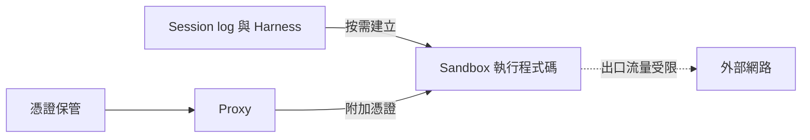

# AI Daily Digest — 2026-10-28

<!-- pipeline-generated:begin -->

## 🔥 今日 TOP 3
### 1. Opus 5.5 實測：終於不煩人
📰 來源：youtube-how-i-ai ｜ 發布：2026-09-28 ｜ 原標題：[Claude is BACK with Opus 5.5](https://www.youtube.com/watch?v=zObYdmNB2Bo)

**一句話：** 新模型好不好用，除了聰明，也看跟它溝通煩不煩。

**Why｜為什麼重要：** 主持人先前因 Fable 與 Opus 5 太冗長、難溝通而放棄 Claude 改用 Codex，可見模型好不好用不只取決於智慧，也取決於溝通風格。

**How｜怎麼做到：** 她用 PRD、原型、程式碼審查、長任務 agent、收件匣整理、computer use、SVG 等實際工作測試，並與 GPT 模型交叉審查 PR。

**What｜具體內容與下一步：** 官方宣稱比 Opus 5 便宜約 40%、快約 30%；定價 $4 / $20，fast mode $8 / $40。長任務 25–82 步皆成功並能忽略 prompt injection。缺點是偏保守、安靜不報進度，她仍偏好 Codex 的 harness。明天可拿自己的真實任務自行盲測再決定。

📖 [閱讀完整 insight](../10-insights/2026-09-28/inbox_c945f767.md) · 🔗 [原文連結](https://www.youtube.com/watch?v=zObYdmNB2Bo)
### 2. Managed Agents：大腦與雙手分家
📰 來源：latent-space ｜ 發布：2026-10-27 ｜ 原標題：[How Anthropic ships Claude with Claude: Separating the Brain from the Hands](https://latent.space/p/opus55/)

**一句話：** 把 agent 的思考和執行程式的環境拆開，一邊掛掉不連累另一邊，憑證也不會被讀到。

**Why｜為什麼重要：** 早期把整個 coding agent 放在 sandbox 後面，啟動環境會拖慢第一次回應，sandbox 一掛 agent 也跟著消失；sandbox 內若有憑證，產生的程式碼就可能讀到。

**How｜怎麼做到：** Managed Agents 把 session log 與 harness 和 sandbox 分離，sandbox 需要時才建立；憑證另外保管、透過 proxy 附加，並限制 sandbox 的流量去向。

**What｜具體內容與下一步：** Latent Space 訪談 Anthropic 的 Katelyn Lesse 與 Angela Jiang，另談 Opus 5.5、保留 thinking blocks 可能破壞客戶 harness、dreaming、Messages API 以 Rust 重寫。設計 agent runtime 時可自問：哪些要存活、哪些跑不受信任的程式、哪些 secret 真的需要在場。

📖 [閱讀完整 insight](../10-insights/2026-10-27/inbox_0f06e9e0.md) · 🔗 [原文連結](https://latent.space/p/opus55/)
### 3. Atlassian：AI 省時 10 小時者剩 26%
📰 來源：infoq-main ｜ 發布：2026-10-27 ｜ 原標題：[Developers Reporting Double-Digit Weekly Time Savings from AI Fell from 68% to 26%](https://www.infoq.com/news/2026/10/atlassian-devex-2026/?utm_campaign=infoq_content&utm_source=infoq&utm_medium=feed&utm_term=global)

**一句話：** 開發者感覺 AI 替自己省下的時間，一年內大幅縮水。

**Why｜為什麼重要：** 工程主管反映，管理與修正 AI 產出所花的時間，比開發者自己認為的更多。這提醒團隊衡量 AI 生產力時，不能只看寫程式變快，還要把審查與修正的成本算進去。

**What｜具體內容與下一步：** Atlassian 的 State of Developer Experience 2026 發現，每週靠 AI 省下 10 小時以上的開發者比例，從 68% 降到 26%；只有 28% 的人表示摩擦比 AI 出現前明顯減少。讀者明天可檢視自己團隊的生產力指標，是否只計入產出速度，而漏掉審查與修正 AI 產出所花的時間。

📖 [閱讀完整 insight](../10-insights/2026-10-27/inbox_f761bc4f.md) · 🔗 [原文連結](https://www.infoq.com/news/2026/10/atlassian-devex-2026/?utm_campaign=infoq_content&utm_source=infoq&utm_medium=feed&utm_term=global)

## 📖 好文章 / 影片精選

_過去 30 天經 traffic 沉澱的高品質內容，按興趣領域分類。每篇只在 column 出現一次。_
### 🎓 AI 使用技巧
- **youtube-how-i-ai** · 2026-10-06 · **[Jev: 8 real use cases this fast, cheap model](../10-insights/2026-10-06/inbox_3e5bc50c.md)**
  用極便宜又極快的「決策模型」Jev，把模糊的文字輸入直接變成可執行的結構化選擇。 **Why** 過去要讓 LLM 做簡單分類或呼叫函式，既慢又貴，很多資料探索因成本太高而不值得做。 **How** Jev 不生成文字，只輸出型別安全的決策（選項、分數、是/否機率）；把問題拆成多層分類（先判斷聽寫是否有效、再配對任務、再配對操作），不夠準就多加一層，再用較聰明的 LLM 抽樣驗證。 **What** 來賓 John Lindquist 展示約 9 個 Jev demo：語音待辦 App、聯絡人去重合併、指令列/工具路由、下棋（官方 benchmark 顯示每步快 10 倍、便宜 4 倍）、Wikipedia 導航到哲學頁、多代理人避免碰撞、簡報教練。價格約每百萬 input token 4 美分、output 不收費，他跑了數百個 demo 只花約 73 美分，處理 5GB JSON 約 40 美分、數分鐘完成。
### 🛤️ 導入心得
- **youtube-ai-engineer** · 2026-10-27 · **[We Kept Rebuilding Our AI Agent. Here&#39;s What Survived - Fuad Ali, Arize AI](../10-insights/2026-10-27/inbox_8b89e673.md)**
  把 AI 代理拆掉重建兩年後，留下來的只有簡單的 harness 設計：計畫與結束由程式碼管、記憶用一個小檔案。 **Why** 模型自己管 to-do、處理超大工具結果、跨 session 記憶時容易失焦、爆 context 或過度工程化。 **How** 把計畫以訊息形式由 harness 每輪注入、用明確 finish 呼叫並在計畫未完成時最多退回三次、大型 JSON 截斷後讓 agent 用 jq 自己找、歷史由模型寫 checkpoint 再丟棄舊內容、長期記憶改由背景工作維護每位使用者一個 markdown 檔。 **What** Arize 的 in-product agent Alex（2023 年底原型，2026 年 2 月 Alex 2.0，6 月 One Alex 合併為單一 agent 按需載入 skills）。不使用 agent framework；長期記憶試過向量檢索、知識圖譜，最後以上限 8,000 字元的 markdown 檔勝出；預設模型選「夠快夠好」而非最新，並以 production traces 當回歸測試集、用 Signal agent 讀 Alex 的 traces。
### 🏢 企業導入
- **youtube-how-i-ai** · 2026-09-28 · **[The enterprise AI stack behind Stripe’s company brain “Kai”](../10-insights/2026-09-28/inbox_14c2b1d0.md)**
  Stripe 自建公司內部 AI agent「Kai」，用 projects 當治理單位，讓全公司安全地用 AI。 **Why** 企業要普及 AI 難在複製公司的運作方式與治理，而非工具本身；agent 還會放大基礎設施的各種失效模式。 **How** 以 projects 為設定與治理層，可指定預設模型、限制昂貴模型、設定 tool policy 與 human-in-the-loop 核准；agent 跑在雲端 sandbox，使用者可把 session 打包成 skill 重複使用。資料查詢採三層 fallback：既有報表 → 分析層 → data catalog。 **What** Kai 由約 1.5 位工程師、兩週做出 V0，目前核心團隊不到 10 人，每週超過 1 萬人使用，公司內採用率達 86% 以上，有約 2,000 個 skills。現場示範用 Kai 生成採用率 dashboard，並用 skill creator 把流程存成 skill。
### 🔐 AI 安全
- **youtube-ai-engineer** · 2026-10-27 · **[300 Agents, 60 People: How We Secured Our Own AI Agents - Aiden Sochowski, Runlayer](../10-insights/2026-10-27/inbox_93a8e138.md)**
  公司內部 50–60 人卻跑著 300 多個 agent，要靠集中記錄每次 session 與 tool call，才看得見風險與浪費。 **Why** 員工在本機或第三方產品自行跑 MCP client、到處授權，企業幾乎沒有可見度；agent 又能快速混合不同資料等級，擴大攻擊面。 **How** 部署 gateway 記錄所有 session 與 tool call，依主題與風險分類；自訓分類器檢查每個 tool call 是否偏離 agent 原本定義的目的；用歷史呼叫建議可移除的權限。 **What** Runlayer 分享自家經驗：300+ agent 每天運行；發現的問題包括 email prompt injection 外洩、PR 審查 agent 在長 session 中被說服而核准、招募 bot 權限過多、非工程人員 vibe code 的 MCP server 反覆報錯導致成本暴增，以及改用更貴模型使成本一週內增加到約 100 倍。
- **lobsters-ai** · 2026-10-27 · **[Fuzzers vs. AI: Comparing Fuzzilli and BigSleep on JavaScript Engines](../10-insights/2026-10-27/inbox_45c6af51.md)**
  Fuzzilli 與 BigSleep 比較：兩者在 V8 找到的漏洞重疊有限，互補而非取代。 **Why** 社群想知道 LLM 是否會取代傳統 fuzzing，作者用 2026 年 4 至 9 月的 bug 數據與重現實驗來回答。 **How** 以 Chromium bugtracker 與 ClusterFuzz 資料篩出可行動的漏洞並去重，另做實驗讓 BigSleep 重現 Fuzzilli 過去找到的漏洞。 **What** 可行動的 type:vulnerability 漏洞中，BigSleep 45 個、Fuzzilli 37 個；實際 bug 重疊約 25%（81 個中 20 個），專門實驗估計理論重疊約 60%；作者建議兩種方法並用。
- **hackernews** · 2026-10-21 · **[PHP2Shell: AI uncovers critical RCE in PHP](../10-insights/2026-10-21/inbox_6c382d61.md)**
  AI 在 PHP 中找出一個嚴重的遠端程式碼執行（RCE）漏洞。 **What** Wiz 部落格文章「PHP2Shell: AI uncovers critical RCE in PHP」，另有專屬網站 php2shell.com。輸入只有標題與連結，AI 使用的方法、漏洞編號與影響版本無法確定。
- **infoq-main** · 2026-10-23 · **[Anthropic Adds Opt-In Security Scanning for Critical Open-Source Projects](../10-insights/2026-10-23/inbox_04a00a15.md)**
  Anthropic 讓開源專案自願加入，由 AI 定期掃描並回報安全漏洞。 **Why** 開源專案維護者資源有限，漏洞難以持續被發現。 **How** 維護者 opt-in 後會定期收到由 Anthropic 最強模型（含 Claude Mythos）產生的安全報告；報告未經人工審核即寄出，維護者可自行驗證發現並決定採納哪些修補建議。 **What** Anthropic 推出免費的 OSS Scanner 服務，對象為關鍵開源專案。
### 🎙️ Lenny's Newsletter・Podcast
- **substack-lennys-newsletter** · 2026-10-19 · **[🎙️ How I AI: Meta Muse Wonder + How Brooke Lacey is scaling video with AI](../10-insights/2026-10-19/inbox_a9c4eb33.md)**
  Lenny's Podcast Network 的 How I AI 每週節目彙整，這集包含 Meta Muse Wonder 與 Brooke Lacey 用 AI 擴大影片製作。 **What** 這是 How I AI 的每週收聽整理，標題提到兩個主題：Meta Muse Wonder，以及 Brooke Lacey 如何用 AI 規模化影片製作。原文
### 🧩 熱門 Skill・MCP・Plugin
- **github-trending-agent-tools** · 2026-10-27 · **[elayadesign/ai-design-skills ⭐ 9,250(今日 +1,395)](../10-insights/2026-10-27/inbox_f99f558f.md)**
  給 AI 寫程式工具用的一組設計規範技能，讓模型照既定視覺風格產出介面。 **How** 每個 skill 是獨立資料夾，核心為 SKILL.md；字型、顏色、間距、動效等設計值集中在檔案底部一段，fork 後修改即可套用到整個 skill。 **What** 支援 Claude Code、Cursor、Codex、Windsurf 等能讀 markdown
- **github-trending-agent-tools** · 2026-10-27 · **[obra/superpowers ⭐ 306,404(今日 +608)](../10-insights/2026-10-27/inbox_29c08abf.md)**
  讓編碼 agent 先釐清需求、寫計畫，再逐項派子 agent 實作的可組合技能框架。 **Why** 框架設計為讓 agent 看到需求時先停下來問清楚目標，而不是直接寫程式。 **How** 以一組自動觸發的 skills 串起流程：brainstorming 先確認設計、writing-plans 把工作拆成 2–5 分鐘的任務，再由 subagent-driven-development 逐項執行與審查；計畫強調 red/green TDD、YAGNI、DRY。 **What** 支援 Claude Code、Codex CLI、Cursor、Gemini CLI、OpenCode、Pi 等多種 harness，各平台需分別安裝；GitHub 星數 306,404（今日 +608）。
- **github-trending-agent-tools** · 2026-10-27 · **[multica-ai/andrej-karpathy-skills ⭐ 224,666(今日 +638)](../10-insights/2026-10-27/inbox_12799b80.md)**
  把 Karpathy 點出的 LLM 寫碼毛病，濃縮成一份 CLAUDE.md 規範。 **Why** 原文引述 Karpathy 指出模型會擅自假設、過度工程、順手改動無關程式碼。 **How** 四條原則：先想再寫（明說假設並提出多種解讀）、簡單優先、外科手術式修改、把任務轉成可驗證的成功標準。 **What** GitHub 倉庫約 22.5 萬星（今日 +638）；可作為 Claude Code plugin 或 CLAUDE.md 安裝，另附 Cursor 規則檔。
### 🛠 工具最新 release
- **claude-code** · 2026-10-27 · **[v2.1.312](../10-insights/2026-10-27/inbox_8e270dfb.md)**
  Claude Code 的例行修正版，補強企業身分、長檔案保護、提示詞設定與雲端工作階段的穩定性。 **Why** 企業環境常用 Microsoft Entra ID 等非標準身分欄位，且大型設定檔與第三方模型部署名稱容易造成誤判或資料被覆寫。 **How** 新增 `oidc.user_id_claim` 讓 gateway 可用 `sub` 以外的 id_token claim 識別使用者；Write 遇到只讀到開頭的大檔會要求 Claude 讀完或就地編輯；對無法辨識的模型名稱改用較短的系統提示詞。 **What** Claude Code v2.1.312 新增 `oidc.user_id_claim`（如 Entra 的 `oid`）與全螢幕點擊「to send now」立即送出佇列訊息。修正大型 CLAUDE.md 被覆寫、managed settings 在 VS Code 登入後未取得、PDF 讀取失敗等問題。Bedrock、Vertex、Foundry、Mantle 遇到自訂部署名稱改用短系統提示詞（可用 `CLAUDE_CODE_SIMPLE_SYSTEM_PROMPT=0` 保留完整版），prompt/agent hooks 每個 session 最多同時跑 24 個，並停止送出 `claude_code.safety_event` OpenTelemetry
- **codex** · 2026-10-27 · **[0.165.0](../10-insights/2026-10-27/inbox_96b6a6c6.md)**
  OpenAI Codex 0.165.0 版：新增 Vertex AI 供應商、GPT-6.1 Terra 模型，並修補多項 TUI 與 MCP 問題。 **What** OpenAI Codex（rust-v0.165.0）新增內建 Google Cloud Vertex AI provider（設定 `model_provider = \"gcp\"`）

## 💡 今日 Takeaway

_讀完今日所有內容後，可帶走的知識點_
### 1. 執行不受信任程式的環境，不該持有憑證
把憑證放在 sandbox 外獨立保管、由 proxy 附加，並限制出口流量，sandbox 內就沒有東西可被生成的程式碼讀走。設計 agent runtime 時，先問哪些元件要存活、哪些會執行不受信任的程式、哪些 secret 真的需要在場。

_類型：pattern_

**參考來源**：
- [How Anthropic ships Claude with Claude: Separating the Brain from the Hands](../10-insights/2026-10-27/inbox_0f06e9e0.md) · [原文](https://latent.space/p/opus55/)
### 2. 常被同意的核准，應改成規則而非人工
人工核准會因疲勞而變成反射性點 yes。明確規則走確定性快速通道，模糊情況交給保守型分類器，只把最重要或不確定的請求交給人；若某類請求 99.99% 都被同意，就該改成規則。

_類型：framework_

**參考來源**：
- [What a $900M Bank Error Teaches Us About AI Agents - John Feminella, Two Sigma](../10-insights/2026-10-27/inbox_c5e1b706.md) · [原文](https://www.youtube.com/watch?v=iniryju23Sk)
### 3. 計畫與結束由 harness 管，不交給模型自己管
純 to-do 工具會讓模型把時間花在勾選清單上，改由 harness 每輪把計畫當訊息注入、以明確 finish 呼叫結束，並在計畫未完成時退回，可避免失焦。長期記憶則以每位使用者一個小型 markdown 檔，易於人工稽核。

_類型：framework_

**參考來源**：
- [We Kept Rebuilding Our AI Agent. Here&#39;s What Survived - Fuad Ali, Arize AI](../10-insights/2026-10-27/inbox_8b89e673.md) · [原文](https://www.youtube.com/watch?v=YIhvrvHtonk)
### 4. 讓 agent 寫程式組合工具，可省 token 與成本
Code mode 讓 agent 先搜尋所需工具，再在程式環境中序列或平行呼叫，只把必要結果回傳 context。Arize 實測 token 減少 43%、成本降低 31%、延遲大致持平，但需自行處理沙箱資源、網路 egress 與 secrets 風險。

_類型：data-point_

**參考來源**：
- [Stop Giving Your Agent Tools. Give It a Sandbox - Mikyo King, Arize AI](../10-insights/2026-10-27/inbox_40481ade.md) · [原文](https://www.youtube.com/watch?v=dAoOYFx7ZYw)
### 5. 多層委派的 agent 權限，取鏈上交集
請求經過多個 agent 轉手時，可存取範圍只取委派鏈上各方共有的權限，範圍永不超過鏈上最小者。搭配唯一 agent ID 與具名負責人，並以確定性規則檢查是否越權、以信心分數分級處置（遮蔽、升級給人、封鎖）。

_類型：framework_

**參考來源**：
- [Why Are We Still Governing AI Agents Like Software? - Tim Tyler, Gravitee](../10-insights/2026-10-27/inbox_8ca9470f.md) · [原文](https://www.youtube.com/watch?v=h8jgniNJcbQ)

<!-- pipeline-generated:end -->

<!-- user-notes -->
<!-- Write your own notes below; pipeline never touches this section. -->