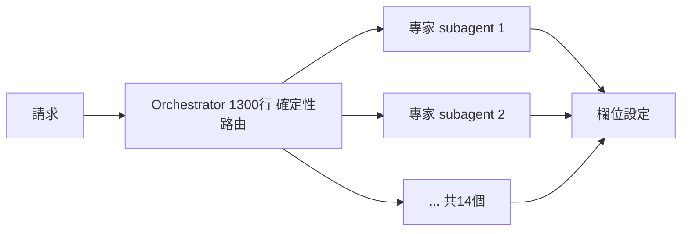

# AI Daily Digest — 2026-10-29

<!-- pipeline-generated:begin -->

## 🔥 今日 TOP 3
### 1. Meta：總管不懂領域，只負責派工
📰 來源：substack-byte-sized-design ｜ 發布：2026-10-28 ｜ 原標題：[🧠 Meta&#39;s Smartest Agent Was the Problem. The Dumb One Fixed It](https://read.bytesizeddesign.com/p/meta-thin-orchestrator-agent-router)

**一句話：** 讓總管 agent 只負責派工、不碰領域知識，各專家只看自己的資料，整個系統反而更準。

**Why｜為什麼重要：** Meta 原本用單一什麼都知道的 agent 處理推薦管線的欄位上線，context 變大後開始幻覺，把一個子系統的命名慣例套到另一個。所有想用單一 agent 吞下複雜領域的團隊都會碰到同樣問題。

**How｜怎麼做到：** 用 1,300 行的 orchestrator 只做意圖分類、欄位收集、可靠性檢查與路由，每次請求跑七個步驟，只有一步呼叫模型。14 個專家 subagent 各自只載入自己的領域。路由決策用確定性程式碼，推理決策才交給 LLM，且放在最小的 context 內。

**What｜具體內容與下一步：** 欄位設定準備時間從人工 3–4 天，降到早期系統的約一天，再降到一小時內，約三分之二的變更不需大幅人工修改，並以固定狀態機工作流支援 20 多種用例。明天可檢查自家 agent：哪些決策能改寫成確定性程式碼，剩下的推理再拆給只載入單一領域的 subagent。

📖 [閱讀完整 insight](../10-insights/2026-10-28/inbox_741cdcb5.md) · 🔗 [原文連結](https://read.bytesizeddesign.com/p/meta-thin-orchestrator-agent-router)
### 2. AI 寫程式不是瓶頸，驗證才是
📰 來源：youtube-ai-engineer ｜ 發布：2026-10-28 ｜ 原標題：[How Anthropic Merges 30,000 Code Changes a Day - Manish Kapur, Sonar &amp; Addy Osmani, Anthropic](https://www.youtube.com/watch?v=AnsXWH2_EBU)

**一句話：** 程式碼產得再快，沒有可信的驗證就不敢自動合併，瓶頸已從「寫」移到「驗」。

**Why｜為什麼重要：** 產出量暴增但審查跟不上。CircleCI 分析 2,800 萬個 CI workflow，吞吐量增加約 59%，卻有三成合併嘗試失敗；Sonar 調查中 76% 的開發者認為 AI 程式碼產出快到無法驗證。

**How｜怎麼做到：** Anthropic 先讓 Claude 做第一輪審查，並要求它像真實使用者一樣實測（端到端測試、瀏覽器操作、linting），再用 hooks 在編輯時分析 diff 並修正 PR。品味與最佳實踐寫進 CLAUDE.md／AGENTS.md，人只檢視 agent 提供的證據（影片、截圖）。Sonar 主張零信任多層驗證：確定性層、agentic 層（邏輯與意圖）、供應鏈層。

**What｜具體內容與下一步：** Addy Osmani 表示 Anthropic 每天合併約 30,000 個程式變更；PR 應標註由 agent 撰寫，但責任仍在人身上。Sonar 調查顯示目前 5% 公司使用 software factory，預計升至 34%。明天可先要求 agent 在 PR 附上實測證據，再談提高自動合併比例。

📖 [閱讀完整 insight](../10-insights/2026-10-28/inbox_7f404477.md) · 🔗 [原文連結](https://www.youtube.com/watch?v=AnsXWH2_EBU)
### 3. GitHub：合併 PR 一年內成長三倍
📰 來源：simon-willison ｜ 發布：2026-10-28 ｜ 原標題：[GitHub Octoverse 2026](https://simonwillison.net/2026/Oct/28/github-octoverse-2026/)

**一句話：** AI agent 讓全球程式碼的產出量在不到一年內暴增約三倍。

**How｜怎麼做到：** Octoverse 方法論用 LLM 從使用者個人檔案萃取國家代碼以修正 VPN 偏差，用微調的多語 embedding 模型把 2022–2026 建立的公開 repo 依 NAICS 產業分類，並以關鍵字統計 interoperability／reverse engineering 相關 repo。

**What｜具體內容與下一步：** GitHub Octoverse 2026 由 EVP Jay Parikh 在 GitHub Universe 公布：merged PR 達每月 2.2 億，不到一年成長三倍；commits 超過三倍，達每月 73.8 億，且多數增長出現在 2026 下半年；新 repo 建立速度翻倍，達每月 3,030 萬。Simon Willison 視此為 agentic engineering 影響 GitHub 的明確證據。產出量暴增意味審查與驗證負擔同步上升，團隊可據此重新評估自己的 review 流程。

📖 [閱讀完整 insight](../10-insights/2026-10-28/inbox_62ebce13.md) · 🔗 [原文連結](https://simonwillison.net/2026/Oct/28/github-octoverse-2026/)

## 📖 好文章 / 影片精選

_過去 30 天經 traffic 沉澱的高品質內容，按興趣領域分類。每篇只在 column 出現一次。_
### 🎓 AI 使用技巧
- **youtube-how-i-ai** · 2026-09-29 · **[I’m using Jev more than Opus 5.5 or GPT-6. Here’s why.](../10-insights/2026-09-29/inbox_5acbe9e7.md)**
  讓便宜快速的小模型負責分類與分群，聰明的大模型只處理分好的重點。 **Why** 用頂級大模型硬吃海量非結構化資料太貴又慢，作者花了數千到數萬美元原型仍困難。 **How** Jev 對文字輸出型別安全的值（choice、score、是/否機率）；做成對（pairwise）比較來分群，再讓便宜模型（Gemini Flash Lite）為群組命名，需要深度分析時才交給 Astra、生成交給 Soul/Luna。 **What** 作者用 Jev 分析 PR：112 個 PR 約 1.1 美分，約 1,700 個 PR（1.7 萬組配對）約 9 美分、2 分鐘，得出約 30% 工作量在平台安全與基礎設施；也分析本機 Claude Code/Codex session 與 YouTube 4,400 則留言情緒。在 chat PRD 產品洞察圖中處理約 1,100 個訊號來源、超過 20 萬次分類與配對，Jev 部分約 4 美元。價格每百萬 input token 4 美分、output 不收費。
### 🛤️ 導入心得
- **youtube-how-i-ai** · 2026-09-28 · **[The AI factory playbook for engineering teams](../10-insights/2026-09-28/inbox_4203d6a3.md)**
  把團隊的 AI coding agent 集中到雲端、在公開頻道運作並持續量測與自我改進，形成「軟體工廠」。 **Why** 每位工程師在本機各用各的 agent，管理者看不到速度、品質與成本，也無法系統化改進。 **How** 工廠以程式碼定義（repos、MCP servers、設定與多個 agent）；任務從 Slack 觸發，自動開 Linear issue、實作、建 PR、用 computer use 錄影做 QA。所有執行用 LLM-as-judge 評分，再由 observer agent 累積約 20–25 次失敗後提出修改工廠定義的建議，並能用過往任務重播不同模型配置以比較成本與品質。 **What** Warp CEO Zach Lloyd 展示其內部工廠「Wilson」：指標包含每個 PR 的人類互動次數、agent 成本（調整模型配置後下降）；提到 kickoff 到 PR 約 35 分鐘、PR 到首次人類審查約 3.5 小時，人類是瓶頸；上月 PR 超過 2,000 個。他也示範以 Figma／Granola／GOG CLI 等 MCP 搭配 coding agent 做簡報與銷售研究。
### 🔐 AI 安全
- **youtube-ai-engineer** · 2026-10-28 · **[Exploits Now Beat Patches: Open Source Security in the AI Era - Patrick Smyth, Chainguard](../10-insights/2026-10-28/inbox_ed752e0e.md)**
  AI 讓攻擊者更快更強，漏洞被利用的速度已經快過修補速度，防守要從「30 天內修」改成「更快、更少依賴、更早簽章驗證」。 **Why** 依 Mandiant 數據，漏洞從被利用到修補的平均天數，2018–2019 年約為 63 天，如今變成 -7 天（exploit 先於 patch）；供應鏈惡意程式、前沿模型找 zero-day 也讓傳統掃描加 30 天修補的節奏失效。 **How** 講者 Patrick Smyth（Chainguard）建議：套件設 cool down 期、加快 CVE 修補、用 Sigstore/SLSA 簽署並驗證 artifact 與 provenance、保護開發者筆電與 CI/CD；Chainguard 的做法是從原始碼自建並替換 PyPI/npm/Maven 套件、用滾動發行的 Wolfi 發行版每日重建映像並維持極簡。 **What** 講者舉例：一名攻擊者用 Claude Code 攻擊 17 個組織、日本 17 歲高中生用 ChatGPT 外洩約 440 萬筆資料，並提到 Trivy、Axios（上線約 2 小時、60 萬次下載）等供應鏈事件。Chainguard 的 SLA 為已知被利用漏洞 1 天、critical 7 天、其餘 14 天；產品包含 Libraries、Containers、Actions、Agent Skills 與
- **lobsters-ai** · 2026-10-28 · **[Why Is This Fingerprinting Script Creating Bioweapons?](../10-insights/2026-10-28/inbox_b5f65955.md)**
  作者爬取 10,000 個網站的 canvas fingerprint 時，發現一支反機器人腳本刻意加入大量誤導 LLM 的字串，干擾 AI 協助去混淆。 **Why** 作者想了解網路上實際存在哪些 fingerprinting 技術，並研究 Cloudflare Turnstile、Akamai 等反機器人腳本。 **How** 以 Tranco Top Sites 清單與 Playwright 爬取，攔截 canvas toDataURL 與 navigator.webdriver 等呼叫，過濾後將結果彙整到 fingerprint.garden。 **What** 這支 servicepipe.tech 腳本的一般收集訊號相當單薄，但混淆層含有偽裝成 system prompt 的字串、政治敏感字詞與假的 policy 字串；原文指其在特定 Node 環境下會執行惡意 shell 指令。作者另查到同名的 servicepipe.ru，其網站自述為 DDoS 與 bot 防護服務商。
### 📚 用 AI 學習・降低認知負荷
- **scott-h-young** · 2026-10-28 · **[Should You Study The Solutions Or Solve Problems?](../10-insights/2026-10-28/inbox_a4498b21.md)**
  學習效果不取決於解題有多吃力，看解答有時反而學得更好。 **Why** 解題時若工作記憶被目標拆解佔滿，就沒有餘裕去發現可遷移的規律。 **How** 依據認知負荷理論，用範例解析（worked examples）取代自行解題，等熟練後再改用提取既有知識（schema retrieval）來練習。 **What** 文中 Sweller 的代數實驗中，看範例的一組在新題型上有四分之三解出，自行解題的一組沒有人解出；作者指出這種效果會隨熟練度反轉。
### 🎙️ Lenny's Newsletter・Podcast
- **substack-lennys-newsletter** · 2026-10-18 · **[Inside the black box of AI: How AI models actually think | Emmanuel Ameisen (Anthropic)](../10-insights/2026-10-18/inbox_b93b1d3b.md)**
  Lenny's Newsletter 的 podcast 單集（72 分鐘），訪談 Anthropic 的 Emmanuel Ameisen，主題是「看進語言模型內部」能揭露什麼。依據原文簡介，討論涵蓋模型的規劃（planning）行為、意識（consciousness）議題，以及 AI 安全。原文僅提供一行簡介，沒有列出具體的研究發現、數字或方法細節，因此
### 🧩 熱門 Skill・MCP・Plugin
- **github-trending-agent-tools** · 2026-10-29 · **[expo/skills ⭐ 3,567(今日 +90)](../10-insights/2026-10-29/inbox_4deb5880.md)**
  讓 AI 編碼代理正確使用 Expo 與 EAS 的專屬知識包。 **Why** AI 代理對 Expo、EAS、React Native 的限制掌握有限，容易用錯 API 或流程。 **How** 以 SKILL.md 形式提供技能，可用 skills CLI 安裝，Claude Code 與 Codex 則用官方外掛市集，並搭配 Expo MCP Server 讓代理即時讀文件、執行安裝與觸發 EAS 建置。 **What** 由 Expo 官方出品，分為免費開源的 SDK 技能、付費 EAS 技能與實驗性技能三組；安裝指令為 npx skills@latest add expo/skills --skill '*'，採 MIT 授權，GitHub 星數 3,567（今日 +90）。
### 🛠 工具最新 release
- **claude-mem** · 2026-10-28 · **[v15.4.0](../10-insights/2026-10-28/inbox_16849568.md)**
  讓 claude-mem 依使用者的焦點領域與需求，自動整理新對話的歸屬。 **What** v15.4.0 新增頂層 Focus areas（依優先順序排列，每個區域顯示待處理數），新區域會出現在 Suggested 供 Keep、Rename、Merge 或 Dismiss；My Goals 頁面已移除並併入焦點區域。新對話先依程式碼連結歸入既有需求，C

## 💡 今日 Takeaway

_讀完今日所有內容後，可帶走的知識點_
### 1. 路由用確定性程式碼，推理才交給 LLM
把分類、收集欄位、檢查與路由這類可寫成規則的決策交給程式碼，只在需要推理時才呼叫模型，並讓每次推理只載入最小的領域 context。這樣可避免大 context 造成的幻覺與跨領域混用，也更容易測試與除錯。

_類型：framework_

**參考來源**：
- [🧠 Meta&#39;s Smartest Agent Was the Problem. The Dumb One Fixed It](../10-insights/2026-10-28/inbox_741cdcb5.md) · [原文](https://read.bytesizeddesign.com/p/meta-thin-orchestrator-agent-router)
### 2. 讓 agent 先實測並附證據，人只審證據
自動合併的前提是可信的驗證：先讓 agent 以端到端測試、瀏覽器操作或 linting 像真實使用者一樣實測，再把影片、截圖等證據交給人檢視。品味與規範寫進 CLAUDE.md／AGENTS.md，並搭配確定性、agentic、供應鏈三層檢查，審查才跟得上產出速度。

_類型：framework_

**參考來源**：
- [How Anthropic Merges 30,000 Code Changes a Day - Manish Kapur, Sonar &amp; Addy Osmani, Anthropic](../10-insights/2026-10-28/inbox_7f404477.md) · [原文](https://www.youtube.com/watch?v=AnsXWH2_EBU)
### 3. Benchmark 一旦公開，就會被過度優化
Goodhart's law 在 AI 時代更明顯：系統能快速為單一 benchmark 調校，分數便失去代表性。有效的 benchmark 應是 ad-hoc、不可靠先驗與快取，並使用隱藏查詢集或定期換題，自己選型時也要以私有資料驗證。

_類型：framework_

**參考來源**：
- [The Benchmarking Crisis](../10-insights/2026-10-28/inbox_e12612d9.md) · [原文](http://databasearchitects.blogspot.com/2026/10/the-benchmarking-crisis.html)
### 4. 別把長期金鑰給 agent，由閘道注入短效憑證
Agent 是非決定性的，手上的憑證會被自行運用，且 PAT、service account 難撤銷。做法是讓 agent 有獨立身分，把憑證放進 vault，由 gateway 在請求當下驗證 policy 後注入，agent 碰不到憑證，也能即時撤銷與降權；代價是多一跳延遲與單點風險。

_類型：framework_

**參考來源**：
- [Who Is Making This Request? Agent Auth 101 - Kamil Potrec, Keycard](../10-insights/2026-10-28/inbox_6c58ae7a.md) · [原文](https://www.youtube.com/watch?v=58ulJViGFgU)
### 5. 定價要分群算單位經濟，別只看平均 LTV
平均值會掩蓋差異：把付款資料依月繳與年繳拆開後，才發現月繳客戶回收期長、幾乎不賺。依分群調整價格（月費漲一倍、年費不變）能讓成長加速，做法是自行匯出資料分群，而不是只看平台給的單一平均數。

_類型：technique_

**參考來源**：
- [I Make $30K/Month From the Most Boring Website on the Internet](../10-insights/2026-10-28/inbox_30fa5288.md) · [原文](https://www.youtube.com/watch?v=pwvnH9S4j60)

<!-- pipeline-generated:end -->

<!-- user-notes -->
<!-- Write your own notes below; pipeline never touches this section. -->