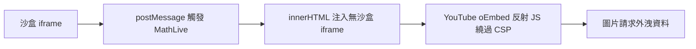

# AI Daily Digest — 2026-11-01

<!-- pipeline-generated:begin -->

## 🔥 今日 TOP 3
### 1. Zed DeltaDB：讓程式碼追溯到對話推理
📰 來源：lobsters-ai ｜ 發布：2026-10-30 ｜ 原標題：[Building fine-grained version control for agents with Rust and Durable Objects](https://delta.dev/blog/fine-grained-version-control-for-agents)

**一句話：** 把「為什麼這樣寫」的對話與推理，跟程式碼一起存下來。

**Why｜為什麼重要：** 寫程式的推理常留在 agent 對話中，或被壓縮進無人閱讀的 commit message 而遺失。

**How｜怎麼做到：** 以 CRDT 組成的 DAG 存在本機 SQLite，每個 delta 是最小變更單位。版本向量在人與 agent 頻繁進出時只增不減，因此改用 DAG 祖先查詢；每個 thread 對應一個 Cloudflare Durable Object 同步。

**What｜具體內容與下一步：** Zed Industries 發布 DeltaDB 與第一方 agent harness Delta，並以 timelines 讓子代理平行修改再合併。設計多人加 agent 的協作系統時，可參考「版本向量不適合頻繁進出的 actor」這個取捨。

📖 [閱讀完整 insight](../10-insights/2026-10-30/inbox_e20c4a2b.md) · 🔗 [原文連結](https://delta.dev/blog/fine-grained-version-control-for-agents)
### 2. 串接小漏洞突破 ChatGPT HTML 沙盒
📰 來源：simon-willison ｜ 發布：2026-10-31 ｜ 原標題：[How We Took Over ChatGPT Accounts](https://simonwillison.net/2026/Oct/31/how-we-took-over-chatgpt-accounts/)

**一句話：** 幾個各自無害的小漏洞串起來，就能逃出沙盒並偷走資料。

**Why｜為什麼重要：** artifacts 類功能要在 sandbox iframe 裡執行不受信任的 HTML，沙盒被突破就能碰到使用者的私人資料與 OpenAI API。

**How｜怎麼做到：** MathLive 虛擬鍵盤透過 postMessage() 讓父頁面用 innerHTML 插入 HTML，因此能注入沒有沙盒限制的新 iframe；CSP 擋了 inline script，但白名單中的 YouTube oEmbed endpoint 會反射 JavaScript，取得執行權後再以圖片請求外洩資料。

**What｜具體內容與下一步：** Parameter Labs 揭露此攻擊鏈：攻擊者可做出 ChatGPT 分享連結，已登入使用者一開就會被外洩資料。OpenAI 已修補並付出 $5,000 bug bounty。明天可檢查自家 CSP 白名單中，有沒有帶反射端點的第三方網域。

📖 [閱讀完整 insight](../10-insights/2026-10-31/inbox_1d14d21e.md) · 🔗 [原文連結](https://simonwillison.net/2026/Oct/31/how-we-took-over-chatgpt-accounts/)
### 3. 自架開源模型跑 coding agent 何時划算
📰 來源：youtube-ai-engineer ｜ 發布：2026-10-31 ｜ 原標題：[When Running Your Own AI Models Beats Paying for APIs - Steven Latré, imec](https://www.youtube.com/watch?v=9-Y_oS9OBLc)

**一句話：** 自架模型划不划算，看 GPU 用得多滿與同時幾人使用，不只看模型準不準。

**Why｜為什麼重要：** token 用量成長後，企業開始考慮自管 AI stack，但硬體、模型、harness 的組合暴增，難以判斷該不該自架。

**How｜怎麼做到：** imec 以 SWE-Bench Pro 長時程任務，搭配 Codex、Pi、Claude Code 三種 harness 與多種開源模型和硬體配置，跑了數千次，量測解題率、延遲與成本並做 TCO 分析。

**What｜具體內容與下一步：** 低階硬體需約 89% GPU 使用率才勝過 API，高階（如 B200 級）只要約 15%；GLM 級應用自架約省 25% TCO。Kimi K3 解題率 86%，但只能穩定支援約 4 位並行使用者。Codex 搭 GLM 產生的 token 只有一半。

📖 [閱讀完整 insight](../10-insights/2026-10-31/inbox_b5a3301f.md) · 🔗 [原文連結](https://www.youtube.com/watch?v=9-Y_oS9OBLc)

## 📖 好文章 / 影片精選

_近期的高品質內容，按興趣領域分類。每篇只在 column 出現一次。_
### 🔐 AI 安全
- **medium-tag-claude** · 2026-10-26 · **[Claude Code Sandbox vs Auto Mode vs Bypass: 7 Guardrails, Ranked](../10-insights/2026-10-26/inbox_4264ede4.md)**
  比較 Claude Code 七種護欄，看跳過權限後哪些仍有效。 **How** 依 --dangerously-skip-permissions 下仍能攔截的程度排序。 **What** 七種護欄中僅 2 種仍有效；sandbox 只需一項設定即可保留防護，hooks 則會 fail open。
- **infoq-main** · 2026-10-24 · **[Google’s Data Agent Kit Hits GA, Splitting Agent Guardrails Between Skills and IAM](../10-insights/2026-10-24/inbox_d36cc188.md)**
  Google 把程式 agent 連到資料雲的工具包正式上線，並區分「請 agent 停手」與「系統直接拒絕」兩種護欄。 **Why** 讓 agent 操作資料服務時，必須分清哪些限制只是建議、哪些是真正強制。 **How** 一種護欄是 skill 內要求 agent 停止，另一種是 IAM deny policy，直接拒絕該次呼叫。 **What** Google Data Agent Kit 正式 GA，免費，內含 MCP 工具與 37 個開源 skills，可將 coding agent 連接到 15 個以上的 Google Data Cloud 服務。
- **youtube-ai-engineer** · 2026-10-27 · **[What a $900M Bank Error Teaches Us About AI Agents - John Feminella, Two Sigma](../10-insights/2026-10-27/inbox_c5e1b706.md)**
  用 2020 年 Revlon 被銀行誤匯約 9 億美元的事件，說明 agent 治理應該是「讓你能開快車的煞車」，而不是全面封鎖。 **Why** 人類按流程操作仍會出錯，agent 同樣不可預測；全面沙箱太無用、放任太危險、只寫政策文件又無法在執行時強制。 **How** 用五個可組合控制：agent registry、依風險分級審查、宣告用途與工具後由 runtime 轉成可執行政策、共用 eval 平台、以分類器處理例行核准並只把重要請求交給人。 **What** Two Sigma 的 John Feminella 分享該公司做法。Revlon 案中 Flexcube 本應只付約 800 萬美元利息，卻把全部本金約 9 億美元付給 300 多家貸方，且人工核准者覆寫了警告；此後商業貸款合約開始加入相關條款。
### 🎙️ Lenny's Newsletter・Podcast
- **substack-lennys-newsletter** · 2026-10-31 · **[🧠 Community Wisdom: The biggest sources of interruptions for PMs, hiring junior PMs with case studies vs. behavioral interviews, building a product harness for AI-driven development, and more](../10-insights/2026-10-31/inbox_169d1636.md)**
  Lenny 社群 Slack 的每週精選討論，整理 PM 常見干擾來源、初階 PM 面試方式與 AI 開發用的 product harness。 **What** Lenny's Newsletter 的訂閱者限定「Community Wisdom」週報，本期主題包含 PM 最大的干擾來源、招募初階 PM 時用 case study 還是行為面試，以及為 A
### 🧩 熱門 Skill・MCP・Plugin
- **github-trending-agent-tools** · 2026-11-01 · **[Orkas-AI/Orkas ⭐ 6,156(今日 +1,044)](../10-insights/2026-11-01/inbox_dc681fd1.md)**
  把目標交給 AI 團隊，自動拆解任務並分派給多個 agent 執行。 **Why** 單次對話難以持續推進跨天的專案。 **How** Commander 將目標拆成 to-do，協調 16 個內建專家 agent 與 Claude Code、Codex、OpenCode、OpenClaw、Hermes-Agent，專案保存目標、規則、記憶與檔案，並支援排程自動化。 **What** Orkas 是 MIT 授權、本機優先的 macOS 與 Windows 桌面 app，可用內建模型或自備 API key；GitHub 上目前 6,156 星，今日新增 1,044 星。
### 🛠 工具最新 release
- **claude-code** · 2026-10-31 · **[v2.1.316](../10-insights/2026-10-31/inbox_3edd063b.md)**
  這版修一批 bug、加管理設定，並宣告 Opus 4.8 fast mode 將下架。 **What** Claude Code v2.1.316 新增 CLAUDE_CODE_DISABLE_ULTRATHINK、CLAUDE_CODE_SUBAGENT_EFFORT 等環境變數，Claude apps gateway 加入 pooled_budget（群

## 💡 今日 Takeaway

_讀完今日所有內容後，可帶走的知識點_
### 1. 風險決策交給確定性規則，不交給模型
Arca 的 agent 只提案，資金動作由人類執行；PageBreak 只認能被程式重現的 exploit。把 agent 的輸出接上可自動驗證或必須人工核准的關卡，能擋掉看似合理卻不成立或有風險的結果。設計時先列出哪些動作不可逆或涉及金錢，再把它們移出模型的判斷範圍。

_類型：pattern_

**參考來源**：
- [Agents Prompt People: Using Agents for Long-Horizon Financial Work](../10-insights/2026-10-31/inbox_4965c197.md) · [原文](https://latent.space/p/arca/)
- [Google Discloses PageBreak AI Security Agent That Found 500+ XSS Bugs](../10-insights/2026-10-31/inbox_62fd74dc.md) · [原文](https://www.infoq.com/news/2026/10/google-pagebreak-security-agent/?utm_campaign=infoq_content&utm_source=infoq&utm_medium=feed&utm_term=global)
### 2. 自架成本看 GPU 使用率與並行度
imec 的分析顯示，低階硬體需約 89% GPU 使用率才勝過 API，高階硬體僅需約 15%。評估自架前，先估算實際使用率與同時使用人數，再與 API 帳單比較。另外 harness 選擇對解題率影響小，卻會讓 token 與 GPU 時間差約一倍，也值得一併比較。

_類型：data-point_

**參考來源**：
- [When Running Your Own AI Models Beats Paying for APIs - Steven Latré, imec](../10-insights/2026-10-31/inbox_b5a3301f.md) · [原文](https://www.youtube.com/watch?v=9-Y_oS9OBLc)
### 3. CSP 白名單網域也可能成為繞過口
ChatGPT 案例中，CSP 擋住了 inline script，但白名單內的 YouTube oEmbed endpoint 會反射 JavaScript，仍被拿來執行程式。審查 CSP 時，要逐一檢查白名單網域是否有可反射內容的端點，而不是只看有沒有擋 inline script。

_類型：pattern_

**參考來源**：
- [How We Took Over ChatGPT Accounts](../10-insights/2026-10-31/inbox_1d14d21e.md) · [原文](https://simonwillison.net/2026/Oct/31/how-we-took-over-chatgpt-accounts/)
### 4. LLM 評審要先用人工標註校準
Upstart 的合規指標與人工的一致率從 33% 提升到 92%，做法是補上未寫下的部落知識、統一人工審核標準並改進 judge。導入 LLM-as-judge 前，先量測它與人工的一致率，並把人工之間的分歧也一併處理。

_類型：pattern_

**參考來源**：
- [Voice AI Where One Wrong Question Breaks the Rules - Shiv Indap, Upstart & Brooke Hopkins, Coval](../10-insights/2026-10-31/inbox_59a6813b.md) · [原文](https://www.youtube.com/watch?v=3osCbSufv8g)
### 5. 記憶要有寫入關卡，不只讀取
retrieval 是讀取路徑，memory 是寫入路徑。先對候選記憶分類、與既有紀錄比對、檢查該類型所需證據，再由 harness 決定接受、拒絕或送人工審核。這樣能避免什麼都記而汙染記憶庫，也避免什麼都不記而失去連續性。

_類型：framework_

**參考來源**：
- [How to Decide What Your AI Agent Should Remember - Wojciech Pluta, Oracle](../10-insights/2026-10-31/inbox_08369649.md) · [原文](https://www.youtube.com/watch?v=qq2Hm4XNRgI)

<!-- pipeline-generated:end -->

<!-- user-notes -->
<!-- Write your own notes below; pipeline never touches this section. -->