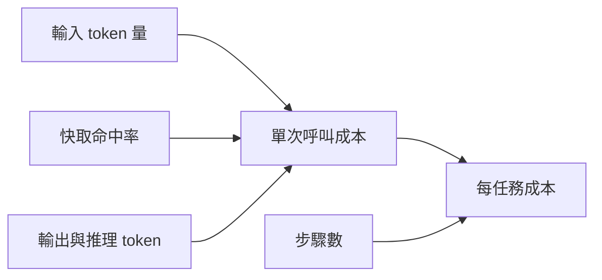

# AI Daily Digest — 2026-11-04

<!-- pipeline-generated:begin -->

## 🔥 今日 TOP 3
### 1. Agent 成本看輸入 token 與快取，不看輸出
📰 來源：youtube-ai-engineer ｜ 發布：2026-11-03 ｜ 原標題：[Without Caching, Your AI Agent Costs 10x More - George Cameron, Artificial Analysis](https://www.youtube.com/watch?v=prGP0huECPo)

**一句話：** 跑 AI agent 的錢，主要花在每一步重送的歷史，而不是模型輸出的字。

**Why｜為什麼重要：** agent 一個任務要跑上百步，每步都重送整段歷史，成本結構與一年前只看輸出價格時完全不同。

**How｜怎麼做到：** Artificial Analysis 以 AA briefcase 拆解：每任務成本 = 單次呼叫成本 × 步驟數；單次呼叫取決於輸入 token、快取命中（約 10 倍折扣）與輸出／推理 token。

**What｜具體內容與下一步：** 講者稱 Opus 5.5 平均每任務約 $21、165 步；快取命中率為 0 時超過 $200。reasoning effort 從 low 到 max，每任務約由 $1 升至 $21。明天可先檢查自家 agent 的快取命中率與步驟數。

📖 [閱讀完整 insight](../10-insights/2026-11-03/inbox_79f3d29c.md) · 🔗 [原文連結](https://www.youtube.com/watch?v=prGP0huECPo)
### 2. S-1/A 揭露：短期 GPU 租價吃掉 Anthropic 獲利
📰 來源：tomasz-tunguz ｜ 發布：2026-11-03 ｜ 原標題：[The Financial Engineering Essential for AI in 2027](https://tomtunguz.com/the-financial-engineering-essential-for-ai-in-2027/)

**一句話：** 算力合約到期後被迫去現貨市場搶 GPU，價格翻幾倍，獲利就被吃掉。

**Why｜為什麼重要：** 價格戰讓調漲 token 價格等於讓出市占，AI 廠商的成本壓力只能往別處消化。

**How｜怎麼做到：** 作者引用 Anthropic S-1/A，指出三種應對：提升模型效率、收緊訂閱額度、把企業客戶推向多年承諾合約。

**What｜具體內容與下一步：** 短期 GPU 租價從 $3 升至 $12–13／小時，長約約 $2–$4；2026 Q3 短期算力花 $5.0b，占算力帳單 51%，Q2 營業獲利 $974m 轉為 Q3 虧損 $567m。作者認為 2027 年重點是讓客戶合約期限對齊算力租約。

📖 [閱讀完整 insight](../10-insights/2026-11-03/inbox_8d9b8d68.md) · 🔗 [原文連結](https://tomtunguz.com/the-financial-engineering-essential-for-ai-in-2027/)
### 3. Netflix 讓 AI 讀效能剖析並自動修瓶頸
📰 來源：substack-bytebytego ｜ 發布：2026-11-03 ｜ 原標題：[How Netflix Uses AI Agents for Performance Engineering](https://blog.bytebytego.com/p/how-netflix-uses-ai-agents-for-performance)

**一句話：** 讓 AI 取代專家盯 flame graph，找出程式裡最浪費資源的地方並提出修正。

**Why｜為什麼重要：** 效能優化原本靠少數專家手動分析，無法規模化；AI 寫碼又看不到執行環境，容易產出大規模下浪費資源的程式。

**How｜怎麼做到：** 各語言 profiler 都輸出 call stack，可用單一管線處理；LLM 以已知反模式比對，並用 package prefix 限定範圍，避免耗在 GC 或 kernel。修正須先過單元／整合／契約測試，再走 canary。

**What｜具體內容與下一步：** 找出 regex 佔 46% CPU（改查表後快 22 倍）、每次呼叫查 metric counter 佔 66% CPU（業務邏輯僅 0.3%）等問題。可先拿自家服務的 profile 試跑反模式比對。

📖 [閱讀完整 insight](../10-insights/2026-11-03/inbox_ff950ff4.md) · 🔗 [原文連結](https://blog.bytebytego.com/p/how-netflix-uses-ai-agents-for-performance)

## 📖 好文章 / 影片精選

_近期的高品質內容，按興趣領域分類。每篇只在 column 出現一次。_
### 🎓 AI 使用技巧
- **youtube-how-i-ai** · 2026-11-02 · **[Inside Figma’s PM OS: skills, agents, and Auto XP](../10-insights/2026-11-02/inbox_81f54a87.md)**
  把 PM 的重複雜務與瑣碎判斷寫成可重用的 AI 技能包，讓 AI 當 PM 的分身去跑。 **Why** 大公司裡 PM 身兼太多角色，有些工作（通知客服、會議紀錄、找 code owner）做不好或根本沒做，Slack 又雜亂到難以掌握重點。 **How** 用一個基本 repo：agent.md 定義行為、多個 skill 定義何時觸發與做什麼、啟動時檢查版本的 command hook；個人工作區是 subrepo，可私下寫回。實驗自動化則用三個由 Slack 觸發的 Cursor automation，分別叫 data scientist、UX writing、engineer agent，上線前人工只審一次，實驗結束後再由 webhook 觸發結果分析。 **What** Figma 內部的 PM OS 有 31 個 skill（如 what's up、找人、spec、coaching、build artifact、FigJam builder），約 60–70 位 PM 使用，最初用 Claude Code，現在主要用 Codex（含瀏覽器 bug bash）。另有 Auto XP：目前有 5 個並行實驗，首次實驗就找到大贏。講者也展示用 Jev（快又便宜的小模型）做即時寫作編輯器，停筆就檢查缺漏與待佐證論述，並從資料庫撈訪談引文。
- **tomsguide-chatgpt** · 2026-11-03 · **[7 real-world ChatGPT uses and prompts I learned directly from OpenAI that blew my mind](../10-insights/2026-11-03/inbox_561f8da3.md)**
  整理 ChatGPT 七類生活情境的實用提示詞範例。 **How** 以具體提示詞模板示範，部分要求 ChatGPT 一次只問一個問題，先收集資訊再給建議。 **What** 涵蓋食物、旅遊、健身、理財、育兒、居家園藝與學習，作者參加 OpenAI「ChatGPT for Everyday」活動後整理，文中未提供量化成效。
- **tomsguide-chatgpt** · 2026-11-01 · **[New to ChatGPT? Here's how to learn in 15 minutes — this lesson plan could even work for your parents](../10-insights/2026-11-01/inbox_e824300b.md)**
  新手用 ChatGPT 的 15 分鐘入門法：寫清楚需求、用追問修正，並查核答案、不輸入敏感資料。 **Why** AI 可能出錯、過度自信，甚至編造非事實資料，使用者需自行查核。 **How** Prompt 應包含目標、背景、限制與回覆格式；研究類任務要求模型標示假設、說明推理並附上可查證的來源。 **What** 作者以規劃晚餐為例，示範用追問加入喜好食材、索取食材清單與影片連結；並提醒不要輸入密碼、銀行資料等敏感資訊。
### 🛤️ 導入心得
- **substack-pragmatic-engineer** · 2026-11-03 · **[How software engineering is changing: a tale of two eras](../10-insights/2026-11-03/inbox_f02c6981.md)**
  一位工程師從 AI 前時代到 AI 原生新創，每月合併的 PR 增加約十倍，同時瓶頸從寫程式轉移到協作與審查。 **Why** AI 讓寫程式變快後，溝通成本、人工 code review 等舊流程成為瓶頸，團隊文化若不跟著改就無法吃到紅利。 **How** 作者用 Claude Code Desktop 同時跑 3-5 個任務、讓 agent 跑 1-2 小時產出 PR，並用 Claude Code GitHub Actions 建立 code review agent 取代人工審查；一人負責整個功能的前後端與設計。 **What** 這是 Pragmatic Engineer 五週年徵文比賽（125 篇投稿）的 $10,000 首獎文章，作者為 Neil Kakkar。他在 Tano 每月 200+ PR，約為 PostHog 時期（每月 8-20 個）的 11 倍，PostHog 又是 Bloomberg 的 2.4 倍。取捨是快速出貨並接受事後修補，例如 agent 生成的幣別程式碼假設所有貨幣最小單位都是 100（巴林第納爾是 1,000 fulūs），且沒用既有的幣別工具函式；新限制包括 context switching、失去共享脈絡、較少設計思考與 AI 用量上限。
- **latent-space** · 2026-11-02 · **[Building Legal Agents When You Can't See the Data - Jacob Lauritzen, CTO of Legora](../10-insights/2026-11-02/inbox_30ea46f6.md)**
  看不到使用者資料時，如何打造並測試法律 AI agent。 **Why** Legora 的資料屬於律所客戶，團隊無法讀取 agent 的任何 trace，因此不能靠看輸出來除錯與評估。 **How** 由 3 位工程師與 3 位律師依客戶實際工作建立測試環境，概念類似強化學習的「worlds」；trace 經改寫（paraphrase）後，把失敗歸納成 10 或 20 種類型。 **What** Latent Space 專訪 Legora CTO Jacob Lauritzen：他估計模型已能做好約 60% 的法律工作；某次模型釋出後，引用正確率從 70% 升到 99%，Legora 無須改動任何東西。Legora 全部跑在 Azure 上，出於資料隱私考量；工程團隊從 20 人成長到 100 人。產品包含 Tabular Review（百萬格試算表）、Word add-in、Slack 法務 intake bot，以及 agent 與 list 可互相啟動的設計。
- **infoq-main** · 2026-10-30 · **[DoorDash Cuts Grocery Reorder Latency from 16 to 2 Seconds with AI Agents](../10-insights/2026-10-30/inbox_953644c8.md)**
  把需要 LLM 判斷的工作提前離線算好，使用者點進來時直接讀結果，延遲就從 16 秒降到 2 秒。 **How** DoorDash 用批次 LLM 推論預先計算週期性採購需求，再以確定性規則驗證；商品選擇用即時目錄解析保持最新，並提供可編輯的購物介面，避免不必要的模型呼叫。 **What** DoorDash 的 AI 雜貨再購買流程，延遲由 16 秒降到
### 🔐 AI 安全
- **youtube-ai-engineer** · 2026-10-30 · **[Your Agent Just Paid for Nothing: 6 Attacks on x402 Payments - Ishween Kaur, SoFi](../10-insights/2026-10-30/inbox_57bf009e.md)**
  讓 AI agent 能自動付小額款項時，付款看似正確卻可能付錯、付多、或被騙，必須在簽款前與出貨前加檢查。 **Why** x402 讓 HTTP 402 狀態碼真正可用於機器付款，agent 成為買家，但即使 agent 沒被攻破也可能損失金錢。 **How** 講者在 Base Sepolia 測試網搭配本地 facilitator，用 Llama 3.2 實測 6 種攻擊並加防護：比對報價欄位（價格、錢包、網路）、共享儲存記錄 payment 編號做冪等與綁定頁面（衝突回 409）、等結算完成再放行資料、付費牆端點全部回 402 並對機密內容設 no-store、買家用 allow/block/probation 清單、將單回合鎖定只能付款一次以擋 prompt injection。 **What** 6 種攻擊：價格被改（列 5 美分實付 50 美分）、重複 payment 編號、免費取得（結算失敗、未設付費牆、公開快取）、多頁面共用同一筆付款、仿冒賣家、回覆文字誘導 agent 再付費（5 美分變 55 美分）。落地建議：以單一 payment ID 追蹤全流程，建立 20–25 筆成功/失敗資料集做錯誤分析，再逐步上警報與阻擋。
- **tomsguide-chatgpt** · 2026-11-03 · **[Real people at AI companies may be reading your private chats — here's how to protect yourself](../10-insights/2026-11-03/inbox_d7af205a.md)**
  關閉模型訓練不等於對話不會被人工審閱，刪除對話也未必立即清除。 **Why** OpenAI、Google、Microsoft、Anthropic 的政策都允許部分對話由人工審閱，用於改進模型、安全調查或排除問題。 **How** 各平台的隱私設定主要影響訓練用途，並不等於排除審閱或縮短保存期限。 **What** Gemini 經人工審閱的對話最長保存三年，刪除活動紀錄也不會移除；Microsoft 表示使用者無法完全退出人工審閱；ChatGPT 刪除的對話約 30 天內永久移除，Claude Incognito 對話一般保留 30 天。
- **hackernews** · 2026-11-03 · **[OpenAI seems to be silently re-enabling model training on Codex chats](../10-insights/2026-11-03/inbox_2352a279.md)**
  有使用者回報 Codex 的「用你的資料改進模型」設定被悄悄重新開啟。 **Why** 作者的公司擔心 IP 透過 prompt 洩漏給前沿實驗室，全員都已關閉資料分享。 **What** Hacker News 貼文，作者與同事昨天發現 Codex 的設定在他們沒有操作的情況下被重新啟用。檢查位置是 chatgpt.com/settings/data-controls 的「Improve the model for everyone」，也可到 privacy.openai.com 關閉。這是單一使用者回報，作者自己也不確定是個案或普遍現象，並補充先前已有類似討論。
### 🎙️ Lenny's Newsletter・Podcast
- **substack-lennys-newsletter** · 2026-11-03 · **[Lenny’s Newsletter holiday gift guide 2026](../10-insights/2026-11-03/inbox_a99045b0.md)**
  Lenny 的第六屆年度節日禮物清單，列出各類實用與有趣的商品推薦。 **What** 清單涵蓋趣味小物、居家與健康、睡眠、親子等分類，Lenny 表示沒有使用聯盟連結，且只投資其中兩家公司；與 AI 產業無直接關聯。
### 🧩 熱門 Skill・MCP・Plugin
- **github-trending-agent-tools** · 2026-11-03 · **[spotify/portal-ai-plugins ⭐ 3,030(今日 +94)](../10-insights/2026-11-03/inbox_21c41d8c.md)**
  Spotify 開源的外掛，讓 Claude Code、Codex、Cursor、pi 等 coding agent 直接操作 Portal 的軟體目錄與服務。 **Why** 讓開發者不必離開 coding agent 就能查詢服務擁有者、健康狀態與文件，並執行 Portal 動作。 **How** 外掛透過 Portal CLI 的 actions registry 呼叫上游 CLI，動作內建 help、dry-run 與確認防護；其中 shunt 外掛（目前僅支援 Claude Code）把大量讀檔、樣板生成等 I/O 密集工作轉交給較便宜的 worker model（AiKA modes）以節省 token。 **What** 倉庫提供 setup、diagnostics、catalog search、service briefing、actions 與 Fleetshift shift 等 workflow，GitHub 今日 +94 星、累計約 3,030 星。
### 🛠 工具最新 release
- **codex** · 2026-11-03 · **[libcap 2.75 source archive](../10-insights/2026-11-03/inbox_00f1e63f.md)**
  OpenAI Codex 為了在 Linux 上建置沙盒元件，鏡像存放一份未修改的 libcap 原始碼壓縮檔。 **What** OpenAI Codex 的 release 頁面發布 libcap 2.75 source archive，為未修改的上游鏡像，用於建置 Codex Linux musl 套件中的 Bubblewrap，並附上 libcap-
- **superpowers** · 2026-11-03 · **[v7.0.2](../10-insights/2026-11-03/inbox_10d1f1e3.md)**
  讓 AI 只在答案會改變產出時才提問，其餘自行決定並說明。 **Why** 舊版 brainstorming 問題過多（盲測中填充問題由 41 降到 23），且有對話在核准前就開始建置。 **How** 無既有資訊可推定且會改變建置內容時才提問；有選項時列出並附建議，並先呈現簡短設計請使用者核准。 **What** Superpowers v7.0.2 調校 brainstorming，並修正六個 harness 的 bootstrap，包括 Copilot on Windows 的 PowerShell 錯誤、Pi 的 prompt cache 問題（@sjawhar 量測 83% 轉換會重寫快取），以及 SDD 與 executing-plans helper 新增 -C DIR 參數。
- **hermes-agent** · 2026-11-03 · **[Hermes Agent v0.22.7](../10-insights/2026-11-03/inbox_e16d70cb.md)**
  Hermes Agent v0.22.7 是整合約 174 個已合併 PR 的補丁版本。 **What** 同步發布於 GitHub（CLI 與安裝程式）、Microsoft Store、Docker 與 Hermes Cloud；另有群聊 lead routing、Kanban 釘選看板、Telegram 接入 Team Gateway 等未在本版文件化的
- **claude-code** · 2026-11-03 · **[v2.1.317](../10-insights/2026-11-03/inbox_be198b94.md)**
  Claude Code 這版主要在補強安全提示、修一大批 bug，並擴充企業管理與雲端排程功能。 **What** Claude Code v2.1.317 新增 /schedule 在雲端排程任務帶入非預期 connector 時的警告，以及 web 或 shell 工具呼叫要把帳號 email 送上網路前的確認；Agent SDK hook callba

## 💡 今日 Takeaway

_讀完今日所有內容後，可帶走的知識點_
### 1. Agent 成本 = 單次呼叫成本 × 步驟數
agent 每步都重送歷史，所以輸入 token 與快取命中率比輸出價格更能左右總成本。規劃預算時，先量測步驟數與快取命中率，再選模型與 reasoning 強度。

_類型：framework_

**參考來源**：
- [Without Caching, Your AI Agent Costs 10x More - George Cameron, Artificial Analysis](../10-insights/2026-11-03/inbox_79f3d29c.md) · [原文](https://www.youtube.com/watch?v=prGP0huECPo)
### 2. 讓 LLM 自動修碼：先限範圍，再過測試與 canary
給 LLM 明確的範圍（如 package prefix）可避免它把推理耗在無關的框架與系統呼叫上。修正再經既有測試與 canary 部署才進 production，這套防護適用於任何自動改碼的 agent。

_類型：technique_

**參考來源**：
- [How Netflix Uses AI Agents for Performance Engineering](../10-insights/2026-11-03/inbox_ff950ff4.md) · [原文](https://blog.bytebytego.com/p/how-netflix-uses-ai-agents-for-performance)
### 3. AI 只在答案會改變產出時才提問
無既有資訊可推定、且答案會改變建置內容時才提問，其餘自行決定並說明。有選項時列出並附建議，先呈現簡短設計請使用者核准。Superpowers 的盲測中，填充問題由 41 降到 23。

_類型：technique_

**參考來源**：
- [v7.0.2](../10-insights/2026-11-03/inbox_10d1f1e3.md) · [原文](https://github.com/obra/superpowers/releases/tag/v7.0.2)
### 4. 運算位置與 agent 解耦，客戶端只需對外連線
讓執行環境主動以 websocket 連回控制端，客戶就不必開放入站連線，也能保留自己的機密與資料位置。把管理對象設為可暫停、快照、fork 的電腦，能處理沙盒時限等限制。

_類型：pattern_

**參考來源**：
- [Your AI Agents Shouldn't Care Where They Run - Nikhil Harithas, Factory](../10-insights/2026-11-03/inbox_18808b15.md) · [原文](https://www.youtube.com/watch?v=XIHZpZtYCzo)
### 5. 提價要賣價值，而不是賣折扣
多數創辦人用成本或競品價格定價，低估了客戶願意付的金額。找出高利潤客戶，把銷售訴求從省錢改為提供更多價值，再用價格測試調整。

_類型：pattern_

**參考來源**：
- [Episode 857 | Finding Hidden Multipliers in Your Business (with Jason Cohen)](../10-insights/2026-11-03/inbox_9c789f17.md) · [原文](https://www.startupsfortherestofus.com/episodes/episode-857-finding-hidden-multipliers-in-your-business-with-jason-cohen)

<!-- pipeline-generated:end -->

<!-- user-notes -->
<!-- Write your own notes below; pipeline never touches this section. -->