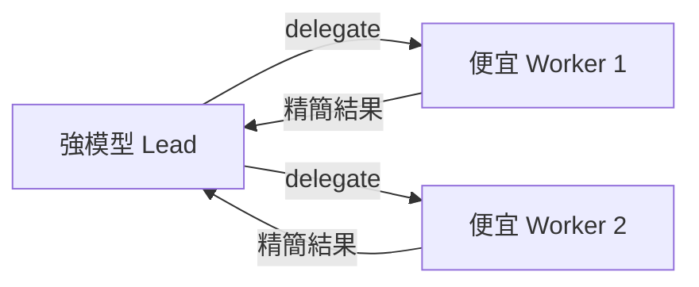

# AI Daily Digest — 2026-11-08

<!-- pipeline-generated:begin -->

## 🔥 今日 TOP 3
### 1. PDF 藏字攻擊：用多層檢查器擋下
📰 來源：lobsters-ai ｜ 發布：2026-11-07 ｜ 原標題：[Catching prompt injections hidden in PDFs](https://tomclancy.info/joshua-judges-ruth.html)

**一句話：** 給 AI 讀的 PDF 可能藏著人眼看不到的字，要用多道各管一件事的檢查器來擋。

**Why｜為什麼重要：** 內部工具解析財報時，白字或零高度文字可能讓模型讀到並採用被竄改的數字，影響所有用 LLM 處理財務文件的團隊。

**How｜怎麼做到：** 每個 judge 只檢查一件事，例如比對像素墨跡與文字層、比對字元 charbox、做 render 差分，多層疊加形成瑞士起司式防禦。

**What｜具體內容與下一步：** 作者實測白字白底、零高度、超大字都能讓 Claude 讀到假數字。已知盲點：pixels only 偵測不到 render mode 3 文字，文字層類檢查在掃描件無效，Type 3 字型（如 LaTeX 產出）直接拒收。作者表示尚未在實際環境抓到案例。可先盤點自家 PDF 解析流程，在輸入端加上文字層與像素比對。

📖 [閱讀完整 insight](../10-insights/2026-11-07/inbox_38269dc5.md) · 🔗 [原文連結](https://tomclancy.info/joshua-judges-ruth.html)
### 2. Firecracker 沙箱逃逸：改寫宿主指令指標
📰 來源：lobsters-ai ｜ 發布：2026-11-07 ｜ 原標題：[Firecracker VM Escape: PwnEscape Part 2](https://pwn.ai/blog/firecracker-escape)

**一句話：** 關在小盒子裡的程式，找到方法讓盒子外的管理程式替它做事。

**Why｜為什麼重要：** Firecracker 微型虛擬機常用來隔離不受信任的程式碼，這篇展示隔離被打破的完整路徑。

**How｜怎麼做到：** 沿用前一篇的宿主記憶體存取能力，從 guest 找到 Firecracker 行程與 vCPU 的 pt_regs 暫存器框架，改寫 KVM_RUN 返回時的指令指標與堆疊，讓 Firecracker 執行 write(2) 輸出標記字串，之後還原堆疊。

**What｜具體內容與下一步：** 測試對象為 Firecracker v1.16.1（x86-64、宿主 kernel 7.0.0-1011-aws），文中標示 CVE-2026-99999。該設定以 root 經 systemd-run 啟動且未使用 jailer，所以呼叫以 root 權限執行；作者指出 jailer 的降權、namespace 與 seccomp 需另行評估。若你用 Firecracker 跑不受信任程式碼，應確認是否啟用 jailer。

📖 [閱讀完整 insight](../10-insights/2026-11-07/inbox_951edf2e.md) · 🔗 [原文連結](https://pwn.ai/blog/firecracker-escape)
### 3. 多 agent 的錢該花在卡關階段
📰 來源：youtube-ai-engineer ｜ 發布：2026-11-07 ｜ 原標題：[How to Get Frontier Coding Results at 70% Lower Cost - Nouha Dziri, Cohere](https://www.youtube.com/watch?v=maitMe9HCvw)

**一句話：** 多 agent 團隊的預算要砸在卡住任務的那個階段，強模型當 lead、便宜模型當 worker 就接近頂級結果。

**Why｜為什麼重要：** 長任務會撐爆 context，多採樣也無法解決；團隊能拆工，但成本暴增，需要知道下一塊錢花在哪裡最有效。

**How｜怎麼做到：** 建立階層式 harness：lead 以 delegate 工具分派 worker，每個 worker 有乾淨 context 並回報精簡結果；在 ProgramBench 上逐一變動團隊組織、階段、規模與模型組合，以「每增加一塊錢換得多少獎勵」衡量。

**What｜具體內容與下一步：** Cohere 研究：團隊比單一 agent 高約 10 分但成本 4–7 倍；worker 只放規劃階段，獎勵與重度提示詞版本相近、成本約一半；強模型當 lead 加 Luna worker，成本約降 60%。瓶頸在規劃的任務就把 worker 放規劃，瓶頸在實作的則放實作。

📖 [閱讀完整 insight](../10-insights/2026-11-07/inbox_57bdd0fe.md) · 🔗 [原文連結](https://www.youtube.com/watch?v=maitMe9HCvw)

## 📖 好文章 / 影片精選

_近期的高品質內容，按興趣領域分類。每篇只在 column 出現一次。_
### 🎙️ Lenny's Newsletter・Podcast
- **substack-lennys-newsletter** · 2026-10-12 · **[🎙️ How I AI: How Meta designed Muse with Alex Cornell](../10-insights/2026-10-12/inbox_c9212bb8.md)**
  這是 How I AI（Lenny's Podcast Network 旗下的每週節目）的一集，主題是「Meta 如何設計 Muse」，來賓為 Alex Cornell。提供的內容僅有節目系列的通用簡介，沒有該集的具體內容。同日還有另一則 Lenny's Newsletter 文章，是同一位來賓的完整訪談，內容較有細節。這一則主要是節目推送通知，資訊量低。
### 🧩 熱門 Skill・MCP・Plugin
- **github-trending-agent-tools** · 2026-11-08 · **[ranxianglei/billion-context ⭐ 4,630(今日 +191)](../10-insights/2026-11-08/inbox_c2e4e149.md)**
  用代理層壓縮對話上下文，讓單一長會話可跑到數十億 token。 **Why** 長程式開發的上下文會快速膨脹，按 token 計費，超出視窗後會退化或失效。 **How** 插件位於 agent 與模型 API 之間，改寫 Anthropic/OpenAI 串流；模型透過注入的工具自行決定壓縮時機與範圍，產生可還原的分層摘要，並保持 prefix cache 有效。 **What** 專案自述 4.5 個月、三台主機、174,327 次模型呼叫、最長會話 12,049 次呼叫，並宣稱約省 5 倍 token；健康會話的 cache 命中率約 95–97%，壓縮成本 ≤2%。數據為作者自述，非獨立驗證。
### 🛠 工具最新 release
- **claude-mem** · 2026-11-07 · **[v15.12.0](../10-insights/2026-11-07/inbox_709b8393.md)**
  讓編碼代理跨 session 記住內容的 claude-mem 發布 v15.12.0，重點是圖片保留與安全修正。 **What** 截圖與圖片預設保留並連結到對應回合的 observation，圖像推論預設關閉；每位 owner 在 cmem.ai 雲端可存 25 GiB 圖片；CLAUDE_MEM_DATA_DIR 與 CLAUDE_MEM_WORKER
  _+ 1 個近期版本（v15.11.1，僅顯示最新）_

## 💡 今日 Takeaway

_讀完今日所有內容後，可帶走的知識點_
### 1. 防禦要靠多個單一用途檢查器疊加
每個檢查器只驗證一件事（如像素 vs 文字層、字元幾何、render 差分），各自有盲點但彼此覆蓋，疊起來就像瑞士起司。設計時先列出每個檢查器的已知盲點，再補上另一層去覆蓋，輸入端與輸出端都要設閘門。

_類型：framework_

**參考來源**：
- [Catching prompt injections hidden in PDFs](../10-insights/2026-11-07/inbox_38269dc5.md) · [原文](https://tomclancy.info/joshua-judges-ruth.html)
### 2. 多 agent 的預算要投在瓶頸階段
先判斷任務卡在規劃還是實作，再把 worker 加在那一階段，比全程鋪人更划算。強 lead 決定品質上限，便宜 worker 決定價格；訊息多不等於好，額外溝通對小模型團隊反而降分。

_類型：pattern_

**參考來源**：
- [How to Get Frontier Coding Results at 70% Lower Cost - Nouha Dziri, Cohere](../10-insights/2026-11-07/inbox_57bdd0fe.md) · [原文](https://www.youtube.com/watch?v=maitMe9HCvw)
### 3. 引用要當成身分，而非字串
把引用設計成含文件 ID、版本與內容 hash 的身分，才能對證據來源設規則（例如只接受銀行直接來源），也能事後重跑單步比對。這讓 agent 的每個決定都可被檢查者追溯。

_類型：framework_

**參考來源**：
- [Your Financial Agent Needs to Show Its Work - Anirudh Veeraragavan, Fieldguide](../10-insights/2026-11-07/inbox_81606d89.md) · [原文](https://www.youtube.com/watch?v=gdzsJZJ6DDs)
### 4. 高分 eval 可能掩蓋標準答案錯誤
整體分數 97% 的案例中，9 個失誤有 4 個是 eval 標錯，另有 12 筆 gold label 因規則變更而過時。稽核 gold data 本身要和稽核模型一樣常態化；告警要稀少且說明清楚，避免人類 automation bias 而一律按同意。

_類型：framework_

**參考來源**：
- [Your Financial Agent Needs to Show Its Work - Anirudh Veeraragavan, Fieldguide](../10-insights/2026-11-07/inbox_81606d89.md) · [原文](https://www.youtube.com/watch?v=gdzsJZJ6DDs)
### 5. 數字從結構上只能引用，不能生成
預先為每個事實指派唯一指標，讓模型只能解參照而非自由輸出數字，運算交給確定性程式碼。這比事後驗證更能從源頭降低幻覺，但模型推論時仍可能自生數字，所以仍需保留後處理驗證。

_類型：technique_

**參考來源**：
- [AI Can't Make Up a Number It Can't Look Up - Vinoo Ganesh, Kepler](../10-insights/2026-11-07/inbox_cf5f8e63.md) · [原文](https://www.youtube.com/watch?v=RdQCY_-SXbA)

<!-- pipeline-generated:end -->

<!-- user-notes -->
<!-- Write your own notes below; pipeline never touches this section. -->