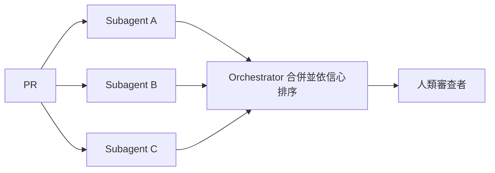

# AI Daily Digest — 2026-11-10

<!-- pipeline-generated:begin -->

## 🔥 今日 TOP 3
### 1. Fable 5.2：近 AGI 但有鋸齒弱點
📰 來源：one-useful-thing ｜ 發布：2026-11-09 ｜ 原標題：[Fable 5.2 and Jagged AGI](https://www.oneusefulthing.org/p/fable-52-and-jagged-agi)

**一句話：** 作者實測新模型後認為，它在電腦上的智力任務已接近專家，但弱點很難察覺。

**Why｜為什麼重要：** 作者把 AGI 定義為「在電腦上能做的大多數智力任務上，和多數人類專家一樣好」，並排除實體世界、與人互動及完整工作。他的結論是「Jagged AGI」：落差不在明顯錯誤或幻覺，而在品味、判斷，以及模型能否自己發現問題。

**How｜怎麼做到：** 公開上線前，用單一提示詞給模型不同領域的高難度任務：把硬體改成遊戲機、規劃創業、重建課程網站、做原創學術研究、建立 3D 傳送門世界。

**What｜具體內容與下一步：** 產出包括六款鍵盤遊戲、182 頁 LLC 規費研究（註冊量約 ±17%，但尚不可發表）、450 個以上世界的網站（約 25,000 次 agent 執行）。第一版網站「準確卻無趣」，模型自己沒察覺。評估新模型時，除了正確性，也要單獨測品味與自我檢查能力。

📖 [閱讀完整 insight](../10-insights/2026-11-09/inbox_eeb1ff75.md) · 🔗 [原文連結](https://www.oneusefulthing.org/p/fable-52-and-jagged-agi)
### 2. LinkedIn 多 agent 互驗審查 PR
📰 來源：substack-bytebytego ｜ 發布：2026-11-09 ｜ 原標題：[How LinkedIn Uses AI to Review 40,000 Pull Requests a Week](https://blog.bytebytego.com/p/how-linkedin-uses-ai-to-review-40000)

**一句話：** 讓多個 AI 各自審查同一份程式碼，再由一個總管只留下可靠意見。

**Why｜為什麼重要：** 程式碼代理讓寫程式變快，瓶頸移到 code review。廠商託管的 reviewer 雜訊多又太通用；單一模型自建則有幻覺與知識盲區，甚至出現行號對不上 diff 的留言。

**How｜怎麼做到：** 採 orchestrator-subagent 架構：多個 subagent（常用不同模型）獨立審查並回報帶行號的發現，orchestrator 合併重疊結果、依信心排序，只發布可靠意見。規則分公司層 YAML、repo 層 markdown、PR 類型層三層。

**What｜具體內容與下一步：** LinkedIn 內部 reviewer 每週涵蓋 4 萬個以上 PR，多數審查在第一位人類審查者開啟 PR 前就已發布，公司有逾 1 萬個活躍 repo。AI 先審、人類保有核准權。自建時可先從「多模型獨立審查加信心排序」開始。

📖 [閱讀完整 insight](../10-insights/2026-11-09/inbox_c5e9362a.md) · 🔗 [原文連結](https://blog.bytebytego.com/p/how-linkedin-uses-ai-to-review-40000)
### 3. Claude Code 2.1.321 補權限漏洞
📰 來源：claude-code-releases ｜ 發布：2026-11-09 ｜ 原標題：[v2.1.321](https://github.com/anthropics/claude-code/releases/tag/v2.1.321)

**一句話：** Claude Code 換上新的預設 Fable 模型，同時修掉一批可能不經提示就寫檔或外洩憑證的權限問題。

**Why｜為什麼重要：** 過去 Bash 權限檢查、MCP OAuth 轉址、網路路徑檔案編輯等處有判斷錯誤，可能在沒提示的情況下寫檔或外洩憑證，影響所有用 Claude Code 與 MCP 的開發者。

**How｜怎麼做到：** 逐項修正權限判斷（路徑、cp/mv、唯讀指令沙箱）；OAuth 被伺服器轉址時，不再把 refresh token 等機密送到另一主機；fast mode 被限流時先以同模型標準速度重試。

**What｜具體內容與下一步：** v2.1.321 新增 claude-fable-5-2 為預設 Fable 模型，1M context，$8/$40 每百萬 token，快取讀取 $0.20/Mtok；`claude remote-control` 新增 `--settings`。另修正 NotebookEdit 覆寫首格等數十項問題。建議盡快升級，並檢查自己的預設模型與成本設定。

📖 [閱讀完整 insight](../10-insights/2026-11-09/inbox_21632ce9.md) · 🔗 [原文連結](https://github.com/anthropics/claude-code/releases/tag/v2.1.321)

## 📖 好文章 / 影片精選

_近期的高品質內容，按興趣領域分類。每篇只在 column 出現一次。_
### 🎙️ Lenny's Newsletter・Podcast
- **substack-lennys-newsletter** · 2026-11-09 · **[🎙️ How I AI: How this founder built a better Duolingo with Codex](../10-insights/2026-11-09/inbox_838d3286.md)**
  沒寫過 Swift 的創辦人，靠 Codex 與即時語音模型做出原生 iOS/Android 語言家教 App。 **Why** William Imoh 連續使用 Duolingo 1,000 天，仍無法用挪威語對話，因此自己做 Mural，用全程沉浸方式教學。 **How** 用 Codex 以 Swift 與 Kotlin 寫原生 App，需求以 epic 與 user story 的形式對應具體使用者問題；用角色分工的 Grok Bot（以魔戒角色命名）協助營運，並連接 Google Workspace、Linear、Notion 等工具。 **What** 他表示 Mural 靠 GPT-Live-1 才可能實現，30 分鐘對話約花 $3 至 $5，貴於一般軟體但低於隨選真人家教。他經營約 25 人的公司，Grok Bot 團隊含 Gandalf（幕僚長）、Legolas（行銷）、Elrond（工程）；模型進步後多數 skills 已不必要，僅保留成長策略、內容策略與去除 AI 文風等經驗。他還自建內部 HR 工具 Three Pipes。
### 🧩 熱門 Skill・MCP・Plugin
- **github-trending-agent-tools** · 2026-11-09 · **[homeassistant-ai/ha-mcp ⭐ 5,935(今日 +31)](../10-insights/2026-11-09/inbox_93a9384d.md)**
  ha-mcp 讓 Claude、ChatGPT 等 AI 助理透過 MCP 設定與自動化 Home Assistant。 **How** 提供 Home Assistant 自訂元件、HA app、Docker/PyPI、本地 stdio 等安裝方式，各方式都提供相同的 server。 **What** GitHub 趨勢頁今日 ⭐5,935（今日 +31）
### 🛠 工具最新 release
- **claude-mem** · 2026-11-09 · **[v15.14.0](../10-insights/2026-11-09/inbox_0934309c.md)**
  claude-mem v15.14.0 新增 My Work 專注領域總覽、自動更新、較快的 hook 與可選的工具紀錄搜尋。 **What** 專注領域卡片可設定圖片為 full/compact/off；自動更新每天檢查一次，只安裝 npm 有 provenance 的新版，失敗會回退，可用 CLAUDE_MEM_AUTO_UPDATE=false 關閉；
  _+ 1 個近期版本（v15.13.0，僅顯示最新）_

## 💡 今日 Takeaway

_讀完今日所有內容後，可帶走的知識點_
### 1. 多模型獨立審查加信心排序，能過濾雜訊
讓多個 subagent（最好用不同模型）獨立審查同一份產物，再由 orchestrator 合併重疊結果、依信心排序，只輸出可靠項目。不同模型能補彼此的盲區，也減少單一模型的幻覺（如行號對不上 diff）。這個模式可用在 code review，也可用在任何需要「先過濾再交給人」的 AI 輸出。

_類型：framework_

**參考來源**：
- [How LinkedIn Uses AI to Review 40,000 Pull Requests a Week](../10-insights/2026-11-09/inbox_c5e9362a.md) · [原文](https://blog.bytebytego.com/p/how-linkedin-uses-ai-to-review-40000)
### 2. 先定執行邊界，再選 agent 框架
框架、模型、提示詞、追蹤、沙盒供應商都能替換，真正難改的是 agent 程式碼在哪裡執行。本機、內嵌引擎與獨立 VM 的差別在被入侵時的影響範圍。建議先定義自己控制的執行介面，再把框架接上去。

_類型：framework_

**參考來源**：
- [The One Thing Every AI Agent Framework Agrees On - Mislav Ivanda, Daytona](../10-insights/2026-11-09/inbox_d311cac4.md) · [原文](https://www.youtube.com/watch?v=WWIFiQi9U4w)
### 3. 把「為什麼做」的脈絡帶到 review
agent 只讀程式碼，看不到意圖、過去決策、取捨與近期 revert。從 triage 起就把客戶資訊、歷史與意圖寫進 issue，review agent 再帶入這些脈絡，並每日把教訓回寫 agents.md。這樣審查才能攔下「正確但不適合產品」的變更。

_類型：framework_

**參考來源**：
- [What Your Coding Agent Can't See in the Code - Tom Moor, Linear](../10-insights/2026-11-09/inbox_7295a6fc.md) · [原文](https://www.youtube.com/watch?v=Xw9utONfhIY)
### 4. 用校準過的小模型擋在 LLM 前面
簡單的是非與分類，可由回傳機率的決策模型處理，只有超過門檻才呼叫昂貴的 LLM。門檻依哪種錯誤代價較高設定，且不能跨任務、模型或版本沿用，需先用 shadow mode 搭配人工標註校準。多步推理與長上下文不適合這個做法。

_類型：framework_

**參考來源**：
- [Not everything needs an LLM](../10-insights/2026-11-09/inbox_66626fd2.md) · [原文](https://newsletter.posthog.com/p/decision-models)
### 5. 預測準確不等於模型正確
兩個錯誤互相抵銷也能得到 4.4% 的誤差，只修正其中一個，誤差就跳到 28%。驗證時讓模型輸出結構化假設，由領域專家審查，並刻意單獨修正單一假設來測試結果穩不穩。專家的檢查最好寫成程式碼，因為運氣不是控制。

_類型：pattern_

**參考來源**：
- [Right Answer, Wrong Reasons: AI Forecasts Costco - Hassan El Mghari & Omar El Mghari, Together AI](../10-insights/2026-11-09/inbox_181156fa.md) · [原文](https://www.youtube.com/watch?v=dznCt8xPW7o)

<!-- pipeline-generated:end -->

<!-- user-notes -->
<!-- Write your own notes below; pipeline never touches this section. -->