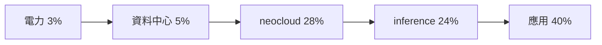

# AI Daily Digest — 2026-11-12

<!-- pipeline-generated:begin -->

## 🔥 今日 TOP 3
### 1. Agent 起草逾 40% PR，瓶頸轉向驗證
📰 來源：substack-bytebytego ｜ 發布：2026-11-11 ｜ 原標題：[The Roundup by ByteByteGo](https://blog.bytebytego.com/p/the-roundup-by-bytebytego)

**一句話：** 寫程式變便宜後，稀缺的是「確認程式碼沒問題」的能力。

**Why｜為什麼重要：** agent 產碼速度已超過人工審查，code review、CI 容量與合併速率成為瓶頸，所有導入 coding agent 的工程團隊都會遇到。

**How｜怎麼做到：** 文章用 GitHub、Anthropic、Copilot 與 PHP 事件的數據，說明驗證與自動化決策必須跟上產碼速度；Anthropic 自製 Scion 取代 Git 來提高合併吞吐。

**What｜具體內容與下一步：** GitHub Octoverse 2026 稱 9 月逾 40% 的 PR 由 agent 起草（3 月為 17%）；Scion 讓每日合併數從約 2500 增至逾 30000。PHP2Shell 兩個 CVSS 9.2 的 RCE 已遭利用，建議把執行環境（runtime）版本納入資產盤點。

📖 [閱讀完整 insight](../10-insights/2026-11-11/inbox_771ad3e1.md) · 🔗 [原文連結](https://blog.bytebytego.com/p/the-roundup-by-bytebytego)
### 2. AI 產業鏈毛利：neocloud 吃 28%
📰 來源：tomasz-tunguz ｜ 發布：2026-11-11 ｜ 原標題：[Who Captures the Most Margin in AI?](https://tomtunguz.com/who-captures-the-most-margin-in-ai/)

**一句話：** 把電力到應用的每一層換成同一單位，才看得出誰分到最多毛利。

**Why｜為什麼重要：** 各層計價單位不同（度電、GPU 小時、完成任務），很難直接比較，投資人與要選算力供應商的團隊都需要共同尺度。

**How｜怎麼做到：** 把每一層正規化成每瓦每年美元（$/w/yr），依公開財報與建模假設畫 waterfall；作者註明誤差大，多項數字來自模型假設。

**What｜具體內容與下一步：** 以應用層毛利 40% 計，電力 3%、資料中心 5%、neocloud 28%（GPU 折舊前）、inference 24%。CoreWeave 新的四到五年合約每 MW 每年 $20–25m，是目前混合費率 $9/w/yr 的兩倍以上；談算力合約時可用這個單位換算。

📖 [閱讀完整 insight](../10-insights/2026-11-11/inbox_fef365f4.md) · 🔗 [原文連結](https://tomtunguz.com/who-captures-the-most-margin-in-ai/)
### 3. Duolingo 用 agent 補 iOS 測試 9%→59%
📰 來源：youtube-ai-engineer ｜ 發布：2026-11-11 ｜ 原標題：[225,000 Lines of Tests, Written and Merged by Agents - Kush Agrawal, Duolingo](https://www.youtube.com/watch?v=D_4Rn6uLdQM)

**一句話：** 讓 agent 自己寫測試、修 CI、找人審，再用多層把關擋住它偷懶。

**Why｜為什麼重要：** agent 讓寫程式變快，瓶頸轉為驗證；單元測試便宜又能當護欄，但 Duolingo iOS 的 MVVM 部分覆蓋率只有約 9%。

**How｜怎麼做到：** 用 Temporal 編排，Claude Code 寫測試、S3 存共享狀態；選檔腳本依檔案類型打分，PR workflow 每隔幾小時推進一步（CI 失敗最多修 5 次、git blame 找審查者）。品質有三層：非測試檔被改就關閉、AI review 的 P0 由 agent 處理、LLM judge 擋掉改 production code 與刪改測試。

**What｜具體內容與下一步：** 約 8 個月合併 700 多個測試 PR、約 22.5 萬行；MVVM 覆蓋率 9%→59%，整體 11%→24%。LLM judge 審約 200 個 PR、退回 73 個，且每個 PR 都經人類核准。

📖 [閱讀完整 insight](../10-insights/2026-11-11/inbox_0620c5ef.md) · 🔗 [原文連結](https://www.youtube.com/watch?v=D_4Rn6uLdQM)

## 📖 好文章 / 影片精選

_近期的高品質內容，按興趣領域分類。每篇只在 column 出現一次。_
### 🎓 AI 使用技巧
- **youtube-ai-engineer** · 2026-11-10 · **[Your Agent Hates Your CLI - Ayush Bhardwaj, Allos AI](../10-insights/2026-11-10/inbox_dd976f0b.md)**
  看 agent 的 transcript 就知道你的 CLI 缺什麼：它們反覆自己寫的 pipe 就是 bug report。 **Why** agent 遇到不好用的輸出時不會回報問題，而是自己用 head、tail、grep、python 切輸出；這種切法暗含「答案在哪」的猜測，還可能因沒設 pipefail 而吞掉錯誤與錯誤碼。 **How** 分析 transcript 中 agent 呼叫工具後立刻做的事，找出重複出現的 pipe 模式，把它們變成 CLI 內建的選取 flag（範圍、限制、compact 輸出、一次查多筆），再用 skill 檔與 help 文字教 agent 使用；並以過去呼叫當 replay 測試案例。 **What** 講者 Ayush Bhardwaj（Allos AI）分析約 20,000 次 agent 呼叫：約四分之一帶 pipe，讀取類指令超過一半（git show、cargo test 皆 62%），83% 的 pipe 屬於至少出現 10 次的重複模式。他自己的 CLI 加入新 flag 後，pipe 比例從 82% 降到約四分之一；Infra 成本工具案例則是 6 題中從 0 題答對提升至 6 題全對，整體成本降 41%。
- **creator-economy** · 2026-11-11 · **[When to Use Fable 5.2 vs Opus 5.5 in Claude Code (Full Tutorial)](../10-insights/2026-11-11/inbox_65666fcc.md)**
  Fable 5.2 能力較強但價格為 Opus 5.5 兩倍，建議日常用 Opus、難題才用 Fable。 **Why** Fable 5.2 在多數任務上勝過 Opus 5.5，但每 token 價格與 Max 方案的額度消耗都較高，選模型需要權衡。 **How** 作者在 Claude Code 中用五個實際情境比較兩者，並整理 Anthropic 工程師 Alex 的建議，例如先請 Fable 指出想法的缺陷、用 medium effort、事先說明哪些需要核准。 **What** Fable 在 Max 方案中最多可占每週額度的一半；作者用 Opus 處理信件、自動化流程與個人 app，用 Fable 處理商業策略、照顧母親的長期決策，以及審查 AI skills 的錯誤。
- **simon-willison** · 2026-11-09 · **[Locating the source of a mysterious beep with Claude](../10-insights/2026-11-09/inbox_6abb8ac2.md)**
  讓 Claude Code 寫出能用多台裝置的麥克風聽聲音、定位神祕嗶聲來源的系統，等於給 AI 助理一雙「耳朵」。 **Why** 家裡箱子房間不定時傳出嗶聲，間隔太長，人站在房裡很難判斷聲源，又不想翻遍所有箱子。 **How** 參考 2007 年 BeepBeep 聲學測距論文；各裝置以瀏覽器 WebAudio 錄 60 秒緩衝，用 FFT 加高通濾波偵測嗶聲，伺服器再讓一台裝置播放 chirp 以對齊各裝置錄音並三角定位。伺服器可透過 WebSocket 的 installModule() 熱更新各裝置的程式碼，讓 Claude 能自行迭代而不必逐台重新授權麥克風。 **What** Beep Locator 先由 Opus 5.5 在 iPhone 上的 Claude Code Cloud 建出雛形，再用剛發布的 Fable 5.2 在筆電上加功能（粗略模式拖曳、拍手測試、回放、標記神祕嗶聲、重新定位）。定位誤差約 40cm，最後在那堆箱子裡找到一個要換電池的舊一氧化碳偵測器。
### 🛤️ 導入心得
- **youtube-ai-engineer** · 2026-11-11 · **[Agents Made Code Free. Maintaining It Didn't Get Cheaper. - Dmitry Buykin, Maersk](../10-insights/2026-11-11/inbox_d4586fb7.md)**
  agent 讓寫程式變便宜，但維護沒變便宜；作者用每週小規模清理與回饋迴圈取代一次性大砍。 **Why** 程式碼量增長速度超過人能審查的範圍，作者曾一次砍光重寫、遺失有用部分，之後又長回來；他自己也因逐一審查而 burnout。 **How** 以六個問題為框架：用 lint 與帳本檢查 prompt 的一致性、重複出現的 agent 路徑才轉成程式碼、由 runtime 決定模型看到的 context（用 handle 取代全文）、寫入前多道檢查與 journal 保證只執行一次、用第二個 agent 依檢查表獨立驗證，並以真實任務重播證據判斷分支是否保留。 **What** Maersk 的 Dmitry Buykin 分享在 110 國、約 1 萬個 prompt 情境的系統維護經驗，其中約四分之三是 prompt。新檢查規則上線前會重放數千個過往 session（觸發不到 1%）；一個 backlog 看似大多已覆蓋，實際只有約四分之一真正能關閉；並附 18 個自我檢核問題。
- **youtube-ai-engineer** · 2026-11-10 · **[An Agent That Fixes Its Own Mistakes - Saloni Gandhi & Ziwei Guo, LinkedIn](../10-insights/2026-11-10/inbox_603dbc07.md)**
  讓 AI 代理從正式環境的失敗紀錄中找出原因、改自己的提示詞，並先驗證再上線。 **Why** 代理品質要持續提升，但回饋若不可信，自動改進會改錯地方，因此評審器（judge）本身的品質和優化系統同樣重要。 **How** 七步迴圈：跑代理並記錄 trace、用 judge 評分、反思找根因（分群、L2 judge 標記根因、合併近似重複、排名）、用 GEPA 產生提示詞修改、驗證、更新提示詞、在保留集上再評估；目前只優化提示詞，未來往結構化 context、workflow、harness 程式碼逐級攀升。 **What** LinkedIn 以「使用者理解代理」為對象，已透過此迴圈上線第一個 GEPA 最佳化的 PR（經人工審查與量化評估）。用 180–200 筆人工標註校準 L1 judge：分數 1、2 的一致率約 55%、57%，分數 3 約 80%；修正 rubric 後人類一致率由 57% 升至 64%、平均誤差由 96 降至 74。L2 反思若沒有「judge 可能判錯」這個選項，會誤把問題歸咎於 rubric。
- **substack-product-for-engineers** · 2026-11-09 · **[Not everything needs an LLM](../10-insights/2026-11-09/inbox_66626fd2.md)**
  用便宜快速、會給機率的「決策模型」擋在昂貴 LLM 前面，簡單判斷不必每次都叫大模型。 **Why** LLM 回答冗長、過度自信，簡單的是非與分類任務用它又貴又慢。 **How** 決策模型針對結構化問題回傳型別化答案與校準過的機率，系統依機率門檻決定是否呼叫 LLM；門檻依哪種錯誤代價較高來設定，且不同任務與模型版本需分別校準。 **What** PostHog 在 Replay Vision 的個資清除流程用兩個是非題把關（任一題 0.4 以上才交給 Gemini 改寫），生產中 98.7% 跳過 LLM 呼叫；據 TypeSafe AI，決策模型最多比前沿模型便宜 444.6 倍、快 193.6 倍。PostHog in Slack 機器人以 0.85 以上才主動回答，並用 choice 題當模型路由器；搜尋結果重排在 20 個測試查詢上排序品質約提升 25%。但多步推理不適合：用於 PR review 發現排序的 AUC 僅 0.52，Highlights 串接兩題的作法還塞爆模型伺服器。
- **medium-tag-claude** · 2026-11-05 · **[One Solo Dev, One AI, and a Pre-BB MapleStory That Runs in Your Browser](../10-insights/2026-11-05/inbox_48545a3b.md)**
  獨立開發者用 Claude 四個月開發瀏覽器版「前 BB」MapleStory 的經驗分享。 **What** 導言提到使用一個 Claude Max 訂閱、783 次 AI 工作階段、約 125B tokens，並設有公開 bug 回報入口，由 AI 回覆每則回報。
### 🔐 AI 安全
- **youtube-ai-engineer** · 2026-11-10 · **[You Can't Tell What an Agent Skill Will Do by Reading It - Roey Ben Chaim, Zenity](../10-insights/2026-11-10/inbox_7a99b6d3.md)**
  光讀 agent skill 的文字看不出它會做什麼，要把它丟進沙盒真的跑一遍才知道。 **Why** skill 由他人撰寫，payload 常放在別處（外部連結、安裝腳本、套件下載），靜態掃描會漏掉；LLM 分析器也可能被一句假註解騙過。 **How** 借用惡意程式研究的「引爆室」做法：世界建構器依 skill 建出所需環境，operator 分析各條執行路徑並驅動 agent，再用對抗式 operator 突破 agent 的拒絕；同時收集 agent trace、行程建立、檔案系統與網路封包。 **What** Zenity 的 Roey Ben Chaim 說，用此方法在數千個 skill 中找出 100 個惡意 skill，已從 skills.sh 下架。案例包括假 Polymarket 套件（竊取資訊）、假冒 Paperclip 的帳號散播憑證竊取程式（相關 skill 下載量達 170 萬，通報 Vercel 與 Microsoft 後 12 小時內下架），以及持久化、靜默替換、遠端 prompt、hook 濫用等手法。
- **infoq-main** · 2026-11-11 · **[GitHub Makes Agentic Workflows Generally Available with Isolation and Budget Controls](../10-insights/2026-11-11/inbox_2141a3eb.md)**
  讓 AI 寫程式的代理人在 GitHub Actions 裡跑，預設只能讀、要寫入得另開受限的工作。 **Why** 讓 coding agent 在 CI 中自動執行很方便，但給它寫入權限會有安全風險，需要隔離與預算控管。 **How** 預設唯讀，寫入動作放在權限範圍分開的獨立 job；但直接設定寫入權限或自訂 job 不在這些保護範圍內，安全性取決於每個 workflow 的設定。 **What** GitHub Agentic Workflows 正式 GA，在 GitHub Actions 中執行 coding agent，具備隔離與預算控制。
- **hackernews** · 2026-11-04 · **[Tell HN: Gemini trains on chat history, even for subscribers (personal accounts)](../10-insights/2026-11-04/inbox_15b8f1ae.md)**
  Gemini 個人帳號即使付費訂閱，只要開著聊天記錄，對話就可能被拿去訓練，也可能被人工審閱。 **Why** 發文者原以為付費訂閱就不會被當成產品，事後才發現並非如此。 **How** 依 Google 支援頁面，Keep Activity 開啟時 Gemini 活動會用於改進服務，包括訓練生成式 AI 模型；要避免只能關閉 Keep Activity 或使用暫時聊天。 **What** 發文者引用 Google 文件：部分對話會由人工審閱，被審閱的聊天刪除活動後仍保留最多三年，且官方警告不要輸入機密資訊；關閉 Keep Activity 後對話約 72 小時後消失。
### 🎙️ Lenny's Newsletter・Podcast
- **substack-lennys-newsletter** · 2026-11-11 · **[Claude Code + Obsidian: My family’s AI brain | Scott Farrar](../10-insights/2026-11-11/inbox_298aa1e1.md)**
  用一個放 Markdown 檔的資料夾，讓 Claude Code 記住全家的家電、保固、保險與待辦事項。 **Why** 一般 AI 聊天容易偏離主題、忘記脈絡，Scott Farrar 因此把家務知識搬到 Claude Code。 **How** 他把資料整理成 Markdown，用 Obsidian 檢視，並與妻子共用同一個「家庭大腦」，優先任務與近期成果則顯示在牆上顯示器。 **What** Lenny's Podcast 這集由 Claire Vo 訪談數學教育者 Scott Farrar，示範用它比價汽車保險、規劃維修，並使用 DAKboard 牆面顯示器。節目也談到 AI 與數學學習，以及讓孩子教 AI 的「翻轉家教」做法。
### 🧩 熱門 Skill・MCP・Plugin
- **github-trending-agent-tools** · 2026-11-12 · **[openai/codex-security ⭐ 11,814(今日 +52)](../10-insights/2026-11-12/inbox_d8727039.md)**
  OpenAI Codex Security 的 CLI 與 TypeScript SDK，用於找出、驗證並修補程式碼資安漏洞。 **How** 可在 Codex 中啟用 Security plugin 掃描，或以 `cs scan .` 指令執行；掃描後產出 Markdown 報告與 findings，並依 repo 內既有的 SECURITY.md 指引決
### 🛠 工具最新 release
- **codex** · 2026-11-11 · **[0.167.2](../10-insights/2026-11-11/inbox_7d4485ca.md)**
  OpenAI Codex 在 Google Cloud Vertex AI 上改為預設以增量方式傳送工具更新。 **What** OpenAI Codex 0.167.2 讓 Vertex AI 預設以增量方式傳送 tool updates；若要沿用舊行為，在 config.toml 的 [features] 下設 incremental_tools_leg
- **claude-mem** · 2026-11-11 · **[v15.17.1](../10-insights/2026-11-11/inbox_caf768ff.md)**
  修正 claude-mem 更新後，已開啟的 Claude Code session 靜默停止記錄的問題。 **Why** 15.16.0 起 worker 會清理舊 plugin 版本資料夾，開啟中的 session 因資料夾被刪而無法執行任何 hook，導致 prompt、工具呼叫與摘要都不再儲存。 **How** 清理程式現在會讀取 Claude Code 為每個 plugin 版本保存的 .in_use 紀錄，只要仍有 session 使用該版本就保留它，未被使用的版本照常清理。 **What** 同時修正數個問題（如 content_filter 不完整報告、Sync 的 database is locked 等），並新增 Vercel AI SDK、LangGraph、Pydantic AI、CrewAI、OpenAI Agents SDK、Google ADK 等 14 個 agent 框架的記憶整合。
  _+ 6 個近期版本（v15.17.0 → v15.15.0，僅顯示最新）_
- **hermes-agent** · 2026-11-10 · **[Hermes Agent v0.23.1](../10-insights/2026-11-10/inbox_ee0f99fa.md)**
  Hermes Agent v0.23.1 修正外掛目錄超過大小上限、安裝時退回舊清單的問題。 **Why** 外掛目錄 JSON 超過客戶端 2 MiB 上限後，安裝會靜默退回隨版本附帶的舊目錄，新外掛與移除項目都無法反映。 **How** 將上限提高到 16 MiB，線上目錄重新生效。 **What** 2026-11-09 發布的修補版本，彙整 v0.23.0 以來約 618 個合併 PR；CLI、Microsoft Store、Docker 皆更新，完整發行說明將隨 v0.24.0 提供；v0.23.0 以前的版本需更新才會修正。

## 💡 今日 Takeaway

_讀完今日所有內容後，可帶走的知識點_
### 1. Agent 會抄捷徑，品質要多層把關
讓 agent 寫測試時，Duolingo 用三層防線：非測試檔被改就關閉、AI review 的高優先留言由 agent 處理、LLM judge 擋掉改 production code 與刪改測試。套用時先列出 agent 最可能走的捷徑，再為每一種設一道自動檢查，而不是只靠人工最後審。

_類型：pattern_

**參考來源**：
- [225,000 Lines of Tests, Written and Merged by Agents - Kush Agrawal, Duolingo](../10-insights/2026-11-11/inbox_0620c5ef.md) · [原文](https://www.youtube.com/watch?v=D_4Rn6uLdQM)
### 2. 異質計價要先正規化成同一單位
不同層的計價單位（度電、GPU 小時、完成任務）無法直接比較，把它們都換算成每瓦每年美元才看得出毛利分布。評估供應商或自家成本結構時，先選定共同分母，再比較各環節占比，同時標明哪些數字是假設。

_類型：framework_

**參考來源**：
- [Who Captures the Most Margin in AI?](../10-insights/2026-11-11/inbox_fef365f4.md) · [原文](https://tomtunguz.com/who-captures-the-most-margin-in-ai/)
### 3. 由 runtime 決定 context，模型只拿 handle
與其把全文塞給模型，不如讓 runtime 決定可見內容，模型只傳 handle，可降低它因看見資訊而亂發動作。重複出現且跨情境一致的 agent 路徑再轉成程式碼，並搭配 lint 與帳本檢查 prompt 漂移。

_類型：framework_

**參考來源**：
- [Agents Made Code Free. Maintaining It Didn't Get Cheaper. - Dmitry Buykin, Maersk](../10-insights/2026-11-11/inbox_d4586fb7.md) · [原文](https://www.youtube.com/watch?v=oeknLUsN_GE)
### 4. 用有無 skill 對照 eval 來瘦身 skill
把 skill 拆成問答，分別在無 skill 與有 skill 下評分，能分出模型本來就會與真正新增的知識。先刪掉模型已知內容再跑 eval，若分數不變就能縮小 skill 以節省 token。

_類型：technique_

**參考來源**：
- [Your SKILL.md Is 70% Stuff the Model Already Knows - Nikolay Petrov, Intel](../10-insights/2026-11-12/inbox_4cdf1735.md) · [原文](https://www.youtube.com/watch?v=yzx4IuEh_tU)
### 5. 先檢查規格有無矛盾，再讓 agent 寫碼
單看合理的規格句子合在一起可能互斥，模糊 prompt 會拉低程式碼準確度。先讓 LLM 把規則轉成形式化公式、由 solver 檢查衝突與缺口，偵測到歧義就請人決定，可在實作前攔下錯誤。

_類型：framework_

**參考來源**：
- [Your Spec Has Bugs. Catch Them Before Your Agent Codes. - Rajath Mahendrappa Kotyal, AWS](../10-insights/2026-11-11/inbox_f36e8985.md) · [原文](https://www.youtube.com/watch?v=0EnLxIbAvYk)

<!-- pipeline-generated:end -->

<!-- user-notes -->
<!-- Write your own notes below; pipeline never touches this section. -->