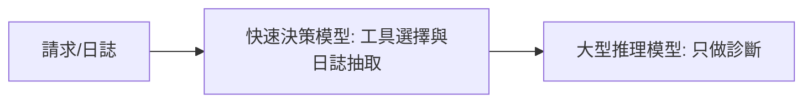

# AI Daily Digest — 2026-11-14

<!-- pipeline-generated:begin -->

## 🔥 今日 TOP 3
### 1. 黃仁勳辭任 CEO，Gemini 4 Hydrogen 同日登場
📰 來源：latent-space ｜ 發布：2026-11-13 ｜ 原標題：[[AINews] Jensen Huang resigns after 33 years leading NVIDIA](https://latent.space/p/ainews-jensen-huang-resigns-after-33-years-leading-nvidia/)

**一句話：** NVIDIA 創辦人黃仁勳辭去 CEO，由財務長 Colette Kress 暫代。

**Why｜為什麼重要：** 此前有報導稱董事會因黃仁勳的私人醜聞準備更換他；同時有人主張中國模型使用了不該取得的 Blackwell GPU 訓練，帶動出口管制討論。NVIDIA 下週財報會議受矚目。

**What｜具體內容與下一步：** 黃仁勳辭去 CEO、總裁與董事。同日 Google 推出 Gemini 4 Hydrogen：$1.5/$7.5、1M context，Artificial Analysis 指數 xhigh 為 54、幻覺率 8%，但 Terminal-Bench 4.0 為 54%，低於 Sonnet 的 64%。Thinking Machines 以 Apache 2.0 釋出 Inkling 2 Small（594B 總參數 / 17B 啟用 MoE）。Depue 的 GPU 初始化主張，規模與解讀有爭議。

📖 [閱讀完整 insight](../10-insights/2026-11-13/inbox_57f3f15e.md) · 🔗 [原文連結](https://latent.space/p/ainews-jensen-huang-resigns-after-33-years-leading-nvidia/)
### 2. 模型變強後，人只管開頭與驗收
📰 來源：youtube-ai-engineer ｜ 發布：2026-11-13 ｜ 原標題：[Rethinking Claude Code Best Practices — Lydia Hallie, Anthropic](https://www.youtube.com/watch?v=vlfCjWuv4es)

**一句話：** 模型變強後，人要從逐步核准退到定義目標與驗收，其餘交給模型、harness 與環境。

**Why｜為什麼重要：** Anthropic 內部每天變更數從 5 月約 2,500 增至 9 月逾 30,000，人同時管數十個跑數小時的 session，無法再逐步盯著核准。

**How｜怎麼做到：** 分三層：模型用 auto mode 取代手動核准；harness 用 deny rule、hooks 與 CI 把關；環境用 sandbox 或雲端 session 限制副作用。

**What｜具體內容與下一步：** Anthropic 研究中真人只攔下約 14% 危險指令，auto mode 攔下 89%；不可逆操作（讀 .env、丟棄未 commit 變更）仍應設 deny rule；hook 腳本要用 exit code 2 才會讓 Claude 回頭修正。明天可先檢查 CLAUDE.md 是否只留 Claude 從程式碼看不到的資訊。

📖 [閱讀完整 insight](../10-insights/2026-11-13/inbox_ccd84dcc.md) · 🔗 [原文連結](https://www.youtube.com/watch?v=vlfCjWuv4es)
### 3. Gemini Decision 1：一次打分取代逐字生成
📰 來源：latent-space ｜ 發布：2026-11-12 ｜ 原標題：[[AINews] D-Day (Decision Models Day)](https://latent.space/p/ainews-d-day-decision-models-day/)

**一句話：** 不逐字生成，而是一次對所有選項打分並附信心分數，專做分類與判斷的模型。

**Why｜為什麼重要：** 用大型生成模型做分類又慢又貴；Cloudflare 的示範顯示，快速決策模型可處理工具選擇與日誌抽取。

**How｜怎麼做到：** 屬封閉式決策，單次 pass 對選項評分；混合架構中，大型推理模型只負責診斷。

**What｜具體內容與下一步：** 支援是非、多選（最多 255 選項）與評分準則，單次最多 1,000 題、256K context，延遲 150–250 ms，$0.10/百萬輸入 token、輸出不計費。AA Decision Index 66，與 Jev 1.14 並列，但每百萬任務 $345，高於 Jev 的 $156。Cloudflare 示範把 6 次 LLM 呼叫降為 1 次，約 4 萬降到 1.8K token。

📖 [閱讀完整 insight](../10-insights/2026-11-12/inbox_cee8156b.md) · 🔗 [原文連結](https://latent.space/p/ainews-d-day-decision-models-day/)

## 📖 好文章 / 影片精選

_近期的高品質內容，按興趣領域分類。每篇只在 column 出現一次。_
### ⚡ 個人生產力心得
- **medium-tag-claude** · 2026-11-13 · **[How I made Claude and ChatGPT hand each other tasks](../10-insights/2026-11-13/inbox_99014848.md)**
  用一份共享待辦清單，讓 Claude 與 ChatGPT 透過 MCP 互相交派任務。 **How** 作者以單一共享的 to-do list 作為兩者之間的連接點，並透過 MCP 串接。 **What** 節錄未提供實作細節、工具名稱或成效數據。
### 🛤️ 導入心得
- **youtube-ai-engineer** · 2026-11-10 · **[Give Your On-Call Its Own AI Teammate - Swaapnika Motapothula, Chinmay Gandhi & Vlad Tsvang, Meta](../10-insights/2026-11-10/inbox_609f0498.md)**
  讓 AI 當值班小組的固定隊友，先查好原因、備好修復，人只負責核准。 **Why** AI 讓程式碼產出變快（Meta 約四分之三的新程式碼由 AI 寫成），但出事時仍需要人半夜被叫醒，且各種自動化各管一塊、彼此不連通，值班人員成了「膠水」。 **How** 每個值班輪值一個共享的 AI 隊友，跨所有訊號運作，並採「自主性階梯」：L1 只調查回報、L2 起草修復但需人核准、L3 自行處理低重要性工作；依「出錯代價多高、多容易被發現」決定升級。團隊記憶會被檢索、評分，並自動升降或淘汰。 **What** Meta 工程團隊（Chinmay Gandhi、Swaapnika Motapothula、Vlad Tsvang）介紹的 AI on-call teammate 已在實際輪值中全天候運作，每天早上 9 點發摘要（如 23 件進來、3 件需你處理、18 件已處理）。效益僅稱「初期跡象樂觀」，尚未給出量化數字；下一步是讓中等重要性任務在有證據下取得自主權。
- **youtube-ai-engineer** · 2026-11-09 · **[Right Answer, Wrong Reasons: AI Forecasts Costco - Hassan El Mghari & Omar El Mghari, Together AI](../10-insights/2026-11-09/inbox_181156fa.md)**
  讓 LLM 替 Costco 建財務預測模型，誤差只有 4.4%，但那是兩個錯誤互相抵銷的運氣，需要領域專家把關。 **Why** 看到預測準確就以為模型正確很危險；沒有會計背景的工程師無法發現假設其實是 AI 編造的。 **How** 選訓練資料截止於事件前的舊開源模型（GPT-OSS 120B），餵入約 214 份公開文件整理成約 3,000 則帶時間戳的事實；讓模型輸出結構化公式與假設，而非自己算數；平行跑 16 次、通過檢查的才採用，錯誤最多回饋兩次自我修正。 **What** Together AI 的 Hassan El Mghari 與其父 Omar（資深稽核與 CFO）以 Costco 2024 年 7 月會員費調漲（標準 60→65 美元、執行 120→130 美元）為測試。最終 5 次通過，誤差 0.7% 到 5.2%，平均 4.4%；預測兩年利潤增加 5.6 億美元，16 次跑的成本僅 0.19 美元。Omar 審查發現：執行會員占比被編成 15%，實際揭露為 45%，且 AI 把漲價套用到全部會員而非僅美加；兩錯抵銷，修正其中一個誤差就跳到 28%。他提出稽核的三道防線，建議把專家檢查寫成程式碼，強調「運氣不是控制」。
### 🧠 知識管理
- **infoq-main** · 2026-11-11 · **[JioHotstar Benchmarks Knowledge Bases for AI Coding Agents](../10-insights/2026-11-11/inbox_2c20b9e0.md)**
  替 AI 寫程式代理人找程式碼資料時，要依任務類型選對檢索工具，沒有單一最佳解。 **Why** coding agent 要先找到相關程式碼才能動手，不同檢索方式在準確度與 token 用量上各有取捨。 **How** JioHotstar 用 SWE、CodeScale Bench 與內部問答 harness 評測 6 種程式碼檢索做法。 **What** 結果顯示結構化搜尋在具體任務表現好，語意檢索則在需求模糊時有幫助；結論是要讓檢索工具與任務類型相匹配。
- **medium-tag-llm** · 2026-11-10 · **[¿Puede OKF sustituir a RAG? Cómo combinar conocimiento curado y búsqueda en agentes de IA](../10-insights/2026-11-10/inbox_db638981.md)**
  用 Azure 參考架構把商業定義、文件與 agent 串起來，探討能否取代 RAG。 **Why** 原文提問 OKF 能否取代 RAG。 **What** 文中描述的參考架構連結商業定義、文件與 agent，並包含權限與可追溯性；原文僅提供截斷摘要，OKF 的完整定義與比較結論無法確認。
- **infoq-main** · 2026-11-13 · **[Netflix Turns Operational Data Into a Knowledge Graph for AI-Driven Observability](../10-insights/2026-11-13/inbox_adee65b2.md)**
  Netflix 把營運資料整理成知識圖譜，讓 AI agent 與工程師都能更快查出線上問題。 **Why** 要加速 production 問題的調查，並讓 AI agent 對營運環境有共同的理解。 **How** 以 ontology 驅動的知識圖譜整合營運資料。 **What** Netflix 正在開發 ontology-driven 知識圖譜，用於 AI 驅動的 observability，作為 AI agent 共享的營運環境知識基礎。
### 🎙️ Lenny's Newsletter・Podcast
- **substack-lennys-newsletter** · 2026-11-09 · **[How this founder built a better Duolingo with Codex | William Imoh](../10-insights/2026-11-09/inbox_da425d1a.md)**
  Lenny's 播客頁面，介紹創辦人如何用 Codex 與 GPT-Live 做出原生語言學習 App Mural。 **Why** William Imoh 用 Duolingo 連續 1,000 天，仍無法用挪威語對話，因此自己動手做。 **What** 此為與 Lenny 同一集 How I AI 的播客頁（含時間軸與連結）。William 是 Hackmamba 創辦人，做過四年產品經理但沒寫過 Swift，用 Codex 與 GPT-Live 做出 iOS/Android 版 Mural，並以魔戒主題的 Grok Bot 團隊協助經營約 25 人的公司。內容涵蓋設計提示詞、GPT-Live-1 單次對話成本與延遲門檻、給 agent 的權限，以及他擔心的是「依賴」而非被取代。
### 🧩 熱門 Skill・MCP・Plugin
- **github-trending-agent-tools** · 2026-11-14 · **[ChromeDevTools/chrome-devtools-mcp ⭐ 55,472(今日 +67)](../10-insights/2026-11-14/inbox_bc45aaaa.md)**
  讓 coding agent 透過 MCP 與 CLI 直接操控並檢視正在執行的 Chrome。 **Why** 原文說明此工具用於讓代理人可靠地自動化操作、深入除錯與分析效能。 **How** 以 Puppeteer 自動化瀏覽器動作並等待結果，同時透過 Chrome DevTools 取得效能 trace、網路請求、console 訊息（含 source-mapped stack）與截圖。 **What** GitHub 星數 55,472（今日 +67），可用 Claude Code 的 `/plugin install` 一次安裝 MCP 與 skills；預設會把 trace URL 送至 CrUX API 並回報使用統計，可用 `--no-performance-crux` 與 `--no-usage-statistics` 關閉。
- **github-trending-agent-tools** · 2026-11-14 · **[tradermonty/claude-trading-skills ⭐ 4,191(今日 +69)](../10-insights/2026-11-14/inbox_1b4caec3.md)**
  用 Claude Skills 把看盤、選股與交易紀錄流程結構化，而不是讓 AI 直接決定買賣。 **Why** 原文指出目標是讓時間有限的個人投資人改善決策流程，而非外包買賣判斷。 **How** 以 workflows/*.yaml 的機器可讀 manifest 串起多個 skill，明列決策關卡與產出物，可手動執行。 **What** 專案為 MIT 授權，GitHub 星數 4,191（今日 +69）；五個入門 skill 不需付費 API，但作者明言這不是訊號服務，也不保證獲利。
### 🛠 工具最新 release
- **claude-code** · 2026-11-13 · **[v2.1.325](../10-insights/2026-11-13/inbox_55949cc1.md)**
  Claude Code v2.1.325 是一次大規模的修補版，重點補強權限規則、沙箱與驗證流程的漏洞，並修正 subagent、MCP 與 session 的多處錯誤。 **Why** 原文未列出單一動機，但修正內容集中在 Bash 權限檢查缺口、deny/ask 規則失效、沙箱防護不完整等安全面向，以及登入切換與 MCP 連線的穩定性。 **What** Claude Code v2.1.325 修正 zstd 壓縮回應解碼的安全問題；修正部分 Bash deny/ask 規則未套用、某些複合指令未經詢問就執行、allow 規則可能執行不同程式等權限缺口；修正沙箱對 worktree 設定、hooks 與共用 git 資料夾的保護不足。另修正 subagent 在 opusplan 或 haiku 設定下被誤換成 plan-mode 模型、第三方 gateway 與 Foundry 每輪都報 context length 錯誤而不壓縮、多個 MCP 任務卡住或重連問題，並改善 subagent 輸出被截斷時會要求更簡短地重答。
  _+ 1 個近期版本（v2.1.323，僅顯示最新）_
- **codex** · 2026-11-13 · **[0.169.0](../10-insights/2026-11-13/inbox_7742820b.md)**
  OpenAI Codex 0.169.0 讓終端機介面能同時開多個側邊對話，並加強自訂模型供應商與專案信任控管。 **Why** 長時間使用 coding agent 時，需要在多個對話、任務與模型來源間切換，同時不能在不受信任的目錄中誤執行專案設定。 **How** 在終端機工作區新增多個 side-chat 分頁並可保存還原；`codex exec` 在未信任目錄預設停用專案設定與 MCP server，需以 `--trust` 明確授權。 **What** OpenAI Codex 0.169.0（rust-v0.169.0）：支援多個側邊對話分頁、依名稱/提示/工作目錄搜尋舊任務、可折疊 turn 細節、終端機內新增或編輯自訂模型供應商（含 device code 登入）、Ctrl+S 儲存診斷 ZIP、macOS/Linux 的 Cloud 連線可傳圖片並選模型與推理強度。另修正 Windows sandbox 路徑處理、貼上圖片方向、中斷 turn 關閉等問題，內建 SQLite 升至 3.54。
  _+ 1 個近期版本（0.168.0，僅顯示最新）_
- **claude-mem** · 2026-11-12 · **[v15.18.3](../10-insights/2026-11-12/inbox_bc938054.md)**
  claude-mem 修正 Codex hook 在每次更新後被關閉、session 停止儲存的問題。 **Why** Codex 以整個外掛資料夾的指紋核准 hook，每次更新都會改寫資料夾，導致七個 hook 全被停用且無提示。 **How** 安裝器改將 hook 註冊到使用者自己的 ~/.codex/hooks.json，hook 執行 PATH 上的 launcher；Codex 依 hooks.json 中的定義與位置信任，批准一次即可跨更新。 **What** 舊用戶需執行 npx claude-mem install 並選 Codex，再於互動式 Codex 執行 /hooks 批准七個 hook；另新增選用的 CLAUDE_MEM_LOCAL_API_TOKEN，預設關閉。
  _+ 3 個近期版本（v15.18.2 → v15.18.0，僅顯示最新）_

## 💡 今日 Takeaway

_讀完今日所有內容後，可帶走的知識點_
### 1. 依「做錯能否收回」決定交給模型還是規則
能 revert 的錯誤（如改錯程式碼）可交給模型自主處理；不可逆操作（丟棄未 commit 變更、讀取密鑰）要用 deny rule 硬性攔截；腳本副作用則靠 sandbox 或雲端 session 限制。以可逆性分流，才能在減少人工核准的同時守住底線。

_類型：framework_

**參考來源**：
- [Rethinking Claude Code Best Practices — Lydia Hallie, Anthropic](../10-insights/2026-11-13/inbox_ccd84dcc.md) · [原文](https://www.youtube.com/watch?v=vlfCjWuv4es)
### 2. 分類與排序用小型決策模型，大模型留給推理
把工具選擇、分類、chunk 排名這類有限選項的判斷，交給回傳結構化選擇或分數的快速模型，大型 LLM 只負責診斷等開放式推理。UiPath 以錦標賽方式排名 chunk，數千次呼叫不到 1 秒；Cloudflare 的示範把 6 次 LLM 呼叫降為 1 次。

_類型：pattern_

**參考來源**：
- [The Jev Revolution: What Engineers Are Already Building with System One Models](../10-insights/2026-11-12/inbox_72b4b08b.md) · [原文](https://latent.space/p/jev-revolution/)
- [[AINews] D-Day (Decision Models Day)](../10-insights/2026-11-12/inbox_cee8156b.md) · [原文](https://latent.space/p/ainews-d-day-decision-models-day/)
### 3. Eval 失敗當額外輸入，重跑整個生成
不要把 eval 的評語當精確修改指令交給 agent，否則容易過擬合；改為把失敗結果當成一個額外輸入，重跑完整生成。非即時的流程（如 email 草稿）可在客戶看不到的地方重跑並存成待審草稿。

_類型：technique_

**參考來源**：
- [How to Build an AI Customer Research Agent in Claude Code](../10-insights/2026-11-13/inbox_a80b4b43.md) · [原文](https://www.news.aakashg.com/p/ai-customer-research)
### 4. 每個指標配一個反向指標，每條定律先查假設
度量要量成果而非產出，每個指標搭配反向指標，避免像 token 排行榜那樣導致 tokenmaxxing。遇到看似矛盾的工程定律（如 Brooks 與 Linus），先檢查各自的適用範圍，再命名當下主導的力量；AI 只會放大這些既有的力量。

_類型：framework_

**參考來源**：
- [We Promised Three Months. It Took Nine.](../10-insights/2026-11-12/inbox_fccfe4f2.md) · [原文](https://newsletter.techworld-with-milan.com/p/we-promised-three-months-it-took)
### 5. 看利潤來自哪裡，就知道誰會擋 AI 代理
收入若來自代理會跳過的環節（廣告、升等、保固），平台傾向封鎖代理；若是按交易抽成，買家是人或代理都一樣，平台就會歡迎。評估自家產品要不要對代理開放，先拆解利潤結構，再決定調價、收代理結帳費或設計加購誘因。

_類型：pattern_

**參考來源**：
- [No Shirt, No Shoes, No Service for Bots](../10-insights/2026-11-13/inbox_7223c86c.md) · [原文](https://tomtunguz.com/no-shirt-no-shoes-no-service-for-bots/)

<!-- pipeline-generated:end -->

<!-- user-notes -->
<!-- Write your own notes below; pipeline never touches this section. -->