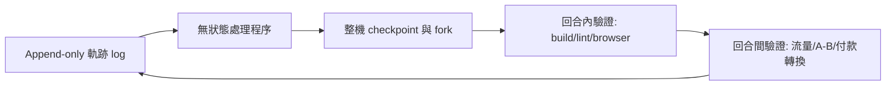

# AI Daily Digest — 2026-11-20

<!-- pipeline-generated:begin -->

## 🔥 今日 TOP 3
### 1. Lovable 讓 agent 連跑 10 小時的三層設計
📰 來源：youtube-ai-engineer ｜ 發布：2026-11-19 ｜ 原標題：[What it takes to set intelligence free — Fabian Hedin, CTO, Lovable](https://www.youtube.com/watch?v=pZWPq_ZAmM4)

**一句話：** 長時間運作的 agent，關鍵是把「任務紀錄、運算環境、驗證迴圈」三件事拆開設計。

**Why｜為什麼重要：** 2023 年 Lovable 太早打造多 agent 框架，產品反而變差，後來退回單一 LLM 的簡單系統。如今模型夠強，agent 要連續跑 10 小時以上，就需要穩定的執行底層。

**How｜怎麼做到：** 軌跡仿 git，是 append-only log，事件指向 parent、可 fork 不可 merge，prompt 另從 log 渲染，處理程序無狀態，因此每天約 700 次部署不會打斷長任務。整台電腦（磁碟、記憶體、執行中程序）可 checkpoint。驗證分回合內（build、lint、型別、headless browser）與回合間（流量、A/B test、付款轉換）兩層。

**What｜具體內容與下一步：** 平台每分鐘處理超過十億 token，黃金 checkpoint 複製約 230 毫秒；Vite 以 Rust 重寫後，預覽從 14 秒降到 3 秒、記憶體少 6.5 倍；agent 不再設 30 分鐘上限。明天可檢查自家 agent：任務歷史是否與 prompt 分離、處理程序是否無狀態。

📖 [閱讀完整 insight](../10-insights/2026-11-19/inbox_14c9cb65.md) · 🔗 [原文連結](https://www.youtube.com/watch?v=pZWPq_ZAmM4)
### 2. Google 讓 LLM 睡覺整理記憶以防遺忘
📰 來源：lobsters-ai ｜ 發布：2026-11-18 ｜ 原標題：[The sleep framework: A new way for LLMs to retain knowledge in continual learning](https://research.google/blog/the-sleep-framework-a-new-way-for-llms-to-retain-knowledge-in-continual-learning/)

**一句話：** 讓模型像人一樣，清醒時學習、睡眠時整理並消化記憶。

**Why｜為什麼重要：** 持續更新參數容易造成災難性遺忘；只靠 in-context learning，短期資訊在 session 結束後就消失。

**How｜怎麼做到：** 清醒時先存入短期記憶。睡眠分兩步：記憶鞏固，以低秩 MoE 專家承接短期記憶，並用 on-policy 蒸餾與語意獎勵對齊；夢境，隨機啟用專家產生合成資料，以梯度篩選樣本後做 SFT 與 RL 精修。原文稱仍在固定模型架構內，只是解鎖預先配置的 MoE 記憶區塊。

**What｜具體內容與下一步：** 作者報告 BABILong 可擴展至 10M tokens；SQuAD 單任務 48.9%、CPT 46.2%；AIME 24、AIME 25、HMMT 25 分別為 79.2%、69.0%、46.1%。以上為作者自報數字，適合當作持續學習方向的追蹤基準。

📖 [閱讀完整 insight](../10-insights/2026-11-18/inbox_c6bdbbca.md) · 🔗 [原文連結](https://research.google/blog/the-sleep-framework-a-new-way-for-llms-to-retain-knowledge-in-continual-learning/)
### 3. Linear 以雙指標判斷產品是否被商品化
📰 來源：latent-space ｜ 發布：2026-11-19 ｜ 原標題：[Scaling Linear’s GTM to $100M ARR — Cristina Cordova, COO](https://latent.space/p/linear-scaling/)

**一句話：** 當 AI agent 開始代替人操作工具，產品要成為 agent 的工作場所，否則會淪為商品。

**Why｜為什麼重要：** Linear 的客戶與前沿 AI 實驗室推動它朝 agent 協作發展，CEO 也在三月發文宣告「Issue tracking is dead」。

**How｜怎麼做到：** 先出 MCP server、agent 平台與 Codex、Cursor、GitHub Copilot 整合，再推出自家 Linear Agent。同時追蹤 agent 使用量與 app 使用量，若前者上升、後者不升，就代表產品正在商品化。銷售端不雇 SDR，AI 只起草客服回覆、由人決定寄出。

**What｜具體內容與下一步：** 據 COO 所述，agent 建立的工作從一年前的 3% 成長到超過一半；ARR 超過 1 億美元、付費客戶逾 4 萬、淨營收留存率 177%。定價仍以 seat 為主。明天可在自家產品加上「agent 使用量 vs 人使用量」兩條指標。

📖 [閱讀完整 insight](../10-insights/2026-11-19/inbox_6628361c.md) · 🔗 [原文連結](https://latent.space/p/linear-scaling/)

## 📖 好文章 / 影片精選

_近期的高品質內容，按興趣領域分類。每篇只在 column 出現一次。_
### 🎙️ Lenny's Newsletter・Podcast
- **substack-lennys-newsletter** · 2026-11-16 · **[How I fight token fraud as a solo founder](../10-insights/2026-11-16/inbox_a608b0c8.md)**
  AI 產品的每次模型呼叫都花真錢，所以被盜刷算力就等於直接燒錢。 **Why** 這位 ChatPRD 的獨立創辦人過去一年因 token 詐欺損失數萬美元，並耗掉幾乎所有工程精力。 **How** 她結合商業控制與技術防禦，並用 Jev loop 即時分類詐欺行為。 **What** Claire Vo 的 How I AI 單人集數，整理她在 ChatPRD 遇到的六種濫用模式（刷免費試用、轉售 promo code、產品中繼、24/7 運行的自訂 MCP 等）與四類濫用者。她最終永久關閉免費試用，並提醒 AI 客服也可能成為攻擊入口；核心結論是「賣 AI 就是賣算力」。（內文僅為節目大綱，細節有限）
### 🧩 熱門 Skill・MCP・Plugin
- **github-trending-agent-tools** · 2026-11-20 · **[cathrynlavery/diagram-design ⭐ 68,633(今日 +271)](../10-insights/2026-11-20/inbox_151626a2.md)**
  Coding agent 用一個 skill 把圖表畫成單一、可直接開啟的 HTML+SVG 檔。 **How** 以 npx skills add cathrynlavery/diagram-design 安裝後，用自然語言描述需求，agent 選擇圖型並輸出一個 .html 檔。 **What** 文中列出支援 Claude Code、Codex、Git
- **github-trending-agent-tools** · 2026-11-20 · **[mjmirza/app-store-compliance ⭐ 1,846(今日 +377)](../10-insights/2026-11-20/inbox_41373bc9.md)**
  把 App Store 與 Google Play 常見退審規則整理成提交前守門檢查，讓 AI coding agent 上傳前自動執行。 **Why** 原文指出一次退審常耗時一週：送審、等待、收到一行退件理由、猜測修正後重送。 **How** 以 git clone 與 bash 安裝；安裝後，agent 在執行 App Store Connect 或 Google Play 上傳指令前會先掃描，遇到關鍵退審風險即阻擋該指令。 **What** 收錄 117 項退審模式與修正方式、95 個追蹤期限（如 EU AI Act、DSA、COPPA）、隱私清單與 Data safety 檢查；支援 Claude Code、Gemini CLI、OpenCode、Copilot；GitHub 今日 +377 星，總數 1,846。
### 🛠 工具最新 release
- **codex** · 2026-11-20 · **[0.171.0](../10-insights/2026-11-20/inbox_52ef4409.md)**
  OpenAI Codex 0.171.0 把新模型加進選單，並預設開啟終端機工作區介面。 **What** OpenAI Codex（Rust 版 rust-v0.171.0）將 GPT-6.2 Sol 與 Astra 加入 model catalog，並以 Sol 為預設選項。TUI workspace 改為預設啟用，支援可搜尋的文件預覽、圖片預覽與 su
- **hermes-agent** · 2026-11-20 · **[Hermes Agent v0.23.3](../10-insights/2026-11-20/inbox_dec3f981.md)**
  Hermes Agent 發布 v0.23.3 修補版，彙整 v0.23.2 以來約 370 個 PR。 **Why** 這個版本把大量變更整合成穩定版，供 CLI、桌面 app、Microsoft Store、Docker 與 Hermes Cloud 使用。 **What** 期間共 1,657 個非 merge commits 與 60 個已關閉 issues；新增 prompt cache 生命週期控制（預設 cache_ttl 為 auto），並讓 GPT-6.2 Astra 與 Sol（含 Pro）上線 OpenRouter 與 Nous Portal。完整說明將於 v0.24.0 提供。
- **claude-code** · 2026-11-19 · **[v2.1.329](../10-insights/2026-11-19/inbox_9ac075d4.md)**
  Claude Code 這版以修 bug 為主，順帶補上 hooks、/tasks、/mcp 等的狀態提示。 **What** Claude Code v2.1.329 新增：信任對話框會標示 hooks 宣告位置、/tasks 可管理排程任務與 /loop wakeups、/mcp 顯示遠端 HTTP MCP server 拒絕連線的 JSON-RPC 錯
- **claude-mem** · 2026-11-19 · **[v16.0.1](../10-insights/2026-11-19/inbox_f1793aef.md)**
  claude-mem v16.0.1 是緊急修補版，主要修復 Windows 上 Codex 登入與 token 刷新失敗。 **Why** 私有 Codex home 的 auth.json 以 hard link 指向真實憑證，而 Codex 會拒絕多 hard link 的憑證檔。 **How** 改為 symlink；只有在 Windows 且無 symlink 權限時才改用私有複本。 **What** 同時修正 quota cooldown 無法解除與 Chroma 慢時搜尋未 fallback 的問題，並新增 Devin cloud sessions 與 Devin Bots 支援。

## 💡 今日 Takeaway

_讀完今日所有內容後，可帶走的知識點_
### 1. 任務歷史與 prompt 分離，處理程序保持無狀態
把 agent 的軌跡存成 append-only log，prompt 再從 log 渲染，處理程序本身不存狀態。這樣可壓縮或換模型，也能在部署新版時不打斷長任務。Lovable 靠此做到每天約 700 次部署而不中斷 10 小時以上的 agent。

_類型：framework_

**參考來源**：
- [What it takes to set intelligence free — Fabian Hedin, CTO, Lovable](../10-insights/2026-11-19/inbox_14c9cb65.md) · [原文](https://www.youtube.com/watch?v=pZWPq_ZAmM4)
### 2. 用「機器使用量 vs 人使用量」偵測商品化
同時追蹤 agent 使用量與 app 使用量：agent 用量上升而 app 用量不升，代表產品價值正被中間層取代。Linear 用這組雙指標判斷自己是否在淪為 commodity，任何會被 agent 呼叫的產品都可套用。

_類型：pattern_

**參考來源**：
- [Scaling Linear’s GTM to $100M ARR — Cristina Cordova, COO](../10-insights/2026-11-19/inbox_6628361c.md) · [原文](https://latent.space/p/linear-scaling/)
### 3. 帶著寫入位置讀副本，就能 read-your-writes
寫入後記下複寫位置（如 PostgreSQL 的 LSN），讀副本前先等它追到該位置，不必把所有讀取都導回主節點。這套 session 一致性的做法也見於 MySQL 與 MediaWiki 的實作。

_類型：technique_

**參考來源**：
- [PostgreSQL 19 Released](../10-insights/2026-11-19/inbox_871080ba.md) · [原文](https://simonwillison.net/2026/Nov/19/postgresql-19/)
### 4. AI 加速產出，瓶頸會移到 review 與複雜度
引用的 2025 年研究顯示，AI 使用最密集的季度合併 PR 增加 98%，review 時間增加 91%。另一篇指出 agentic AI 的速度增益會隨程式碼複雜度上升在數月內消失，而 healthy code 讓 AI 更省 token。衡量 AI 成效時要把 review 成本與 code health 納入。

_類型：pattern_

**參考來源**：
- [How to tell if AI is working in your team](../10-insights/2026-11-19/inbox_0da11eec.md) · [原文](https://medium.com/design-bootcamp/how-to-tell-if-ai-is-working-in-your-team-0d308f564034?source=rss------claude-5)
- [Producing Healthy Code with Artificial Intelligence Costs Fewer Tokens](../10-insights/2026-11-19/inbox_64242813.md) · [原文](https://www.infoq.com/news/2026/11/healthy-code-AI-tokens/?utm_campaign=infoq_content&utm_source=infoq&utm_medium=feed&utm_term=global)
### 5. 把 codebase 分成 agent 寫的碼與人讀的 spec
保留一個人類可讀、有 lint 規則的 spec 資料夾（類似自訂腳本語言），由 agent 負責底層引擎實作。這讓人能掌握系統行為，避免 vibe coding 時不知道 agent 到底做了什麼。

_類型：technique_

**參考來源**：
- [The Sweet Side of the Bitter Lesson — Thariq Shihipar, Independent](../10-insights/2026-11-19/inbox_986b3317.md) · [原文](https://www.youtube.com/watch?v=xRJMiaUoD_8)

<!-- pipeline-generated:end -->

<!-- user-notes -->
<!-- Write your own notes below; pipeline never touches this section. -->