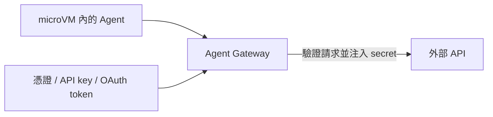

# AI Daily Digest — 2026-11-23

<!-- pipeline-generated:begin -->

## 🔥 今日 TOP 3
### 1. Claude Code 本機檔洩出 2,282 組機密
📰 來源：infoq-main ｜ 發布：2026-11-22 ｜ 原標題：[Claude Code Has Been Leaking Secrets through its "Don't Ask Again" Feature](https://www.infoq.com/news/2026/11/claude-code-leaking-secrets/?utm_campaign=infoq_content&utm_source=infoq&utm_medium=feed&utm_term=global)

**一句話：** Claude Code 為了記住「不再詢問」，把機密寫進本機檔案，一被提交就外洩。

**Why｜為什麼重要：** 本機設定檔一旦被提交到公開 repository，裡面的機密就會跟著外洩，影響所有用 coding agent 的開發者。

**How｜怎麼做到：** 資安公司 Apiiro 指出，Claude Code 為實作「Don't Ask Again」，會把機密存進開發者機器上的本機檔案。

**What｜具體內容與下一步：** Apiiro 在 claude/settings.local.json 找到 1,122 個 secrets，另在 git history、共用 settings.json 與 repo 內的 agent 對話紀錄找到 1,160 個。建議明天檢查自己 repo 的 .gitignore 是否排除這些檔案，並掃描 git history。

📖 [閱讀完整 insight](../10-insights/2026-11-22/inbox_aece89b6.md) · 🔗 [原文連結](https://www.infoq.com/news/2026/11/claude-code-leaking-secrets/?utm_campaign=infoq_content&utm_source=infoq&utm_medium=feed&utm_term=global)
### 2. Agent 越跑越久，瓶頸變成人的注意力
📰 來源：youtube-ai-engineer ｜ 發布：2026-11-22 ｜ 原標題：[Build the Workshop Before the Software Factory — Armin Ronacher, Earendil](https://www.youtube.com/watch?v=JNexz3Tbiu8)

**一句話：** 模型變強後，卡住的不是工具，而是人看不過來。

**Why｜為什麼重要：** Agent 跑得越久、產出越多，人類的注意力、理解力與協作能力卻沒有成長。專案容易無節制膨脹，也會衝擊沒準備好的外部系統。

**How｜怎麼做到：** Armin Ronacher 用自己的 Pi 工作階段資料佐證：核心 harness 一年沒改，修正次數卻隨模型進步下降。對策是在約 70% 進度請 agent 產出摘要與 HTML 頁面方便驗證、少依賴、用標準格式，並做可暫停／恢復的 durable agent。

**What｜具體內容與下一步：** P90 agent 執行時間從 Opus 4.6 的約 2.5 分鐘升至 14 分鐘以上；每日 prompt 約 120–190 持平；141 個專案中只有約 10–15 個持續提交。可先試著在長任務中途要求 agent 產出摘要頁。

📖 [閱讀完整 insight](../10-insights/2026-11-22/inbox_c79d75c7.md) · 🔗 [原文連結](https://www.youtube.com/watch?v=JNexz3Tbiu8)
### 3. Google 把 agent 關進 microVM，金鑰放外面
📰 來源：infoq-main ｜ 發布：2026-11-22 ｜ 原標題：[Google Announces Agent Compute Engine for Secure AI Agent Execution](https://www.infoq.com/news/2026/11/google-agent-compute-engine/?utm_campaign=infoq_content&utm_source=infoq&utm_medium=feed&utm_term=global)

**一句話：** 把 AI agent 關在隔離的小型虛擬機裡，密碼金鑰放在外面，agent 碰不到。

**Why｜為什麼重要：** Agent 會自動執行程式與呼叫 API，若憑證放在沙箱內，agent 一旦被誘導或出錯就可能外洩。

**How｜怎麼做到：** 以 microVM 隔離執行環境，並支援 checkpoint 來暫停與恢復。憑證、API key、OAuth refresh token 全放在沙箱外，由外部 Agent Gateway 驗證請求並注入所需的 secret。

**What｜具體內容與下一步：** Google 宣布託管服務 Agent Compute Engine。自建 agent 環境時，可借用「憑證不進沙箱」的做法。

📖 [閱讀完整 insight](../10-insights/2026-11-22/inbox_f522ff85.md) · 🔗 [原文連結](https://www.infoq.com/news/2026/11/google-agent-compute-engine/?utm_campaign=infoq_content&utm_source=infoq&utm_medium=feed&utm_term=global)

## 📈 本週 GitHub 飆升 Top 10

_GitHub 本週新增 star 最多的專案_

### 1. [dream-num/univer](https://github.com/dream-num/univer)
⭐ +6,436 this week · 🧬 TypeScript

這是一套可內嵌到自家產品的 Office SDK，把文件編輯、公式計算、協作與檔案處理整合在一起，讓使用者和 AI agent 都能操作，核心部分開源。它本週登頂，看來是切中「讓 agent 直接讀寫試算表與文件」這個正在升溫的需求。適合想在產品裡加入類 Office 功能的前端或全端團隊。
### 2. [mvanhorn/last30days-skill](https://github.com/mvanhorn/last30days-skill)
⭐ +4,731 this week · 🧬 Python

這是一個 agent skill，會到 Reddit、X、YouTube、Hacker News、Polymarket 和一般網頁搜集資料，再整理成有出處依據的摘要。它可能受歡迎，是因為模型本身的知識有時效限制，而這類工具能補上社群上的最新討論。適合需要快速掌握某個主題近期動態的人，例如技術選型調研或市場觀察。
### 3. [kajisho5/ffmpeg-skill](https://github.com/kajisho5/ffmpeg-skill)
⭐ +3,748 this week · 🧬 Python

這套工具讓 coding agent 能在本機剪輯影片，提供 42 個 FFmpeg 工具與機器可讀的介面規格，並附 MCP server，支援 Claude Code、Cursor 和 Codex。功能涵蓋剪輯、字幕、畫面重新構圖、響度調整與各平台輸出，全程不用雲端或 API key。這種「不上傳素材、在本機完成」的做法可能是它吸引人的原因，適合想讓 agent 代勞影片後製的創作者與開發者。
### 4. [alibaba/open-code-review](https://github.com/alibaba/open-code-review)
⭐ +3,700 this week · 🧬 Go

這是以 Go 寫成的程式碼審查工具，採用混合架構，把確定性的檢查流程和 LLM agent 結合，能產生精確到行的評論，並內建針對 NPE、執行緒安全、XSS、SQL injection 等問題的多語言規則，相容 OpenAI 與 Anthropic 的介面。它可能因為出自阿里巴巴且主打大規模實戰，加上 AI code review 本來就是熱門痛點而受到關注。適合想在 CI 或 PR 流程中加入自動審查、又希望結果不要全憑模型發揮的團隊。
### 5. [meta/astryx](https://github.com/meta/astryx)
⭐ +3,626 this week · 🧬 TypeScript

這是一套開源設計系統，主打可完整客製，並且對 agent 友善，也就是讓 AI 較容易按照設計規範產出介面。它可能受矚目，是因為由 Meta 發布，而且切中「讓 AI 生成的 UI 符合統一風格」這個常見困擾。適合正在建立或重整前端元件庫、並打算讓 coding agent 參與開發的團隊。
### 6. [ag-ui-protocol/ag-ui](https://github.com/ag-ui-protocol/ag-ui)
⭐ +3,620 this week · 🧬 TypeScript

AG-UI 是一個定義 agent 與使用者互動方式的協定，目標是把 agent 帶進前端應用，讓後端 agent 與前端介面有共通的溝通規格。看來它切中的是「agent 能力很多，但前端串接方式各做各的」這個痛點。適合要把 agent 嵌進 Web 應用、又不想自己設計一套互動協定的前端與全端工程師。
### 7. [GoogleChrome/modern-web-guidance-src](https://github.com/GoogleChrome/modern-web-guidance-src)
⭐ +3,575 this week · 🧬 TypeScript

這個專案的目的是讓 coding agent 跟上最新的網頁開發最佳實務，由 GoogleChrome 組織發布。模型的訓練資料常常落後於瀏覽器與 Web 標準的演進，這可能是它快速獲得關注的原因。適合用 AI 寫前端、希望產出的程式碼採用較新做法而非過時寫法的開發者。
### 8. [backnotprop/plannotator](https://github.com/backnotprop/plannotator)
⭐ +2,815 this week · 🧬 TypeScript

這是一個協作工作空間，讓你在 agent 工作時能規劃、標註、審查程式碼並與團隊分享，最後一鍵把所有回饋送回給 agent。它切中的是 agent 產出越來越多、人需要有效介入與把關的需求。適合經常讓 agent 擬定計畫或改動程式碼、並希望用標註方式給出明確修正意見的個人與團隊。
### 9. [google-labs-code/stitch-skills](https://github.com/google-labs-code/stitch-skills)
⭐ +2,683 this week · 🧬 TypeScript

這是一組搭配 Stitch MCP server 使用的 Agent Skills，遵循 Agent Skills 開放標準，可用於 Antigravity、Gemini CLI、Claude Code、Cursor 等 coding agent。它由 Google Labs 發布，加上 skills 格式正在被多個工具採用，看來是它升溫的原因。適合已經在使用 Stitch、想讓不同的 coding agent 以統一方式呼叫其能力的開發者。
### 10. [tradermonty/claude-trading-skills](https://github.com/tradermonty/claude-trading-skills)
⭐ +2,616 this week · 🧬 Python

這是一批給 Claude Code 使用的 skills，面向股票投資人與交易者，涵蓋市場分析、技術圖表、經濟日曆、選股器與交易策略開發。它把 agent skills 的概念帶到非工程的金融場景，這可能是它出圈的原因。適合想用 Claude Code 輔助研究與整理市場資訊的投資人，但輸出內容仍需自行判斷，不應視為投資建議。

## 📖 好文章 / 影片精選

_近期的高品質內容，按興趣領域分類。每篇只在 column 出現一次。_
### 🎓 AI 使用技巧
- **medium-tag-claude** · 2026-11-22 · **[I Analysed 20,000 of My Claude Code Replies. 97% of the Tokens Were Claude Re-Reading Old Messages.](../10-insights/2026-11-22/inbox_e777e695.md)**
  分析作者 65 億 token 的 Claude Code 對話，發現多數 token 花在重讀舊訊息。 **Why** 上下文視窗與用量上限被什麼吃掉，是使用者不易察覺的成本來源。 **How** 以作者自己的 session 紀錄統計各類內容的 token 佔用。 **What** 標題宣稱 2 萬則 Claude Code 回覆中約 97% 的 token 來自 Claude 重讀舊訊息；內文僅為預覽，未展開計算方式。
- **medium-tag-llm** · 2026-11-19 · **[LLM Output Validation in Production: Why Valid JSON Is Not Enough](../10-insights/2026-11-19/inbox_836250be.md)**
  LLM 輸出上線前要通過結構與語意檢查，光是 JSON 格式正確並不夠。 **Why** 格式合法的 JSON 不代表內容在生產環境可用。 **How** 文章提到結構化輸出、Pydantic 驗證、語意檢查、受控重試與失敗處理等做法。 **What** 節錄僅列出這些組成元素，未提供具體程式範例或數據。
- **medium-tag-claude** · 2026-11-22 · **[How I Use Claude to Build Things I Don’t Know How to Build](../10-insights/2026-11-22/inbox_64521bc0.md)**
  作者以四階段方法，不寫程式完成並上線一個真實專案。 **What** 原文提到用 Claude 的四階段方法建立並上線專案，四個階段的具體內容在摘要片段中未列出。
### 🏢 企業導入
- **medium-tag-llm** · 2026-11-19 · **[AI Pilot Success—Measure the Work Around the Model](../10-insights/2026-11-19/inbox_8f7b0947.md)**
  AI 試點在儀表板上看似成功，卻可能把額外工作轉嫁給人，應量測模型周邊的交接成本。 **Why** 儀表板指標可能遮住使用者實際承擔的負擔。 **What** 文章指出 AI pilot 可能在數據上呈現成功，同時讓被期待使用的人承擔額外工作（handoff）；摘要未提供具體數據或案例。
- **medium-tag-claude** · 2026-11-22 · **[Seven things AI killed while you were measuring productivity](../10-insights/2026-11-22/inbox_667b5341.md)**
  高階主管看不到 AI 成效，原文認為問題出在衡量位置錯誤。 **Why** 原文提到 80% 的高階主管認為 AI 未帶來影響，這使衡量方式值得檢視。 **What** 標題為「AI 在衡量生產力時消失的七件事」；摘要未列出這七項內容。
### 🧠 知識管理
- **medium-tag-claude** · 2026-11-21 · **[RAG vs Long Context: The Cheap Context Window Sees 0.17% of Your Corpus](../10-insights/2026-11-21/inbox_3e8c7ee5.md)**
  把大型語料全塞進上下文成本高，便宜的 1M 視窗只能覆蓋約 0.17%。 **Why** 大型語料要回答問題時，需比較全量讀取、快取上下文與搜尋迴圈的成本。 **How** 原文以 6 億 token 語料為例，比較三種做法的每題成本。 **What** 全量讀取每題 $1,204.80；快取 1M-token 視窗 $0.108；agent 搜尋迴圈 $0.162；1M 視窗約覆蓋 0.17%（1M ÷ 600M）。
- **medium-tag-llm** · 2026-11-19 · **[️ Your Agentic RAG System Is Not One Model. It’s Six. Here Is How Much GPU They Really Eat](../10-insights/2026-11-19/inbox_46c48c8b.md)**
  代理式 RAG 系統用到的不只一個模型，GPU 預算要把嵌入、重排與語音等模型一起算。 **Why** 只估算 LLM 的 GPU 需求，會低估整體系統的資源消耗。 **How** 文章逐一列出 embedder、reranker、Whisper、OCR、TTS 等附加模型。 **What** 標題指出代理式 RAG 系統實際包含六個模型，節錄提到的附加元件包括 embedder、reranker、Whisper、OCR 與 TTS。
### 🔐 AI 安全
- **openai-blog** · 2026-11-18 · **[Inside the Codex sandbox](../10-insights/2026-11-18/inbox_510550fd.md)**
  說明 Codex 如何在你的電腦上跑指令，同時守住你設定的檔案與網路限制。 **What** OpenAI 的〈Inside the Codex sandbox〉介紹 OpenAI Codex 在 macOS、Linux、Windows 上執行指令時，如何落實使用者控制的檔案系統與網路限制。取得的內容只有簡短摘要，沒有各平台實作機制的細節。
### 🎙️ Lenny's Newsletter・Podcast
- **substack-lennys-newsletter** · 2026-11-22 · **[First principles: What it takes to be a great product manager in the AI era | Sherif Mansour](../10-insights/2026-11-22/inbox_3efa6a0e.md)**
  Atlassian AI 與產品工藝負責人談 AI 時代怎樣當好產品經理。 **Why** AI 時代 PM 角色的需求與工作方式都在改變。 **What** Lenny's Podcast 專訪 Sherif Mansour（Atlassian Head of AI and Product Craft，任職 17 年，曾是 Confluence 首位 PM）。討論主題包括 PM 的首要工作是建立「shared brain」、藝術家／科學家／GM 三種 PM 類型、AI 時代 PM 職缺成長最快、Atlassian 招募比以往更多的初階人員，以及新任 PM 主管最常犯的錯誤。
### 🛠 工具最新 release
- **claude-mem** · 2026-11-22 · **[v16.0.4](../10-insights/2026-11-22/inbox_d18c9393.md)**
  claude-mem v16.0.4 為修補版，修正 Chroma 搜尋退回 FTS5、OpenCode Go 回 400 等問題。 **Why** 修復前 Chroma 無法新增文件，搜尋會退回 FTS5；OpenCode Go 每個步驟都回 400。 **What** NO_PROXY 的 IPv6 方括號格式使 httpx 0.28 報 Invalid port，已修正（#6399）；OpenCode Go 需 x-opencode-session 標頭並設 reasoning_effort: none（#6395）；INTERNAL_PROJECTOR_URL 啟動時驗證格式，避免內部 secret 以明文送出（#6397，需部署 services/sync-api 才生效）。

## 💡 今日 Takeaway

_讀完今日所有內容後，可帶走的知識點_
### 1. 憑證留在沙箱外，由閘道代為注入
Agent 會自動執行程式與呼叫 API，把金鑰放在它能碰到的環境，被誘導或出錯時就可能外洩。做法是讓 agent 跑在隔離環境，憑證放在外部，由 gateway 驗證請求後再注入所需 secret。

_類型：pattern_

**參考來源**：
- [Google Announces Agent Compute Engine for Secure AI Agent Execution](../10-insights/2026-11-22/inbox_f522ff85.md) · [原文](https://www.infoq.com/news/2026/11/google-agent-compute-engine/?utm_campaign=infoq_content&utm_source=infoq&utm_medium=feed&utm_term=global)
### 2. Agent 本機狀態檔也要當成含機密處理
Claude Code 為了記住使用者的授權選擇，把機密存進本機檔案，Apiiro 在 settings.local.json 找到 1,122 個 secrets。使用任何 coding agent 時，都該把它的設定檔與對話紀錄納入 .gitignore，並掃描 git history。

_類型：data-point_

**參考來源**：
- [Claude Code Has Been Leaking Secrets through its "Don't Ask Again" Feature](../10-insights/2026-11-22/inbox_aece89b6.md) · [原文](https://www.infoq.com/news/2026/11/claude-code-leaking-secrets/?utm_campaign=infoq_content&utm_source=infoq&utm_medium=feed&utm_term=global)
### 3. 讓 AI 只做判斷，執行交給程式碼
在高風險流程（如動用真實資金的交易）中，把 LLM 限制在判斷這一步，其餘動作由確定性的程式碼處理，可避免 LLM 掌控關鍵操作。作者稱這是一個月真實資金交易下最重要的規則。

_類型：pattern_

**參考來源**：
- [How to Put an LLM Into an Automated Trading Pipeline Without Letting It Take Control](../10-insights/2026-11-22/inbox_8b68421e.md) · [原文](https://medium.com/@ie2891/how-to-put-an-llm-into-an-automated-trading-pipeline-without-letting-it-take-control-c12dbd51dcbf?source=rss------claude-5)
### 4. Agent 跑得越久，越要設計驗證點
人的注意力是瓶頸，agent 做得越多，人越難逐步檢查。可在約 70% 進度請 agent 產出簡短摘要與 HTML 頁面，讓驗證成本變低，並維持少依賴與標準格式，讓專案不致無節制膨脹。

_類型：framework_

**參考來源**：
- [Build the Workshop Before the Software Factory — Armin Ronacher, Earendil](../10-insights/2026-11-22/inbox_c79d75c7.md) · [原文](https://www.youtube.com/watch?v=JNexz3Tbiu8)
### 5. 上下文塞得越多，回答可能越差
原文引用 Anthropic 文件，稱上下文過多可能讓回答變差（context rot）。寫 prompt 或設計 agent 時，應主動保持上下文整潔，而不是把所有資料都放進去。

_類型：framework_

**參考來源**：
- [Context Rot Explained With a Cluttered Desk](../10-insights/2026-11-22/inbox_5b3b7375.md) · [原文](https://medium.com/@sanookai55/context-rot-explained-with-a-cluttered-desk-d10849b7f63d?source=rss------large_language_models-5)

<!-- pipeline-generated:end -->

<!-- user-notes -->
<!-- Write your own notes below; pipeline never touches this section. -->