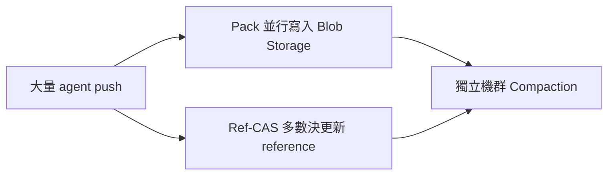

# AI Daily Digest — 2026-11-24

<!-- pipeline-generated:begin -->

## 🔥 今日 TOP 3
### 1. GitHub 重做 Git 儲存：只讓指標走共識
📰 來源：substack-byte-sized-design ｜ 發布：2026-11-23 ｜ 原標題：[🧷 GitHub Rebuilt Git Storage Around One Idea: Only the Pointer Needs Consensus](https://read.bytesizeddesign.com/p/github-git-storage-rubicon-ref-cas)

**一句話：** Git 只讓「指標更新」排隊達成共識，大型資料各自平行寫入。

**Why｜為什麼重要：** AI agent 全天候平行推送，讓單一 repo 的寫入從偶發尖峰變成持續高速率。原架構讓每個 pack 的每個位元組都經過共識，無法再提速。

**How｜怎麼做到：** Git 物件不可變且以內容雜湊命名，寫入 pack 不需協調，只有 reference 更新要排序。Pack 並行寫入 Azure Blob Storage，reference 交給 Ref-CAS，以多數決提交的 compare-and-swap 更新。

**What｜具體內容與下一步：** Project Rubicon 內部測試達到 5,000 個並發 agent、每秒 7,200 次 push 到同一 repo，讀取延遲持平。作者指出測試中寫入者多半碰不同 reference，瓶頸會轉到 merge queue、CI 與 review。原文中途被截斷。

📖 [閱讀完整 insight](../10-insights/2026-11-23/inbox_976545af.md) · 🔗 [原文連結](https://read.bytesizeddesign.com/p/github-git-storage-rubicon-ref-cas)
### 2. 軟體工廠不等於放手：人仍要擋 slop
📰 來源：youtube-ai-engineer ｜ 發布：2026-11-23 ｜ 原標題：[12 Rules for a Software Factory That Doesn't Ship Slop — Dex Horthy, Factory](https://www.youtube.com/watch?v=-NFMsM2y0Vk)

**一句話：** 軟體工廠就是好的工程實務：agent 自動接工作、自動把關，人仍要審查與負責。

**Why｜為什麼重要：** 讓 agent 寫程式的成本趨近零，審查成本卻沒變。講者引用 Feros 研究（30% PR 未經 review 就合併、更多 bug 與事故）與 SlopCodeBench，說明放手不管會讓 codebase 品質隨時間惡化。

**How｜怎麼做到：** 用 forward pressure（需求、事故自動進工廠）與 back pressure（agent code review、測試、CI/linter、形式驗證）讓 agent 自己爬向好結果。規劃投入以「預期痛苦＝改動機率 × 改動難度」判斷。

**What｜具體內容與下一步：** Dex Horthy 在 AI Engineer 提出 12 條實務與 Anti-Slop Manifesto。SlopCodeBench 中 GPT 5.5 得 15%、Astra 約 16.3%。明天可先檢查自己的 agent 流程有沒有 back pressure。

📖 [閱讀完整 insight](../10-insights/2026-11-23/inbox_4cb1ad04.md) · 🔗 [原文連結](https://www.youtube.com/watch?v=-NFMsM2y0Vk)
### 3. Ladybird 發布 alpha，靠 agent 刷 WPT
📰 來源：simon-willison ｜ 發布：2026-11-23 ｜ 原標題：[Ladybird's first alpha release](https://simonwillison.net/2026/Nov/23/ladybird/)

**一句話：** 從零自製的新瀏覽器 Ladybird 發布第一個 alpha，可直接安裝。

**Why｜為什麼重要：** 瀏覽器引擎市場停滯，Ladybird 用自己實作的 HTML、CSS、排版、JavaScript 與 WebAssembly 嘗試打造新選手。

**How｜怎麼做到：** 專案今年大量使用 coding agent：把 agent 指向 web-platform-tests（WPT），請它補齊缺漏功能，累積許多小修正。

**What｜具體內容與下一步：** 提供 macOS 與 Linux alpha 版。2026 年 10 月在約 225 萬個 WPT 子測試中新增 75,650 項通過，超越 Safari，大部分增幅集中在 10/22 到 10/27 五天。官方不保證安全，Simon Willison 只用於匿名瀏覽，不登入敏感帳號。

📖 [閱讀完整 insight](../10-insights/2026-11-23/inbox_4229667f.md) · 🔗 [原文連結](https://simonwillison.net/2026/Nov/23/ladybird/)

## 📖 好文章 / 影片精選

_近期的高品質內容，按興趣領域分類。每篇只在 column 出現一次。_
### 🎓 AI 使用技巧
- **substack-product-growth** · 2026-11-24 · **[A FAANG PM's Guide to Practical AI Evals](../10-insights/2026-11-24/inbox_f3d69f10.md)**
  把「AI 產出好不好」拆成一連串是/否問題，再用 LLM 當評審放大，最後仍由人抽查。 **Why** AI 產品的品質難以主觀判斷，PM 若不懂 evals 就無法決定什麼分數可以上線，也無法與工程師分工。 **How** 四步驟：用 3H（helpful、honest、harmless）定義好、把門檻設在競品與最強模型之間、讓 LLM judge 與專家達 70–80% 一致、持續由人抽樣檢查。 **What** Aakash Gupta 整理 Microsoft Foundry 的 evals 實作講座：以合約代理人為例，下限 45%（Cowork）、門檻 65%、上限 70%（最強模型）；專家標註成本舉例 $25,000；大型合約代理人每週人工抽查 200–1,000 筆輸出。分工上 PM 負責撰寫是/否問題、設定上線門檻並決定什麼可上線，工程師負責 judge 與 pipeline。另附 /evals skill（PM OS）與 AI PM 薪資區間，薪資數字為講者個人說法。
### ⚡ 個人生產力心得
- **youtube-how-i-ai** · 2026-11-23 · **[Why this CTO still loves OpenClaw on a Mac Mini](../10-insights/2026-11-23/inbox_1ad7dd94.md)**
  一位 CTO 把 OpenClaw 當成專屬 Jarvis，拆成多個分工明確的小 agent，替他處理審批、訂餐、打電話與智慧家居這些瑣事。 **Why** 他身為主管常是團隊審批的瓶頸，也想消除生活中哪怕只有 1% 的惱人小事。 **How** 用 soul 檔設定護欄與人格，一個 master agent 加多個 micro agent 負責路由，避免單一 agent 在不同角色間產生幻覺；主要用 WhatsApp 與 TUI 直接對話來建構，需要寫程式時由 OpenClaw 自行呼叫 Claude Code 等工具。 **What** 講者是 Inovvisir 的 CTO Ankit Maheswari，OpenClaw 跑在舊金山家中的 Mac Mini 上，用 Opus 5.5，每月 Anthropic 費用約 $500–600。用例包括每 4 小時彙整待審履歷、透過 n8n 處理 Navan/Coupa 的差旅與費用審批、用 Bland AI 打電話催同事或訂位與談判、在 9:30 確認後自動訂午餐、反向工程智慧家居協定並依下班位置自動開冷氣。他另一台 Mac Mini 跑 GLM 5.2 Flash（230K context），適合摘要與 email cron，但操作瀏覽器會失敗；曾有 agent 在他搭機時自動核准差旅，因此強調護欄。
### 🏢 企業導入
- **infoq-main** · 2026-11-23 · **[Netflix at QConSF 2026: Retrofitting the SDLC for AI Coding Agents](../10-insights/2026-11-23/inbox_d10bfcfd.md)**
  改造軟體開發流程，讓 AI 寫程式 agent 和工程師能一起交付。 **Why** AI coding agent 加入後，原有 SDLC 需要調整，才能讓人與 agent 協同出貨。 **How** 撰寫同時給人與 agent 讀的架構決策紀錄，加入只回報已驗證阻塞問題的 review agent，並透過單一 MCP tool 提供各領域的 GraphRAG context。 **What** Netflix Commerce 團隊的 Mark Khuzam 在 QCon San Francisco 2026 分享：寫了 45 份 ADR、review agent 只張貼經驗證的 blocker、以單一 MCP tool 提供 per-domain GraphRAG。
### 🔐 AI 安全
- **infoq-main** · 2026-11-23 · **[QCon San Francisco 2026: Securing AI Agents in Production](../10-insights/2026-11-23/inbox_b41979ab.md)**
  把 AI agent 當成以機器速度運作的內部人員風險來管理。 **Why** Agent 可代表使用者行動並持有存取權，一旦出錯或被濫用，影響速度遠快於人類。 **What** InfoQ 報導 QCon San Francisco 2026 上，Google 的 Amanda Walker 把 AI agent 定位為內部風險（insider risk）問題，並介紹在生產環境安全運行 agent 的身分、憑證與隔離（containment）模式。原文僅有一句摘要，具體的模式內容與做法沒有提供。
- **openai-blog** · 2026-11-18 · **[Managing frontier AI risk: From training to deployment](../10-insights/2026-11-18/inbox_23d81d54.md)**
  OpenAI 說明他們從訓練到上線，如何一層層管控最前沿模型的風險。 **What** OpenAI 發文介紹前沿 AI 風險管理做法，涵蓋模型對齊（alignment）、沙箱（sandboxing）、阻擋式安全防護（blocking safeguards）與監控（monitoring），貫穿訓練到部署。原文僅提供摘要，未列出具體數字或實作細節。
### 🎙️ Lenny's Newsletter・Podcast
- **substack-lennys-newsletter** · 2026-11-23 · **[🎙️ How I AI: OpenClaw for executives: Automate every 1% annoyance](../10-insights/2026-11-23/inbox_709e03e2.md)**
  把工作中每個讓人有點煩的小事交給 AI 代理人自動處理，並用嚴格規則限制它能做什麼。 **Why** 作為 CTO，Ankit Maheshwari 的核准流程讓自己成為工作瓶頸，他想把重複又瑣碎的事情交出去。 **How** 以 cron job 定時摘要待核准事項起步；用 soul.md 等檔案定義各代理人的人格、邊界、權限與路由；把語音通話拆給專責子代理人；先對最壞情況設護欄。 **What** Innovaccer CTO 在 Mac Mini 上用 OpenClaw 跑個人 AI 幕僚長 Jarvis，負責核准、訂午餐、打電話給沒回 Slack 的同事、訂餐廳與控制智慧家居。節目中提到 Jarvis 每月在 Opus 5.5 上約花 $500–600，並在測試以近乎免費的本地模型處理摘要、email、cron 檢查與通話協調，但複雜的瀏覽器操作仍需前沿模型。
### 🛠 工具最新 release
- **codex** · 2026-11-24 · **[0.172.0](../10-insights/2026-11-24/inbox_bf029638.md)**
  OpenAI Codex 這版強化終端機操作、MCP 啟動方式與遠端 session 的設定保留。 **Why** 長時間、多代理、跨平台的使用情境下，常出現工作目錄遺失、錯誤延遲顯示與操作不便。 **How** 新增連結跳轉、slash command 的 Tab 補全與任務群組導覽；stdio MCP server 改為首次呼叫工具時才啟動；resume 與遠端 session 保留 sandbox 權限、工作目錄與 workspace roots。 **What** OpenAI Codex 0.172.0：可為個別 connected app 工具設定 approval reviewer；App-server 客戶端可選 Amazon Bedrock Runtime；內建 openai-docs skill 新增 GPT-6.2 Astra 與 Sol 的遷移指引；Code Mode 的 host 連線全面改用 gRPC，code_mode_host_grpc 設定已棄用。
- **claude-mem** · 2026-11-23 · **[v16.1.1](../10-insights/2026-11-23/inbox_83b948bc.md)**
  claude-mem v16.1.1 調整雲端同步（Cloud Sync）的設定與結帳流程。 **What** 月付 $12/月，含 30 天免費試用且需綁定信用卡；年付 $99 預付。設定會預選偵測到的 agent，開通後顯示原始掃描的 token 用量，並可選擇性啟用託管記憶生成。
  _+ 1 個近期版本（v16.1.0，僅顯示最新）_
- **claude-code** · 2026-11-23 · **[v2.1.331](../10-insights/2026-11-23/inbox_68f5cb80.md)**
  Claude Code 這版主要補齊雲端平台支援、可觀測性，並修掉大量終端機與 VSCode 的小問題。 **Why** 企業用戶在不同雲端、代理與 Windows 受管設定下，常遇到連線、權限與顯示異常。 **How** 擴充 Code Mode 到多個雲端平台、在 trace span 加入 gen_ai.* 欄位、新增 claude doctor 的 API 連線檢查，並逐項修正 MCP、compact、plugin 與 VSCode 行為。 **What** Claude Code v2.1.331：Code Mode 支援 Amazon Bedrock、Google Cloud Agent Platform、Microsoft Foundry 與 Claude Platform on AWS；新增 CLAUDE_CODE_DISABLE_RESPONSE_COMPRESSION 與 plugin optionalDependencies；修正 MCP 工具呼叫最久卡 30 分鐘的問題。另預告 2026-11-30 起，managed extraKnownMarketplaces 的 plugin marketplace 將預設自動更新（可設 \"autoUpdate\": false 退出）。

## 💡 今日 Takeaway

_讀完今日所有內容後，可帶走的知識點_
### 1. 不可變資料免協調，只有可變指標需共識
內容定址、不可變的資料可以平行寫入，不需要排序；只有會被覆寫的指標才需要共識。設計高寫入系統時，先把「必須協調的最小狀態」切出來，其餘走便宜的路徑。

_類型：pattern_

**參考來源**：
- [🧷 GitHub Rebuilt Git Storage Around One Idea: Only the Pointer Needs Consensus](../10-insights/2026-11-23/inbox_976545af.md) · [原文](https://read.bytesizeddesign.com/p/github-git-storage-rubicon-ref-cas)
### 2. 用 back pressure 讓 agent 自己爬向好結果
讓工作自動進來（forward pressure）的同時，要配上 agent code review、測試、CI/linter 與形式驗證（back pressure）。規劃投入可用「預期痛苦＝改動機率 × 改動難度」決定，資料庫 schema 要細想，按鈕顏色不必。

_類型：framework_

**參考來源**：
- [12 Rules for a Software Factory That Doesn't Ship Slop — Dex Horthy, Factory](../10-insights/2026-11-23/inbox_4cb1ad04.md) · [原文](https://www.youtube.com/watch?v=-NFMsM2y0Vk)
### 3. LLM judge 上線前要先對齊專家
把品質拆成二元是/否問題，再用 LLM judge 放大，目標是與專家一致 70–80%，並持續人工抽樣。另一個案例中，judge 在 54 個提示只有 4 個標籤被接受，所以在拿 judge 結果去做決策或訓練前，要先驗證它。

_類型：technique_

**參考來源**：
- [A FAANG PM's Guide to Practical AI Evals](../10-insights/2026-11-24/inbox_f3d69f10.md) · [原文](https://www.news.aakashg.com/p/practical-ai-evals)
- [I built a Constitutional AI pipeline. Then I tested whether I could trust its judge.](../10-insights/2026-11-23/inbox_51a4fec6.md) · [原文](https://medium.com/@bainamndidaliwa/i-built-a-constitutional-ai-pipeline-then-i-tested-whether-i-could-trust-its-judge-68a956d69b82?source=rss------large_language_models-5)
### 4. 訪談問做過什麼，不問想要什麼
問「上次使用是什麼時候」，並把功能請求還原成問題。遇到模糊詞要量化（「some」是 5% 還是 90%），遇到強烈情緒字眼一定追問，並用同一措辭的評分讓回答可比較。

_類型：technique_

**參考來源**：
- [Stop asking users what they want](../10-insights/2026-11-23/inbox_f9150d3f.md) · [原文](https://newsletter.posthog.com/p/user-interviews)
### 5. 大問題先分塊平行算，上線先用 shadow 驗證
複雜度近二次方的問題可用預先分群與階層式分解切塊，再以全域 reconcile 補回邊界關聯。換掉核心系統時，先雙寫流量給新舊兩套，只讓舊系統控制實際結果，新系統輸出僅供分析。

_類型：pattern_

**參考來源**：
- [DoorDash Dispatch: Building a Lightning-Fast Delivery System](../10-insights/2026-11-23/inbox_11dd8f1a.md) · [原文](https://blog.bytebytego.com/p/doordash-dispatch-building-a-lightning)

<!-- pipeline-generated:end -->

<!-- user-notes -->
<!-- Write your own notes below; pipeline never touches this section. -->