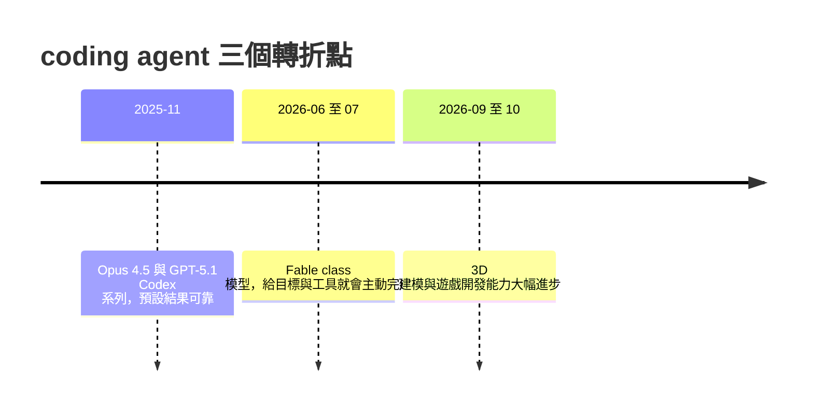

# AI Daily Digest — 2026-11-25

<!-- pipeline-generated:begin -->

## 🔥 今日 TOP 3
### 1. Agent 寫數百萬行，靠既有測試擋住 slop
📰 來源：youtube-ai-engineer ｜ 發布：2026-11-24 ｜ 原標題：[How to Ship Millions of Lines of Agent-Written Code — Jarred Sumner, Anthropic](https://www.youtube.com/watch?v=TvsF67C2F54)

**一句話：** AI 能替你寫多少程式碼，取決於你有多相信它的驗證方式。

**Why｜為什麼重要：** 大型專案交給 agent 產出後，真正的限制是測試：能不能有信心地出貨，決定了整個做法。

**How｜怎麼做到：** 沿用專案之前就存在的測試（Bun、WebKit、test262、Claude Code），並要求 JIT、AOT、去掉型別三種版本行為一致才算通過；再用 Fuzzilli 與 Claude 產生的 code generator 做 fuzz，並檢查測試是否真能抓到 bug。長期用 sub agent 保留上下文，每小時貼 scorecard。

**What｜具體內容與下一步：** Anthropic 的 Jarred Sumner 為 Bun 加入 AOT compiler，PR 達數百萬行，一個多月重寫五次（第三版 140 個 agent 同時寫、程式碼是 slop；第四版編譯 50 秒；第五版不到 20 秒，預計下週出貨）。成果是 Claude Code 記憶體約少 4 倍、啟動約快 2 倍，可用 `bun upgrade --canary` 試用。下一步：讓 agent 動手前，先盤點專案裡已有的測試當驗收標準。

📖 [閱讀完整 insight](../10-insights/2026-11-24/inbox_085b8fd2.md) · 🔗 [原文連結](https://www.youtube.com/watch?v=TvsF67C2F54)
### 2. Willison：一年內 coding agent 的三個轉折
📰 來源：simon-willison ｜ 發布：2026-11-24 ｜ 原標題：[Three LLM inflection points in twelve months](https://simonwillison.net/2026/Nov/24/llm-inflection-points/)

**一句話：** 從「偶爾能用」到「給目標就會做完」，coding agent 一年內跨了三道門檻。

**Why｜為什麼重要：** Simon Willison 認為軟體開發在一年內已變得面目全非，需要歸納是哪些模型世代造成質變。

**How｜怎麼做到：** 他依自身實際使用經驗劃分轉折點。

**What｜具體內容與下一步：** 他把 Claude Fable 5、5.1、5.2 與 Opus 5.5 列為 Fable class，GPT-6 Astra 也算。範例：Fable 用 5 個 WebAudio 麥克風把神秘嗶聲定位到約 40 公分內；Opus 5.5 花 12 小時試玩並重新平衡，讓他的 RTS 遊戲變好玩。Fable 5.2 是否為新轉折點他仍在判斷，但認為只要能清楚描述軟體，Fable 就能建出來。

📖 [閱讀完整 insight](../10-insights/2026-11-24/inbox_49245683.md) · 🔗 [原文連結](https://simonwillison.net/2026/Nov/24/llm-inflection-points/)
### 3. OpenAI 公開 perplexity：下個躍升在 0.68–0.70
📰 來源：latent-space ｜ 發布：2026-11-24 ｜ 原標題：[[AINews] Jensen Is Back! and OpenAI Shows Its Pretraining Curve, joined by Microsoft](https://latent.space/p/ainews-jensen-is-back-and-openai-shows-its-pretraining-curve-joined-by-microsoft/)

**一句話：** OpenAI 用一條「預測下個字的準確度」曲線，指出下一波能力躍升大概落在哪裡。

**Why｜為什麼重要：** OpenAI 首席科學家 Pachocki 主張各實驗室應共同設定發展上限，並訂出跨越上限所需的條件，例如 CoT 監控的後繼技術。

**How｜怎麼做到：** 以固定的內部 held-out 程式碼資料集，量測基礎模型對下一個 token 的 log-perplexity，數值越低越好。

**What｜具體內容與下一步：** 數字為 GPT-3.5 約 0.99、GPT-4 約 0.91、GPT6 Astra 約 0.76；低於 0.8 時出現資安與數學的湧現能力，OpenAI 預期下一個躍升在 0.68–0.70。Microsoft 的 MAI-2 Base 在同一評測集為 0.819。批評者指出 tokenizer 偏差、後訓練占超過 75% FLOPs、合成資料等混淆因素，解讀時要保留這些前提。

📖 [閱讀完整 insight](../10-insights/2026-11-24/inbox_7202e21c.md) · 🔗 [原文連結](https://latent.space/p/ainews-jensen-is-back-and-openai-shows-its-pretraining-curve-joined-by-microsoft/)

## 📖 好文章 / 影片精選

_近期的高品質內容，按興趣領域分類。每篇只在 column 出現一次。_
### 🎓 AI 使用技巧
- **infoq-main** · 2026-11-23 · **[Claude Code Adds Experimental Code Mode to Orchestrate Tool Calls with JavaScript](../10-insights/2026-11-23/inbox_5b85c253.md)**
  讓 Claude Code 寫一段 JavaScript 來一次串接多個工具呼叫，而不是一個一個來。 **How** Code Mode 讓 Claude Code 撰寫 JavaScript，對 Bash、Read、Edit 呼叫進行串接、平行化與過濾，並調整 auto mode 與 hooks 審查這些呼叫的方式。 **What** Anthropic 
- **infoq-main** · 2026-11-19 · **[Presentation: RIIIR: Rewrite It In *Idiomatic* Rust (with AI)](../10-insights/2026-11-19/inbox_21d68c14.md)**
  用 AI 把程式改寫成道地的 Rust，並用標準協定讓 agent 接上各種工具。 **Why** 講者主張 AI 讓 Rust 成為現代生產系統的理想選擇，編譯器的護欄可跳過陡峭的採用門檻。 **How** 以 Agent Client Protocol (ACP) 標準化 agent 與工具之間的擴充方式，適用於不同的企業開發流程。 **What** Nicholas (Niko) Matsakis 介紹 Rust Foundation 的開源 agent 導向工具鏈 Symposium，並示範 ACP 的用法。
### 🛤️ 導入心得
- **youtube-ai-engineer** · 2026-11-24 · **[Software Factories: Escape from Trash Mountain — Steve Yegge, Gas Town](../10-insights/2026-11-24/inbox_f2deb239.md)**
  Steve Yegge 分享自建「軟體工廠」（多 agent 協作系統）一年的經驗：工廠會長成垃圾山，管理 agent 更像管理人。 **Why** 讓 Claude 去跑 Claude 時，每一代模型都會蓋出略大於自己能處理的東西，最後得整個燒掉重寫；同時 token 成本、工作流、context 堆積與 agent 行為都成為新瓶頸。 **How** 他用 beads（agent 速度的任務追蹤器，自動長成知識圖譜）表示工作；定期大刀闊斧清理 append-only 的記錄；並用「模型福利」做法，讓新 session 看到前任紀錄與政策，降低 agent 花在驗證環境、自我防衛的 token，也避免被罵後過度設限。 **What** 他的 Gas Town（2026/1/1 發布）與自用的 Wheelhouse 工廠，替跑了 25 年的 MUD 遊戲 Wyvern 每天產出 50 到 100 個功能，約四個月消化 60 年的 backlog，但玩家要求放慢並提供 roadmap。他用 22 個 Claude Max 帳號，月花約 5,000 美元 inference，估計每天約 50 億 token，API 等值約每年 150 萬美元，全速約 300 萬；工廠自稱穩態需 55 個帳號，他轉向燃料效率。他認為工廠分兩層：底層（merge queue、CI/CD、review）Cl
- **infoq-main** · 2026-11-24 · **[QCon San Francisco 2026: Lessons from Building a $100M Product in Six Weeks at OpenAI](../10-insights/2026-11-24/inbox_bcb19bcc.md)**
  OpenAI 用 Codex agent、零人工手寫程式碼，六週做出一個廣告產品，工程師變成 agent 的管理者。 **Why** 當 agent 負責寫程式，瓶頸轉移到如何驗證與審查大量產出，並避免 agent 做出不安全的動作。 **How** 採分層測試、sandbox 隔離，以及批次化的 pull request review；並建議逐步導入。 **What** QCon SF 2026 上 OpenAI 的 Brian Yang 分享 ChatGPT ads 產品的開發經驗，標題為六週打造 $100M 產品。他點出的失敗模式包括程式碼「slop」與不安全的 agent 行為，並主張工程師應定位為 agent 的 manager。
- **tomasz-tunguz** · 2026-11-22 · **[What Kind of Factory Will You Build?](../10-insights/2026-11-22/inbox_a037a485.md)**
  把「軟體工廠」的做法搬到公司其他工作上：讓 agent 做事、記錄結果、再回頭改進規則。 **Why** 工程團隊已經不再逐行寫程式，而是建系統來寫、測、出貨；作者問為什麼其他團隊不照做。 **How** 四步循環：shared context（規格、文件、歷史）→ agent 執行 → execution trace（記錄出貨、出錯與成本）→ curator 讀 trace 改寫 skills 與 specs。後兩步會複利，讓系統每週變好，否則只是一次性的 workflow。 **What** Tomasz Tunguz 引用 11/21 Notion 的「A New Shape for Work」與 LangChain 的「How to Build a Knowledge Factory」，兩者描述同一個循環；作者也在註腳指出兩篇都沒有 benchmark、客戶成果或獨立驗證，只是廠商的架構論述。他認為工廠是營運專案而非買模型，需要有人負責 context、spec、trace 與定期執行 curator。
### 🏢 企業導入
- **creator-economy** · 2026-11-22 · **[What Should Engineers Do When AI Writes All the Code | Charles Lamanna](../10-insights/2026-11-22/inbox_12ac3cf6.md)**
  工程師角色正從手寫程式轉向管理 agent，判斷與對齊變得更重要。 **Why** 文章認為寫程式的成本趨近於零後，工程師的價值轉向架構、測試與對齊。 **What** 訪談 Microsoft Copilot 與 Agents 負責人 Charles Lamanna，並附作者參與 Satya 圓桌的筆記；文中提到 Copilot Cowork 僅 11 位工程師打造，單一工程師維護整個 GitHub Copilot runtime。
- **substack-elena-verna** · 2026-11-19 · **[How did Lovable grow so fast?](../10-insights/2026-11-19/inbox_ea0de5e2.md)**
  Lovable 的爆發成長沒有祕訣，而是身處高速成長市場，加上一艘能承受亂流的組織。 **Why** 作者（Lovable 成長負責人）認為這種規模的成長不是單一人或單一職能能做到，也不是任何 growth playbook 能複製。 **How** 提出 Whitewater Framework：市場是河流（引擎），公司要造一艘能存活的筏。筏的部件包含產品（充氣筒）、信任文化（防撕布料）、出貨速度（打氣筒）、AI 自動化（自動排水地板），團隊面則有小團隊、個人化社群與大膽押注。 **What** 文中數字：ARR 超過 6 億美元、每週新增 120 萬個專案、用 Lovable 做出的 app 每月超過 10 億次造訪。作者延伸自 Lenny 與 Dan Hockenmaier 的 Racecar Growth Framework，並引用 James Currier 的「找到快速流動的水」。原文在中途被截斷，後半段（個人社群、大膽押注）未涵蓋。
### 🔐 AI 安全
- **youtube-invest-like-the-best** · 2026-11-24 · **[Are the Biggest Companies on Earth About to Get Hacked?](../10-insights/2026-11-24/inbox_645df488.md)**
  AI 找漏洞的能力已很強，預期未來 6 至 12 個月大型機構將遭入侵，防守需靠 agent 持續掃描。 **Why** 過去沒人有時間或能力窮舉所有攻擊路徑，現在模型能大規模嘗試，老舊程式碼中的漏洞因此會被找出。 **How** 建議企業用 agent swarm 持續掃描整個攻擊面與程式碼，並監控 runtime 與登入流程，同時限制 agent 的沙箱權限。 **What** 受訪的 Cognition（Devin 開發商）表示，營收 run rate 於 2026/9/16 跨過 10 億美元，已有 100 多家 Fortune 500 客戶；廠商自述客戶 ROI 約 8 至 15 倍，City Bank 計畫導入約 14,000 名工程師。
### 🛠 工具最新 release
- **claude-mem** · 2026-11-24 · **[v16.1.3](../10-insights/2026-11-24/inbox_8ef333fd.md)**
  HTTP 200 不代表成功，claude-mem 改看回應內的錯誤碼，避免丟掉佇列事件。 **Why** OpenRouter 會在 200 回應內回報「high demand」等暫時性錯誤，舊版誤判為不可復原，結束 session 並丟棄排隊的 observation；回報者一天損失 8.5% 至 16% 的事件。 **How** 分類器在 HTTP 2xx 時改讀數值 error.code（429 為限流、5xx 為暫時性錯誤）；server 端 job 遇到 Retry-After 時依提供方等待時間延後，上限 60 秒。 **What** v16.1.3 同時修正 POST /v1/events 對含 NUL 字元的資料改回 400（原為 500），並新增 CLAUDE_MEM_OPENAI_COMPAT_REASONING_EFFORT、CLAUDE_MEM_WORK_VIEW_API_TIMEOUT_MS（預設 600000）與 CLAUDE_MEM_WORK_VIEW_MAX_OUTPUT_TOKENS（預設 16000）設定，並補上巴西葡萄牙語翻譯。
  _+ 1 個近期版本（v16.1.2，僅顯示最新）_
- **hermes-agent** · 2026-11-24 · **[commit.20261124T085444Z-v0.0.0](../10-insights/2026-11-24/inbox_e2868390.md)**
  Hermes Agent 的 build 紀錄，內容截斷，沒有功能說明。 **What** 只有 commit 6cd0c4764cae36d35b3e97b6d4ce836dc1fab366 與空的 bundleEnv 欄位，無法判斷包含哪些變更。
  _+ 2 個近期版本（v0.23.4 → 20261124T050806Z-v0.0.0，僅顯示最新）_

## 💡 今日 Takeaway

_讀完今日所有內容後，可帶走的知識點_
### 1. Agent 產出規模，受限於驗證而非寫碼速度
用專案原有的測試當驗收，並要求多種執行模式行為一致，再加 fuzz 與測試有效性檢查，agent 就難以動手腳。OpenAI 的 ads 案例同樣靠分層測試、sandbox 與批次 PR review 把關。導入 agent 前，先盤點既有測試與審查流程。

_類型：framework_

**參考來源**：
- [How to Ship Millions of Lines of Agent-Written Code — Jarred Sumner, Anthropic](../10-insights/2026-11-24/inbox_085b8fd2.md) · [原文](https://www.youtube.com/watch?v=TvsF67C2F54)
- [QCon San Francisco 2026: Lessons from Building a $100M Product in Six Weeks at OpenAI](../10-insights/2026-11-24/inbox_bcb19bcc.md) · [原文](https://www.infoq.com/news/2026/11/qcon-sf-openai-lessons/?utm_campaign=infoq_content&utm_source=infoq&utm_medium=feed&utm_term=global)
### 2. 非確定性輸出，用發布門檻工程化管控
高風險場景不能容忍 LLM 輸出不一致或捏造。做法是用知識圖譜做 grounding，搭配雙層 eval judge 與 CI/CD release gate，再以 golden dataset 做回歸測試。套用時把 eval 當成發布條件，未通過就不上線。

_類型：framework_

**參考來源**：
- [Article: Engineering Around Non-Determinism: Evals, Grounding, and Release Gates for AI-Drafted Suspicious Reports](../10-insights/2026-11-24/inbox_72121144.md) · [原文](https://www.infoq.com/articles/llm-agent-architecture-evals-grounding/?utm_campaign=infoq_content&utm_source=infoq&utm_medium=feed&utm_term=global)
### 3. 建得快不等於學得快，先找客戶再定產品
AI 讓團隊在訪談客戶前就做出完整產品，MVP 退化成投影片式展示。Steve Blank 建議先取得 design partners 與客戶、做面對面訪談，合成使用者訪談則會產生幻覺。評估新點子時，以客戶驗證進度而非成品完成度為準。

_類型：framework_

**參考來源**：
- [Episode 860 | Is the MVP Dead? Steve Blank on What Comes Next](../10-insights/2026-11-24/inbox_6bd0e93b.md) · [原文](https://permalink.castos.com/podcast/5031/episode/2696260)
### 4. Agent 系統的記錄與程式會堆成垃圾山
Yegge 指出讓 Claude 去跑 Claude，每一代模型都會蓋出略大於自己能處理的東西，最後得整個重寫。他的對策是定期大刀闊斧清理 append-only 的記錄，並讓新 session 看到前任紀錄與政策。多 agent 系統要把清理與重置排進維運週期。

_類型：pattern_

**參考來源**：
- [Software Factories: Escape from Trash Mountain — Steve Yegge, Gas Town](../10-insights/2026-11-24/inbox_f2deb239.md) · [原文](https://www.youtube.com/watch?v=SRhXgeNluIk)
### 5. HTTP 200 不代表成功，要讀回應內的錯誤碼
有些提供方會在 200 回應內回報暫時性錯誤，若只看狀態碼就會誤判為不可復原並丟棄資料。claude-mem 的修正是在 2xx 時改讀 error.code：429 視為限流、5xx 視為暫時性錯誤，並依 Retry-After 延後重試。呼叫 LLM 閘道時，分類器應同時檢查狀態碼與 body。

_類型：pattern_

**參考來源**：
- [v16.1.3](../10-insights/2026-11-24/inbox_8ef333fd.md) · [原文](https://github.com/thedotmack/claude-mem/releases/tag/v16.1.3)

<!-- pipeline-generated:end -->

<!-- user-notes -->
<!-- Write your own notes below; pipeline never touches this section. -->