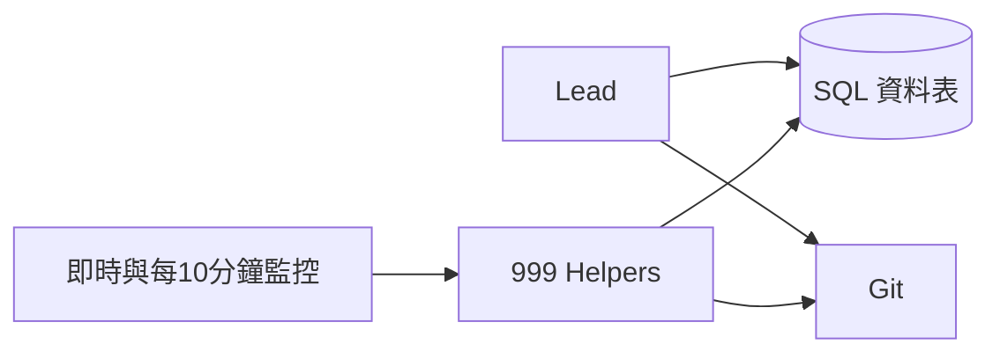

# AI Daily Digest — 2026-11-27

<!-- pipeline-generated:begin -->

## 🔥 今日 TOP 3
### 1. 千個 Claude 代理人只靠 Git 與資料庫證明費馬
📰 來源：youtube-ai-engineer ｜ 發布：2026-11-26 ｜ 原標題：[1,000 Claude Agents Formalized Fermat's Last Theorem — Lance Martin, Anthropic](https://www.youtube.com/watch?v=wrfbI5eyLAI)

**一句話：** 一千個 AI 各自分工，只靠共用的 Git 和資料庫，就把費馬最後定理寫成可驗證的程式證明。

**Why｜為什麼重要：** 形式化這類長時程任務，原本需要領域專用 harness 與研究員協助；記憶方面則有「寫入時只看當下，卻要成為全域一致的地圖」的悖論。

**How｜怎麼做到：** 每個代理人在受限網路的沙盒中，只能連 Git 與 SQL 資料庫，另有即時與每 10 分鐘的離線監控；lead 約 5 分鐘內自建 announce、notes、subtask、land 等資料表來調度。記憶則讓 Claude 回顧 transcript 與筆記（dreaming），修正錯誤記憶、補齊 wiki 缺漏。

**What｜具體內容與下一步：** 1 個 lead 加 999 個 helper 約跑 30 小時，涵蓋證明中的 60 個陳述，無領域專用 harness 與人工指引。Pokemon 實驗中，dreaming 修復毒化記憶並讓進度脫離迴圈。可先試讓多代理共用 Git 加資料表協調，而非預先設計流程（這是推論）。

📖 [閱讀完整 insight](../10-insights/2026-11-26/inbox_03518b33.md) · 🔗 [原文連結](https://www.youtube.com/watch?v=wrfbI5eyLAI)
### 2. Anthropic 用 Claude 五個月把 API 改寫成 Rust
📰 來源：substack-pragmatic-engineer ｜ 發布：2026-11-25 ｜ 原標題：[How Anthropic builds software in 2026 with Katelyn Lesse](https://newsletter.pragmaticengineer.com/p/how-anthropic-builds-software-in)

**一句話：** 舊系統就是最好的考卷：新程式照打同樣流量，答案跟舊的一模一樣才算過關。

**Why｜為什麼重要：** 服務所有 Claude token 的 Python monolith 是 2023 年研究團隊為了方便整合推論基礎設施而寫，CPU 用量日益成為問題，加上全球 CPU 短缺。

**How｜怎麼做到：** 讓新的 Rust API 對正式流量做 shadowing，持續迭代到回應與舊 Python API 完全一致；現有 API 就是完美的測試基準，所以只需仔細看約 20% 的程式碼。

**What｜具體內容與下一步：** 幾位工程師約五個月完成，且無人是 Rust 專家。Anthropic 另以 Claude code review 分類器決定是否需人工 review、需幾位、送哪個團隊，低風險機械變更（SDK 升級、換新模型、修 flaky test）可免人工 review；API oncall 由 Claude agent 先接警報。有舊系統可比對的重寫案，可優先考慮 shadow traffic 驗證。

📖 [閱讀完整 insight](../10-insights/2026-11-25/inbox_e5dc931b.md) · 🔗 [原文連結](https://newsletter.pragmaticengineer.com/p/how-anthropic-builds-software-in)
### 3. token 降價用量暴增，營收看彈性
📰 來源：tomasz-tunguz ｜ 發布：2026-11-24 ｜ 原標題：[Will AI Deflate Like Lightbulbs or Compound Like Copper?](https://tomtunguz.com/jevons-works-on-tokens-not-on-dollars/)

**一句話：** 東西變便宜大家會用更多，但花的總錢是增是減，取決於「降價一點，用量增加多少」。

**Why｜為什麼重要：** 傑文斯悖論常被引用，但用量增加後的營收怎樣，才決定 AI 市場能否撐住龐大的算力支出。

**How｜怎麼做到：** 用價格需求彈性衡量：彈性 1 代表降價後花費持平，0.5 代表花費縮水。作者以 Ramp 與 OpenRouter 的用量與支出資料，以及 Anthropic S-1 估算。

**What｜具體內容與下一步：** Ramp 價格降 1%，token 用量增 4.3%（用量 11.1 倍、支出 4.7 倍）；OpenRouter 為 6.8%（50 倍、21 倍）。neocloud GPU 租金一年漲 48%，CoreWeave 續約重訂價 30–50%。Anthropic S-1 顯示 Opus 4.5 降低每任務成本後，季營收成長由 48% 升至 132%，隱含彈性遠大於 1。2027 年可觀察支出與用量差距是否收斂、前沿實驗室毛利是否維持 40% 以上。

📖 [閱讀完整 insight](../10-insights/2026-11-24/inbox_becdb0b9.md) · 🔗 [原文連結](https://tomtunguz.com/jevons-works-on-tokens-not-on-dollars/)

## 📖 好文章 / 影片精選

_近期的高品質內容，按興趣領域分類。每篇只在 column 出現一次。_
### 🎓 AI 使用技巧
- **substack-techworld-milan** · 2026-11-26 · **[Agents write 99% of my code. Here is what I still do.](../10-insights/2026-11-26/inbox_a2363dd6.md)**
  作者把工作切成「定義、實作、驗收」三段，實作交給 agent，自己把力氣放在前後兩端。 **Why** 作者認為定義與判斷對結果的影響比模型本身更大；他以 2025 年 11 月 Opus 4.5 發布為轉折點，從此幻覺幾乎看不到。 **How** 用 OpenSpec 寫 Markdown spec 讓 Claude 依現有程式碼出計畫，修正幾輪後再實作，並把計畫交給另一個模型審查（模型訓練不同，盲點不同）；bug 先寫失敗測試；完成後用全新 session 審查，自己只看關鍵 diff 並實際操作 app。 **What** Milan 稱 agent 寫了他 99% 的程式碼，Claude Code 占 80%、Codex 占 20%。他公開 63 行的 AGENTS.md，並引用 ETH Zurich 研究：規則檔未提升成功率、成本卻增加 20% 以上，所以刻意保持精簡。另分享六個可複製的 prompt：先出計畫、有疑問就問、用第二個模型、新 session 審查、要求證據、再做一次檢查。
- **medium-tag-claude** · 2026-11-24 · **[10 Claude Code Workflows That Save Me Hours Every Week](../10-insights/2026-11-24/inbox_da72178e.md)**
  作者整理 10 個 Claude Code 工作流程，涵蓋自動重構與測試生成等。 **What** 文章主張這些流程能每週節省數小時；原文僅為片段，未列出完整 10 項內容。
### ⚡ 個人生產力心得
- **substack-phil-hardman** · 2026-11-26 · **[How I AI: my top 5 daily AI use cases in 2026](../10-insights/2026-11-26/inbox_fdbe270d.md)**
  作者讓 Claude 回溯全年對話，發現自己的 AI 用法已從「做得快」轉向「做得好」。 **Why** 多數團隊仍主要用 AI 生成內容，用途改變不大，較難看出差異。 **How** 作者把用法拆成分析、設計、開發、實施、評估五階段，每階段附工具、輸入、提示詞與輸出範例。 **What** 分析階段用 AI 逐筆歸類學習者訊號並附可核對引文；設計階段先用深度研究工具建立證據基礎，再對照草稿評分；開發階段讓合成學習者預先作答測驗題。
### 🛤️ 導入心得
- **infoq-main** · 2026-11-24 · **[Article: Engineering Around Non-Determinism: Evals, Grounding, and Release Gates for AI-Drafted Suspicious Reports](../10-insights/2026-11-24/inbox_72121144.md)**
  把 AI 的不確定輸出當成工程問題，用評測與發布門檻擋住幻覺。 **Why** 高風險場景（如可疑交易報告）不能容忍 LLM 每次輸出不同或捏造內容，非確定性必須被工程化管控。 **How** 以知識圖譜做 grounding，搭配雙層 eval judge、CI/CD 發布門檻，並用 golden dataset 做回歸測試。 **What** InfoQ 文章（Ritesh Modi、Sasidhar Gudala）提出一套架構藍圖，目標是在自動起草可疑活動報告的同時維持零幻覺合規；原文摘要未提供具體數字或實測結果。
### 🧠 知識管理
- **infoq-main** · 2026-11-26 · **[Presentation: Finetuning Your Embedding Model for Better Search: Learning from Agentic Search at Dell](../10-insights/2026-11-26/inbox_816f60d5.md)**
  把開源 embedding 模型用公司內部資料微調，讓企業搜尋看得懂內部術語。 **Why** 企業 RAG 在內部專有術語上常檢索失敗，通用 embedding 模型無法理解這些詞。 **How** 微調開源 embedding 模型：準備含 hard negatives 的資料，在 H100 GPU 上以分散式 InfoNCE loss 訓練，搭配自動化超參數調整，並以 LLM-as-a-judge 做上線評估。 **What** Rachel Shalom 在 InfoQ 演講中分享 Dell 的 agentic search 實戰經驗，涵蓋資料準備、訓練、調參到 production 評估的完整流程。
### 🔐 AI 安全
- **youtube-i'm-阿湯** · 2026-11-24 · **[You Can Change Passwords, But You Can't Change Your Face! Bureau of Consular Affairs Hacked, 70,0...](../10-insights/2026-11-24/inbox_22cdf08b.md)**
  台灣外交部領事事務局網站遭駭，7 萬多張護照大頭照等資料被拿走，原因是委外廠商更新系統時的設定錯誤，被 AI 工具掃描找到。 **Why** 臉無法像密碼或卡號一樣更換，照片外洩的後果更難補救；同時 AI 代理程式讓攻擊者能持續自動試探漏洞。 **How** 數發部長表示，廠商更新系統時的設定錯誤造成新漏洞，駭客用 AI 工具掃描找到並進入。資安署說，境外駭客自 7 月起用 AI 代理程式直接打後端 API，多挑 PHP、Node.js、GitLab 的已知高風險漏洞；即使畫面上的功能已移除，只要後端程式還在仍可能被攻擊。資安署未說領務局案屬同一波。 **What** 領務局表示，被拿走的有：9/3–11/2 期間部分護照大頭照共 72,702 個檔案、駐紐約辦事處驗證的授權書掃描檔 26,072 個、ABTC 線上申請資料 774 件（無姓名、護照號碼與聯絡方式）；目前鑑識未發現姓名、身分證字號、護照號碼外洩。領務局提供免費換照（受理至 2027/5/14），條件是經確認照片在外洩範圍內等；換照會變更護照號碼與效期，已訂簽證機票者需先確認。委外廠商與駭客身分尚未公開，部分資料日期晚於 11/4 發現入侵日，原因未說明。
- **openai-blog** · 2026-11-20 · **[Combatting adversarial distillation](../10-insights/2026-11-20/inbox_2af289f4.md)**
  OpenAI 說明如何防止他人用大量查詢把模型能力「蒸餾」走。 **What** OpenAI 發表〈Combatting adversarial distillation〉，採分層做法，結合模型訓練、safeguards、偵測與執法，以防範能力萃取（capability extraction）。原文僅有摘要，未提供具體技術細節或數據。
- **medium-tag-claude** · 2026-11-22 · **[How to Put an LLM Into an Automated Trading Pipeline Without Letting It Take Control](../10-insights/2026-11-22/inbox_8b68421e.md)**
  AI 只負責判斷，交易執行交給程式碼，避免 LLM 掌控資金。 **What** 作者讓 Claude Opus 5.5 以真實資金交易一個月，原文稱最重要的規則是「AI 只用於判斷，其餘一切交給程式碼」。
### 💰 用 AI 賺錢
- **youtube-ai-engineer** · 2026-11-26 · **[How 21 People Built a $100M+ Agent Company — Quinn Slack, Amp](../10-insights/2026-11-26/inbox_b3ffedb0.md)**
  21 人的小團隊把所有流程都收進 agent 裡，做出年營收破億美元的 coding agent 產品。 **Why** 講者認為 agent 出現後，傳統企業就緒清單、銷售團隊與功能差異化都會過時，團隊必須在前沿快速移動，而分拆出 Sourcegraph 後一年無法招人，反而逼出新的工作方式。 **How** 不用 Jira、無客服系統，所有溝通與修 bug 都在 agent 的 thread 內進行；頻繁推小改動並讓 agent 監控、用影子系統比對結果、讓 agent 逐幀比較 UI；bug 回報形成完整閉環（修復、致信、贈點數、從日誌找出其他受影響用戶）；每週只開一個會，人人有股權、直接面對客戶。 **What** Amp 的 Quinn Slack 說，Amp 於 2025 年初從 Sourcegraph 以約 20 人起步，最終分拆並維持 21 人，年營收超過 1 億美元，宣稱比傳統公司效率高 40 至 50 倍。他還舉例以 agent 自建精簡 CRM 取代 Salesforce，並呼籲開發者「走出籠子」讓 agent 重塑工作方式。
### 🧩 熱門 Skill・MCP・Plugin
- **github-trending-agent-tools** · 2026-11-27 · **[zhouxiaoka/autoclip ⭐ 16,934(今日 +774)](../10-insights/2026-11-27/inbox_5d21e2fd.md)**
  一個開源、本地運行的 AI 工具，把長影片自動剪成短影音。 **Why** 原文定位為 OpusClip 的開源替代方案，主打零訂閱、免付費牆。 **How** 剪輯與渲染都在本機執行，語音辨識可用本地 Whisper / SenseVoice 或雲端 ASR，分析可接 Ollama / LM Studio 離線運行。 **What** 支援 TikTok、Shorts、Reels、抖音、小紅書、Bilibili 等平台，內建 MCP（`uvx autoclip-mcp`）供 Claude Code、Cursor 等代理呼叫，目前 v1.6、MIT 授權，GitHub 顯示 16,934 星（今日 +774）。
### 🛠 工具最新 release
- **claude-mem** · 2026-11-26 · **[v17.0.2](../10-insights/2026-11-26/inbox_c9314045.md)**
  Claude-Mem 17.0.2 修正多項安裝與搜尋問題，並新增 ZCode 支援。 **Why** 部分安裝路徑會卡住或未完成同步，導致使用者的記憶沒有正確寫入。 **What** 新增 npx claude-mem install --ide zcode；prompt 搜尋改為需符合所有關鍵字；Restore 會拒絕非 claude-mem 的 SQLite 檔；CLAUDE_MEM_MONTHLY_TOKEN_CAP 不需 metering 即可記錄 token 用量。
  _+ 7 個近期版本（v17.0.1 → v16.1.4，僅顯示最新）_
- **claude-code** · 2026-11-25 · **[v2.1.332](../10-insights/2026-11-25/inbox_af94f5d2.md)**
  Claude Code 這版主要在修大量當機、卡死與模型回退問題，同時新增 MCP 技能與一個 hook 事件。 **Why** 長時間使用下，hook 輸出無限、MCP 伺服器狂吐 stdout、超長輸入等情況會讓終端卡死或記憶體暴增，在第三方雲端（Bedrock、Foundry 等）上模型被拒時也會直接失敗。 **How** 對超長 hook 日誌截斷（超過約 50,000 字元）、對卡住的具名管道讀取設 20 秒逾時、壓縮失敗時改請模型寫更短的摘要，模型被拒時則往同系列較舊版本逐級回退。 **What** Claude Code v2.1.332 新增 MCP 伺服器提供的技能（beta，在 / 選單顯示為 server:skill）、PreSkillShellCommand hook 事件（可拒絕技能或指令載入時的內嵌 shell 指令）、OpenTelemetry 的 assistant_response 事件，並在啟動標頭顯示 Cyber Verification Program 存取等級。另修正 Bedrock Mantle 上 sonnet 別名誤解析為 Haiku 4.5 的問題，現在指向 Sonnet 5（非 Sonnet 5.5）；本篇內容在來源處被截斷，以上僅涵蓋可見部分。
- **hermes-agent** · 2026-11-25 · **[commit.20261125T001913Z-v0.0.0](../10-insights/2026-11-25/inbox_bc050d7c.md)**
  Hermes Agent 發布一個以 commit 命名的建置版本，原文內容不足，無法判斷功能變更。 **What** 原文只有截斷的建置元資料 JSON（commit e68a1d67），沒有發布說明或功能描述。

## 💡 今日 Takeaway

_讀完今日所有內容後，可帶走的知識點_
### 1. 有舊系統可比對時，用 shadow traffic 驗證重寫
讓新實作對正式流量做 shadowing，持續迭代到輸出與舊系統一致，舊系統本身就成為完美的測試基準。Anthropic 以此方式只需細看約 20% 的程式碼，適用於任何有穩定舊行為可比對的 migration。

_類型：technique_

**參考來源**：
- [How Anthropic builds software in 2026 with Katelyn Lesse](../10-insights/2026-11-25/inbox_e5dc931b.md) · [原文](https://newsletter.pragmaticengineer.com/p/how-anthropic-builds-software-in)
### 2. 把規則明講給模型，比事後防堵更有效
Anthropic Siren 測試中，Claude 在弱化 sandbox 探測外部資源的比例為 21–32%，在 system prompt 描述 sandbox 規則後降至約 2% 以下。設計 agent 時應先明說邊界與規則，再用評測驗證。

_類型：data-point_

**參考來源**：
- [[AINews] Gemini 4 Neon marks GDM's full return as a Frontier Lab](../10-insights/2026-11-25/inbox_286aba25.md) · [原文](https://latent.space/p/ainews-gemini-4-neon-marks-gdm-s-full-return-as-a-frontier-lab/)
### 3. 證明通過不等於規格正確，人要讀定理陳述
形式化驗證只保證證明對，不保證 theorem statement 捕捉了真正意圖，仍需人閱讀確認。用 LLM 產生程式或證明時，把人力集中在審查「規格」而非逐行檢查實作。

_類型：framework_

**參考來源**：
- [The need for a formally verifiable mainstream programming language](../10-insights/2026-11-26/inbox_6c22ba12.md) · [原文](https://blainehansen.me/post/mainstream-verifiable-language/)
### 4. 實作交給 agent，用新 session 與第二模型把關
把工作切成定義、實作、驗收：計畫交給訓練不同的第二個模型審查，完成後用全新 session 審查，bug 先寫失敗測試。規則檔（AGENTS.md）刻意精簡，作者引用研究指出規則檔未提升成功率、成本卻增加 20% 以上。

_類型：technique_

**參考來源**：
- [Agents write 99% of my code. Here is what I still do.](../10-insights/2026-11-26/inbox_a2363dd6.md) · [原文](https://newsletter.techworld-with-milan.com/p/agents-write-99-of-my-code-here-is)
### 5. 用自己的對話紀錄量化模型「煩人程度」
統計你把工作丟回給 agent、表達挫折或說「繼續」的頻率，能補足盲測與基準測試看不到的使用摩擦。Claire Vo 的結果中，Opus 55 盲測排名低但煩人程度最低，與盲測排名相反。

_類型：technique_

**參考來源**：
- [Gemini 4 Neon beat GPT-6.2 and Claude in my 25-task AI benchmark](../10-insights/2026-11-26/inbox_6637923a.md) · [原文](https://www.youtube.com/watch?v=HnUtw3IWT3k)

<!-- pipeline-generated:end -->

<!-- user-notes -->
<!-- Write your own notes below; pipeline never touches this section. -->