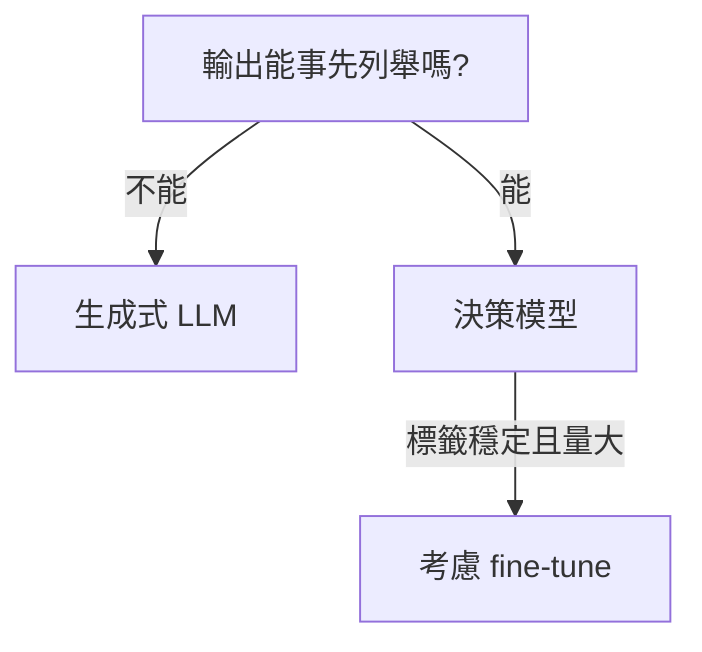
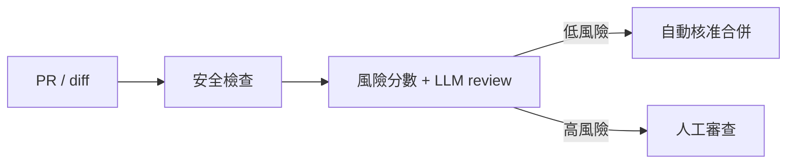

# AI Daily Digest — 2026-11-28

<!-- pipeline-generated:begin -->

## 🔥 今日 TOP 3
### 1. Glean：有限選項判斷改用決策模型
📰 來源：youtube-ai-engineer ｜ 發布：2026-11-27 ｜ 原標題：[Stop Paying LLM Prices for Yes-or-No Answers — Chinmay Goyal, Glean](https://www.youtube.com/watch?v=K5_ST-kMrvY)

**一句話：** 答案只有固定幾個選項的判斷題，改用只算一次的小模型，比叫通用 LLM 更快更便宜。

**Why｜為什麼重要：** 分類、路由、排序、驗證引用等多數 AI 產品步驟，答案只有有限選項，不是生成問題，卻一直付完整 LLM 的成本與延遲。

**How｜怎麼做到：** 決策模型只做一次 forward pass，直接輸出各選項的機率；分類體系改變時只改 prompt，不必重新 fine-tune。

**What｜具體內容與下一步：** Glean 實測：查詢分類品質約為基礎開源模型 2 倍、達 fine-tuned 模型 90%；專家路由延遲降約 8 倍；安全檢查第一階段 recall 由 31.5% 升至 90.2%。判準是輸出能否事先列舉，明天可先盤點自家流程中的分類與路由步驟。

📖 [閱讀完整 insight](../10-insights/2026-11-27/inbox_a748ab2e.md) · 🔗 [原文連結](https://www.youtube.com/watch?v=K5_ST-kMrvY)
### 2. PyTorch GreenLight：AI 核准低風險 PR
📰 來源：infoq-main ｜ 發布：2026-11-27 ｜ 原標題：[Meta Brings Code Review Auto-Approval More Mainstream with PyTorch GreenLight](https://www.infoq.com/news/2026/11/uber-agent-spend-steady/?utm_campaign=infoq_content&utm_source=infoq&utm_medium=feed&utm_term=global)

**一句話：** 低風險的程式碼變更讓 AI 直接核准，人只看高風險的那部分。

**Why｜為什麼重要：** 程式碼審查成為瓶頸，低風險變更仍佔用維護者的時間。

**How｜怎麼做到：** 參照 Meta 的 RADAR：先通過安全檢查，再算風險分數並做 LLM review，低風險的 diff 自動合併。

**What｜具體內容與下一步：** PyTorch 推出開源的 GreenLight，讓 AI 審查者能核准維護者自己提出的 pull request。原文指出 OpenAI、Anthropic 與 Sonar 也有類似的自動核准作法，同時對高風險變更保留人工審查。

📖 [閱讀完整 insight](../10-insights/2026-11-27/inbox_8998e275.md) · 🔗 [原文連結](https://www.infoq.com/news/2026/11/uber-agent-spend-steady/?utm_campaign=infoq_content&utm_source=infoq&utm_medium=feed&utm_term=global)
### 3. 訓練資料怎麼買：任務、種子、驗證器
📰 來源：latent-space ｜ 發布：2026-11-27 ｜ 原標題：[Inside the AI Training Data Market — Gabe Greenberg, G2i](https://latent.space/p/inside_the_ai_training_data_market_gabe_greenberg_g2i/)

**一句話：** 好的訓練資料，是難度略高於模型現有能力、且能自動評分的任務。

**Why｜為什麼重要：** 模型訓練需要由資深工程師設計、可被驗證的任務與資料，實驗室必須決定買獨家資料、買折扣的共享資料，或自建團隊。

**How｜怎麼做到：** 任務難度要略高於模型目前能力；由資深工程師設計任務、挑選起始資料（seed data），並建立能為結果評分的 verifier。

**What｜具體內容與下一步：** Latent Space 訪談 G2i 創辦人 Gabe Greenberg（G2i 為前沿實驗室提供訓練資料與強化學習環境），涵蓋實驗室如何預算與定價、小型試點如何擴大、獨家與共享資料的取捨、何時自建資料團隊，以及企業原始資料市場。

📖 [閱讀完整 insight](../10-insights/2026-11-27/inbox_012e2a78.md) · 🔗 [原文連結](https://latent.space/p/inside_the_ai_training_data_market_gabe_greenberg_g2i/)

## 📖 好文章 / 影片精選

_近期的高品質內容，按興趣領域分類。每篇只在 column 出現一次。_
### 🎓 AI 使用技巧
- **medium-tag-llm** · 2026-11-26 · **[AI Agents Are Burning Tokens on Things They Shouldn’t Even Be Thinking About](../10-insights/2026-11-26/inbox_3f7dbca7.md)**
  AI agent 會把 token 耗在不必要的內容上，文中以兩種方法降低這類開銷。 **Why** 同樣的昂貴問題是 token 消耗過高。 **How** Cloudflare 處理 MCP 工具的額外負擔，MemTensor 則壓縮 AI 記憶。 **What** Cloudflare 將 MCP 工具額外開銷降低 99.9%；MemTensor 讓 AI 記憶體積縮小 66 倍。
- **medium-tag-claude** · 2026-11-22 · **[I Tried Anthropic Claude Code Verification System (That Writes 90% of Its Code)](../10-insights/2026-11-22/inbox_e4950888.md)**
  作者試用 Claude Code 的驗證系統，該系統據稱用於撰寫與審查團隊程式碼。 **What** 原文稱 Claude Code 團隊約 90% 的程式碼由 Claude Code 撰寫與審查；具體流程與試用結果在摘要片段中未呈現。
### 🛤️ 導入心得
- **latent-space** · 2026-11-26 · **[How Clay Builds GTM Agents — Jeff Barg, Head of AI](../10-insights/2026-11-26/inbox_c483bf64.md)**
  Clay 把 GTM 工具做成任何 agent 都能用的基礎設施，並分享打造 agent 的實戰取捨。 **Why** 客戶不想自己挑模型、也不想被綁在單一介面；Clay 希望無論用自家 agent 或 Claude Code，結果都差不多。 **How** 把 Sculptor 從「工具迴圈」重建成跑在 Pi harness 上的 coding agent，在雲端 sandbox 執行 Clay CLI，並用 Audiences 資料層串接 CRM 與 Gong；後端自建 BullMQ 而非 Temporal 或 LangGraph，並用 LangSmith 觀測、自製限流與暫停/續跑機制。 **What** Head of AI Jeff Barg 表示使用量已接近 50/50 分給 Clay agent 與外部 harness。以約 1,000 token 的 LinkedIn 頁面加 500 token 的 ICP 估算，用 TypeSafe 的 Jev 分類器掃完 4,000 萬家公司約 $1,500；他認為年度推論花費約 $1,000 萬–1 億美元之間才值得 post-train；Clay 9 月以 71 億美元估值募得 1.15 億美元，團隊約 600 人，並即將推出自動模型 router。
- **medium-tag-llm** · 2026-11-23 · **[I built a Constitutional AI pipeline. Then I tested whether I could trust its judge.](../10-insights/2026-11-23/inbox_51a4fec6.md)**
  作者建立 Constitutional AI 流程後檢驗其評審（judge）是否可信，54 個提示中只有 4 個標籤被接受，促使他重新審視原計畫用於訓練的環節。 **Why** 作者原本打算把此評審的判斷用於訓練，因此要先確認可信度。 **How** 以 Constitutional AI 流程中的 judge 為 54 個提示產生標籤並檢驗。 **What** 54 個提示中僅 4 個標籤被接受。
### 🔐 AI 安全
- **medium-tag-claude** · 2026-11-28 · **[I Gave Claude My Google Drive. Seven Things Nobody Warned Me About.](../10-insights/2026-11-28/inbox_40193ee0.md)**
  給 AI 存取雲端硬碟前，先檢查舊的公開分享連結。 **What** 作者授權 Claude 讀取 Google Drive 內 2,317 個可追溯至 2012 年的檔案，首次提問就找出一份自 2019 年起以連結公開、含家庭住址的文件。
- **infoq-main** · 2026-11-20 · **[Google Donates Agent Substrate and gVisor to the CNCF to Secure AI Agents at Scale](../10-insights/2026-11-20/inbox_d52b70bb.md)**
  Google 把保護 AI agent 執行環境的兩個基礎元件交給中立的開源基金會管理。 **What** Google 宣布將 Agent Substrate 與 gVisor 捐贈給 CNCF（Cloud Native Computing Foundation），兩者都是其 AI agent 基礎設施的重要元件，改由廠商中立的開源治理。
- **medium-tag-claude** · 2026-11-28 · **[Should a Clinic Send Patient Notes to Claude? Open-Weight vs API](../10-insights/2026-11-28/inbox_73f964fa.md)**
  診所病歷能否送 Claude，取決於用雲端 API 還是本地開源模型。 **Why** 情境是診所要把病歷交給 Claude，因此需評估 BAA 與資料留存（ZDR）條件。 **How** 比較兩條路線：雲端 API 與本地部署的開源權重模型。 **What** API 可簽 BAA，但 ZDR 需經銷售審核；本地模型資料不離開場域，但不會簽 BAA。
- **medium-tag-claude** · 2026-11-27 · **[Netflix Accidentally Shipped Its Homework.](../10-insights/2026-11-27/inbox_b1c141c4.md)**
  Netflix 的 iOS App 安裝包內意外夾帶一份 CLAUDE.md 檔案。 **What** 文章稱該檔案不含憑證、使用者資料或機密；檔案實際內容在原文摘要中被截斷，未載明。

## 💡 今日 Takeaway

_讀完今日所有內容後，可帶走的知識點_
### 1. 輸出能事先列舉，就別用生成式 LLM
分類、路由、排序、驗證這類答案只有固定選項的步驟，是決策問題而非生成問題，用只做一次 forward pass 的決策模型即可。選型順序：輸出可列舉用決策模型，不可列舉才用生成式 LLM，標籤穩定且量大才考慮 fine-tune。

_類型：framework_

**參考來源**：
- [Stop Paying LLM Prices for Yes-or-No Answers — Chinmay Goyal, Glean](../10-insights/2026-11-27/inbox_a748ab2e.md) · [原文](https://www.youtube.com/watch?v=K5_ST-kMrvY)
### 2. 小模型先篩選抽取，大模型最後決策
在 agent 流程前段用小模型做工具剪裁、欄位抽取與 log 閱讀，把縮小後的 context 才交給大 LLM 做行動決策。Cloudflare 的 CI 排錯 demo 靠此把 LLM 呼叫由 5–6 次降到 1 次，token 少 94%。

_類型：pattern_

**參考來源**：
- [Why Cloudflare Became a Neolab — Michelle Chen, Cloudflare](../10-insights/2026-11-27/inbox_6d68d2fc.md) · [原文](https://www.youtube.com/watch?v=cYcYfM9Mvwo)
### 3. Agent 成本先看重複 context，不是新輸入
生產 trace 顯示 coding agent 單次請求 input tokens 中位數約 129,000，只有約 500 為新內容。優化成本前先量測每次請求中重複 context 的比例，再決定從哪裡下手。

_類型：data-point_

**參考來源**：
- [Most of the Bill Is Remembering](../10-insights/2026-11-28/inbox_38aaf840.md) · [原文](https://medium.com/@dydrnsj/most-of-the-bill-is-remembering-1dd3626c22da?source=rss------large_language_models-5)
### 4. 依風險分層審查，低風險交給 AI 自動核准
先過安全檢查、再算風險分數與 LLM review，低風險變更自動合併，高風險仍由人審。這把有限的人力集中在真正需要判斷的改動上，適用於任何有審查瓶頸的流程。

_類型：pattern_

**參考來源**：
- [Meta Brings Code Review Auto-Approval More Mainstream with PyTorch GreenLight](../10-insights/2026-11-27/inbox_8998e275.md) · [原文](https://www.infoq.com/news/2026/11/uber-agent-spend-steady/?utm_campaign=infoq_content&utm_source=infoq&utm_medium=feed&utm_term=global)
### 5. 結構正確不等於判斷正確，需加語意驗證
結構化輸出只能保證 JSON 格式，攔不住判斷錯誤。在 AI 工作流中另外建立檢查輸出內容的語意驗證層，與格式驗證分開設計。

_類型：framework_

**參考來源**：
- [Your LLM Can Return the Right JSON and Still Make the Wrong Decision. Here’s How to Catch It.](../10-insights/2026-11-27/inbox_3533d1ed.md) · [原文](https://pub.towardsai.net/your-llm-can-return-the-right-json-and-still-make-the-wrong-decision-heres-how-to-catch-it-2ab40183cc5e?source=rss------large_language_models-5)

<!-- pipeline-generated:end -->

<!-- user-notes -->
<!-- Write your own notes below; pipeline never touches this section. -->